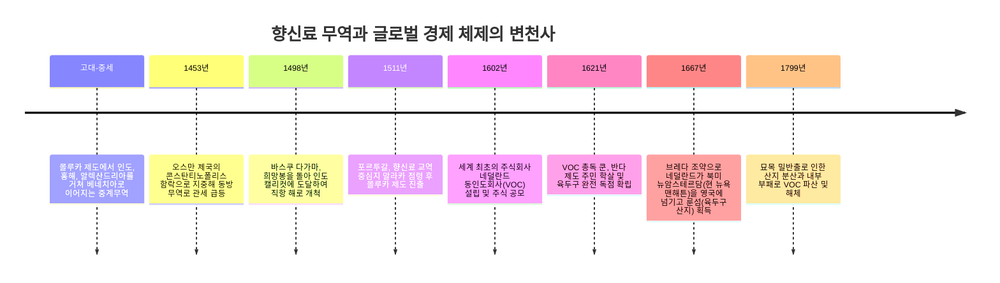
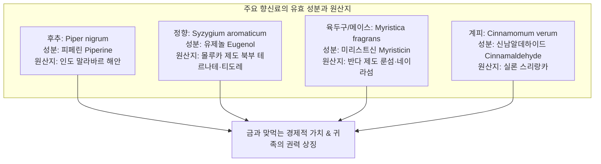
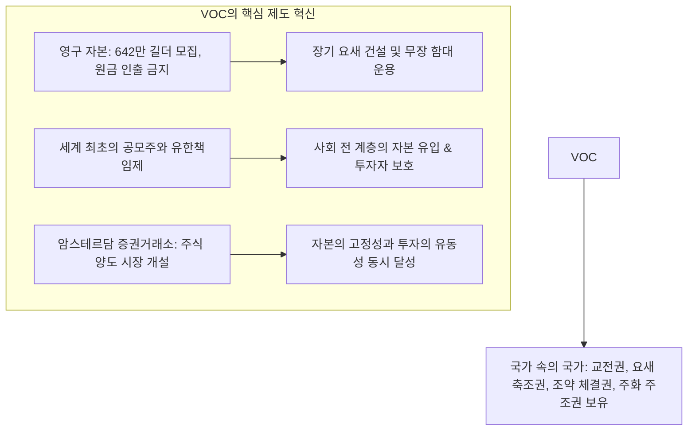

오늘날 현대 식료품점에 가면 후추나 육두구, 정향 같은 향신료는 몇천 원이면 손쉽게 구매할 수 있습니다. 그러나 16세기와 17세기 유럽에서 이 건조된 열대 식물의 씨앗과 꽃봉오리는 **'같은 무게의 금과 교환될 정도'**의 천문학적인 가치를 지녔으며, 왕후 귀족이 자신의 부와 권력을 과시하는 최고의 사치품이었습니다.

향신료에 대한 유럽의 열망은 목조 범선을 미지의 대양으로 내몰아 대항해시대를 열었고, 수천 년간 지속된 유라시아 내륙 교역망을 해체시켰습니다. 그리고 원거리 항해의 막대한 자본과 위험을 분산하기 위해 암스테르담 상인들이 고안해낸 제도가 바로 **세계 최초의 근대적 주식회사 '네덜란드 동인도회사(VOC)'와 암스테르담 증권거래소**였습니다.

---

## 1. 향신료의 식물화학적 특성과 중세 유럽의 열광

유럽인들은 왜 목숨을 걸고 지구 반대편의 화산섬으로 향했을까요? 그 배경에는 강력한 약리 작용과 중세 특유의 의학·사회적 패러다임이 있었습니다.

### 1.1 분자 생화학과 약리 메커니즘
- **후추 (피페린 $\text{C}_{17}\text{H}_{19}\text{NO}_3$)**: 구강 내 TRPV1 수용체를 자극하여 강렬한 매운맛을 전달하고 위산 분비를 촉진하며, 강력한 항균 작용을 발휘합니다.
- **정향 (유제놀 $\text{C}_{10}\text{H}_{12}\text{O}_2$)**: 정유의 70~90%를 차지하며 탁월한 항산화, 항염증, 국소 마취 작용을 합니다. 페스트가 창궐하던 시기 나쁜 공기(미아스마)를 막는 최고의 의약품으로 여겨졌습니다.
- **육두구 (미리스트신 $\text{C}_{11}\text{H}_{12}\text{O}_3$)**: 향긋하고 달콤한 풍미를 내며, 고용량 섭취 시 환각과 중추신경 흥분을 유발하는 신경약리적 활성을 갖습니다.

### 1.2 '상한 고기 냄새 제거용'이라는 역사적 왜곡
흔히 "냉장고가 없던 중세에 썩은 고기 냄새를 가리기 위해 향신료를 썼다"고 알려져 있으나, 이는 현대 경제사학에 의해 완전히 논박되었습니다:
1. **경제적 모순**: 당시 향신료 한 줌의 가격은 살아있는 건강한 소나 양 여러 마리의 값에 달했습니다. 귀족이 썩은 고기를 먹기 위해 고기보다 수십 배 비싼 향신료를 뿌렸다는 것은 경제적으로 성립하지 않습니다.
2. **과시적 소비 (Conspicuous Consumption)**: 귀족들의 연회에서 금빛 사프란과 이국적인 향신료를 듬뿍 뿌려 대접하는 행위는 부와 위세를 과시하는 궁극의 권력 의례였습니다.
3. **갈레노스의 4체액설**: 중세 의학에서는 육류가 '차갑고 습한' 성질을 띠므로, 이를 소화하고 질병을 막으려면 '뜨겁고 건조한' 향신료를 반드시 조합해 섭취해야 건강이 유지된다고 믿었습니다.

---

## 2. 전통적 중계무역의 붕괴와 대항해시대의 개막

16세기 이전 향신료는 몰루카 제도에서 말라카, 인도 서해안, 홍해, 카이로를 거쳐 베네치아 상인에게 전달되는 릴레이 무역망을 거쳤습니다. 관세와 중계 마진이 누적되어 유럽 시장에 도착할 때는 원산지 가격의 **100~200배 이상**으로 폭등했습니다.

1453년 오스만 제국이 콘스탄티노폴리스를 장악하며 지중해 무역로의 관세가 치솟자, 이베리아 반도의 포르투갈과 스페인은 바닷길을 통한 직항로 개척에 나섰습니다:
- **1498년**: **바스쿠 다가마**가 희망봉을 돌아 인도 캘리컷에 도달, 후추를 싣고 귀환하여 원정 비용의 **60배가 넘는 순이익**을 달성했습니다.
- **1511년**: 알부케르크가 말라카를 무력 점령하고 고아, 호르무즈, 마카오를 잇는 해상 무역 요새 제국(Estado da Índia)을 구축했습니다.

---

## 3. 세계 최초의 주식회사: 네덜란드 동인도회사(VOC)의 금융 혁신

16세기 말 포르투갈의 공급 차단에 맞서 네덜란드 상인들은 직접 아시아로 향했습니다. 그러나 개별 상단 간의 출혈 경쟁으로 구매 가격이 폭등하자, 1602년 정부 주도로 전 회사를 통합하여 **네덜란드 동인도회사(VOC)**를 출범시켰습니다.

VOC는 기존의 '항해 1회당 청산' 방식을 버리고 **영구 자본**을 구축했으며, 투자자들에게 **유한책임**을 보장했습니다. 주주들이 현금이 필요할 때는 **암스테르담 증권거래소**에서 주식을 자유롭게 매매할 수 있도록 함으로써, 근대 자본주의 금융의 초석을 놓았습니다.

---

## 4. 반다 제도의 비극과 잔혹한 독점 메커니즘

VOC의 높은 수익률 뒤에는 식민지 현지인들에 대한 무자비한 폭력이 있었습니다.

- **1621년 반다 제도 학살**: 얀 피테르스존 쿤(Jan Pieterszoon Coen) 총독은 육두구 독점 협정을 어기고 영국 상인에게 밀매했다는 이유로 약 15,000명의 반다 원주민을 무자비하게 학살하거나 노예로 팔아넘겼습니다. 섬은 노예 농장(Perken)으로 재편되었습니다.
- **홍기 원정(Hongitochten)**: 네덜란드 함대는 주기적으로 인근 섬들을 순찰하며 허가받지 않은 정향나무와 육두구나무를 무차별 벌채·방화하여 공급량을 인위적으로 억제했습니다.
- **1667년 브레다 조약**: 네덜란드는 영국과의 조약을 통해 북미 식민지 **뉴암스테르담(현재의 뉴욕 맨해튼)**을 영국에 넘기는 대신, 영국이 점령하고 있던 마지막 육두구 섬 **룬섬(Run Island)**을 손에 넣어 육두구의 완전 독점을 완성했습니다.

---

## 5. 근대 세계체제와 21세기적 유산

향신료 무역은 네덜란드의 황금시대를 열었고, 중심부-반주변부-주변부로 이어지는 불평등한 근대 세계체제의 원형을 형성했습니다. 18세기 프랑스와 영국의 묘목 밀반출과 커피·설탕·면직물로의 수요 변화, 내부 부패로 1799년 VOC는 해체되었지만, 그들이 발명한 **주식회사, 증권거래소, 글로벌 공급망 관리 기법**은 21세기 현대 글로벌 경제를 작동시키는 근본적인 메커니즘으로 살아 숨 쉬고 있습니다.
