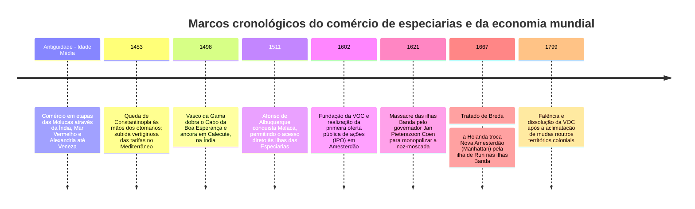
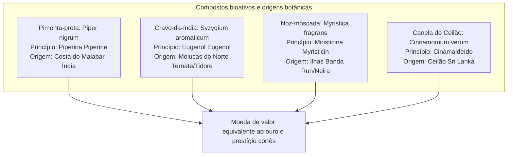
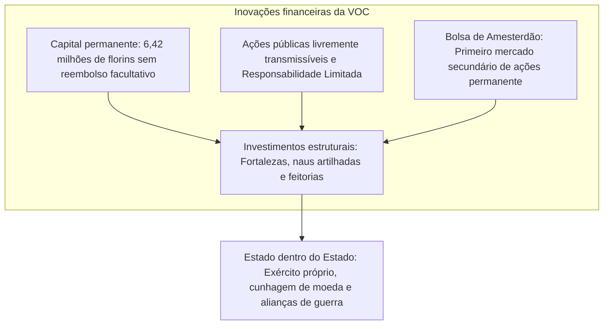

Nos supermercados dos dias de hoje, pequenos frascos de pimenta-preta, noz-moscada ou cravo-da-índia custam apenas trocos. Contudo, durante os séculos XVI e XVII, estas sementes e botões florais secos eram **literalmente transacionados pelo seu peso em ouro**. Representavam o expoente máximo da sumptuosidade aristocrática e do prestígio político nas cortes europeias.

A busca obstinada pelas especiarias empurrou naus e caravelas para oceanos bravios e desconhecidos, abrindo a Era dos Descobrimentos e desarticulando as rotas terrestres ancestrais da Rota da Seda. Para coligar capitais astronómicos e diluir os riscos letais da navegação de longo curso, os mercadores de Amesterdão forjaram a própria espinha dorsal do capitalismo corporativo: **a primeira sociedade anónima cotada em bolsa da história, a Companhia Holandesa das Índias Orientais (VOC), e a Bolsa de Valores de Amesterdão**.

---

## 1. A bioquímica das especiarias e o fascínio europeu

Por que razão arriscavam os europeus a morte por escorbuto, naufrágio ou pirataria por simples bagas aromáticas? A razão advém da sua impressionante eficácia farmacológica e dos paradigmas médicos da época.

### 1.1 Farmacologia molecular
- **Pimenta-preta (Piperina $\text{C}_{17}\text{H}_{19}\text{NO}_3$)**: Liga-se aos recetores TRPV1 da cavidade oral, provocando ardência revigorante, acentuando a secreção de suco gástrico e atuando como poderoso agente antimicrobiano.
- **Cravo-da-índia (Eugenol $\text{C}_{10}\text{H}_{12}\text{O}_2$)**: Corresponde a 70–90 % do óleo volátil. É um excecional analgésico local, antioxidante e desinfetante. Durante os surtos de peste bubónica, era usado em pomadas aromáticas para afastar os miasmas infecciosos.
- **Noz-moscada (Miristicina $\text{C}_{11}\text{H}_{12}\text{O}_3$)**: De odor picante e aveludado; em doses elevadas atua a nível do sistema nervoso central, apresentando propriedades alucinogénias e narcóticas.

### 1.2 O desmantelamento da fábula da "carne estragada"
A lenda popular alega que as especiarias serviam para disfarçar o cheiro de carnes podres devido à carência de frio artificial. Os historiadores modernos refutaram completamente essa hipótese:
1. **Incoerência económica**: Uma libra de noz-moscada ou de açafrão custava muito mais do que várias reses inteiras de gado vacum. Qualquer nobre com posses para importar condimentos orientais adquiria gado são e fresco das suas herdades. Desperdiçar iguarias caríssimas em carnes deterioradas seria financeiramente absurdo.
2. **Consumo conspícuo**: Polvilhar carnes assadas com especiarias e dourá-las com açafrão era a demonstração suprema de riqueza e autoridade aristocrática perante convidados estrangeiros.
3. **Teoria humoral de Galeno**: A carne era classificada na medicina medieval como "fria e húmida". Para harmonizar os quatro humores corporais, era considerado biologicamente indispensável temperá-la com especiarias "quentes e secas".

---

## 2. A viragem geopolítica e o império marítimo português

Até 1500, o trânsito das especiarias dependia de mercadores muçulmanos e da República de Veneza, que inflacionavam os preços até **200 vezes** o valor na origem. A queda de Constantinopla em 1453 aumentou exponencialmente os impostos aduaneiros no Mediterrâneo oriental.

Portugal respondeu com o projeto naval pioneiro do Infante D. Henrique:
- **1498**: **Vasco da Gama** alcança Calecute contornando o continente africano. A venda do carregamento de pimenta na Europa proporcionou um lucro líquido equivalente a **60 vezes o custo integral da armada**.
- **1511**: Afonso de Albuquerque toma Malaca de assalto, erigindo o *Estado da Índia*: uma rede de fortalezas costeiras que impunha o sistema de salvo-condutos armados (*cartazes*) a toda a navegação mercantil no Índico.

---

## 3. A revolução financeira da VOC (1602)

Para sanar a rivalidade predatória entre os armadores neerlandeses, Johan van Oldenbarnevelt coordenou a fusão das várias companhias na **Companhia Holandesa das Índias Orientais (VOC)** em 1602.

A VOC implementou os alicerces corporativos contemporâneos:
- **Capitalização permanente**: O capital da empresa tornou-se autónomo em relação aos investidores individuais.
- **Responsabilidade limitada**: O acionista arriscava apenas a quantia subscrita.
- **Liquidez bolsista**: A **Bolsa de Amesterdão** viabilizou a negociação secundária das ações sem desfalcar os cofres da empresa.

Dotada de competências soberanas, a VOC manteve armadas de guerra, edificou fortalezas e bateu moeda em solo asiático.

---

## 4. A violência monopolista: O sacrifício das ilhas Banda

A lógica mercantil da VOC não tolerava a livre concorrência.

- **O massacre das ilhas Banda (1621)**: Perante a resistência dos chefes locais (*Orang Kaya*) em manter contratos monopolistas que os impediam de negociar com ingleses e javaneses, o governador-geral **Jan Pieterszoon Coen** promoveu um massacre impiedoso. Quase 90 % dos 15.000 nativos foram dizimados ou escravizados, sendo as ilhas retalhadas em parcelas agrícolas (*perken*) operadas por mão de obra escrava.
- **Expedições Hongi (*Hongitochten*)**: Esquadras patrulhavam anualmente os arquipélagos para queimar e arrancar pés de cravo selvagens, garantindo uma escassez artificial de oferta para manter os preços elevados na Europa.
- **O Tratado de Breda (1667)**: Os Países Baixos abdicaram da sua colónia norte-americana de **Nova Amesterdão (a atual ilha de Manhattan em Nova Iorque)** a favor da Coroa inglesa em troca da diminuta ilha de **Run** no arquipélago de Banda, alcançando o controlo global indisputado da noz-moscada.

---

## 5. O legado eterno do comércio de especiarias

O rio de riqueza gerado pelas especiarias sustentou a Idade de Ouro neerlandesa e lançou as bases do moderno sistema-mundo. Embora o monopólio geográfico tenha sido quebrado no século XVIII pelo contrabando botânico de sementes e pela falência da VOC em 1799, os seus instrumentos institucionais — **a sociedade por ações, a bolsa de valores e as cadeias de abastecimento intercontinentais** — continuam a comandar a engrenagem do comércio global contemporâneo.
