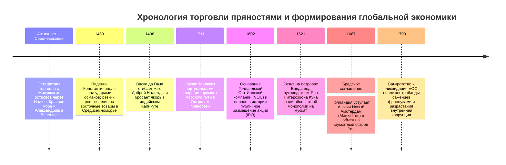
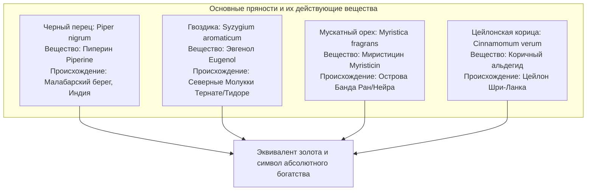
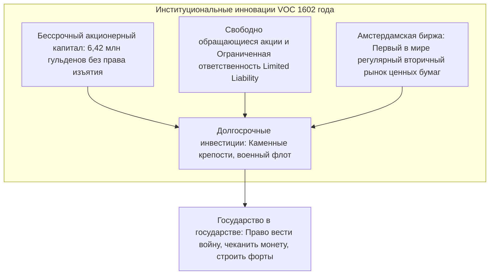

Сегодня в любом супермаркете баночки с черным перцем, гвоздикой или мускатным орехом стоят сущие копейки. Однако в XVI и XVII веках эти высушенные семена и цветочные почки тропических растений **буквально ценились на вес чистого золота**. Они служили абсолютным символом аристократического богатства, власти и престижа при европейских королевских дворах.

Жажда обладания пряностями толкнула деревянные парусники европейцев в неизведанные, смертельно опасные океаны, положив начало Эпохе великих географических открытий и разрушив древние караванные пути Шелкового пути. А для распределения колоссальных рисков далеких морских походов и концентрации капитала купцы Амстердама создали институциональный фундамент современного капитализма: **первое в мире публичное акционерное общество — Голландскую Ост-Индскую компанию (VOC) — и Амстердамскую фондовую биржу**.

---

## 1. Биохимия пряностей и европейская одержимость

Почему европейцы рисковали жизнью, погибали от цинги и кораблекрушений ради горсти высушенных плодов с далеких вулканических островов? Ответ кроется в уникальных фармакологических свойствах растительных молекул и средневековых медицинских представлениях.

### 1.1 Молекулярные механизмы действия
- **Черный перец (Пиперин $\text{C}_{17}\text{H}_{19}\text{NO}_3$)**: Воздействует на ванилоидные рецепторы TRPV1 слизистой рта, вызывая чувство жгучего тепла, стимулирует выработку соляной кислоты и желудочных ферментов, а также подавляет размножение бактерий.
- **Гвоздика (Эвгенол $\text{C}_{10}\text{H}_{12}\text{O}_2$)**: Составляет до 90 % эфирного масла. Мощный природный антиоксидант, местный анестетик и антисептик. Во время эпидемий чумы считался главным средством очищения воздуха от моровых миазмов.
- **Мускатный орех (Миристицин $\text{C}_{11}\text{H}_{12}\text{O}_3$)**: Обладает теплым пряным ароматом; в высоких концентрациях метаболизируется в организме в соединения с психоактивным и галлюциногенным действием.

### 1.2 Опровержение мифа об «испорченном мясе»
В популярной литературе часто утверждается, что пряности были нужны европейцам для маскировки запаха тухлого мяса из-за отсутствия холодильников. Историческая наука доказала полную несостоятельность этого мифа:
1. **Экономический абсурд**: В средневековой Европе горсть мускатного ореха стоила дороже целого стада живых упитанных коров. Любой аристократ, способный купить заморские специи, имел свежайшее мясо из собственных угодий. Тратить баснословно дорогие пряности на гнилое мясо было верхом расточительства.
2. **Демонстративное потребление**: Окрашивание блюд в золотой цвет шафраном и обильное посыпание гвоздикой служило публичным ритуалом демонстрации безграничной платежеспособности хозяина.
3. **Гуморальная медицина Галена**: Согласно античной теории четырех жидкостей тела, мясо считалось «холодным и сырым». Чтобы сохранить баланс здоровья, врачи требовали уравновешивать его «горячими и сухими» пряностями.

---

## 2. Крах средиземноморского транзита и португальская морская экспансия

До XVI века пряности шли через руки десятков арабских, индийских и персидских посредников, попадая в Европу через монопольные каналы Венеции с наценкой в **100–200 раз**. Захват Константинополя османами в 1453 году и перекрытие сухопутных путей подтолкнули Португалию к поиску океанского пути в обход Африки.

- **1498**: **Васко да Гама** обогнул мыс Доброй Надежды и привел корабли в индийский Каликут. Продажа привезенного перца принесла прибыль, в **60 раз превысившую расходы на всю экспедицию**.
- **1511**: Афонсу ди Албукерки силой захватил стратегическую Малакку, создав *Estado da Índia* — сеть укрепленных баз (Гоа, Ормуз, Малакка) и систему принудительных платных пропусков (*картазов*), обложив данью всю торговлю в Индийском океане.

---

## 3. Финансовая революция Голландской Ост-Индской компании (VOC)

В конце XVI века ожесточенная ценовая война между голландскими купцами привела к взвинчиванию закупочных цен в Азии и обвалу цен в Европе. В 1602 году по инициативе великого пенсионария Йохана ван Олденбарневелта все компании были объединены в **Объединенную Ост-Индскую компанию (VOC)**.

VOC изобрела структуру современного корпоративного бизнеса:
- **Постоянный капитал**: Капитал оставался на балансе компании бессрочно, избавляя ее от ликвидации после каждого рейса.
- **Ограниченная ответственность**: Инвесторы рисковали только внесенной суммой.
- **Ликвидность акций**: Создание **Амстердамской фондовой биржи** позволило акционерам свободно продавать свои доли, сохраняя целостность производственного капитала компании.

---

## 4. Кровавая монополия на островах Банда

VOC добивалась не свободной торговли, а абсолютной, защищенной пушками монополии.

- **Резня на островах Банда (1621)**: Обвинив старейшин островов Банда в контрабандной продаже мускатного ореха англичанам, генерал-губернатор **Ян Питерсзоон Кун** высадился с войсками и японскими наемниками-самураями. Свыше 90 % коренного населения (около 15 000 человек) было безжалостно истреблено или продано в рабство. Острова были разделены на плантации (*перкены*), куда завезли рабов из Африки и Азии.
- **Рейды Хонги (*Hongitochten*)**: Вооруженные галеры ежегодно патрулировали Молуккские острова, вырубая и сжигая все дикорастущие гвоздичные и мускатные деревья вне подконтрольных зон, создавая искусственный дефицит на мировом рынке.
- **Бредский мир (1667)**: Голландия обменяла свою североамериканскую колонию **Новый Амстердам (нынешний остров Манхэттен в Нью-Йорке)** на крошечный британский остров **Ран** в архипелаге Банда, обеспечив себе 100-процентную всемирную монополию на мускатный орех.

---

## 5. Наследие эпохи пряностей

Сверхприбыли от пряностей породили Золотой век Голландии и сформировали капиталистическую мир-систему (ядро и периферию). Хотя монополия была сломлена в конце XVIII века тайным вывозом живых саженцев на Маврикий и упадком самой компании (ликвидирована в 1799 г.), ее институциональные изобретения — **акционерное общество, биржа и глобальное управление цепями поставок** — остаются фундаментом мировой экономики и в XXI веке.
