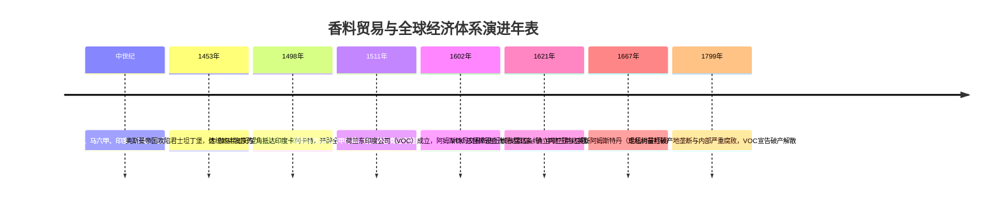
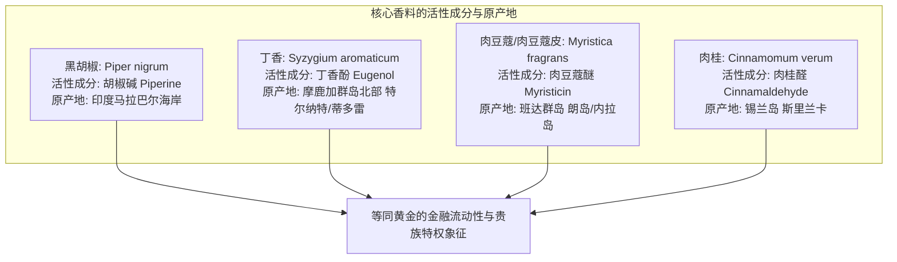
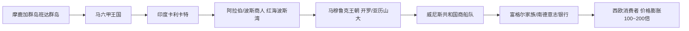
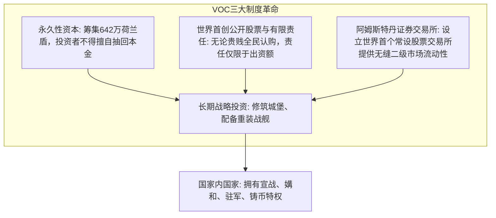
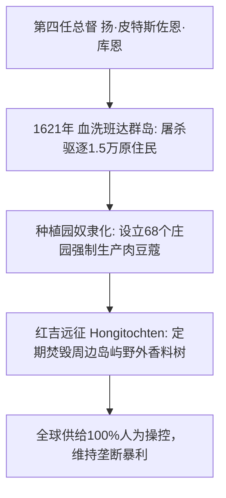

在当今的超市货架上，一瓶黑胡椒或肉豆蔻粉只需花费几块钱便可唾手可得。然而在16至17世纪的欧洲，这些来自遥远热带火山岛屿的植物果实与花蕾，曾**“与同等重量的黄金等价”**。它们不仅是王公贵族宴席上夸耀极致财富与显赫权力的奢侈象征，更是点燃整个大航海时代、彻底重塑人类历史版图的导火索。

为了打破传统欧亚大陆的中继贸易垄断，欧洲水手驾驶木质帆船横渡险象环生的未知大洋。为了分散远洋探险的灭顶风险并募集巨额长期资本，阿姆斯特丹的商人们创造出了近代资本主义最重要的制度基石——**世界第一家近代股份有限公司“荷兰东印度公司（VOC）”以及阿姆斯特丹证券交易所**。

---

## 1. 香料的植物化学与中世欧洲的狂热需求

为什么当时的欧洲人愿意冒着坏血病、沉船与海盗的死亡威胁，耗费数年航行至地球另一端的蛮荒孤岛？其深层原因植根于特殊的植物次生代谢产物与当时欧洲的社会医学范式。

### 1.1 分子药理学机制
- **黑胡椒（胡椒碱 $\text{C}_{17}\text{H}_{19}\text{NO}_3$）**：激活口腔TRPV1受体产生灼热快感，强力刺激胃液胃蛋白酶分泌，对多种食源性腐败菌具有显著抑制作用。
- **丁香（丁香酚 $\text{C}_{10}\text{H}_{12}\text{O}_2$）**：占挥发油的70%~90%，具备极强的抗氧化、局部麻醉与防腐效能。在黑死病与瘟疫横行的欧洲，丁香被视为净化“瘴气”的最高级医药屏障。
- **肉豆蔻（肉豆蔻醚 $\text{C}_{11}\text{H}_{12}\text{O}_3$）**：不仅赋予甜美浓郁的香气，高剂量摄入在人体代谢下具有中枢神经兴奋与致幻神经药理效应。

### 1.2 破除“掩盖腐肉臭味”的历史谬误
通俗历史常误传“中世纪没有冰箱，香料是为了掩盖变质腐肉的气味”。这一说法已被现代经济史学家彻底证伪：
1. **经济成本倒挂**：在中世纪的伦敦或纽伦堡，一小袋肉豆蔻或藏红花的价钱可以购买一整群健康的活牛活羊。将极其昂贵的香料撒在廉价腐肉上完全违背经济学常识。
2. **凡勃伦式“炫耀性消费”**：在贵族宴会中，菜肴表面覆盖金黄色的藏红花与扑鼻的肉豆蔻香气，是庄园领主向宾客宣示其跨大洋调动资源能力的最高权力仪式。
3. **希波克拉底-盖伦“四体液说”**：中世纪医学认为牛肉、猪肉属“冷湿”性质，必须辅以“热干”属性的烈性香料进行烹饪调和，以维持体内血液、粘液、黄胆汁与黑胆汁的生命平衡。

---

## 2. 地中海中继贸易的瓦解与大航海突破

在16世纪前，香料从摩鹿加群岛运抵欧洲消费端，需经过多达十几个中继商业节点：

每一道关卡不仅层层加价，威尼斯共和国更与埃及马穆鲁克苏丹国缔结排他性盟约，独揽欧洲香料进口。1453年奥斯曼帝国攻破君士坦丁堡并逐步兼并中东，东方陆上通道关税急剧攀升。

为了摆脱威尼斯与伊斯兰商人的盘剥，葡萄牙在恩里克王子的组织下全力开拓大西洋非洲西岸航线：
- **1488年**：迪亚斯发现好望角。
- **1498年**：**达·伽马**成功开辟印度直达航线，其带回的胡椒销售利润高达远征总成本的**60倍以上**。
- **1511年**：阿尔布开克攻占马六甲要冲，建立起依托果阿、霍尔木兹、马六甲军事要塞与“武装通行证（Cartaz）”垄断印度洋的交易站帝国。

---

## 3. 世界第一家近代股份公司：荷兰东印度公司（VOC）的金融创举

16世纪末，摆脱西班牙统治的荷兰商人们决心越过葡萄牙直接前往东方进货。然而各城市独立远征船队的恶性价格战导致产地价格飙升、国内售价暴跌。

1602年，在荷兰大议长奥尔登巴内费尔特的主导下，各前身公司合并组建了**荷兰东印度公司（VOC）**。

VOC彻底告别了以往“单次航行清算散伙”的前近代合伙制，确立了**“资本永久锁定”与“股票自由流通流动性”**的完美结合。投资者若需资金，可随时在阿姆斯特丹证券交易所将股票转让套现，而公司的重资产远洋运营却丝毫不受抽资影响。

---

## 4. 班达群岛的血腥垄断与人造供给控制

VOC维持高额利润的核心逻辑绝非自由竞争，而是**绝对的暴力垄断**。

- **1621年班达大屠杀**：因岛民向英国及爪哇商人转售肉豆蔻，第四任总督**库恩（Jan Pieterszoon Coen）**率领战舰与日本浪人雇佣军登岛，屠杀了当地几乎全部长老并灭绝了原住民，将土地划归前雇员改造成奴隶种植园。
- **红吉远征（Hongitochten）**：VOC舰队常年在摩鹿加周边武装巡逻，野蛮砍伐焚毁一切未经许可的丁香和肉豆蔻树；若欧洲市场出现供过于求导致价格下跌，VOC甚至会在阿姆斯特丹仓库成吨焚烧香料以维持高价。
- **1667年《布雷达条约》**：荷兰用北美新阿姆斯特丹（即今纽约曼哈顿岛）换取了英国占领的最后一处肉豆蔻岛屿——朗岛（Run Island），达成了全球肉豆蔻产地的绝对一统。

---

## 5. 近代世界体系成型与历史回响

香料贸易不仅催生了荷兰的黄金时代，也推动了沃勒斯坦所指的“近代世界体系”（核心-半边缘-边缘）分工结构的确立。

尽管18世纪末法国农学家皮埃尔·普瓦夫尔偷运树苗成功移植至毛里求斯、欧洲大众口味转向蔗糖、茶叶与咖啡、以及VOC内部腐败导致其在1799年最终破产，但香料贸易留下的**有限责任公司、证券交易所、跨球供应链管理**等金融组织形态，至今仍是支配现代全球经济命脉的底层操作系统。
