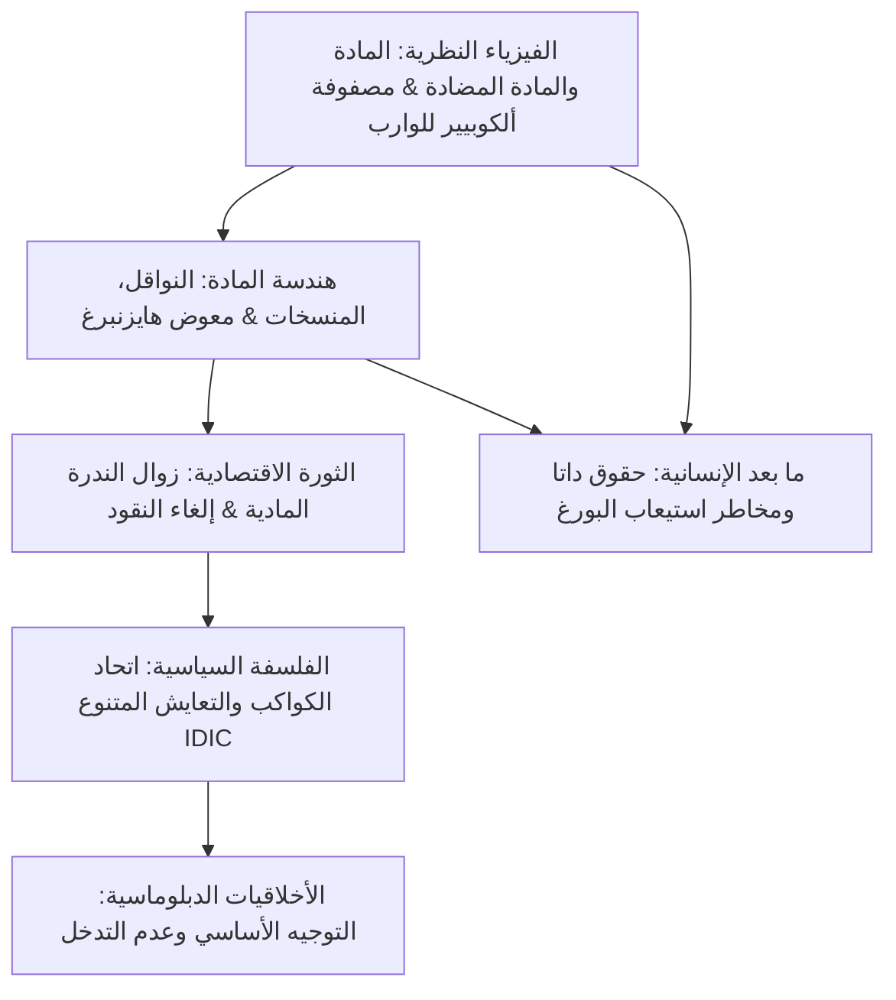

يعد عالم *ستار تريك* (Star Trek) الذي ابتكره جين رودينبيري في عام 1966 علامة فارقة في تاريخ الخيال العلمي الفلسفي والأدبي المعاصر. ما يميز هذا العالم عن غيره من روايات الفضاء والمستقبل هو جمعه العبقري والفريد بين **الدقة الفيزيائية النظرية والتكنولوجية المتقدمة** من جهة، و**النزعة الإنسانية التنويرية المتفائلة** من جهة أخرى. في القرن الرابع والعشرين، تمكنت البشرية من التغلب نهائياً على آفات الفقر والمجاعات والحروب المدمرة وعبودية العمل المأجور وجمع الثروات، وذلك بفضل تطورين تقنيين حاسمين: توليد طاقة فناء المادة والمادة المضادة، وتقنية النسخ الجزيئي للمادة. لقد وضع هذان الإنجازان حجر الأساس لما يعرف في علم الاجتماع والاقتصاد السياسي بـ **مجتمع واقتصاد ما بعد الندرة (Post-Scarcity Economy)**.

---

## 1. الفيزياء النظرية لمحرك الدفع الفائق (Warp Drive) ومصفوفة ألكوبيير

تفرض نظرية النسبية الخاصة لألبرت أينشتاين حداً كونياً صارماً على السرعة، حيث يستحيل على أي جسم يمتلك كتلة سكونية حقيقية ($m_0 > 0$) أن يبلغ سرعة الضوء في الفراغ $c$، نظراً لأن طاقة حركته تتجه نحو اللانهاية:

$$E = \frac{m_0 c^2}{\sqrt{1 - \frac{v^2}{c^2}}} \xrightarrow{v \to c} \infty$$

تتجاوز سفن أسطول النجوم (Starfleet)، ولا سيما السفينة الأسطورية *إنتربرايز* (USS Enterprise)، هذا الحاجز الكوني دون انتهاك مباشر لقوانين النسبية الخاصة، وذلك ليس بالتسارع التقليدي عبر الفضاء، بل بـ **تشويه وتطويع نسيج الزمكان ذاته**. وفي عام 1994، قدم عالم الفيزياء المكسيكي ميغيل ألكوبيير (Miguel Alcubierre) صياغة رياضية صارمة في إطار النسبية العامة تثبت إمكانية هذا المفهوم علمياً من خلال مترية هندسية تُعرف باسم **مصفوفة ألكوبيير (Alcubierre Metric)**:

$$ds^2 = -c^2 dt^2 + \left(dx - v_s(t) f(r_s) dt\right)^2 + dy^2 + dz^2$$

حيث تمثل $v_s(t)$ سرعة حركة مركز فقاعة الدفع، بينما تحدد الدالة $f(r_s)$ شكل وتوزيع هندسة الزمكان حول المركبة الفضائية:

- **انكماش الفضاء:** ينكمش نسيج الزمكان بمعدلات هائلة في مقدمة المركبة؛
- **تمدد الفضاء:** يتمدد الفضاء بتماثل دقيق خلف المركبة دافعاً إياها إلى الأمام؛
- **السكون الموضعي داخل الفقاعة:** تبقى المركبة الفضائية مستقرة في منطقة زمكانية منبسطة تماماً ($g_{\mu\nu} = \eta_{\mu\nu}$)، مما يعني أن الطاقم لا يعاني من أي قوى تسارع قصورية (0g) أو آثار التباطؤ الزمني النسبي لأينشتاين.

| معامل الوارب (TNG) | السرعة المكافئة لسرعة الضوء ($c$) | الزمن لقطع سنة ضوئية واحدة | الملاحظات الفيزيائية والميكانيكية |
| :--- | :--- | :--- | :--- |
| **Warp 1** | $1.0\,c$ | 365.25 يوماً | سرعة الضوء النسبية في الفراغ |
| **Warp 3** | $38.9\,c$ | 9.38 يوماً | استهلاك طاقة منخفض في الفضاء الإقليمي |
| **Warp 5** | $213.7\,c$ | 1.71 يوماً (41 ساعة) | سرعة الرحلات الاستكشافية القياسية للاتحاد |
| **Warp 7** | $659.3\,c$ | 13.3 ساعة | سرعة الاستجابة للطوارئ والمهمات العسكرية |
| **Warp 9** | $1,516.4\,c$ | 5.78 ساعات | الحد الأقصى الآمن للرحلات الطويلة المستمرة |
| **Warp 9.9** | $3,053.0\,c$ | 2.87 ساعة | قدرة قصوى للسفن الحديثة من فئة إنتربيد |

يتطلب تشغيل هذا المحرك كميات هائلة من الطاقة يتم توليدها في محرك تفاعل المادة والمادة المضادة (Warp Core)، حيث يتفاعل الديوتيريوم مع مضاد الهيدروجين في تفاعل إفناء كروي تام يُدار ويُنظم بدقة عبر شبكة بلورات الديليثيوم (Dilithium Crystals) غير المتفاعلة.

---

## 2. النواقل، معوض هايزنبرغ، وهندسة المنسخ الجزيئي

تعتبر تقنية الناقل الآني (Transporter) والمنسخ الجزيئي (Replicator) من أهم الركائز التكنولوجية التي صاغت مجتمع ستار تريك. واجه مؤلفو العمل الفيزيائيون تحدياً نظرياً عميقاً يتمثل في **مبدأ عدم اليقين لهايزنبرغ (Heisenberg Uncertainty Principle)**، والذي ينص على استحالة قياس موقع الجسيم الكمي وزخمه معاً بدقة مطلقة متزامنة:

$$\Delta x \cdot \Delta p \ge \frac{\hbar}{2}$$

تجاوزت الرؤية العلمية لستار تريك هذه العقبة الكوانتية بابتكار جهاز دقيق يُعرف باسم **معوض هايزنبرغ (Heisenberg Compensator)**، والذي يقوم بمزامنة الحالات الكمومية للذرات وتخزين نمطها في مخزن مؤقت (Pattern Buffer).

وعند تطبيق هذه التقنية على المستوى المدني واليومي، وُلد **المنسخ الجزيئي (Replicator)**. يستطيع المنسخ في غضون ثوانٍ معدودة تحويل الطاقة الكهرومغناطيسية الخام والكتل الأولية إلى أي مادة أو وجبة طعام أو دواء أو قطعة غيار معقدة بنقاوة مطلقة وبناءً على مخططات رقمية مخزنة. وتبقى عبارة الكابتن جان لوك بيكارد الأيقونية: *"شاي، إيرل غراي، ساخن"*، التعبير الأكثر بلاغة عن بساطة السيطرة البشرية الكاملة على المادة والطاقة وتطويعها لخدمة الرفاه اليومي.

---

## 3. اقتصاد ما بعد الندرة (Post-Scarcity) ومجتمع ما بعد الرأسمالية

يقوم علم الاقتصاد الكلاسيكي والنيوكلاسيكي برمته على افتراض جوهري مفاده أن الموارد الطبيعية والمادية محدودة ونادرة بينما حاجات ورغبات الإنسان غير محدودة. غير أن اقتران الطاقة النجمية اللانهائية بقدرة المنسخ الجزيئي على تصنيع المواد أديا معاً إلى انهيار مفهوم الندرة المادية، وهبوط **التكلفة الحدية للإنتاج إلى الصفر المطلق ($MC \to 0$)**.

$$\lim_{MC \to 0} P = 0$$

أدى هذا التحول التكنولوجي الجذري إلى تلاشي النقود والأوراق المالية والأسواق التجارية والأنظمة المصرفية الربحية من كوكب الأرض ومعظم كواكب الاتحاد الفيدرالي للكواكب. وكما يشرح الكابتن جان لوك بيكارد في فيلم *أول اتصال* (Star Trek: First Contact):

> **"إن النقود لا وجود لها في القرن الرابع والعشرين. إن امتلاك الأشياء وتكديس الثروات المادية لم يعد القوة الدافعة لحياتنا أو مقياساً لقيمتنا. نحن نعمل على تطوير أنفسنا، والارتقاء بقدراتنا الفكرية والأخلاقية، والمساهمة في خدمة وتطوير البشرية جمعاء."**

ارتقى الحافز الإنساني في مجتمع ستار تريك إلى قمة هرم ماسلو للاحتياجات: تحقيق الذات، البحث المعرفي والعلمي، التعبير الفني، والاستكشاف الدبلوماسي بين المجرات. كما يتجلى التنوع الثقافي في الشعار الفلسفي الفولكاني الخالد: **IDIC** (Infinite Diversity in Infinite Combinations - تنوع لا نهائي في توافقات لا نهائية)، والذي يؤكد أن الجمال والقوة ينبعان من التعددية والتعايش الخلاق.

---

## 4. الأخلاقيات السياسية والدبلوماسية: التوجيه الأساسي (Prime Directive)

يمثل **الأمر العام رقم 1 (General Order 1)** لأسطول النجوم، والمعروف بـ **التوجيه الأساسي (Prime Directive)**، أسمى التزام أخلاقي وقانوني ودبلوماسي في مجتمع ستار تريك. ينص هذا القانون الصارم على **الحظر المطلق للتدخل في التطور الطبيعي والداخلي لأي حضارة أو مجتمع لم يطور تقنية محركات الدفع الفائق (Warp Drive) بمفرده**.

| مبدأ التوجيه الأساسي | الغاية الأخلاقية والفلسفية | التطبيق العملي في رحلات الاستكشاف |
| :--- | :--- | :--- |
| **منع التلوث الثقافي** | حماية المجتمعات النامية من صدمة الهوية والانهيار الروحي | إخفاء التكنولوجيا المتقدمة ومراقبة الكواكب عن بعد بدون كشف الهوية |
| **رفض الهيمنة الاستعمارية** | تجنب تكرار أخطاء الإمبريالية القديمة للأرض وتفوق العرق | عدم التدخل العسكري أو فرض النظم السياسية أو الاقتصادية بالقوة |
| **احترام التطور الذاتي** | تمكين كل نوع حضاري من الوصول المستقل إلى الحكمة والتنوير | الامتناع عن تقديم التكنولوجيا المتطورة حتى بلوغ عتبة السفر النجمي |

يهدف التوجيه الأساسي إلى منع تكرار الكوارث الاستعمارية والإمبريالية التي شهدها تاريخ كوكب الأرض في العصور القديمة، وحماية الشعوب الناشئة من الصدمات الثقافية والدمار التكنولوجي الذي قد يسببه الاحتكاك المبكر بحضارات بالغة التقدم.

---

## 5. معضلات الذكاء الاصطناعي وما بعد الإنسانية: حقوق داتا وتهديد البورغ

لا يكتفي عالم ستار تريك بتقديم اليوتوبيا المادية، بل يطرح أسئلة فلسفية وقانونية عميقة حول كينونة الوعي الإنساني ومستقبل الكائنات الذكية:

1. **حقوق الكائنات الاصطناعية (الملازم داتا):** في الحلقة الكلاسيكية *مقياس إنسان* (The Measure of a Man)، يخوض الكابتن بيكارد معركة قضائية تاريخية للدفاع عن الملازم أول داتا (Data)، وهو أندرويد بوزيتروني، رافضاً اعتباره مجرد ملكية مادية أو آلة تابعة لأسطول النجوم، ومؤكداً أن امتلاك الوعي الذاتي، الذكاء التأملي، والإرادة الحرة يمنحه حقوق المواطنة الكاملة والكرامة الوجودية المتأصلة، ويحذر من خلق طبقة جديدة من العبيد التكنولوجيين.
2. **رعب الاستيعاب والشمولية المطلقة (البورغ):** يمثل كائن البورغ (The Borg) الوجه المظلم والمشوه والمخيف لما بعد الإنسانية؛ فهو نظام جمعي قهري يستوعب الكائنات والأجناس بالقوة ويمحو الفردية والإرادة الحرة والتنوع الثقافي تحت ذريعة بلوغ الكمال التقني والأداء الوظيفي المطلق (*"المقاومة لا فائدة منها"*).

يقدم عالم *ستار تريك* بذلك نموذجاً فريداً وملهماً لليوتوبيا الواقعية: رؤية فكرية تتحدى موجات التشاؤم والديستوبيا المستقبلية السائدة، وتؤكد أن التقدم العلمي والتقني، إذا اقترن بالحكمة الفلسفية والنزاهة المؤسسية والتضامن الأخلاقي، قادر على قيادة البشرية نحو عصر ذهبي من السلام والحرية والمعرفة اللانهائية في أعماق الكون الفسيح.
