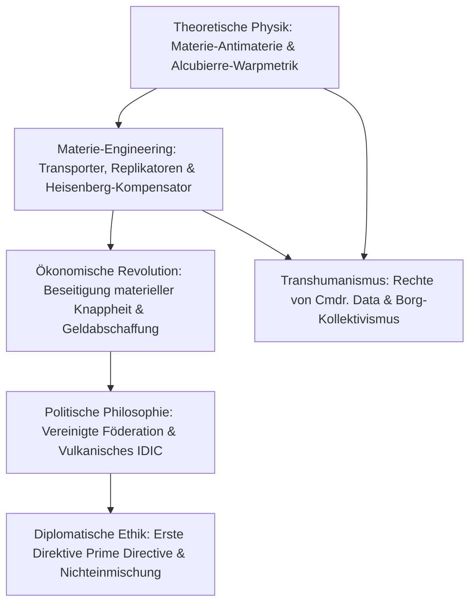

Seit 1966 steht Gene Roddenberrys *Star Trek* als unvergleichliches Monument visionärer Science-Fiction. Was *Star Trek* von anderen Weltraumopern unterscheidet, ist die einzigartige Synthese aus **theoretisch fundierter Physik** und einer **aufklärerischen humanistischen Gesellschaftsphilosophie**. Die Menschheit hat Armut, Kriege und die Besessenheit von Geld überwunden. Die Vereinigung von unbegrenzter Antimaterie-Energie und atomaren Molekular-Replikatoren eliminiert jegliche materielle Knappheit und schafft eine **Post-Scarcity-Gesellschaft** (Gesellschaft nach der Knappheit).

## 1. Theoretische Physik des Warp-Antriebs

Die Spezielle Relativitätstheorie verbietet die Beschleunigung massereicher Körper ($m_0 > 0$) auf oder über Lichtgeschwindigkeit $c$:

$$E = \frac{m_0 c^2}{\sqrt{1 - \frac{v^2}{c^2}}} \xrightarrow{v \to c} \infty$$

Die USS Enterprise umgeht dieses Gesetz, indem sie nicht das Schiff beschleunigt, sondern die **vierdimensionale Raumzeit krümmt**. 1994 bewies der theoretische Physiker Miguel Alcubierre die mathematische Machbarkeit durch seine Metrik:

$$ds^2 = -c^2 dt^2 + \left(dx - v_s(t) f(r_s) dt\right)^2 + dy^2 + dz^2$$

- **Der Raum vor dem Schiff wird drastisch kontrahiert**;
- **Der Raum hinter dem Schiff wird symmetrisch expandiert**;
- **Das Schiffsinnere bleibt eine unbeschleunigte, flache Minkowski-Raumzeit (0g)**.

Die Besatzung erleidet weder Trägheitskräfte noch relativistische Zeitdilatation. Die gewaltige Energie wird durch die kontrollierte Zerstrahlung von Deuterium und Antideuterium ($E = 2mc^2$) im Warpkern bereitgestellt, stabilisiert durch Dilithiumkristalle.

## 2. Materietransport und Molekularreplikatoren

Die Heisenberg'sche Unschärferelation verbietet die gleichzeitige exakte Messung von Ort und Impuls eines Teilchens:

$$\Delta x \cdot \Delta p \ge \frac{\hbar}{2}$$

Um diese Barriere beim Beamen zu umgehen, erfand Chefberater Michael Okuda den **Heisenberg-Kompensator**.
Der **Replikator** wendet dieselbe Technologie auf molekularer Ebene an: Aus Rohmaterie und Reingenergieströmen formt er jede Mahlzeit, Kleidung oder Werkzeuge binnen Sekunden exakt nach digitalem Code. "Tee, Earl Grey, heiß" genügt, um eine Tasse samt heißem Getränk aus dem Nichts zu materialisieren.

## 3. Post-Scarcity-Ökonomie: Das Verschwinden des Geldes

Die klassische Ökonomie basiert auf der Knappheit von Gütern. **Unerschöpfliche Fusionsenergie und Replikatoren machten die Grenzkosten der Produktion gleich null ($MC \to 0$).**
Dadurch wurde Geld überflüssig. Wie Captain Picard in *First Contact* erklärt:

> **"In unserem Jahrhundert existiert kein Geld mehr. Der Erwerb von Reichtum ist nicht mehr der Antrieb unseres Lebens. Wir arbeiten, um uns selbst zu vervollkommnen und der Menschheit zu dienen."**

Menschliche Motivation speist sich im 24. Jahrhundert aus Selbstverwirklichung, Wissenschaft, Kunst und gesellschaftlichem Dienst. Einzig unreplizierbare Güter (wie historische Grundstücke oder das flüssige Edelmetall Latinum der kapitalistischen Ferengi) behalten Tauschwert.

## 4. Die Oberste Direktive (Prime Directive)

Die **Erste Direktive (General Order 1)** ist das höchste ethische Gesetz der Sternenflotte:
Das absolute Verbot jeglicher Einmischung in die natürliche gesellschaftliche oder technologische Entwicklung von Zivilisationen, die noch keinen eigenen Warp-Antrieb entwickelt haben. Diese Regel schützt prä-warp Kulturen vor kolonialer Zerrüttung und technologischer Selbstzerstörung.

## 5. Transhumanismus und künstliches Leben

In der TNG-Episode *Wem gehört Data?* (The Measure of a Man) erstreitet Captain Picard vor Gericht die vollen Bürger- und Persönlichkeitsrechte für den Androiden **Data**: Ein Wesen mit Intelligenz, Selbstwahrnehmung und Bewusstsein darf niemals zum Staatseigentum degradiert werden. Demgegenüber steht das **Borg-Kollektiv**, das die totale Auslöschung des Individuums durch kybernetische Zwangsharmonisierung versinnbildlicht.

*Star Trek* verkörpert den unerschütterlichen Glauben an die Vernunft, Wissenschaft und Würde aller intelligenten Wesen.
