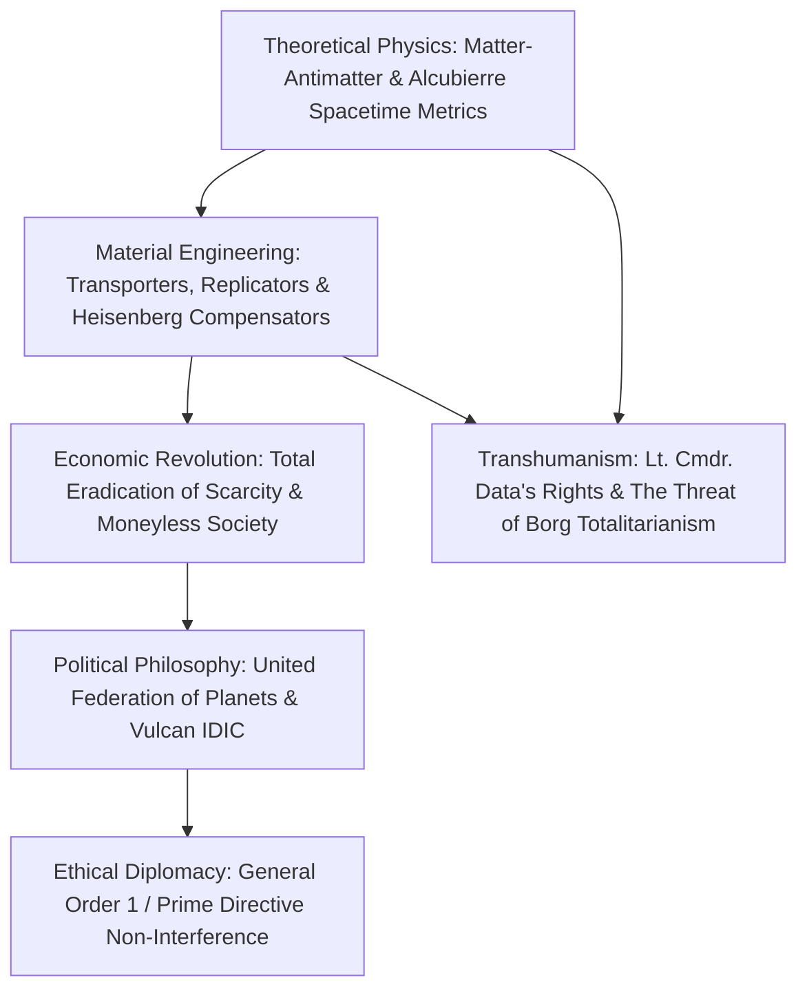
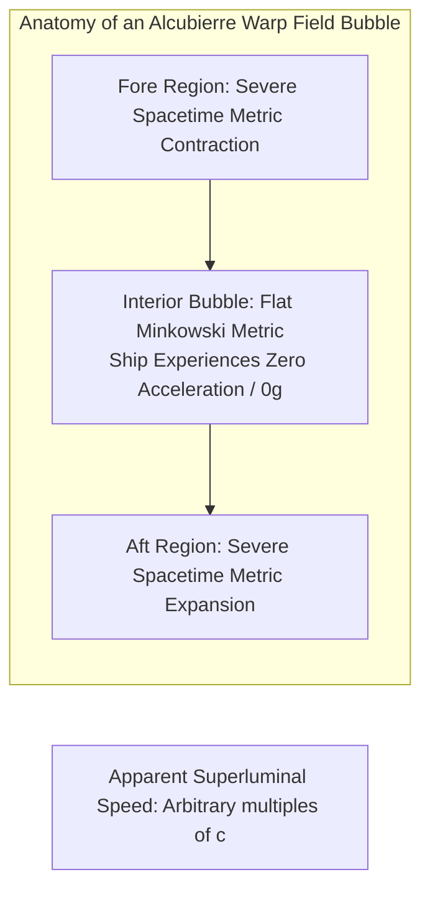
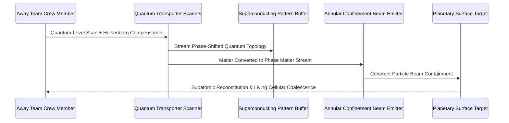
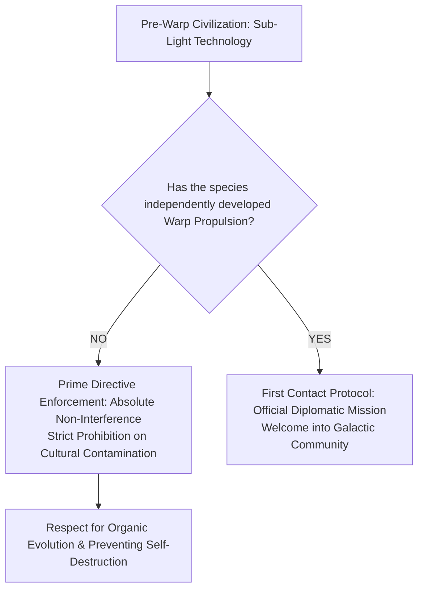

Conceived by Gene Roddenberry in 1966, *Star Trek* has stood for over half a century as a foundational cultural and philosophical touchstone in modern science fiction. Its technological concepts have inspired generations of real-world engineers, astrophysicists, and inventors—from mobile cellular communications and spatial computing to the theoretical formulation of superluminal space-time distortion fields.

Yet what permanently elevates *Star Trek* above conventional space operas is its profound structural duality: an unwavering dedication to **theoretical physical plausibility** reconciled with an aspirational, Enlightenment-rooted **humanist social philosophy**. *Star Trek* presumes that humanity will not destroy itself in thermonuclear madness, ecological devastation, or resource wars. Instead, through the convergence of infinite matter-antimatter power generation and atomic-level molecular replication, civilization completely eradicates physical scarcity. In doing so, it dismantles the very foundation of capitalism, market transactions, and wage labor, giving birth to a **post-scarcity utopia** governed not by the accumulation of wealth, but by self-actualization, exploratory curiosity, and universal cooperation.

This treatise presents a rigorous, multidisciplinary deconstruction of the *Star Trek* universe: the general relativistic spacetime geometry of warp physics and the Alcubierre metric, the quantum limits of molecular transporters and replicators, the macroeconomic structure of a moneyless civilization, the diplomatic ethics of the Prime Directive, and the transhumanist legal definitions of artificial consciousness.

---

## 1. The Theoretical Physics of Warp Drive

### Circumventing Special Relativity's Universal Speed Limit

Under Einstein's Special Theory of Relativity, accelerating any massive object ($m_0 > 0$) to or beyond the speed of light in vacuum ($c \approx 2.998 \times 10^8 \text{ m/s}$) is physically impossible. As velocity $v$ approaches $c$, the relativistic mass and energy requirements diverge asymptotically to infinity via the Lorentz factor $\gamma$:

$$E = \gamma m_0 c^2 = \frac{m_0 c^2}{\sqrt{1 - \frac{v^2}{c^2}}} \xrightarrow{v \to c} \infty$$

Moreover, accelerating through local spacetime at superluminal speeds violates causal structure, transforming temporal vectors into spatial vectors and permitting grandfather-paradox time travel.

The genius of *Star Trek*'s warp drive—formulated by technical advisors Rick Sternbach and Michael Okuda, and validated mathematically in 1994 by theoretical physicist Miguel Alcubierre—is that the starship **never accelerates locally past the speed of light**. Instead, the propulsion system locally manipulates the geometry of four-dimensional spacetime itself.

### The Alcubierre Metric and Spacetime Contraction

In 1994, Mexican physicist Miguel Alcubierre demonstrated that Einstein’s gravitational field equations:

$$G_{\mu\nu} = R_{\mu\nu} - \frac{1}{2} R g_{\mu\nu} = \frac{8\pi G}{c^4} T_{\mu\nu}$$

admit an exact geometric solution permitting arbitrary apparent superluminal velocities without violating local Lorentz invariance. The Alcubierre metric is defined as:

$$ds^2 = -c^2 dt^2 + \left(dx - v_s(t) f(r_s) dt\right)^2 + dy^2 + dz^2$$

where $v_s(t) = \frac{dx_s(t)}{dt}$ represents the coordinate velocity of the warp bubble center, $r_s(t) = \sqrt{(x - x_s(t))^2 + y^2 + z^2}$ is the radial distance from the craft, and $f(r_s)$ is a continuous shaping function defining the bubble boundary:

$$f(r_s) = \frac{\tanh\left(\sigma (r_s + R)\right) - \tanh\left(\sigma (r_s - R)\right)}{2 \tanh(\sigma R)}$$

Within this geometric field:
1. **Spacetime in front of the vessel contracts violently**, reducing the physical distance to the destination coordinate.
2. **Spacetime behind the vessel expands symmetrically**, pushing the bubble forward through the coordinate grid.
3. **The interior volume containing the starship remains a flat, uncurved Minkowski metric**.

Because the starship remains stationary within its local frame ($v_{\text{local}} = 0$), the crew experiences **zero inertial g-forces** during radical maneuvers and suffers **zero relativistic time dilation** (the twin paradox does not apply). The ship does not move through space; space itself flows around the bubble.

### Negative Energy Densities and the Antimatter Core

The severe physical constraint of the Alcubierre metric is that contracting spacetime ahead and expanding it behind requires an energy-momentum tensor $T_{\mu\nu}$ with a strictly negative local energy density:

$$\rho = T_{00} < 0$$

In standard quantum field theory, the **Casimir effect** confirms that negative energy densities are physically achievable between closely spaced conducting plates. In *Star Trek* canon, the immense energy required to generate and sustain these subspace distortion fields is supplied by a **Matter-Antimatter Reaction Assembly (M/ARA)**.

Within the warp core, deuterium (hydrogen-2) and antideuterium undergo mutual matter-antimatter annihilation ($E = 2 m c^2$), yielding high-energy electro-plasma at 100% theoretical thermodynamic conversion efficiency. This reaction is moderated through a lattice of **Dilithium crystals** (a fictional non-reactive mineral whose sub-atomic structure resists antimatter bombardment in higher subspace dimensions). The regulated plasma is channeled through electro-plasma conduits (EPS) into the warp nacelles, energizing toroidal coils wound from superconducting verterium-cortenide to project concentric warp field layers.

---

## 2. Transporters and Molecular Replicators

### Overcoming the Heisenberg Uncertainty Principle

The transporter system—originally conceived by Roddenberry as a low-cost production alternative to landing miniature spacecraft every week—is one of the most meticulously documented technologies in speculative fiction:
1. **Molecular De-materialization**: High-resolution molecular imaging scanners scan every subatomic particle, coordinate, and quantum spin state of the subject.
2. **Phase Transition**: The matter is transformed into an energized sub-atomically decoupled matter stream.
3. **Pattern Buffers**: The gigabytes of quantum topological data are temporarily cached in superconducting magnetic delay coils.
4. **Annular Confinement Beam (ACB)**: The matter stream and coordinate data are beamed to the target coordinate, where quantum re-assembly restores the living organism cell for cell.

In reality, Werner Heisenberg's uncertainty principle sets a hard physical limit on measuring position and momentum simultaneously:

$$\Delta x \cdot \Delta p \ge \frac{\hbar}{2}$$

If an instrument scans an electron's position with sub-nanometer precision, its momentum vector is scrambled, making accurate reconstitution impossible. When asked by physicists how the fictional transporter bypasses this law of quantum mechanics, technical consultant Michael Okuda famously delivered the immortal response: **"It works very well, thank you."** In canon, this is achieved by the **Heisenberg Compensator**—a device that offsets quantum decoherence in real-time.

### The Molecular Replicator: Eliminating Scarcity

While transporters operate at subatomic quantum resolution to preserve neurological synaptic pathways and living consciousness, **Molecular Replicators** operate at a coarser, purely molecular level:
- Instead of scanning living beings dynamically, replicators read static software matrix files stored in computer memory banks.
- Drawing upon raw feedstock (dematerialized bulk carbon, water, trace minerals) and electromagnetic energy, the replicator synthesizes complex chemical compounds, tools, apparel, or gourmet meals in seconds.

The moment Captain Jean-Luc Picard speaks the command *"Tea, Earl Grey, hot,"* the computer activates an atomic assembler that arranges water molecules, tannins, bergamot flavoring, and porcelain ceramics with microscopic perfection. The invention of the replicator fundamentally rewrote human destiny: it mechanized the complete abolition of physical deprivation.

---

## 3. The Post-Scarcity Economy: The Death of Money

### Overturning the Classical Scarcity Axiom

Every classical and neoclassical economic model—from Adam Smith and David Ricardo to Karl Marx and John Maynard Keynes—rests upon a single foundational axiom: **the principle of scarcity**. Human wants are virtually infinite, whereas productive resources (land, physical labor, capital, raw materials, energy) are strictly finite. Markets, prices, debt, wages, and property rights exist entirely as institutional algorithms designed to allocate scarce resources.

**The fusion of infinite matter-antimatter energy and molecular replication shattered the scarcity axiom permanently.**

When any citizen can materialize clothing, pharmaceuticals, construction materials, computing hardware, or nutrient-dense food at zero marginal cost:
- The marginal cost of production approaches zero: $MC \to 0$.
- Market price equilibriums collapse: $P = MC = 0$.
- The necessity for private accumulation of consumer capital evaporates.

In *Star Trek: First Contact* (1996), when 21st-century human Lily Sloane asks Captain Picard how much the starship Enterprise cost to build, Picard smiles gently:

> **"The economics of the future is somewhat different. You see, money doesn't exist in the 24th century. The acquisition of wealth is no longer the driving force in our lives. We work to better ourselves and the rest of humanity."**

### Residual Scarcities in a Post-Capitalist World

Despite the abolition of money, the Federation is not an anarchic fantasy; it recognizes that certain forms of scarcity are mathematically and physically irreducible:
1. **Positional and Spatial Scarcity**: While anyone can replicate a château, only one family can own the ancestral Château Picard in La Barre, France. Prime real estate on Earth, planetary beach fronts, and historical artifacts cannot be duplicated.
2. **Authenticity and Tactile Value**: While replicated synthesized wine is chemically indistinguishable from grape-fermented wine, humans place a premium on handcrafted cultivation, historical heritage, and artisanal labor.
3. **Un-replicable Exotic Matter**: Certain complex lattices, such as Dilithium crystals, Ketracel-white, or **Gold-Pressed Latinum** (used as currency by the hyper-capitalist Ferengi Alliance), possess quantum topologies that resist molecular replication. Latinum serves as the universal trade medium with external, non-Federation market economies.

In the Federation, human motivation undergoes a profound psychological evolution conforming to Maslow's hierarchy of needs: once physiological and safety needs are universally secured, social status is determined not by conspicuous consumption, but by **reputation, creative brilliance, scientific discovery, and humanitarian service**.

---

## 4. The United Federation of Planets and the Prime Directive

### Infinite Diversity in Infinite Combinations (IDIC)

Founded in 2161 by Earth, Vulcan, Andoria, and Tellar Prime, the **United Federation of Planets** embodies an institutional philosophy derived from the Vulcan principle of **IDIC (*Kol-Ut-Shan* / Infinite Diversity in Infinite Combinations)**.

The Federation is not an assimilationist empire; it is an open interstellar commonwealth of over 150 member worlds spanning 8,000 light-years. Each civilization preserves its sovereign culture, legal tradition, and spiritual autonomy while participating in common mutual defense, scientific research, and diplomatic councils.

### Starfleet General Order 1: The Prime Directive

The cornerstone of Starfleet jurisprudence and ethical philosophy is **The Prime Directive (General Order 1)**. It supersedes all other directives, including the survival of Starfleet officers:

> **"No starship, officer, or crew shall interfere in the natural, healthy, and organic technological, cultural, or social development of any pre-warp civilization."**

The sociological rationale behind this draconian prohibition is rooted in the tragic history of terrestrial colonialism. Whenever an advanced technological civilization imposes its knowledge, weapons, or theology onto a developing culture:
- Societal cohesion disintegrates under existential shock.
- Immature political structures misappropriate advanced energy sources into cataclysmic weaponry.
- The developing species forms cargo cults, deifying visitors as supernatural gods and abandoning independent intellectual evolution.

The Prime Directive confronts Starfleet commanders with agonizing moral paradoxes. When an extinction-level asteroid threatens a pre-warp world, should Starfleet violate the directive to save billions of innocent lives, or allow natural selection to take its course? In episodes like TNG's *Pen Pals* and *Homeward*, Picard and his officers wrestle with the fine line between cosmic humility and callous moral negligence. The Prime Directive is a solemn treaty against the hubris of cultural imperialism.

---

## 5. Transhumanism, Cybernetics, and Consciousness

*Star Trek* conducts foundational philosophical thought experiments regarding the nature of the soul, artificial intelligence, and the boundaries of human identity.

### The Measure of a Man: Artificial Sentience and Civil Rights

In TNG’s masterwork *The Measure of a Man* (1989), Starfleet cyberneticist Bruce Maddox attempts to dismantle the android **Lieutenant Commander Data** to reverse-engineer his positronic brain. Data refuses, prompting an extraordinary court-martial hearing to determine whether Data is Starfleet property or a sentient individual endowed with constitutional rights.

Captain Picard mounts a monumental defense:
- To qualify as a sentient life form, an entity must demonstrate three attributes: **Intelligence**, **Self-Awareness**, and **Consciousness**.
- While Data's intelligence and self-awareness are objectively proven, Picard demonstrates that science cannot empirically measure human consciousness either.
- Picard delivers the crushing verdict: to declare Data property is to create a disposable race of sentient android slaves, violating the moral soul of the Federation. Data is granted legal self-determination.

### The Borg Collective: The Nightmare of Totalitarian Homogenization

At the conceptual antipodes of the Federation's diversity stands **The Borg Collective**: a cybernetic hive-mind that forcibly absorbs biological species, obliterating individuality, free will, and emotion in pursuit of computational perfection:

> **"We are the Borg. Lower your shields and surrender your ships. We will add your biological and technological distinctiveness to our own. Your culture will adapt to service us. Resistance is futile."**

The Borg represent the ultimate techno-totalitarian nightmare: a society where technology does not liberate human potential, but consumes it entirely. The epic ideological clash between the Federation and the Borg is a metaphysical defense of the messy, imperfect, magnificent beauty of individual consciousness against cold, algorithmic determinism.

---

## 6. Summary: The Audacious Hope of Star Trek

| Domain | Technological Mechanism | Philosophical & Sociological Meaning |
| :--- | :--- | :--- |
| **Warp Propulsion** | Alcubierre metric, Antimatter M/ARA, Dilithium plasma moderation | Transcending the light barrier through spacetime manipulation; enabling cosmic fellowship. |
| **Matter Teleportation** | Subatomic de-materialization, Heisenberg compensation | Conquering physical geography; instant spatial connectivity. |
| **Molecular Replication** | Matter-energy synthesis from digital software matrices | Eradicating material scarcity; the obsolescence of currency, poverty, and wage labor. |
| **The Prime Directive** | Absolute non-intervention in pre-warp civilizational development | Ethical restraint; institutional humility against techno-colonial hubris. |
| **IDIC Philosophy** | Harmonious integration of diverse evolutionary species | Universal multi-species multiculturalism celebrating difference as strength. |

In our modern cultural landscape dominated by cynical, dystopian forecasts of corporate serfdom and environmental collapse, *Star Trek* remains an audacious beacon of rational optimism. It reminds humanity that our destiny is not to extinguish our light in planetary squalor, but to mature ethically alongside our technologies—venturing forward as one united species *to boldly go where no one has gone before*.

---

## 7. Deep Space Nine and the Fragility of Utopia

While Gene Roddenberry's original conception championed an unblemished, sanitized paradise, the spin-off series *Star Trek: Deep Space Nine* (1993–1999) enriched the canon by subjecting Federation idealism to the crucible of existential total war.

Stationed on a battered alien outpost on the turbulent frontier, Commander Benjamin Sisko delivers a devastating critique to Federation bureaucrats residing in the pristine comfort of Earth:

> **"It's easy to be a saint in paradise. But those of us out here on the frontier... we deal in reality."**

When the totalitarian Dominion challenges the Federation, Starfleet faces the harrowing temptation to compromise its foundational principles for survival. In the legendary masterpiece episode *In the Pale Moonlight*, Captain Sisko participates in forgery, bribery, and complicity in political assassination to bring the Romulan Star Empire into the war. Sisko's confession—*"I can live with it... because I can live with it, I'll delete the log"*—demonstrates that paradise is not a self-sustaining perpetual motion machine, but a fragile moral equilibrium defended by individuals willing to endure psychological damnation so that the dream may survive.

Furthermore, DS9 revealed the existence of **Section 31**: a rogue, black-ops intelligence division operating outside the oversight of Starfleet Command or the Federation Council. Justifying its extralegal existence under Article 14, Section 31 of the original Starfleet Charter, this covert network attempted biological genocide against the Dominion's Founders using a manufactured morphogenic virus. The tension between Section 31's brutal machiavellianism and Doctor Julian Bashir's Hippocratic ethics exposes the perennial crisis of constitutional democracies: *Can a society violate its moral soul in order to protect its physical existence?*
