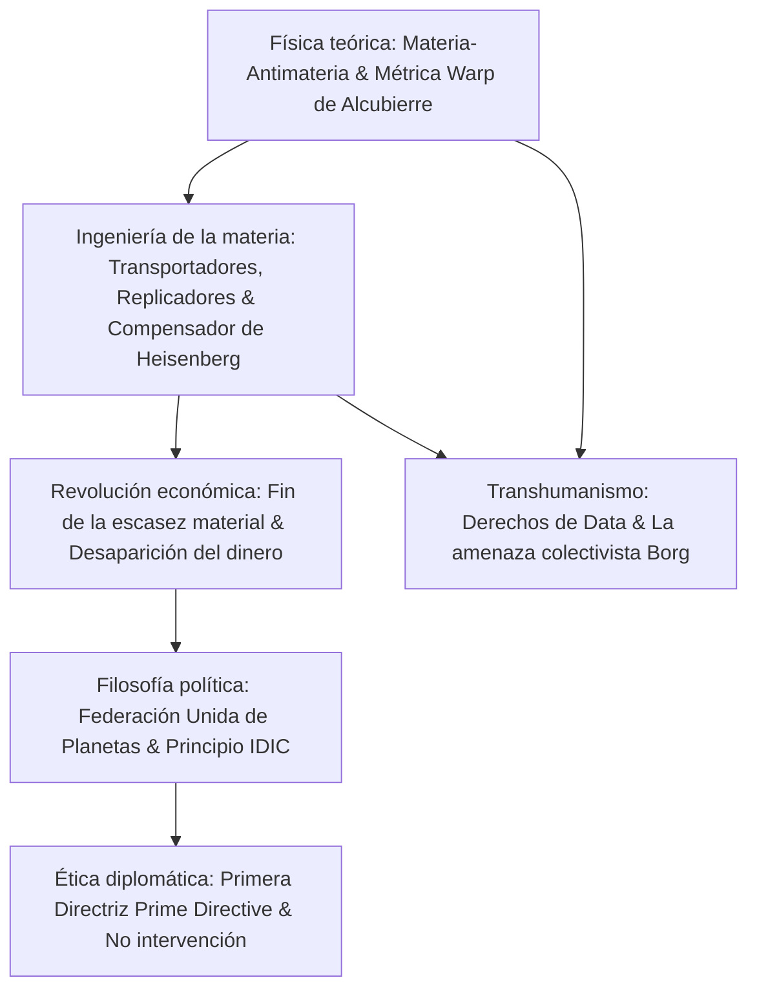

Creada en 1966 por Gene Roddenberry, *Star Trek* representa la cúspide de la ciencia ficción optimista. Destaca por conjugar **física teórica rigurosa** con una **filosofía social humanista inspirada en la Ilustración**. La humanidad del siglo XXIV ha erradicado la pobreza y el hambre mediante la energía de la antimateria y los replicadores moleculares, creando una **sociedad post-escasez**.

## 1. Física teórica del motor warp (Warp Drive)

La Relatividad Especial prohíbe que un cuerpo con masa ($m_0 > 0$) supere la velocidad de la luz $c$:

$$E = \frac{m_0 c^2}{\sqrt{1 - \frac{v^2}{c^2}}} \xrightarrow{v \to c} \infty$$

El Enterprise soluciona esta barrera **deformando el tejido espacio-temporal** circundante. En 1994, el físico mexicano Miguel Alcubierre formalizó la solución matemática:

$$ds^2 = -c^2 dt^2 + \left(dx - v_s(t) f(r_s) dt\right)^2 + dy^2 + dz^2$$

- **El espacio frontal se contrae** drásticamente;
- **El espacio posterior se expande** simétricamente;
- **El interior de la burbuja permanece plano en métrica de Minkowski (0g)**.

La nave no experimenta aceleración inercial ni dilatación temporal. La energía emana de la aniquilación controlada de deuterio y antideuterio ($E = 2mc^2$), canalizada a través de cristales de dilitio.

## 2. Teletransporte y replicadores moleculares

El principio de incertidumbre de Heisenberg impide medir con exactitud absoluta la posición y el momento de una partícula cuántica:

$$\Delta x \cdot \Delta p \ge \frac{\hbar}{2}$$

El **compensador de Heisenberg** solventa teóricamente esta limitación.
El **replicador molecular** democratizó esta tecnología: a partir de energía y materias primas básicas, ensambla comida, ropa o herramientas átomo por átomo en segundos. El famoso comando del capitán Picard *"Té, Earl Grey, caliente"* simboliza esta revolución.

## 3. Economía post-escasez: la muerte del dinero

La economía clásica se fundamenta en la escasez. **La energía ilimitada y la replicación molecular redujeron el coste marginal de producción a cero ($MC \to 0$).**
Como explica el capitán Picard en *Primer Contacto*:

> **"El dinero no existe en el siglo XXIV. La adquisición de riquezas ya no es la fuerza motriz de nuestras vidas. Trabajamos para mejorarnos a nosotros mismos y al resto de la humanidad."**

La motivación individual se traslada a la cima de la pirámide de Maslow: autorrealización, conocimiento científico, creación artística y servicio ético a la comunidad.

## 4. La Primera Directriz (Prime Directive)

La Orden General n.º 1 prohíbe taxativamente intervenir en el curso natural o social de civilizaciones que no hayan desarrollado la propulsión warp por sus propios medios. Esta doctrina protege a los mundos pre-warp de la devastación colonial y el colapso prematuro.

## 5. Conciencia artificial y transhumanismo

En el episodio *La medida de un hombre* (*The Measure of a Man*), Picard defiende los derechos del androide **Data**: cualquier ser con inteligencia, autoconciencia y voluntad propia merece reconocimiento constitucional como persona. En contraste, los **Borg** personifican el peligro del colectivismo totalitario que despoja al individuo de su libertad.

*Star Trek* es una oda inmortal a la razón, la ética y la infinita capacidad humana para convivir en paz entre las estrellas.
