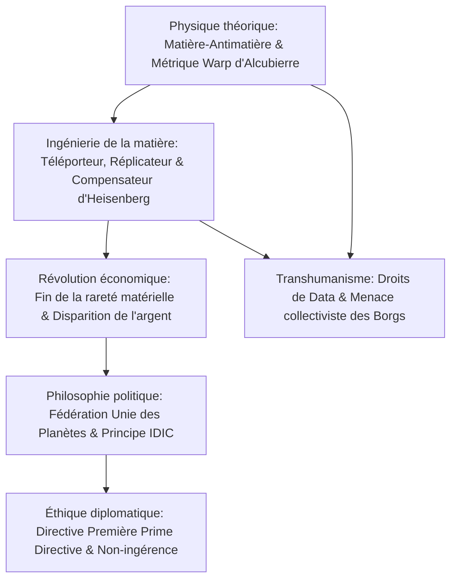

Depuis 1966, *Star Trek* brille au sommet de la science-fiction philosophique. Son originalité réside dans l'alliance d'une **physique théorique d'une grande rigueur** et d'un **humanisme d'inspiration humaniste et des Lumières**. L'humanité du XXIVe siècle a éliminé la guerre, la pauvreté et la tyrannie de l'argent grâce à l'énergie de l'antimatière et aux réplicateurs moléculaires, instaurant une véritable **économie post-rareté (Post-Scarcity)**.

## 1. Physique théorique de la distorsion (Warp Drive)

La relativité restreinte interdit à tout corps massique ($m_0 > 0$) de dépasser la vitesse de la lumière $c$ :

$$E = \frac{m_0 c^2}{\sqrt{1 - \frac{v^2}{c^2}}} \xrightarrow{v \to c} \infty$$

L'Enterprise contourne cette impossibilité en **déformant l'espace-temps autour du vaisseau**. En 1994, le physicien théoricien Miguel Alcubierre en a formulé la métrique mathématique rigoureuse :

$$ds^2 = -c^2 dt^2 + \left(dx - v_s(t) f(r_s) dt\right)^2 + dy^2 + dz^2$$

- **L'espace à l'avant se contracte** violemment ;
- **L'espace à l'arrière s'étire** symétriquement ;
- **L'intérieur de la bulle reste un espace-temps de Minkowski plat (0g)**.

L'équipage ne subit ni accélération brutale ni dilatation temporelle relativiste. L'énergie colossale requise provient de l'annihilation matière-antimatière ($E = 2mc^2$) dans le cœur de distorsion régulé par des cristaux de dilithium.

## 2. Téléportation et réplicateurs moléculaires

Le principe d'incertitude d'Heisenberg interdit de mesurer simultanément la position et la quantité de mouvement d'une particule :

$$\Delta x \cdot \Delta p \ge \frac{\hbar}{2}$$

Les scénaristes ont contourné ce paradoxe grâce au **compensateur d'Heisenberg**.
Le **réplicateur moléculaire** applique cette technologie au niveau atomique : à partir d'énergie et de matière brute, il assemble en quelques secondes des aliments, des vêtements ou des machines. La réplique célèbre du capitaine Picard *"Thé Earl Grey, chaud"* résume cette libération technologique.

## 3. L'économie post-rareté et la fin de l'argent

Toute l'économie classique repose sur le postulat de la rareté. **L'énergie infinie et les réplicateurs ont fait chuter le coût marginal de production à zéro ($MC \to 0$).**
Dans *Star Trek : Premier Contact*, Picard l'affirme à Lily Sloane :

> **"L'argent n'existe plus au XXIVe siècle. L'acquisition de richesses n'est plus le moteur de nos vies. Nous travaillons pour nous perfectionner et faire progresser l'humanité."**

Dans ce modèle, les motivations humaines s'élèvent au sommet de la pyramide de Maslow : accomplissement intellectuel, exploration scientifique, création artistique et dévouement au bien commun.

## 4. La Directive Première (Prime Directive)

L'Ordre Général n°1 impose une **non-ingérence absolue** dans le développement des civilisations qui n'ont pas encore découvert le voyage supraluminique par leurs propres moyens. Cette règle morale fondamentale vise à protéger les sociétés pré-warp des dévastations du colonialisme culturel et de la destruction prématurée.

## 5. Transhumanisme et conscience artificielle

L'épisode magistral *Être ou ne pas être* (*The Measure of a Man*) voit Picard défendre l'androïde **Data** devant un tribunal : une entité consciente, douée d'intelligence et de libre arbitre ne peut être réduite à une simple propriété de Starfleet. À l'opposé, les **Borgs** incarnent l'horreur de l'assimilation forcée et de l'annihilation de l'individu.

*Star Trek* est un hymne impérissable à la rationalité, à la liberté et à la noblesse de l'esprit humain explorant le cosmos.
