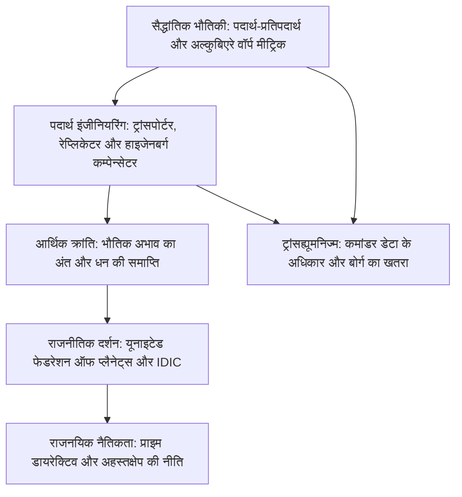

1966 में जीन रोडेनबेरी द्वारा रचित *स्टार ट्रेक* (Star Trek) विज्ञान और मानवीय दर्शन का अद्वितीय संगम है। इसने न केवल मोबाइल फोन और क्वांटम भौतिकी को प्रेरित किया, बल्कि यह भी दिखाया कि जब इंसान गरीबी, युद्ध और लालच को मिटा देता है, तो वह अंतरिक्ष में कैसा न्यायपूर्ण समाज बना सकता है।

स्टार ट्रेक की विशेषता यह है कि यह **कठोर सैद्धांतिक भौतिकी** को **मानवतावादी दर्शन** के साथ जोड़ता है। इसके वॉर्प ड्राइव (Warp Drive) को 1994 में भौतिक विज्ञानी मिगुएल अल्कुबिएरे ने आइंस्टीन के समीकरणों के तहत सही सिद्ध किया। आणविक रेप्लिकेटर (Replicator) ने संसाधनों की कमी को मिटाकर **उत्तर-अभाव समाज (Post-Scarcity Economy)** की नींव रखी जहाँ पैसे का कोई अस्तित्व नहीं है।

## 1. वॉर्प ड्राइव की सैद्धांतिक भौतिकी

विशेष सापेक्षता के अनुसार द्रव्यमान वाला कोई भी पिंड प्रकाश की चाल $c$ को पार नहीं कर सकता:

$$E = \frac{m_0 c^2}{\sqrt{1 - \frac{v^2}{c^2}}} \xrightarrow{v \to c} \infty$$

एंटरप्राइज जहाज खुद को तेज नहीं करता, बल्कि **अपने आसपास के दिक्-काल (Spacetime) को सिकोड़ता और फैलाता है**। 1994 में मिगुएल अल्कुबिएरे ने इसका गणितीय हल निकाला:

$$ds^2 = -c^2 dt^2 + \left(dx - v_s(t) f(r_s) dt\right)^2 + dy^2 + dz^2$$

- **जहाज के आगे का अंतरिक्ष तेजी से सिकुड़ता है**;
- **पीछे का अंतरिक्ष फैलता है**;
- **बबल के अंदर का स्थान पूरी तरह सपाट रहता है (0g)**।

चालक दल को कोई झटका या समय फैलाव (Time Dilation) महसूस नहीं होता। ड्यूटेरियम और एंटीड्यूटेरियम के परस्पर विनाश ($E = 2mc^2$) से ऊर्जा मिलती है, जिसे डाइलिशियम क्रिस्टल नियंत्रित करते हैं।

## 2. ट्रांसपोर्टर और आणविक रेप्लिकेटर

हाइजेनबर्ग का अनिश्चितता सिद्धांत स्थिति और संवेग को एक साथ सटीक मापने से रोकता है:

$$\Delta x \cdot \Delta p \ge \frac{\hbar}{2}$$

वैज्ञानिकों ने काल्पनिक **हाइजेनबर्ग कम्पेन्सेटर** से इस बाधा को दूर दिखाया।
**रेप्लिकेटर** इसी तकनीक से भोजन, कपड़े और पुर्जे कुछ ही सेकंड में परमाणुओं को जोड़कर तैयार कर देता है। कैप्टन पिकार्ड का प्रसिद्ध आदेश *"चाय, अर्ल ग्रे, गर्म"* इसका प्रतीक है।

## 3. उत्तर-अभाव अर्थव्यवस्था: धन की समाप्ति

पारंपरिक अर्थशास्त्र संसाधनों की कमी पर टिका है। **असीमित ऊर्जा और रेप्लिकेटर ने उत्पादन की सीमांत लागत को शून्य ($MC \to 0$) कर दिया।**
24वीं सदी में पैसे का लोप हो गया। कैप्टन पिकार्ड कहते हैं:

> **"24वीं सदी में पैसा नहीं होता। धन अर्जित करना हमारे जीवन का उद्देश्य नहीं है। हम स्वयं को बेहतर बनाने और मानवता की सेवा के लिए काम करते हैं।"**

मनुष्य का ध्यान आत्म-साक्षात्कार, वैज्ञानिक खोजों और कला के निर्माण पर केंद्रित हो गया।

## 4. प्राइम डायरेक्टिव (Prime Directive)

स्टारफ्लीट का जनरल ऑर्डर 1 उन सभ्यताओं के विकास में **पूर्ण अहस्तक्षेप** का आदेश देता है जिन्होंने अभी तक खुद वॉर्प ड्राइव नहीं बनाया है। यह नियम उन्हें सांस्कृतिक गुलामी और आत्मविनाश से बचाता है।

## 5. कृत्रिम बुद्धिमत्ता और ट्रांसह्यूमनिज्म

*द मेजर ऑफ ए मैन* में पिकार्ड एंड्रॉइड **डेटा** के इंसानी अधिकारों की रक्षा करते हैं: जो सोच सकता है और आत्म-जागरूक है, वह किसी की निजी संपत्ति नहीं हो सकता। दूसरी ओर, **बोर्ग** जबरन दिमाग छीनने वाले अधिनायकवाद का सबसे बड़ा खतरा बनकर सामने आता है।

*स्टार ट्रेक* विज्ञान, नैतिकता और सितारों के बीच मानव जाति के शांतिपूर्ण सह-अस्तित्व की अमर गाथा है।
