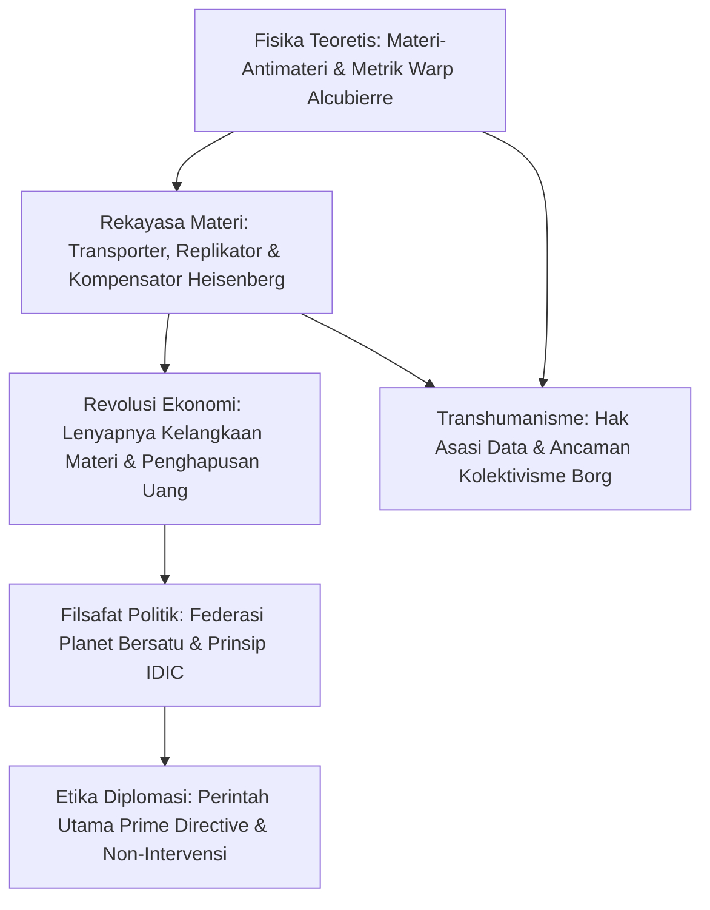

Sejak diciptakan pada tahun 1966 oleh Gene Roddenberry, *Star Trek* telah menjadi lambang optimisme sains dan filsafat manusia. Serial ini memadukan **fisika teoretis yang sangat presisi** dengan **humanisme pencerahan**. Umat manusia abad ke-24 telah mengentaskan kemiskinan dan perang berkat energi antimeteri dan replikator molekuler, mewujudkan **ekonomi pasca-kelangkaan (Post-Scarcity)**.

## 1. Fisika Teoretis Motor Warp (Warp Drive)

Relativitas Khusus melarang massa ($m_0 > 0$) melaju setara atau melebihi kecepatan cahaya $c$:

$$E = \frac{m_0 c^2}{\sqrt{1 - \frac{v^2}{c^2}}} \xrightarrow{v \to c} \infty$$

Kapal Enterprise mengatasinya dengan **melengkungkan ruang-waktu di sekitar kapal**. Pada tahun 1994, fisikawan Miguel Alcubierre merumuskan metrik matematisnya:

$$ds^2 = -c^2 dt^2 + \left(dx - v_s(t) f(r_s) dt\right)^2 + dy^2 + dz^2$$

- **Ruang di depan kapal menyusut** secara drastis;
- **Ruang di belakang kapal mengembang** secara simetris;
- **Bagian dalam gelembung tetap berupa ruang-waktu Minkowski yang datar (0g)**.

Awak kapal tidak mengalami gaya inersia maupun dilatasi waktu relativistik. Energi dahsyat diperoleh dari reaksi pemusnahan deuterium dan antideuterium ($E = 2mc^2$), dikendalikan kristal dilithium.

## 2. Transporter dan Replikator Molekuler

Prinsip ketidakpastian Heisenberg melarang pengukuran simultan posisi dan momentum partikel secara presisi mutlak:

$$\Delta x \cdot \Delta p \ge \frac{\hbar}{2}$$

Ilmuwan fiksi Star Trek mengatasinya menggunakan **Kompensator Heisenberg**.
**Replikator molekuler** mendemokratisasi teknologi ini: dari bahan mentah dan energi murni, alat ini merakit makanan, pakaian, atau perkakas dalam hitungan detik. Perintah legendaris Kapten Picard *"Tea, Earl Grey, hot"* adalah simbol kemakmuran tanpa batas.

## 3. Ekonomi Pasca-Kelangkaan: Kematian Uang

Ekonomi tradisional bertumpu pada kelangkaan barang. **Energi tak terbatas dan replikasi molekuler memangkas biaya marjinal produksi menjadi nol ($MC \to 0$).**
Uang pun menjadi usang. Sebagaimana dijelaskan Kapten Picard:

> **"Uang tidak lagi ada di abad ke-24. Perolehan kekayaan bukan lagi tujuan hidup kami. Kami bekerja untuk mengembangkan diri dan memajukan umat manusia."**

Motivasi manusia berpindah ke puncak hierarki Maslow: aktualisasi diri, penelitian ilmiah, dan pengabdian bagi kebaikan galaksi.

## 4. Perintah Utama (Prime Directive)

Perintah Umum No. 1 mewajibkan **larangan campur tangan mutlak** dalam perkembangan alami peradaban yang belum menemukan perjalanan warp sendiri. Doktrin ini melindungi spesies pra-warp dari kehancuran kolonialisme dan kontaminasi budaya.

## 5. Kesadaran Buatan dan Transhumanisme

Dalam episode *The Measure of a Man*, Picard membela hak hidup android **Data**: makhluk yang memiliki kecerdasan, kesadaran diri, dan kehendak bebas tidak boleh diperlakukan sebagai budak atau properti. Sebaliknya, **Borg** menggambarkan bahaya totaliterisme yang melenyapkan individualitas.

*Star Trek* adalah perayaan abadi atas akal budi, sains, dan persaudaraan antarbintang.
