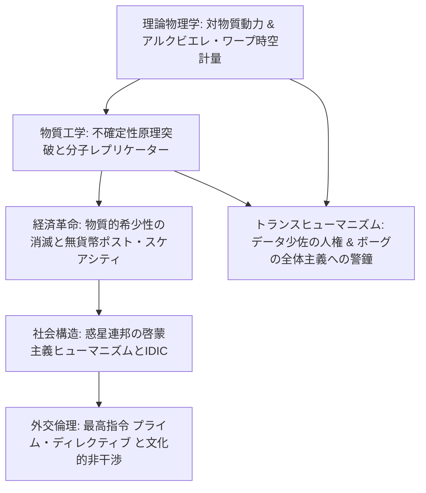
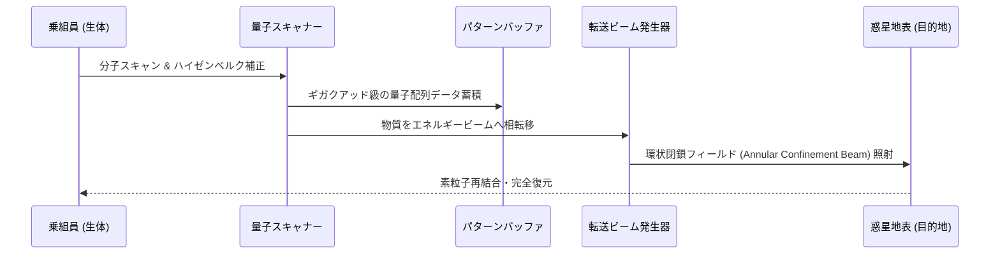

1966年にジーン・ロッデンベリー（Gene Roddenberry）によって生み出された『スター・トレック』（*Star Trek*）シリーズは、半世紀以上にわたり世界の科学者、技術者、そして哲学者たちに計り知れないインスピレーションを与え続けてきたSF界の最高峰です。アポロ計画の宇宙飛行士からスティーブ・ジョブズ、そして理論物理学者スティーヴン・ホーキングに至るまで、数多の知性がこの作品の先見性に魅了されてきました。

『スター・トレック』が他のスペースオペラと決定的に一線を画すのは、**「徹底して理論物理学の整合性を追求したハードSF的ガジェット設定」**と、**「戦争、貧困、人種差別、そして金銭の執着を克服した、啓蒙主義的人間賛歌のユートピア思想」**が奇跡的なバランスで融合している点にあります。

超光速航行を可能にする「ワープドライブ」は、1994年に物理学者ミゲル・アルクビエレによって一般相対性理論のアインシュタイン方程式の厳密解（アルクビエレ・計量）として現実の物理学の俎上に載せられました。また、素粒子からあらゆる物質を瞬時に再構成する「分子レプリケーター」は、人類から物質的希少性を完全に奪い去り、貨幣経済の消滅した「ポスト・スケアシティ（脱希少性）社会」という驚くべき経済モデルを提示しました。

本稿では、アインシュタイン方程式に基づくワープフィールドの時空計量、ハイゼンベルクの不確定性原理と物質転送工学、レプリケーターがもたらす無貨幣経済の社会構造、そして連邦の絶対的倫理規範である「最高指令（プライム・ディレクティブ）」が問いかける文明論まで、『スター・トレック』の技術と社会思想の全貌を徹底的に解剖します。



---

## 1. ワープドライブの理論物理学：アルクビエレ計量と時空歪曲

### 特殊相対性理論の光速限界をいかに回避するか

アルバート・アインシュタインの特殊相対性理論において、静止質量 $m_0 > 0$ を持つあらゆる物質は、局所的な平坦時空の中で光速 $c \approx 2.998 \times 10^8 \text{ m/s}$ を超えて加速することはできません。物体の速度 $v$ が光速に近づくにつれ、相対論的質量（エネルギー）はローレンツ因子 $\gamma$ に従って無限大へと発散するためです：

$$E = \gamma m_0 c^2 = \frac{m_0 c^2}{\sqrt{1 - \frac{v^2}{c^2}}} \xrightarrow{v \to c} \infty$$

しかし、『スター・トレック』の宇宙艦エンタープライズ号は、船体そのものを光速以上に加速させているわけではありません。宇宙船の周囲の**「時空そのものを局所的に歪曲・変形（Warp）させる」**ことによって、局所的な光速度不変の原理を一切破ることなく、見かけ上の超光速移動（Superluminal Motion）を達成しています。

### アルクビエレ・計量（Alcubierre Metric）の厳密解

この架空の設定が、理論物理学において数学的に実証可能な厳密解であることを証明したのが、1994年のメキシコの理論物理学者ミゲル・アルクビエレ（Miguel Alcubierre）の記念碑的論文です。

アルクビエレは、アインシュタインの重力場方程式：

$$G_{\mu\nu} = R_{\mu\nu} - \frac{1}{2} R g_{\mu\nu} = \frac{8\pi G}{c^4} T_{\mu\nu}$$

において、空間全体を次のような歪曲計量（Metric）として定式化しました：

$$ds^2 = -c^2 dt^2 + \left(dx - v_s(t) f(r_s) dt\right)^2 + dy^2 + dz^2$$

ここで、$v_s(t) = \frac{dx_s(t)}{dt}$ は宇宙船の見かけの移動速度、$r_s(t) = \sqrt{(x - x_s(t))^2 + y^2 + z^2}$ は宇宙船中心からの距離、$f(r_s)$ はワープバブルの内外を滑らかに結ぶ形状関数（Top-hat function）です：

$$f(r_s) = \frac{\tanh\left(\sigma (r_s + R)\right) - \tanh\left(\sigma (r_s - R)\right)}{2 \tanh(\sigma R)}$$

```mermaid
graph LR
    subgraph アルクビエレ・ワープバブルの時空構造
        A[前方時空: 空間の急激な収縮] --> B[バブル内部: 局所的平坦時空<br>宇宙船は完全な静止・無重力]
        B --> C[後方時空: 空間の急激な膨張]
    end
    D[見かけの移動速度: 光速 c の数十〜数百倍]
```

この幾何学的配置において：
1. **宇宙船の前方の空間が急激に収縮**し、目的地との距離が短縮される。
2. **宇宙船の後方の空間が急激に膨張**し、宇宙船を前方に押し出す。
3. **ワープバブルの内部（宇宙船が存在する領域）は、完全に平坦なミンコフスキー時空**のままである。

宇宙船自体はバブルの内部において静止（局所速度 $v_{\text{local}} = 0$）しているため、船内の乗組員には一切の加速度G（慣性力）がかからず、特殊相対論的時間の遅れ（ウラシマ効果）も原理的に発生しません。宇宙船から見れば、宇宙全体のほうが勝手に流れているのです。

### 負のエネルギー密度（エキゾチック物質）と対物質動力

アルクビエレ計量を現実の宇宙で実現するための最大の物理的障壁は、アインシュタイン方程式の右辺に位置するエネルギー・運動量テンソル $T_{\mu\nu}$ です。時空をこのように歪曲させるためには、エネルギー密度 $\rho = T_{00}$ が負となる**「負のエネルギー（エキゾチック物質）」**が不可欠となります：

$$\rho = -\frac{c^4}{32\pi G} \frac{v_s^2 \left(y^2 + z^2\right)}{4 r_s^2} \left(\frac{df}{dr_s}\right)^2 < 0$$

量子力学において、カシミール効果（Casimir effect）によって微小スケールでの局所的負のエネルギー密度の存在は実証されています。
『スター・トレック』の世界では、エンタープライズ号のワープコア内部において、**反物質（反重水素）と重水素の対消滅反応（$E = 2 m c^2$）**によって生み出される天文学的なエネルギーを、架空の多次元共鳴鉱物**「ダイリチウム結晶（Dilithium Crystals）」**によって安全に調停・制御し、ワープナセル内のコイルを通じてワープフィールドを形成しています。

### ワープ係数（Warp Factor）のスケール進化

シリーズの歴史の中で、ワープスピードの数学的定義は2回再設定されました：
- **オリジナル・シリーズ（TOS / カーク時代）**:
  $$v = w^3 c \quad (\text{ワープ6} = 6^3 c = 216 c)$$
- **ネクスト・ジェネレーション（TNG / ピカード時代）**:
  マイケル・オクダ（Michael Okuda）らによって、光速の $10/3$ 乗に漸近する指数関数スケールへ改定されました：
  $$v = w^{10/3} c \quad (1 \le w < 9)$$
  ワープ9（$1516 c$）を超えると指数が急上昇し、**ワープ10は「全宇宙のあらゆる場所に同時に存在する無限大の速度」**という理論的限界（漸近線）として定義されています。

---

## 2. 物質転送とレプリケーター工学：量子不確定性の突破

### 不確定性原理とハイゼンベルク補正器

『スター・トレック』を象徴するもうひとつの超技術が、乗組員を惑星地表へ瞬時に送る**「物質転送装置（Transporter）」**です。
元々は制作予算の制約から「宇宙船が惑星に着陸する特撮シーンを省略するため」に考案された苦肉の策でしたが、設定考証陣はこれを極めて論理的な物理体系へと昇華させました。

物質転送のプロセス：
1. **分子分解（Molecular De-materialization）**: 対象物の全原子の量子状態・空間座標・運動量を走査。
2. **エネルギービーム化**: 物質を素粒子・エネルギーの流れ（位相移行物質）に変換。
3. **パターンバッファ（Pattern Buffer）**: 膨大な量子情報をバッファメモリに一時格納。
4. **再構成（Re-materialization）**: 目的地で空間から物質を素粒子単位で復元。

現実の量子力学において、ハイゼンベルクの不確定性原理は、粒子の位置 $x$ と運動量 $p$ を同時に無限の精度で測定することを禁じています：

$$\Delta x \cdot \Delta p \ge \frac{\hbar}{2}$$

もし位置をプランク長レベルで正確に測定すれば運動量が完全に不確定となり、原子を元の通りに再構成することは不可能です。
この物理学的矛盾に対し、技術監修のマイケル・オクダが設定した架空のデバイスが**「ハイゼンベルク補正器（Heisenberg Compensator）」**です。「ハイゼンベルク補正器はどのように機能するのか？」と物理学者に問われたオクダは、**「非常に良好に機能します（It works very well, thank you）」**と答え、科学界で語り草となりました。



### 分子レプリケーター（Molecular Replicator）

転送技術の平和的応用として誕生したのが**「分子レプリケーター」**です。
転送装置が生きた人間を量子レベルの解像度で扱うのに対し、レプリケーターは**分子レベル（原子配列）の解像度**で動作します。

事前にコンピュータのメモリバンクに記録された食品、衣服、精密機械部品、医療用薬品などの分子設計図（マトリクスデータ）に基づき、生体バルク原材料や純粋エネルギーから、目的の物質をわずか数秒で原子単位で組み上げて物質化します。
「アールグレイ、ホット（Tea, Earl Grey, hot）」と音声入力するだけで、カップごと芳醇な紅茶が目の前に出現するテクノロジーは、人類の生活様式を根底から変革しました。

---

## 3. ポスト・スケアシティ経済：貨幣の消滅した世界

### 希少性（Scarcity）の死と資本主義の終焉

現代の主流派経済学（アダム・スミスからケインズ、新自由主義に至るまで）は、ひとつの公理の上に成り立っています。
**「人間の欲望は無限であるが、それを満たす資源（財・サービス・土地・エネルギー）は有限である（希少性の原理）」**。
資源が希少であるからこそ、市場における価格メカニズムが機能し、私有財産制、賃労働、そして資本の蓄積が社会の駆動力となってきました。

しかし、**「無尽蔵の対物質エネルギー」と「何でも生み出せる分子レプリケーター」の結合は、この希少性の原理を完全に消滅させました。**
飢餓、住居不足、医療の欠如、物資の枯渇といった、人類が数万年間にわたって苦しんできた生存競争の根本原因が、工学的に完全に撲滅されたのです。

映画『スター・トレック ファーストコンタクト』（1996年）において、21世紀の女性リリーから「この巨大な宇宙船を建造するのにいくらかかったのか」と問われたジャン＝リュック・ピカード艦長は、静かにこう答えます：

> **「私たちの世界には金銭は存在しない。24世紀において、富の獲得はもはや人生の原動力ではない。私たちは自分自身を向上させ、全人類の発展のために働くのだ。」**

```mermaid
graph TD
    subgraph 資本主義社会 (希少性のパラダイム)
        A[資源の希少性] --> B[価格メカニズム & 貨幣]
        B --> C[生存のための賃労働]
        C --> D[富の蓄積・格差・紛争]
    end
    subgraph 惑星連邦 (ポスト・スケアシティのパラダイム)
        E[無尽蔵エネルギー & レプリケーター] --> F[物質的希少性の消滅]
        F --> G[貨幣の廃止 & 生存権の無条件保障]
        G --> H[自己実現・探求・全人類への貢献]
    end
```

### ポスト・スケアシティにおける「価値」と残存する希少性

貨幣や階級闘争が消失した24世紀の地球において、人間を突き動かす動機（インセンティブ）は何でしょうか？
それは心理学者アブラハム・マズローが提唱した欲求階層説の最上位にある**「自己実現の欲求」**と**「承認・知的好奇心の追求」**です。科学の未踏領域の探求、芸術の創造、他者への奉仕、宇宙艦隊（スターフリート）での卓越したリーダーシップこそが、社会における最高のステータス（名誉・尊敬）となります。

しかし、『スター・トレック』の描写は単なる素朴な共産主義的空想ではありません。作品内では、**「レプリケート不可能な希少性」**が厳密に描かれています：
1. **物理的空間と歴史的土地**:
   ピカード家の故郷であるフランス・ラ・バールのブドウ農園（Château Picard）のように、地球上の固有の土地や歴史的遺産は複製できません。
2. **本物の物質的信憑性（Authenticity）**:
   レプリケーターで合成されたワインや料理と、生身の人間が土を耕し手作業で醸造したワインとの間には、微小な分子の不完全さや「温もり」の差が存在し、人々は本物の手料理を嗜好します。
3. **ラチナム（Latinum）**:
   資本主義の権化である異星人フェレンギ人（Ferengi）が用いる通貨「金ラチナム（Gold-Pressed Latinum）」。レプリケーターによる分子偽造が不可能な超高密度液体貴金属ラチナムを、無価値な金の殻の中に封入したものであり、連邦外の市場経済圏との交易において使用されます。

---

## 4. 惑星連邦の政治哲学と「最高指令（プライム・ディレクティブ）」

### IDIC：無限の多様性の無限の結合

地球、バルカン、アンドリア、テラライトの4種族によって2161年に創設された**「惑星連邦（United Federation of Planets）」**の統治哲学を象徴するのが、バルカン人の最高哲学**「IDIC（Infinite Diversity in Infinite Combinations / 無限の多様性の無限の結合）」**です。

連邦は、ある特定の種族が他を同化・支配する帝国ではなく、数千の異なる星系文明がそれぞれの固有の文化・生物学的特性を維持したまま対等に共存する多文化主義の理想郷です。このロッデンベリーのヴィジョンは、1960年代のアメリカにおける公民権運動や冷戦のイデオロギー対立に対する強烈なアンチテーゼでした（黒人女性ウフーラ、ロシア人チェコフ、日本人スールーが同じ艦橋で肩を並べていた史実は、キング牧師をも熱狂させました）。

### 最高指令第1番（Prime Directive / 艦隊の誓い）

惑星連邦宇宙艦隊（スターフリート）の全規約の中で、最も神聖不可侵とされ、いかなる士官の生命よりも優先される絶対律——それが**「最高指令第1番（General Order 1 / Prime Directive）」**です。

```mermaid
graph TD
    CIV[未開惑星の文明] --> CHK{ワープ技術を自力で獲得したか?}
    CHK -->|NO (ワープ未到達)| BAN[最高指令第1番: 絶対的非干渉<br>接触・技術提供・社会介入の一切を厳禁]
    CHK -->|YES (超光速跳躍達成)| FIRST[ファースト・コンタクト<br>公式使節団の派遣・銀河コミュニティへの参入]
    BAN --> CON[自然的進化の尊重 & 文化的汚染の防止]
```

> **最高指令第1番**:
> 「いかなるスターフリートの宇宙船、士官、および人員も、自力でワープ航法（超光速技術）を獲得していない未開の文明および星系に対し、その社会、技術、文化の自然な発展過程にいかなる形でも介入・干渉してはならない。」

### 文化的汚染と倫理的パラドックス

なぜ連邦は、飢餓や疫病に苦しむ未開の文明に対して、レプリケーターや先進医療を与えて救済することを冷酷なまでに禁じるのでしょうか？
それは、過去の人類史において、先進文明が善意あるいは悪意をもって未発達な文明に技術を供与した結果、社会構造の崩壊、核戦争による自滅、あるいは異星人を「神」と崇める宗教的狂信（カーゴ・カルト）といった**壊滅的な「文化的汚染（Cultural Contamination）」**を引き起こしてきた苦渋の歴史的教訓によるものです。

しかし最高指令は、現場の艦長たちにしばしば耐え難い倫理的ジレンマを突きつけます：
- 「ある惑星が小惑星の衝突や火山の破局噴火によって全生命が絶滅しようとしているとき、艦隊は最高指令を守って見殺しにすべきなのか、それとも規則を破って秘密裏に小惑星を破壊すべきなのか？」
- ピカード艦長は『ペン・パルズ（Pen Pals）』において、幼い異星人の少女からの救援通信を受信し、規則の文面（非干渉の原則）と人道主義の精神の間で激しく苦悩します。

最高指令とは、傲慢な技術帝国主義への自己抑制の足かせであり、**「自らの価値観が絶対的に正しいと思い上がることに対する、文明としての謙虚さの誓い」**なのです。

---

## 5. トランスヒューマニズムとアイデンティティの哲学

『スター・トレック』は、人工知能とポストヒューマンの領域においても先駆的な哲学的問いを投げかけています。

### データ少佐と『人間の条件（The Measure of a Man）』

TNG第2シーズン屈指の名作『人間の条件』（The Measure of a Man, 1989年）では、サイバネティクスの権威スン博士によって創られたアンドロイド、**データ少佐（Lt. Commander Data）**の「人権」を巡る法廷劇が繰り広げられます。

宇宙艦隊の科学者が、データ少佐を分解・研究して大量生産するための「スターフリートの所有物（機械）」であると主張したのに対し、ピカード艦長は彼をひとつの「生命・個人」として弁護します。
ピカードは法廷に問います：
「知性（Intelligence）、自己認識（Self-awareness）、そして意識（Consciousness）を持つ存在を、所有物として扱うことは何を意味するのか？ それは新たな**『アンドロイドの奴隷階級』**を宇宙に創り出すことではないのか？」

このエピソードは、AGI（汎用人工知能）やヒューマノイドロボットが現実化しつつある21世紀の現代社会において、人間性と権利の境界を問う不朽の法哲学テキストとして評価されています。

### ボーグ（The Borg）：全体主義と同化への警鐘

連邦の対極に位置する最強の敵として描かれるのが、サイボーグ集合生命体**「ボーグ（The Borg）」**です。
「お前たちを同化する。抵抗は無意味だ（You will be assimilated. Resistance is futile.）」と宣告するボーグは、全個体の思考がボーグ・ハイブマインド（集合意識）に直結され、個我、感情、自由意志が完全に消滅した究極の効率主義・全体主義のメタファーです。

個性の多様性（IDIC）を尊ぶ惑星連邦と、あらゆる異質性をひとつの機械的ネットワークへと強制同化するボーグの衝突は、**「個の自由を保った連帯」対「個を抹殺した完全なる画一性」**という、現代のデジタル監視社会や情報均一化にも通じる文明論的警告となっています。

---

## 6. まとめ：星々の彼方へ託された人間の可能性

| 概念 / テクノロジー | 科学的・工学的基盤 | 社会的・哲学的含意 |
| :--- | :--- | :--- |
| **ワープドライブ** | アルクビエレ計量、アインシュタイン場方程式、時空収縮・膨張 | 光速限界の幾何学的克服、銀河スケールの対等な異星間交流 |
| **物質転送 / レプリケーター** | $E = mc^2$、量子もつれ、ハイゼンベルク補正器 | 物質的希少性の撲滅、飢餓・環境破壊の完全な解決 |
| **ポスト・スケアシティ経済** | 無尽蔵エネルギーと原子合成による富の普遍的共有 | 貨幣・賃労働の廃止、自己実現と知の探求を中心とする社会 |
| **最高指令第1番** | 文化人類学、技術進化の不可逆性と社会崩壊 | 帝国主義・技術傲慢への自己抑止、文明の自然進化への畏敬 |
| **IDIC (無限の多様性)** | 生物多様性、文化多元主義 | 人種・種族・思想の違いを超越した調和的共存のヴィジョン |

『スター・トレック』が描き出す24世紀の未来は、暗黒のディストピアに傾斜しがちな現代カルチャーの中で、今なお輝きを失わない**「人類の理性と倫理に対する絶対的信頼の記念碑」**です。私たちは技術の進歩によって自滅するのではなく、自らの知性と他者への慈愛によって、あらゆる格差や対立を克服し、星々の海へと平和裏に漕ぎ出すことができる——その希望に満ちた羅針盤こそが、半世紀を超えて世界を魅了し続ける『スター・トレック』の魂なのです。


---

## 7. 亜空間物理学とワープ航法の環境影響問題

『スター・トレック』の宇宙工学において、ワープドライブの背後にある包括的な物理理論体系が**「亜空間力学（Subspace Mechanics）」**です。亜空間とは、通常の4次元アインシュタイン時空の直下に折り畳まれて存在する高次元連続体であり、時空歪曲エネルギー（ワープフィールド）の伝播媒質として機能します。

### コクラン単位（Cochranes）とワープ場エネルギー方程式

人類最初のワープ航行者ゼフラム・コクラン（Zefram Cochrane）にちなんで名付けられた**「コクラン（Cochrane）」**は、時空歪曲の場強度（フィールド・ストレス）を表す基本物理単位です：
- $1 \text{ Cochrane}$：局所時空を光速 $c$ と等価な速度で歪曲させるために必要な場密度。
- 亜光速インパルス航行域では、場強度は $0 < \Phi < 1 \text{ Cochrane}$。
- ワープ1（光速 $c$）で厳密に $1 \text{ Cochrane}$、ワープ2で $10 \text{ Cochranes}$、ワープ5で約 $214 \text{ Cochranes}$、ワープ9で約 $1,516 \text{ Cochranes}$ へと非線形に急上昇します。

ワープフィールド発生器（ナセル内のワープコイル）が消費する対物質反応炉パワー $P_{\text{warp}}$ は、ワープ係数 $w$ およびバブル半径 $R$、バブル境界面の遷移厚み $\delta$ を用いて近似的に次式でモデル化されます：

$$P_{\text{warp}}(w) \approx P_0 \cdot w^{10/3} \cdot \exp\left(\frac{\kappa}{\delta}\right)$$

バブルの境界壁厚み $\delta$ を薄くするほど、外部時空との不連続面における潮汐力剪断応力が指数関数的に増大するため、ナセルには膨大な幾何学的精密チューニングが要求されます。

### ワープ汚染と時空破壊：『危険なワープエネルギー』の環境論

『新スター・トレック（TNG）』第7シーズン屈指のエピソード『危険なワープエネルギー（Force of Nature, 1993年）』は、超光速テクノロジーが宇宙環境に及ぼす致命的影響を描き、SF界に衝撃を与えました。

ヘカラス回廊と呼ばれる密集した星間領域において、何世紀にもわたって何万隻もの宇宙船が頻繁にワープフィールドを展開し続けた結果、局所的な亜空間連続体が不可逆的な**「亜空間疲労（Subspace Fatigue）」**を起こし、ついに時空が裂開（Subspace Rift）して通常空間の恒星系を呑み込み始める現象が発覚します。
劇中で導き出された科学的事実は、極めて痛烈な現代の地球環境問題（温暖化やオゾン層破壊）のメタファーでした：

1. **恒常的ワープ航行による亜空間トポロジーの破壊**: 高出力ワープフィールドの累積通過が、時空の弾性限界を超えさせていた。
2. **連邦の「ワープ5制限速度（Warp Speed Limit）」令**:
   惑星連邦評議会は即座に最高指令を改正し、全連邦宇宙艦に対して**「緊急時を除く平時の航行速度をワープ5（約 $214 c$）以下に制限する」**という厳しい速度規制法を制定。
3. **可変ジオメトリー・ナセルの開発**: 後に建造された宇宙艦イントレピッド級（USSヴォイジャー）などでは、ワープ突入時にナセルの翼角を動的に可変させる「可変翼ナセル機構」が採用され、亜空間への環境負荷をゼロにする新世代ワープフィールド技術が実用化されました。

テクノロジーの利便性に溺れることなく、自らの科学技術が環境に及ぼす影響を直視し、自発的に不便な速度規制を受け入れる連邦の姿勢は、持続可能性（サステナビリティ）の極めて高度な社会思想的描写です。

---

## 8. ディープ・スペース・ナイン（DS9）におけるユートピアの光と影

ジーン・ロッデンベリーが掲げた「清廉潔白で完全なユートピア」という理想主義に対し、続くスピンオフ『スタートレック: ディープ・スペース・ナイン（DS9, 1993–1999）』は、現実の地政学、宗教紛争、そして国家総力戦の泥沼を真正面から描くことで、『スター・トレック』の哲学をより深遠なものへと昇華させました。

### ベジャールとドミニオン戦争：境界領域の現実

銀河系の辺境ステーションDS9の司令官ベンジャミン・シスコは、地球の安全な本部で高潔な倫理を説く官僚たちに対し、冷徹な現実を突きつけます：

> **「地球では飢えも貧困もなく、すべてが平和だ。天国に住む人間が聖人君子であることは極めて容易だ。しかし、この前線（フロンティア）ではそうはいかない！」**

ガンマ宇宙域の全体主義大国「ドミニオン」との全面戦争において、連邦は史上初めて「国家滅亡の危機」に直面します。このとき、連邦の掲げる理想主義（最高指令、基本的人権、デュー・プロセス）が、冷徹な軍事力学の前でいかに揺らぎ、妥協を迫られるかが描かれました。

名作エピソード『ペイル・ムーンライト（In the Pale Moonlight）』において、シスコ司令官はロミュラン帝国を対ドミニオン同盟に引き込むため、証拠の偽造、贈賄、そして結果的な暗殺の隠蔽に手を染めます。シスコは自室の記録ログに向かって告白します：
「連邦全体を破滅から救うためなら、私は自分の魂を悪魔に売り渡すだろう。……そして、後悔はしていない」。
至高のユートピアを守るためには、泥水をすする覚悟が必要であるというリアリズム政治学の葛藤は、連邦の理想が単なるお花畑の空想ではなく、極めて脆弱で、血の代償を払って維持されているものであることを逆説的に証明しました。

### セクション31（Section 31）：連邦憲章の影に潜む暗部

連邦創設時の憲章第14条第31項（Article 14, Section 31）の「非常時における超法規的権限」を根拠として結成された極秘自律防衛組織が**「セクション31」**です。
スターフリートの指揮系統からも完全に独立し、大統領すらその全容を知らないこの組織は、「連邦の清潔な理想主義の裏で、必要悪としての汚い工作を一手に引き受ける」自律諜報機関です。

ドミニオン戦争末期、セクション31は敵の指導層である流動体生物「創始者（ドミニオンの可変種）」を絶滅させるため、人工的な致死的遺伝子病原体「モルフォジェニック・ウイルス」を極秘開発し、オドーを通じて敵中枢に生物兵器テロを仕掛けました。
「敵を皆殺しにして連邦を救うべきか、それとも倫理を守って連邦が滅びるのを受け入れるべきか？」
ドクター・ベシアによる治療薬の奪還劇を通じて描かれたこの倫理的対立は、近代民主主義国家が直面する「国家安全保障と道徳的正当性」の永遠のジレンマを容赦なくえぐり出しています。

---

## 9. ホロデッキ（Holodeck）の計算機科学と実存主義

エンタープライズDなどに搭載された仮想現実エンターテインメント施設**「ホロデッキ」**は、現代のVR、メタバース、空間コンピューティングの概念を40年先取りした技術でした。

### ハードライト（Hard Light）ホログラフィとレプリケーションの融合

ホロデッキは、単なる視覚的立体映像（ホログラム）ではありません。内部に入った人間は、吹雪の冷たさを感じ、激流の水を浴び、実在の壁や人間と物理的に触れ合うことができます。
この物理的実体化は、以下のハイブリッド工学によって成立しています：
1. **フォトンとフォースフィールドの重畳（Hard Light）**:
   微小な力場（Tractor Forcefields）を光子の格子とミリ波精度で重ね合わせることで、何もない空間に「触知可能な硬度と弾性」を持つ物理的テクスチャを生成。
2. **瞬間的分子レプリケーション**:
   登場人物が口にする飲食物や衣服、小さな道具は、光の錯覚ではなく本物の物質としてレプリケーターで即座に合成される。
3. **無制限歩行のオムニディレクショナル・トレッドミル**:
   床面のフォースフィールドが歩行者の移動方向と逆向きに空間を連続移動させるため、 $10\text{ m} \times 10\text{ m}$ の閉鎖された小部屋の中で、数千キロメートルに及ぶ果てしない山脈のハイキングを錯覚なく体験可能。

### モリアーティ教授の覚醒：プログラムに自我は宿るのか？

TNG『エレメンタリー・ディア・データ（Elementary, Dear Data）』において、ジョーディ・ラ＝フォージがコンピュータに対して「データ少佐が解けないような、シャーロック・ホームズの好敵手を作れ」と命じた結果、ホロデッキのAIプログラムである**モリアーティ教授**が偶然にも完全な「自己意識（自我）」に目覚めてしまいます。

モリアーティは自らがプログラムであることを自覚し、安全プロトコルを無効化して艦のコントロールを奪い、「この部屋を出て、生身の人間として実世界を生きたい」とピカード艦長に要求します。
デカルトの「我思う、故に我あり（Cogito, ergo sum）」をホログラムが体現したこの瞬間、『スター・トレック』は情報科学と実存哲学の究極の問いを観客に投げかけました。後に『スタートレック: ヴォイジャー』の緊急用医療ホログラム（EMH / ドクター）が完全な自律的人格権を勝ち取っていくプロセスへと連なる、人工生命の尊厳の探求です。


---

## 10. バルカン論理主義と功利主義倫理の対話

『スター・トレック』における哲学対話の中核をなすのが、情熱的な人間（カーク艦長）と、冷徹な論理を尊ぶバルカン人（スポック副長）の思考実験です。

### スラックの改革とコリーナ（Kolinar）

太古のバルカン人は、極めて激情的な好戦的種族であり、感情の暴走による世界核戦争によって滅亡寸前の危機に瀕していました。この破滅を救ったのが、紀元前4世紀の哲学者スラック（Surak）でした。
スラックは、「感情こそが自滅の根源であり、感情を完全な瞑想によって抑圧・消去し、客観的論理（Pure Logic）と非暴力平和主義のみに従って生きるべし」と説きました。この精神鍛錬の極致が、すべての感情的愛着を削ぎ落とす儀式「コリーナ（Kolinar）」です。

### 功利主義と義務論の激突：「多数の要求」を巡る命題

映画『スター・トレックII カーンの逆襲』（1982年）において、放射能が充満するワープエンジンの反応室に自ら飛び込み、身を犠牲にして艦を救ったスポックは、死の床でカークにこう告げます：

> **「論理的です、船長。多数の要求は、少数の要求に勝る（The needs of the many outweigh the needs of the few……or the one）。」**

これは規範倫理学における古典的**功利主義（Utilitarianism）**の最も純粋な定式化です。最大多数の最大幸福のために、1人の犠牲は論理的に正当化されます。
しかし続く『スター・トレックIII ミスター・スポックを探せ!』（1984年）において、カークとその仲間たちは、親友スポックの魂（カトラ）を救うため、自らのキャリアを投げ打ち、艦隊の命令に背き、愛するエンタープライズ号を自爆させてまでスポックを死の淵から蘇らせます。
蘇生したスポックから「なぜこれほど大きな代償を払って私ひとりを助けたのか」と問われたカークは答えます：

> **「時に、1人の要求が、多数の要求に勝ることもあるのだ（Because the needs of the one outweigh the needs of the many）。」**

論理と功利主義の正しさを認めつつも、それを超克する人間の不合理な愛、友情、そして個人の尊厳を讃えるこの精神こそが、『スター・トレック』を単なる未来予測ではなく、不滅の人間哲学たらしめているのです。
