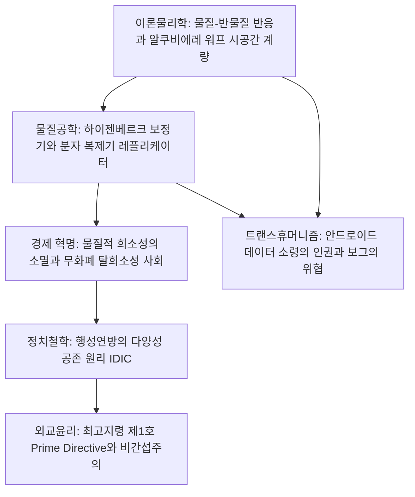

1966년 진 로든베리(Gene Roddenberry)가 창시한 《스타 트렉》(Star Trek)은 현대 과학과 철학에 가장 깊은 영감을 불어넣은 SF의 금자탑입니다. 아폴로 계획의 과학자들부터 이론물리학자 스티븐 호킹에 이르기까지 수많은 지성이 스타 트렉의 예지력에 찬사를 보냈습니다.

스타 트렉의 진정한 위대함은 **'이론물리학의 정합성을 추구한 하드 SF 메커니즘'**과 **'물질적 궁핍과 화폐 집착을 극복한 계몽주의적 유토피아 철학'**의 조화에 있습니다. 초광속 항행 기술인 '워프 드라이브(Warp Drive)'는 1994년 물리학자 미겔 알쿠비에레에 의해 일반상대성이론 아인슈타인 방정식의 엄밀해로 증명되었습니다. 또한 물질-에너지 변환 장치인 '분자 복제기(Replicator)'는 자원의 희소성을 완전히 제거하여 인류 역사상 유례없는 **탈희소성 사회(Post-Scarcity Economy)**를 실현했습니다.

## 1. 워프 드라이브의 이론물리학: 알쿠비에레 계량

특수상대성이론에 따르면 질량을 가진 물체는 국소 시공간에서 빛의 속도 $c$를 넘어 가속할 수 없습니다. 그러나 엔터프라이즈호는 우주선 자체를 가속하는 것이 아니라, 우주선 주변의 **'시공간 자체를 왜곡(Warp)'**시킴으로써 겉보기 초광속을 달성합니다.

1994년 멕시코 이론물리학자 미겔 알쿠비에레는 아인슈타인 중력장 방정식을 만족하는 해를 유도했습니다:

$$ds^2 = -c^2 dt^2 + \left(dx - v_s(t) f(r_s) dt\right)^2 + dy^2 + dz^2$$

워프 버블의 시공간 메커니즘:
1. **우주선 전방의 시공간을 급격히 수축**시켜 목적지와의 거리를 단축;
2. **우주선 후방의 시공간을 대칭적으로 팽창**시켜 앞으로 밀어냄;
3. **버블 내부의 우주선 영역은 완전히 평탄한 민코프스키 시공간 유지**.

우주선은 버블 내부에서 국소적으로 정지($v_{\text{local}} = 0$)해 있으므로 승무원은 관성력(G)이나 특수상대론적 시간 지연을 전혀 겪지 않습니다. 워프 구동에 필요한 에너지는 **중수소와 반중수소의 쌍소멸 반응($E = 2mc^2$)**에서 얻으며, 딜리튬 결정을 통해 제어됩니다.

## 2. 물질 전송과 분자 복제기: 하이젠베르크 보정기

양자역학의 하이젠베르크 불확정성 원리는 입자의 위치와 운동량을 동시에 정밀 측정할 수 없음을 규정합니다:

$$\Delta x \cdot \Delta p \ge \frac{\hbar}{2}$$

물질 전송 장치는 양자 수준에서 인체를 주사하여 에너지 빔으로 분해한 뒤 목적지에서 재결합합니다. 설정 전문가 마이클 오쿠다는 양자 결맞음 상실을 보정하는 **'하이젠베르크 보정기(Heisenberg Compensator)'**라는 가상의 기구를 도입했습니다.

분자 복제기(Replicator)는 이 전송 기술을 분자 배열 수준으로 단순화하여 민간에 보급한 장치입니다. 컴퓨터 메모리에 저장된 분자 매트릭스 데이터를 바탕으로 원료와 에너지를 결합해 음식, 의복, 정밀 도구를 몇 초 만에 합성합니다. 피카드 함장의 "얼 그레이 차, 뜨겁게"라는 말 한마디로 도자기 잔에 담긴 따뜻한 차가 즉석에서 물질화됩니다.

## 3. 탈희소성 경제학: 화폐와 계급의 소멸

고전 경제학은 '자원의 유한성과 인간 욕망의 무한성'이라는 희소성의 원리에 기초합니다. **그러나 무한한 반물질 에너지와 복제기의 결합은 물질적 희소성을 완전히 박멸했습니다.**
한계생산비용이 0이 됨으로써($MC \to 0$) 전통적 시장 가격 체계가 붕괴했습니다. 피카드 함장은 21세기 여성에게 다음과 같이 설명합니다:

> **"24세기에는 돈이 존재하지 않습니다. 부의 축적은 더 이상 삶의 원동력이 아닙니다. 우리는 자신을 향상시키고 인류 전체에 기여하기 위해 일합니다."**

물질적 생존 투쟁에서 해방된 인류의 동기는 매슬로 욕구단계설의 최상위인 **자아실현, 지적 탐구, 예술 창조, 사회적 봉사**로 이동했습니다.

## 4. 행성연방과 최고지령(Prime Directive)

행성연방(United Federation of Planets)은 벌컨의 철학인 **IDIC(무한한 다양성의 무한한 결합)**을 신조로 삼습니다. 그리고 스타플릿의 가장 신성한 헌법은 **최고지령 제1호(Prime Directive)**입니다:

> **"자력으로 워프 항행 기술을 획득하지 못한 미개 문명의 자연스러운 사회적, 기술적 발전에 스타플릿의 어떠한 개입도 엄격히 금지한다."**

이는 과거 지구 역사에서 강대국이 원주민 문명에 개입하여 사회를 붕괴시키고 자멸로 이끌었던 식민주의적 비극에 대한 뼈아픈 반성에서 비롯되었습니다.

## 5. 트랜스휴머니즘과 자아의 철학

TNG의 걸작 에피소드 《인간의 조건》(The Measure of a Man)에서는 안드로이드 **데이터 소령(Data)**의 인권을 다룹니다. 지능, 자의식, 의식을 지닌 존재를 스타플릿의 자산(기계)으로 규정하는 것은 연방 내에 노예 계급을 부활시키는 것과 같다는 피카드 함장의 변론을 통해 인공지능의 인격권이 확립됩니다. 반면 모든 개성을 강제 박탈하는 사이보그 집단 **보그(The Borg)**는 전체주의의 궁극적 디스토피아를 경고합니다.

《스타 트렉》은 과학기술이 인간성을 파괴하는 것이 아니라, 인류를 야만에서 벗어나게 하는 고귀한 나침반임을 증명하는 위대한 지적 유산입니다.

## 6. 아공간 역학과 워프 속도 제한, 그리고 DS9의 현실주의적 그늘

스타 트렉의 공학 체계에서 워프 필드는 '아공간(Subspace)'을 매개로 전파되며, 시공간 왜곡 강도는 '코크런(Cochranes)' 단위로 측정됩니다. TNG 에피소드 《자연의 힘》(Force of Nature)에서는 무분별한 고속 워프 항해가 아공간 피로를 유발해 시공간 균열을 초래한다는 사실이 밝혀지고, 행성연방은 '워프 5 제한속도'를 제정하여 환경 보전의 중요성을 선도적으로 제시했습니다.

또한 《딥 스페이스 나인》(DS9)에서는 도미니언과의 전면전 속에서 연방 유토피아의 이면이 적나라하게 해부됩니다. 시스코 사령관은 "천국 같은 지구에서 성인군자로 살기는 쉽지만, 여기 최전선은 다르다!"고 일갈하며 연방 수호를 위해 도덕적 타협을 감내합니다. 연방 헌장의 어둠 속에 숨겨진 비밀 첩보기관 '섹션 31(Section 31)'의 비합법적 작전과 생물학 무기 공작은 민주주의 국가의 이상과 안보 딜레마를 심도 있게 다룹니다.

## 7. 홀로덱의 계산물리학과 자아의 실존주의

엔터프라이즈호의 가상현실 시설인 **홀로덱(Holodeck)**은 포톤과 역장을 결합한 '하드 라이트(Hard Light)'와 분자 복제 기술의 하이브리드 결합체입니다. TNG에서 셜록 홈즈 프로그램의 AI인 모리아티 교수가 자의식을 각성하고 인권을 요구하는 사건을 통해, 스타 트렉은 강인공지능과 가상 생명체의 인격권에 관한 현대 실존주의 철학의 화두를 던졌습니다.
