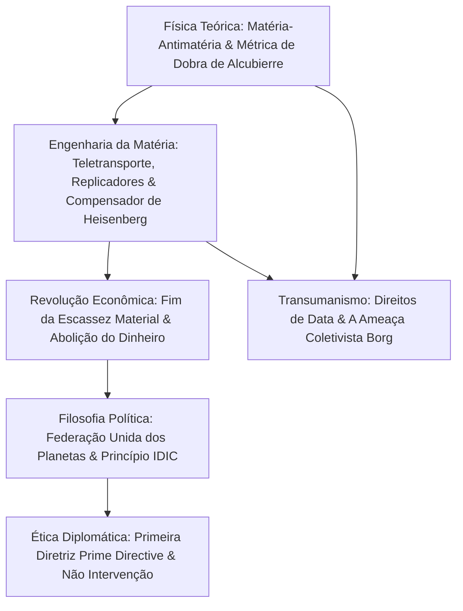

Criada em 1966 por Gene Roddenberry, *Star Trek* (Jornada nas Estrelas) representa o patamar supremo da ficção científica filosófica. Sua grandiosidade repousa na fusão entre **física teórica rigorosa** e um **humanismo iluminista**. A humanidade do século XXIV superou a pobreza, a guerra e a obsessão monetária por meio da energia de antimatéria e dos replicadores moleculares, edificando uma autêntica **sociedade pós-escassez (Post-Scarcity)**.

## 1. Física Teórica do Motor de Dobra (Warp Drive)

A Relatividade Restrita impede que qualquer objeto dotado de massa ($m_0 > 0$) supere localmente a velocidade da luz $c$:

$$E = \frac{m_0 c^2}{\sqrt{1 - \frac{v^2}{c^2}}} \xrightarrow{v \to c} \infty$$

A USS Enterprise contorna esse obstáculo **distorcendo a geometria do próprio espaço-tempo**. Em 1994, o físico Miguel Alcubierre derivou a solução matemática exata das equações de Einstein:

$$ds^2 = -c^2 dt^2 + \left(dx - v_s(t) f(r_s) dt\right)^2 + dy^2 + dz^2$$

- **O espaço frontal contrai-se** fortemente;
- **O espaço posterior expande-se** simetricamente;
- **O interior da bolha permanece plano em métrica de Minkowski (0g)**.

A tripulação não sofre forças g nem dilatação temporal relativística. A colossal energia provém da aniquilação de deutério e antideutério ($E = 2mc^2$), modulada por cristais de dilítio.

## 2. Teletransporte e Replicadores Moleculares

O princípio da incerteza de Heisenberg impede a medição simultânea perfeita de posição e momento:

$$\Delta x \cdot \Delta p \ge \frac{\hbar}{2}$$

O **compensador de Heisenberg** viabiliza o teletransporte quântico.
O **replicador molecular** democratiza essa tecnologia: a partir de energia e matérias-primas básicas, sintetiza refeições, roupas ou peças átomo por átomo. A ordem do Capitão Picard *"Chá Earl Grey, quente"* sintetiza esse salto civilizatório.

## 3. Economia Pós-Escassez e o Fim do Dinheiro

A economia clássica ancora-se na escassez. **Energia abundante e replicação molecular reduziram o custo marginal de produção a zero ($MC \to 0$).**
Como explica Picard em *Primeiro Contato*:

> **"O dinheiro não existe no século XXIV. A aquisição de riquezas não é mais o motor de nossas vidas. Trabalhamos para melhorar a nós mesmos e a toda a humanidade."**

A motivação humana migra para o topo da pirâmide de Maslow: autorrealização, exploração científica, criação estética e serviço solidário à comunidade.

## 4. A Primeira Diretriz (Prime Directive)

A Ordem Geral nº 1 estabelece a **não intervenção absoluta** no curso natural de civilizações que ainda não descobriram a propulsão de dobra por seus próprios méritos. Essa norma protege povos pré-dobra contra o choque colonial e a destruição precoce.

## 5. Consciência Artificial e Transumanismo

No clássico episódio *A Medida de um Homem* (*The Measure of a Man*), Picard defende em corte marcial a condição de pessoa do androide **Data**: qualquer ser dotado de inteligência, autoconsciência e vontade livre não pode ser degradado à condição de propriedade. Em oposição, os **Borgs** encarnam o pesadelo do totalitarismo cibernético que aniquila a individualidade.

*Star Trek* é um tributo imperecível à razão, à fraternidade cósmica e ao potencial luminoso da humanidade.
