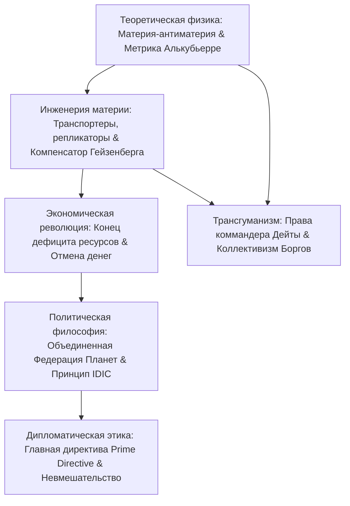

Созданный в 1966 году Джином Родденберри «Звездный путь» (*Star Trek*) — непревзойденный шедевр научно-философской мысли. В отличие от мрачных антиутопий, он предлагает оптимистический образ будущего: человечество побороло нищету, войны и алчность, построив **постдефицитную экономику (Post-Scarcity)** на базе энергии антиматерии и молекулярных репликаторов.

## 1. Теоретическая физика варп-двигателя

Специальная теория относительности запрещает телам с массой ($m_0 > 0$) разгоняться до скорости света $c$:

$$E = \frac{m_0 c^2}{\sqrt{1 - \frac{v^2}{c^2}}} \xrightarrow{v \to c} \infty$$

Звездолет «Энтерпрайз» преодолевает световой барьер не за счет разгона, а за счет **искривления самого четырехмерного пространства-времени**. В 1994 году физик Мигель Алькубьерре математически обосновал это:

$$ds^2 = -c^2 dt^2 + \left(dx - v_s(t) f(r_s) dt\right)^2 + dy^2 + dz^2$$

- **Пространство перед кораблем резко сжимается**;
- **Пространство позади корабля расширяется**;
- **Внутри варп-пузыря сохраняется плоское пространство Минковского (0g)**.

Экипаж не испытывает перегрузок и релятивистского замедления времени. Колоссальная энергия вырабатывается аннигиляцией дейтерия и антидейтерия ($E = 2mc^2$), стабилизируемой кристаллами дилития.

## 2. Квантовые транспортеры и молекулярные репликаторы

Принцип неопределенности Гейзенберга запрещает одновременное точное измерение координаты и импульса частицы:

$$\Delta x \cdot \Delta p \ge \frac{\hbar}{2}$$

Для преодоления квантовой декогеренции сценаристы ввели **компенсатор Гейзенберга**.
**Молекулярный репликатор** применяет эту технологию в быту: из сырья и энергии он за считанные секунды по цифровому коду синтезирует блюда, одежду и инструменты. Знаменитая фраза капитана Пикара *«Чай, Эрл Грей, горячий»* символизирует технологическую победу над голодом.

## 3. Постдефицитная экономика и исчезновение денег

Классическая экономика построена на нехватке ресурсов. **Бесконечная энергия и репликаторы свели предельную стоимость производства к нулю ($MC \to 0$).**
Капитан Пикар формулирует это так:

> **«В XXIV веке денег не существует. Накопление богатства больше не является смыслом жизни. Мы трудимся ради самосовершенствования и блага всего человечества».**

Человеческая мотивация переместилась на вершину пирамиды Маслоу: познание тайн космоса, искусство, наука и служение обществу.

## 4. Главная директива (Prime Directive)

Директива №1 категорически запрещает вмешательство в развитие цивилизаций, еще не открывших варп-технологию самостоятельно. Этот абсолютный закон защищает молодые культуры от колониального распада и самоистребления.

## 5. Трансгуманизм и права искусственного интеллекта

В серии «Мера человека» Пикар отстаивает в суде права андроида **Дейты**: мыслящее существо, обладающее самосознанием, не может быть чьей-то собственностью. В противоположность этому **коллектив Боргов** предостерегает против тоталитарного уничтожения личности.

«Звездный путь» остается величайшим гимном разуму, свободе и безграничному величию гуманизма среди звезд.
