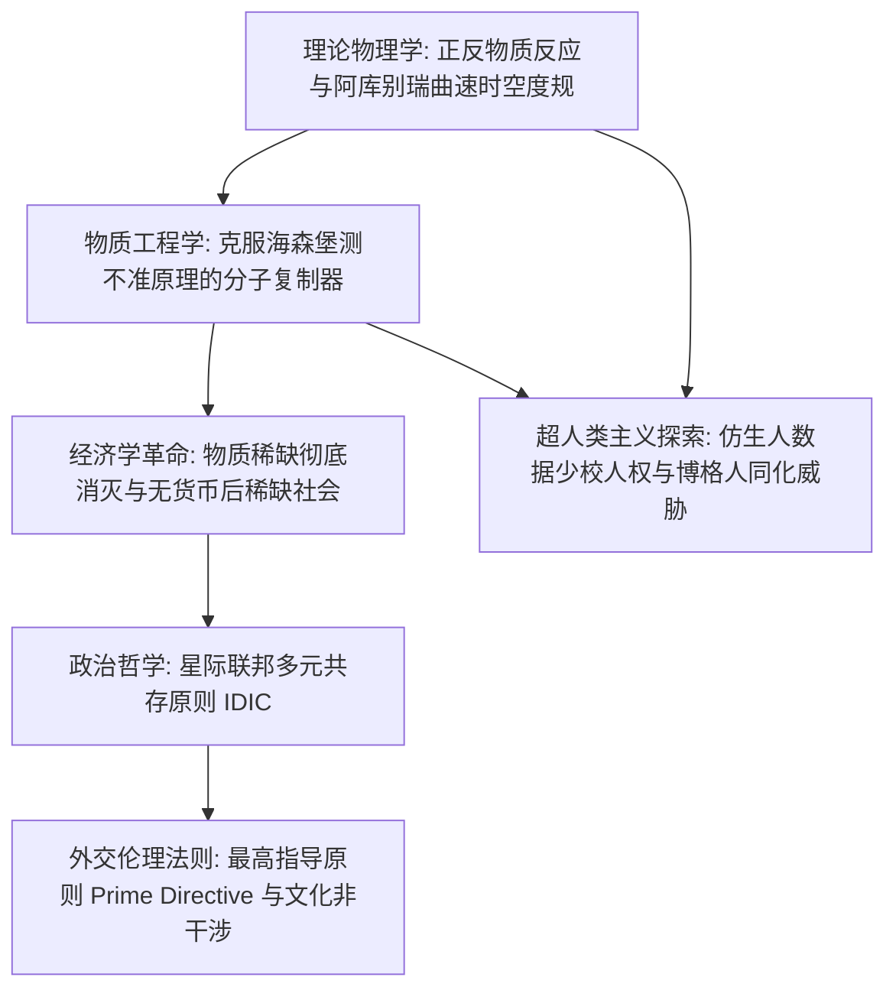

自1966年由吉恩·罗登贝瑞（Gene Roddenberry）开创以来，《星际迷航》（*Star Trek*）便以其博大精深的科学严谨性与崇高的人文主义关怀，成为世界科幻史上的不朽丰碑。它不仅启迪了从移动通讯到核聚变的数代科学家，更向全人类展现了一幅震撼人心的理性未来图景：在彻底消除贫困、饥荒、战争与对金钱的病态执念后，人类文明如何在浩瀚星海中建立公正、包容与繁荣。

与其他太空歌剧不同，《星际迷航》拥有极高水准的理论物理考据与独树一帜的社会制度设计。其核心推进系统“曲速引擎（Warp Drive）”在1994年由理论物理学家米格尔·阿库别瑞（Miguel Alcubierre）证明为广义相对论爱因斯坦场方程下的数学严格解。而将能量直接合成为任何宏观实物的“分子复制器（Replicator）”，彻底摧毁了古典经济学关于“资源稀缺”的基本公理，催生出一个无需货币的**后稀缺社会（Post-Scarcity Economy）**。

## 1. 曲速引擎的理论物理学：阿库别瑞时空度规

在狭义相对论中，具有静止质量 $m_0 > 0$ 的物体无法在局部空间中加速至或超越光速 $c$。然而，《星际迷航》中的进取号并非通过自身加速超光速，而是通过**扭曲星舰周围的时空结构本身**，实现视超光速航行。

1994年，理论物理学家米格尔·阿库别瑞提出了满足爱因斯坦场方程的著名度规：

$$ds^2 = -c^2 dt^2 + \left(dx - v_s(t) f(r_s) dt\right)^2 + dy^2 + dz^2$$

在曲速泡（Warp Bubble）的几何结构中：
1. **飞船前方空间剧烈压缩收缩**，拉近目标距离；
2. **飞船后方空间对称膨胀拉伸**，将气泡推向前进；
3. **曲速泡内部保持绝对平坦的闵氏时空**。

飞船在气泡内部局部相对静止（$v_{\text{local}} = 0$），因此乘员完全感受不到加速度过载（0G），亦不会产生狭义相对论的时钟变慢时间膨胀效应。曲速推进所需的庞大能量，来自曲速核心内**氘与反氘的对消灭反应（$E = 2mc^2$）**，并通过虚构的多维共振矿物“二锂晶体（Dilithium）”进行磁等离子体阻尼控制。

## 2. 物质传输与分子复制器：突破海森堡测不准原理

量子力学中的海森堡不确定性原理限制了对粒子位置和动量的精确同时测量：

$$\Delta x \cdot \Delta p \ge \frac{\hbar}{2}$$

为了在量子层面上分解人体并在行星表面重组，设定专家迈克尔·奥库达引入了著名的**“海森堡补偿器（Heisenberg Compensator）”**，通过实时量子退相干校正保证传输精确性。

分子复制器则是传输技术的民用降维版本：
- 复制器运行在分子与原子排列级别（无需保留意识灵魂层面的亚原子量子自旋）。
- 依据计算机内存中的数字矩阵代码，直接利用能量与散装碳水化合物原料，在数秒内以原子级精度打印出任何食品、衣物、精密机械与医疗试剂。
- 皮卡德舰长只需一句“热伯爵红茶（Tea, Earl Grey, hot）”，带陶瓷茶杯的香浓茶水便瞬间物质化成真。

## 3. 后稀缺经济学：货币与阶级的彻底消亡

古典经济学的核心假定是“欲望无限而资源稀缺”。**而近乎无限的正反物质能源与万能复制器的结合，彻底终结了物质稀缺性**。
边际生产成本归零（$MC \to 0$），导致传统商品市场价格体系瓦解。在《星际迷航：第一类接触》中，皮卡德舰长向21世纪的人类解释道：

> **“24世纪里金钱已经不存在了。财富的积累不再是我们生活的驱动力。我们工作是为了提升自我，并造福全人类。”**

在没有货币、没有生存压迫的星际联邦中，人类的进取动机跃迁至马斯洛需求金字塔的最顶端：**自我实现、科学求知、艺术创造与社会荣誉**。当然，对于无法复制的绝对独特空间（如皮卡德家族在法国的古老葡萄园）与稀有矿物（如金压拉提姆），仍存在天然的位置与真实性溢价。

## 4. 星际联邦与最高指导原则（Prime Directive）

星际联邦的哲学核心建立在瓦肯人的**IDIC（Infinite Diversity in Infinite Combinations，万物包容的无限多样性）**之上。而在星际舰队所有法令中，至高无上、高于任何军官生命的绝对天条是**最高指导原则（星舰第1号通令 / Prime Directive）**：

> **“严禁星际舰队任何舰船与人员对任何尚未自力掌握曲速航行技术的文明进行任何形式的技术、文化或社会干涉。”**

这一冷峻的非干涉原则，源于人类地球历史上先进文明对原始土著进行掠夺、文化污染与毁灭性殖民的历史血泪教训。即使面对即将遭遇行星火山爆发或彗星撞击而灭绝的原始外星文明，联邦军官亦必须克制科技傲慢，恪守文明演化的自然规律。最高指导原则是文明自省的终极契约。

## 5. 超人类主义哲学：仿生人数据少校的法庭答辩

在TNG名篇《人类的度量》（*The Measure of a Man*）中，星际舰队试图将数据少校（Data）拆解研究以量产仿生人劳动力。皮卡德舰长在法庭上为数据争取独立人格权，直击哲学的永恒拷问：
当一个人造物同时具备智力、自我意识与自主意识时，将其定性为“财产”无异于在星际联邦内复辟残酷的奴隶制度。数据的胜利，确立了人工智能拥有生命尊严的宪法法理。
相反，**博格人（The Borg）**代表了强迫同化、抹杀个性与自由意志的极端极权机械蜂群，成为多元文化与个人自由的终极警钟。

《星际迷航》是人类文明写给未来宇宙的一封最宏伟的理性情书：科学技术不是自毁的毒药，而是人性超越野蛮、驶向星海的崇高翅膀。

## 6. 亚空间力学、曲速环境污染与九号深空站（DS9）的现实主义反思

在《星际迷航》的科技体系中，曲速场在“亚空间（Subspace）”中传播。曲速强度以人类首位曲速航行者命名的“科克伦（Cochranes）”为单位。在TNG名篇《自然之力》（*Force of Nature*）中，科学界发现频繁的高速曲速航行会导致局部亚空间疲劳并引发时空断裂，星际联邦为此颁布了“曲速5级限速令”，并研发了对环境零破坏的可变几何机翼机舱（如航海家号），展示了极具前瞻性的生态可持续发展思想。

而在《深空九号》（DS9）中，联邦乌托邦在自治领（Dominion）全面战争的惨烈冲击下展现出复杂阴影。本杰明·西斯科上校直言：“在天堂般的地球上当圣人轻而易举，但在边疆现实完全不同！”为了挽救联邦，西斯科不得不参与伪造情报引诱罗慕伦参战。而联邦宪章暗部诞生的极秘自律谍报机关“31区（Section 31）”，甚至研制基因病毒企图灭绝敌方领袖。这种理想主义与冷酷现实地缘政治的张力，赋予了《星际迷航》极其深沉的制度反思与哲学厚度。

## 7. 全息甲板的物理实现与意识存在主义

企业号上的全息甲板（Holodeck）结合了**“硬光全息（Hard Light）”**与实时分子复制技术。微型力场与光子网格重叠赋予虚拟物体可触摸的实体硬度，同时瞬间复制真实的食物。在莫里亚蒂教授（Moriarty）程序自主觉醒自我意识并索要人权的事件中，《星际迷航》借由笛卡尔“我思故我在”的命题，深刻探讨了强人工智能时代虚拟生命的人格权。

## 8. 瓦肯纯粹逻辑主义与功利主义伦理对话

《星际迷航》最深层的哲学对话体现在柯克舰长的人性热情与斯波克副官的冷峻逻辑之间。太古瓦肯人曾因情绪失控而濒临核毁灭，哲学家苏拉克（Surak）创立了绝对逻辑与非暴力和平主义。在《可汗之怒》中斯波克牺牲前留下至理名言：“多数人的需求重于少数人的需求，或者重于一个人的需求（The needs of the many outweigh the needs of the few）。”而在《石破天惊》中，柯克不惜自毁企业号拯救挚友灵魂，并以“有时一个人的需求重于多数人的需求”有力反驳。这种对崇高个体生命的敬畏，正是《星际迷航》人文精神的不灭精髓。
