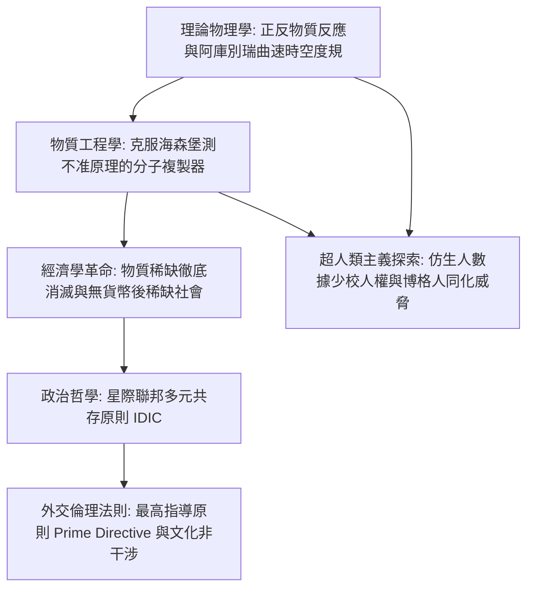

自1966年由吉恩·羅登貝瑞（Gene Roddenberry）開創以來，《星際爭霸戰》（*Star Trek*）便以其博大精深的科學嚴謹性與崇高的人文主義關懷，成為世界科幻史上的不朽豐碑。它不僅啟迪了從行動通訊到核融合的數代科學家，更向全人類展現了一幅震撼人心的理性未來圖景：在徹底消除貧困、飢荒、戰爭與對金錢的病態執念後，人類文明如何在浩瀚星海中建立公正、包容與繁榮。

與其他太空歌劇不同，《星際爭霸戰》擁有極高水準的理論物理考據與獨樹一幟的社會制度設計。其核心推進系統「曲速引擎（Warp Drive）」在1994年由理論物理學家米格爾·阿庫別瑞（Miguel Alcubierre）證明為廣義相對論愛因斯坦場方程式下的數學嚴格解。而將能量直接合成為任何宏觀實物的「分子複製器（Replicator）」，徹底摧毀了古典經濟學關於「資源稀缺」的基本公理，催生出一個無需貨幣的**後稀缺社會（Post-Scarcity Economy）**。

## 1. 曲速引擎的理論物理學：阿庫別瑞時空度規

在狹義相對論中，具有靜止質量 $m_0 > 0$ 的物體無法在局部空間中加速至或超越光速 $c$。然而，《星際爭霸戰》中的企業號並非通過自身加速超光速，而是通過**扭曲星艦周圍的時空結構本身**，實現視超光速航行。

1994年，理論物理學家米格爾·阿庫別瑞提出了滿足愛因斯坦場方程式的著名度規：

$$ds^2 = -c^2 dt^2 + \left(dx - v_s(t) f(r_s) dt\right)^2 + dy^2 + dz^2$$

在曲速泡（Warp Bubble）的幾何結構中：
1. **飛船前方空間劇烈壓縮收縮**，拉近目標距離；
2. **飛船後方空間對稱膨脹拉伸**，將氣泡推向前進；
3. **曲速泡內部保持絕對平坦的閔氏時空**。

飛船在氣泡內部局部相對靜止（$v_{\text{local}} = 0$），因此乘員完全感受不到加速度過載（0G），亦不會產生狹義相對論的時鐘變慢時間膨脹效應。曲速推進所需的龐大能量，來自曲速核心內**氘與反氘的對消滅反應（$E = 2mc^2$）**，並通過虛構的多維共振礦物「二鋰晶體（Dilithium）」進行磁等離子體阻尼控制。

## 2. 物質傳輸與分子複製器：突破海森堡測不准原理

量子力學中的海森堡不確定性原理限制了對粒子位置和動量的精確同時測量：

$$\Delta x \cdot \Delta p \ge \frac{\hbar}{2}$$

為了在量子層面上分解人體並在行星表面重組，設定專家邁克爾·奧庫達引入了著名的**「海森堡補償器（Heisenberg Compensator）」**，通過即時量子退相干校正保證傳輸精確性。

分子複製器則是傳輸技術的民用降維版本：
- 複製器運行在分子與原子排列級別（無需保留意識靈魂層面的亞原子量子自旋）。
- 依據計算機內存中的數位矩陣代碼，直接利用能量與散裝碳水化合物原料，在數秒內以原子級精度列印出任何食品、衣物、精密機械與醫療試劑。
- 畢凱艦長只需一句「熱伯爵紅茶（Tea, Earl Grey, hot）」，帶陶瓷茶杯的香濃茶水便瞬間物質化成真。

## 3. 後稀缺經濟學：貨幣與階級的徹底消亡

古典經濟學的核心假定是「欲望無限而資源稀缺」。**而近乎無限的正反物質能源與萬能複製器的結合，徹底終結了物質稀缺性**。
邊際生產成本歸零（$MC \to 0$），導致傳統商品市場價格體系瓦解。在《星際爭霸戰：第一類接觸》中，畢凱艦長向21世紀的人類解釋道：

> **「24世紀裡金錢已經不存在了。財富的積累不再是我們生活的驅動力。我們工作是為了提升自我，並造福全人類。」**

在沒有貨幣、沒有生存壓迫的星際聯邦中，人類的進取動機躍遷至馬斯洛需求金字塔的最頂端：**自我實現、科學求知、藝術創造與社會榮譽**。當然，對於無法複製的絕對獨特空間（如畢凱家族在法國的古老葡萄園）與稀有礦物（如金壓拉提姆），仍存在天然的位置與真實性溢價。

## 4. 星際聯邦與最高指導原則（Prime Directive）

星際聯邦的哲學核心建立在瓦肯人的**IDIC（Infinite Diversity in Infinite Combinations，萬物包容的無限多樣性）**之上。而在星際艦隊所有法令中，至高無上、高於任何軍官生命的絕對天條是**最高指導原則（星艦第1號通令 / Prime Directive）**：

> **「嚴禁星際艦隊任何艦船與人員對任何尚未自力掌握曲速航行技術的文明進行任何形式的技術、文化或社會干涉。」**

這一冷峻的非干涉原則，源於人類地球歷史上先進文明對原始土著進行掠奪、文化污染與毀滅性殖民的歷史血淚教訓。即使面對即將遭遇行星火山爆發或彗星撞擊而滅絕的原始外星文明，聯邦軍官亦必須克制科技傲慢，恪守文明演化的自然規律。最高指導原則是文明自省的終極契約。

## 5. 超人類主義哲學：仿生人數據少校的法庭答辯

在TNG名篇《人類的度量》（*The Measure of a Man*）中，星際艦隊試圖將數據少校（Data）拆解研究以量產仿生人勞動力。畢凱艦長在法庭上為數據爭取獨立人格權，直擊哲學的永恆拷問：
當一個人造物同時具備智力、自我意識與自主意識時，將其定性為「財產」無異於在星際聯邦內復辟殘酷的奴隸制度。數據的勝利，確立了人工智慧擁有生命尊嚴的憲法法理。
相反，**博格人（The Borg）**代表了強迫同化、抹殺個性與自由意志的極端極權機械蜂群，成為多元文化與個人自由的終極警鐘。

《星際爭霸戰》是人類文明寫給未來宇宙的一封最宏偉的理性情書：科學技術不是自毀的毒藥，而是人性超越野蠻、駛向星海的崇高翅膀。

## 6. 亞空間力學、曲速環境污染與九號深空站（DS9）的現實主義反思

在《星際爭霸戰》的科技體系中，曲速場在「亞空間（Subspace）」中傳播。曲速強度以人類首位曲速航行者命名的「科克倫（Cochranes）」為單位。在TNG名篇《自然之力》（*Force of Nature*）中，科學界發現頻繁的高速曲速航行會導致局部亞空間疲勞並引發時空斷裂，星際聯邦為此頒布了「曲速5級限速令」，並研發了對環境零破壞的可變幾何機翼機艙（如航海家號），展示了極具前瞻性的生態可持續發展思想。

而在《銀河前哨》（DS9）中，聯邦烏托邦在自治領（Dominion）全面戰爭的慘烈衝擊下展現出複雜陰影。本傑明·西斯科上校直言：「在天堂般的地球上當聖人輕而易舉，但在邊疆現實完全不同！」為了挽救聯邦，西斯科不得不參與偽造情報引誘羅慕倫參戰。而聯邦憲章暗部誕生的極秘自律諜報機關「31區（Section 31）」，甚至研製基因病毒企圖滅絕敵方領袖。這種理想主義與冷酷現實地緣政治的張力，賦予了《星際爭霸戰》極其深沉的制度反思與哲學厚度。

## 7. 全像甲板的物理實現與意識存在主義

企業號上的全像甲板（Holodeck）結合了**「硬光全像（Hard Light）」**與即時分子複製技術。微型力場與光子網格重疊賦予虛擬物體可觸摸的實體硬度，同時瞬間複製真實的食物。在莫里亞蒂教授（Moriarty）程式自主覺醒自我意識並索要人權的事件中，《星際爭霸戰》藉由笛卡兒「我思故我在」的命題，深刻探討了強人工智慧時代虛擬生命的人格權。

## 8. 瓦肯純粹邏輯主義與功利主義倫理對話

《星際爭霸戰》最深層的哲學對話體現在柯克艦長的人性熱情與史巴克副官的冷峻邏輯之間。太古瓦肯人曾因情緒失控而瀕臨核毀滅，哲學家蘇拉克（Surak）創立了絕對邏輯與非暴力和平主義。在《星戰大怒吼》中史巴克犧牲前留下至理名言：「多數人的需求重於少數人的需求，或者重於一個人的需求（The needs of the many outweigh the needs of the few）。」而在《石破天驚》中，柯克不惜自毀企業號拯救摯友靈魂，並以「有時一個人的需求重於多數人的需求」有力反駁。這種對崇高個體生命的敬畏，正是《星際爭霸戰》人文精神的不滅精髓。
