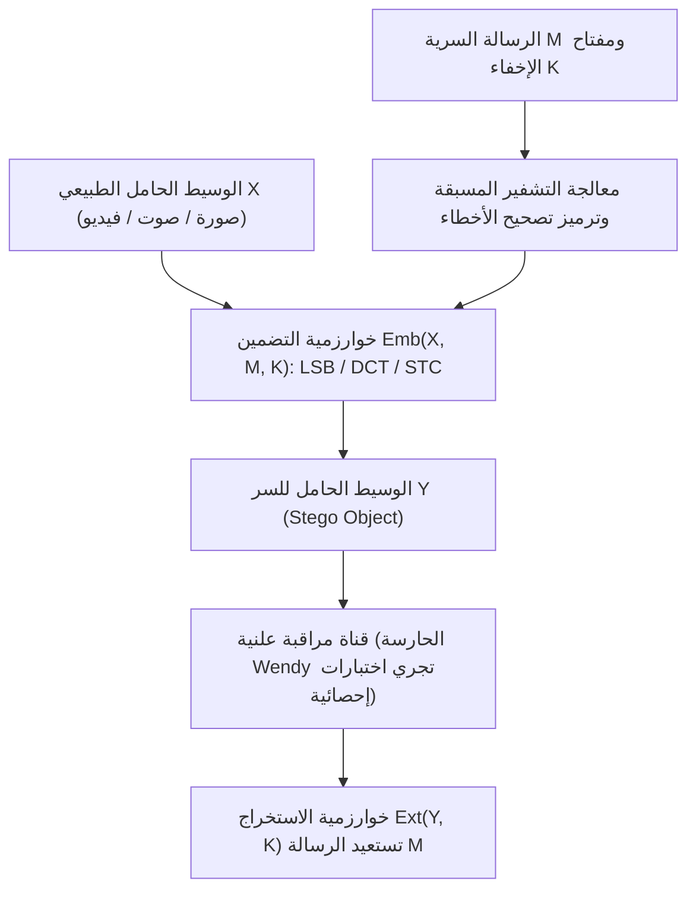
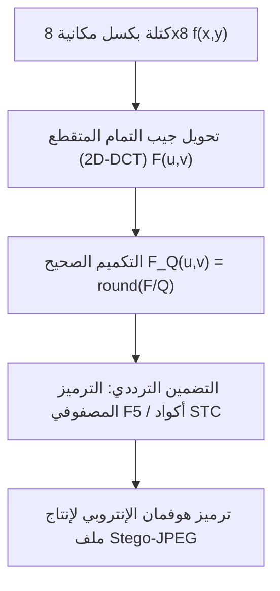

## 1. التعمية مقابل إخفاء المعلومات: هل نخفي «المحتوى» أم نخفي «الوجود»؟

في هندسة أمن المعلومات، يسعى كل من <strong>علم التعمية (Cryptography)</strong> و<strong>علم إخفاء المعلومات (Steganography)</strong> إلى تحقيق هدفين متعامدين تماماً. يقوم علم التعمية بتحويل النص الصريح $M$ باستخدام مفتاح سري $K$ إلى نص مُعمّى غير مقروء $C = E_K(M)$. عندما يعترض المهاجم النص $C$، فإنه يعجز عن فهم معناه الدلالي، غير أن <strong>حقيقة وجود اتصال سري مُشفّر بين الطرفين تكون مكشوفة تماماً للعيان</strong>. وفي بيئات الرقابة الصارمة أو شبكات المراقبة الشاملة، فإن مجرد إرسال تدفق بيانات ذي إنتروبيا عالية (مثل رسائل PGP أو حزم TLS غير المألوفة) يكفي لإطلاق الإنذار وقطع الاتصال أو إثارة الشبهات الجنائية.

على النقيض من ذلك، يهدف <strong>إخفاء المعلومات (Steganography)</strong> — المشتق من اليونانية القديمة *steganos* بمعنى «مُغطّى أو محجوب» و*graphein* بمعنى «يكتب» — إلى <strong>طمس أي أثر يدل على وجود الرسالة السرية من الأساس</strong>. فمنذ القصص التي رواها المؤرخ الإغريقي هيرودوت (حلق شعر رأس رسول ووشم الرسالة على فروة رأسه ثم انتظار نمو الشعر، أو النقش على الخشب تحت طبقة الشمع في ألواح الكتابة)، ومروراً بكتاب يوهانس تريثيميوس *Steganographia* عام 1499، وصولاً إلى التقنيات الرقمية المعاصرة التي تدسّ البيانات داخل صور فوتوغرافية عادية أو ملفات صوتية، يقوم هذا العلم بتضمين الرسالة السرية $M$ داخل <strong>وعاء حامل بريء المظهر (Cover Object) $X$</strong> لإنتاج <strong>الوعاء الحامل للسر (Stego Object) $Y$</strong>.

في عام 1983، صاغ غوستافوس سيمونز (Gustavus J. Simmons) <strong>«معضلة السجينين (The Prisoners’ Problem)»</strong> التي أرست النموذج الرياضي القياسي لإخفاء المعلومات: يحاول السجينان أليس وبوب التخطيط للهروب، لكن جميع الرسائل المتبادلة بينهما تخضع لتفتيش الحارسة ويندي (Warden). فإذا لمحت ويندي أي نص مشفر أو أي شذوذ إحصائي في الصور المتبادلة، ستصادر الرسالة فوراً وتودعهما الحبس الانفرادي. لذا يتعين على أليس إخفاء البتات السرية داخل صورة طبيعية $Y$ بحيث تعجز ويندي عن التمييز إحصائياً بين التوزيع الاحتمالي للصور الطبيعية $P_X$ والتوزيع الاحتمالي للصور الحاملة للسر $P_Y$.

وفي عام 1998، قدّم كريستيان كاشين (Christian Cachin) التعريف الرياضي الصارم لأمان إخفاء المعلومات باستخدام <strong>تباعد كولباك-لايبلر (Kullback-Leibler Divergence / الإنتروبيا النسبية)</strong>. إذا كان $P_X$ هو التوزيع الاحتمالي للأوعية الطبيعية على الفضاء $\mathcal{X}$ و$P_Y$ هو توزيع الأوعية الحاملة للسر، فإن النظام يكون آمناً بمقدار $\varepsilon$ (وآمناً تماماً عند $\varepsilon = 0$) إذا حقق:

$$D_{\text{KL}}(P_X \,\|\, P_Y) = \sum_{x \in \mathcal{X}} P_X(x) \log_2 \frac{P_X(x)}{P_Y(x)} \le \varepsilon$$

وبموجب <strong>متباينة معالجة البيانات (Data-Processing Inequality)</strong> في نظرية المعلومات، مهما بلغت دقة الاختبار الإحصائي أو الشبكة العصبية العميقة التي تستخدمها الحارسة ويندي، فإن احتمال الإنذار الكاذب $\alpha$ (خطأ النوع الأول) واحتمال الإخفاق في الكشف $\beta$ (خطأ النوع الثاني) مقيدان بالإنتروبيا النسبية الثنائية:

$$d(1-\alpha, \beta) = (1-\alpha)\log_2 \frac{1-\alpha}{\beta} + \alpha \log_2 \frac{\alpha}{1-\beta} \le D_{\text{KL}}(P_X \,\|\, P_Y) \le \varepsilon$$

وعندما تقترب $\varepsilon \to 0$، فإن $\alpha + \beta \to 1$، مما يعني أن قدرة الحارسة ويندي على الكشف تتلاشى لتصبح مساوية لرمي قطعة نقد عشوائية.

| بُعد المقارنة | علم التعمية (Cryptography) | إخفاء المعلومات (Steganography) | العلامات المائية الرقمية (Watermarking) |
|---|---|---|---|
| <strong>الهدف الأساسي</strong> | إخفاء <strong>المحتوى الدلالي</strong> للرسالة | إخفاء <strong>وجود الاتصال السري ذاته</strong> | إثبات <strong>حقوق الملكية الفكرية وسلامة الوسيط</strong> |
| <strong>ظهور السر</strong> | مرئي للعلن (النص المشفر عالي الإنتروبيا واضح) | مخفي بصرامة (مموه كملف طبيعي عادي) | مرئي أو غير مرئي (الأولوية لاستحالة الإزالة) |
| <strong>نموذج المهاجم</strong> | تحليل الشفرات (فك التشفير بدون مفتاح) | <strong>تحليل إخفاء المعلومات (Steganalysis)</strong>: كشف $P_X \ne P_Y$ | <strong>هجمات الإزالة</strong>: الضغط، القص، التشويش، التدوير |
| <strong>المعيار الرئيسي</strong> | عدم القابلية للتمييز حسابياً (IND-CPA) | عدم القابلية للكشف إحصائياً ($D_{\text{KL}} \to 0$) والسعة | <strong>المتانة والصلابة (Robustness)</strong> ضد تشويه الإشارة |

---

## 2. المجال المكاني: استبدال البت الأقل أهمية (LSB) وهجوم مربع كاي ($\chi^2$)

في الصور الرقمية غير المضغوطة أو المضغوطة بدون فقدان (مثل BMP بعمق 24 بت، أو PNG، أو ملفات الصوت WAV PCM بعمق 16 بت)، تُعد طريقة <strong>استبدال البت الأقل أهمية (Least Significant Bit Replacement, LSB Replacement)</strong> الأسلوب الكلاسيكي الأشهر في المجال المكاني. في صورة تدرج رمادي بعمق 8 بت، يُمثَّل سطوع كل بكسل $x_i \in \{0, 1, \dots, 255\}$ ثنائياً على النحو:

$$x_i = \sum_{b=0}^{7} a_{i,b} \, 2^b = 128 a_{i,7} + 64 a_{i,6} + \dots + 2 a_{i,1} + a_{i,0}$$

وبينما يغيّر البت الأكثر أهمية (MSB, $a_{i,7}$) شدة الإضاءة بمقدار $128$ درجة، فإن البت الأقل أهمية (LSB, $a_{i,0} = x_i \bmod 2$) لا يغيّر القيمة إلا بمقدار $\pm 1$. فإذا استبدلنا البت الأخير مباشرة ببت سري مشفر وموزع بانتظام $m_i \in \{0, 1\}$:

$$y_i = 2 \left\lfloor \frac{x_i}{2} \right\rfloor + m_i$$

فإنه عند التضمين الكامل ($1\,\text{bit per pixel, bpp}$)، تظل نصف البكسلات دون تغيير ويتغير النصف الآخر بمقدار $\pm 1$ فقط. وبحساب متوسط مربع الخطأ (MSE) ونسبة ذروة الإشارة إلى الضجيج (PSNR):

$$\text{MSE} = \frac{1}{N}\sum_{i=1}^{N} (x_i - y_i)^2 = 0.5, \qquad \text{PSNR} = 10 \log_{10}\!\left(\frac{255^2}{\text{MSE}}\right) \approx 51.14\,\text{dB}$$

لا يستطيع الجهاز البصري البشري (HVS) إدراك أي فرق عندما يتجاوز $\text{PSNR}$ عتبة $40\,\text{dB}$. ولكن <strong>عدم الرؤية بالعين المجردة لا يعني أبداً الأمان الإحصائي!</strong>

ففي عام 1999، قدّم أندرياس فيستفيلد وأندرياس بفيتزمان <strong>هجوم مربع كاي ($\chi^2$ Steganalysis Attack)</strong> الذي يفضح استبدال LSB على الفور. يكمن الخلل الرياضي في <strong>عدم التماثل البنيوي لعملية استبدال LSB</strong>: فالقيمة الزوجية $2k$ لا يمكن أن تتحول إلا إلى $2k$ أو $2k+1$، والقيمة الفردية $2k+1$ لا تتحول إلا إلى $2k$ أو $2k+1$، ولا يحدث أي انتقال بين $2k-1$ و$2k$! وبالتالي تشكّل الأزواج $\{2k, 2k+1\}$ ما يُعرف بـ<strong>«أزواج القيم المغلقة (Pairs of Values, PoVs)»</strong>. وبما أن البتات المشفرة متساوية الاحتمال ($P(0)=P(1)=0.5$)، فإن تكرارات المدرج التكراري $h_Y(2k)$ و$h_Y(2k+1)$ في الصورة الحاملة للسر تتساوى قسراً عند متوسطهما الحسابي:

$$\mathbb{E}[h_Y(2k)] = \mathbb{E}[h_Y(2k+1)] = \frac{h_X(2k) + h_X(2k+1)}{2} = \bar{h}_k$$

وعند حساب إحصائية مربع كاي لبيرسون عبر الأزواج الـ 128:

$$\chi^2 = \sum_{k=0}^{127} \frac{\bigl(h_Y(2k) - \bar{h}_k\bigr)^2}{\bar{h}_k}$$

تُظهر الصورة الطبيعية قيمة $\chi^2$ مرتفعة ($p \approx 0$)، بينما تُظهر صورة استبدال LSB مدرجاً تكرارياً ذا درجات زوجية متطابقة ($\chi^2 \to 0, \; p \to 1$). كما طور فريق جيسيكا فريدريش <strong>تحليل RS (Regular-Singular)</strong> القادر على كشف معدلات تضمين منخفضة تصل إلى $0.02\,\text{bpp}$. ولتجاوز هذا الخلل، تضيف طريقة <strong>مطابقة البت الأقل أهمية (LSB Matching / $\pm 1$ Embedding)</strong> أو تطرح $1$ عشوائياً عندما يكون $m_i \ne \text{LSB}(x_i)$.

---

## 3. مجال الترددات والترميز المصفوفي: تحويل JPEG DCT وخوارزمية F5 وأكواد STC

في تطبيقات الإنترنت الواقعية، ينهار التضمين المكاني أمام <strong>الضغط مع فقدان البيانات (Lossy Compression)</strong>؛ إذ تُعاد صياغة الصور المرسلة عبر منصات التواصل الاجتماعي إلى تنسيق <strong>JPEG</strong>، مما يمحو بتات LSB المكانية. لذلك تعمل تقنيات إخفاء المعلومات الحديثة مباشرة في <strong>مجال التحويل الترددي (Transform Domain)</strong>.

يقسم معيار JPEG الصورة (في فضاء $\text{YCbCr}$) إلى كتل بحجم $8 \times 8$ بكسل $f(x,y)$، ويطبق <strong>تحويل جيب التمام المتقطع ثنائي الأبعاد (2D-DCT)</strong> لإنتاج 64 معاملاً ترددياً $F(u,v)$، ثم يقسمها على مصفوفة التكميم $Q(u,v)$ مع التقريب إلى أعداد صحيحة $F_Q(u,v)$:

$$F(u,v) = \frac{1}{4} C(u) C(v) \sum_{x=0}^{7} \sum_{y=0}^{7} f(x,y) \cos\!\left(\frac{(2x+1)u\pi}{16}\right) \cos\!\left(\frac{(2y+1)v\pi}{16}\right), \qquad F_Q(u,v) = \text{round}\!\left(\frac{F(u,v)}{Q(u,v)}\right)$$

وفي عام 2001، أحدث أندرياس فيستفيلد ثورة في إخفاء معلومات JPEG عبر <strong>خوارزمية F5</strong> التي قدمت ابتكارين جوهريين:
1. <strong>إنقاص القيمة المطلقة</strong>: بدلاً من تبديل LSB لمعاملات DCT (كما في JSteg)، تقوم F5 دائماً بإنقاص القيمة المطلقة للمعامل غير الصفري بمقدار 1 باتجاه الصفر، محافظةً على شكل توزيع لابلاس الطبيعي للمدرج التكراري.
2. <strong>الترميز المصفوفي (Matrix Encoding عبر أكواد هامينغ)</strong>: لتضمين $k$ بتات سرية $\mathbf{m} \in \{0,1\}^k$ في $n = 2^k - 1$ معاملاً غير صفري $\mathbf{x} \in \{0,1\}^n$، تُستخدم مصفوفة فحص التكافؤ $\mathbf{H} \in \{0,1\}^{k \times (2^k-1)}$ لكود هامينغ الثنائي. ويشير المتلازم $\mathbf{s} = \mathbf{m} \oplus \mathbf{H}\mathbf{x}$ مباشرة إلى فهرس <strong>المعامل الوحيد $x_j$ الذي يحتاج إلى تعديل</strong> لتحقيق $\mathbf{H}\mathbf{y} = \mathbf{m}$! وبذلك ترتفع <strong>كفاءة التضمين (Embedding Efficiency)</strong> إلى:

$$e(k) = \frac{k}{1 - 2^{-k}} = \frac{k \cdot 2^k}{2^k - 1}\,\text{bits per modification}$$

وتدمج الخوارزميات التكيفية الحديثة (<strong>WOW, S-UNIWARD, J-UNIWARD, HILL</strong>) دوال تكلفة التشويه المحلية $\rho_i$ مع <strong>أكواد الشبكة المتلازمة (Syndrome-Trellis Codes, STC)</strong> وخوارزمية فيتربي لحصر جميع التعديلات في المناطق ذات النسيج البصري المعقد (أوراق الأشجار، تموجات المياه) حيث تعجز الشبكات العصبية (مثل SRNet) عن التنبؤ الدقيق.

---

## 4. قانون الجذر التربيعي لسعة إخفاء المعلومات والعلامات المائية الرقمية

هل تنمو السعة الآمنة للبيانات المخفية $m$ خطياً مع زيادة عدد البكسلات $n$ ($m = O(n)$)؟ في عام 2008، برهن توماش فيلر وأندرو كير وجيسيكا فريدريش <strong>قانون الجذر التربيعي لسعة إخفاء المعلومات (Square Root Law)</strong>: عند معدل تعديل $\beta = m / n$ ومعلومات فيشر $I_F > 0$، فإن مفكوك تايلور من الدرجة الثانية لتباعد KL الكلي عبر $n$ بكسل مستقل يحقق:

$$D_{\text{KL}}\!\left(P_X^{(n)} \,\big\|\, P_Y^{(n)}\right) = \frac{1}{2} n \beta^2 I_F + O(n\beta^3) = \frac{I_F}{2} \frac{m^2}{n} + O\!\left(\frac{m^3}{n^2}\right)$$

ولكي يظل التباعد الكلي $D_{\text{KL}}^{(n)} \le \varepsilon$ محدوداً دون عتبة الكشف الإحصائي، فإن الحمولة السرية الآمنة $m_{\text{safe}}(n)$ <strong>لا يمكن أن تنمو إلا بالتناسب مع الجذر التربيعي لعدد البكسلات $\sqrt{n}$</strong>:

$$m_{\text{safe}}(n) = O\!\left(\sqrt{n}\right)$$

وأخيراً، ضمن <strong>«المثلث السحري لإخفاء المعلومات» (السعة، عدم الإدراك الحسي، المتانة)</strong>، تقف <strong>العلامات المائية الرقمية (Digital Watermarking)</strong> في القطب المقابل لإخفاء المعلومات: فسواء في تقنية <strong>الطيف المنتشر (Spread-Spectrum Watermarking)</strong> لإنغمار كوكس، أو <strong>تعديل مؤشر التكميم (QIM)</strong>، أو <strong>كوكبة EURion</strong> على الأوراق النقدية، أو نظام <strong>SynthID</strong> من Google DeepMind لتمييز الصور والنصوص المولدة بالذكاء الاصطناعي، تضحي العلامة المائية بالسعة (بضع عشرات من البتات فقط) في سبيل تحقيق <strong>متانة قصوى (Robustness)</strong> تصمد أمام الضغط والقص والتشويه.
