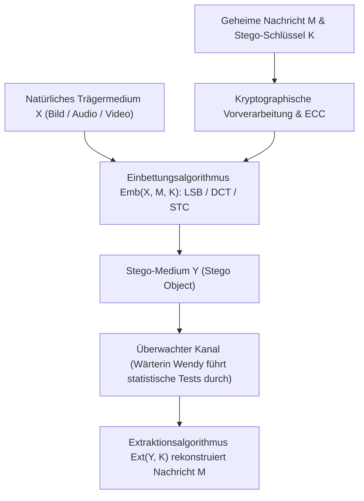
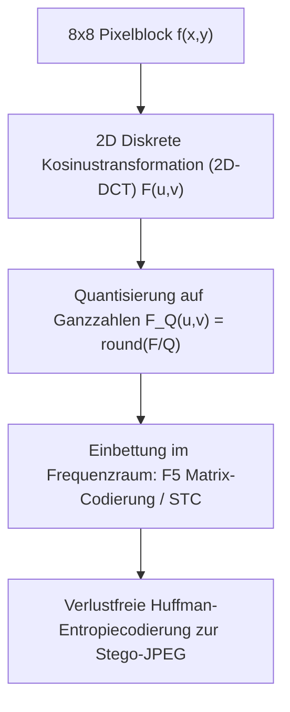

## 1. Kryptographie vs. Steganographie: Verbergen des Inhalts oder Verbergen der Existenz?

In der Informationssicherheit verfolgen <strong>Kryptographie</strong> und <strong>Steganographie</strong> zwei fundamental orthogonale Ziele. Die Kryptographie transformiert einen Klartext $M$ mithilfe eines geheimen Schlüssels $K$ in ein unlesbares Chiffrat $C = E_K(M)$. Wenn ein Angreifer $C$ abfängt, kann er zwar die semantische Bedeutung der Nachricht nicht entschlüsseln, doch <strong>die Tatsache, dass eine geheime, verschlüsselte Kommunikation stattfindet, ist für jeden Beobachter offensichtlich</strong>. In streng überwachten Netzwerken oder unter repressiven Zensurregimen reicht allein das Vorhandensein von hochgradig entropischem Datenverkehr (wie PGP-Blöcken oder unautorisierten TLS-Strömen) aus, um Alarm auszulösen, die Verbindung zu kappen oder Sanktionen einzuleiten.

Im Gegensatz dazu zielt die <strong>Steganographie</strong> (aus dem Altgriechischen *steganos* = „bedeckt, verborgen“ und *graphein* = „schreiben“) darauf ab, <strong>die bloße Existenz der geheimen Kommunikation vollständig unsichtbar zu machen</strong>. Von den historischen Berichten Herodots im antiken Griechenland (Geheimtexte auf der rasierten Kopfhaut eines Boten oder unter der Wachsschicht einer Schreibtafel) über Johannes Trithemius’ Werk *Steganographia* (1499) bis hin zur modernen digitalen Einbettung in harmlose Urlaubsfotos, Audiodateien oder Netzwerkpakete bettet die Steganographie eine geheime Nachricht $M$ unter Verwendung eines Schlüssels $K$ in ein unverdächtiges <strong>Trägerobjekt (Cover Object) $X$</strong> ein, sodass ein <strong>Stego-Objekt $Y$</strong> entsteht.

Im Jahr 1983 formulierte Gustavus J. Simmons das berühmte <strong>„Gefangenenproblem (The Prisoners’ Problem)“</strong>, das bis heute das formale Fundament der Steganographie bildet: Zwei Gefangene, Alice und Bob, wollen einen Fluchtplan austauschen, doch jede Nachricht wird von der Gefängniswärterin Wendy (Warden) kontrolliert. Entdeckt Wendy verschlüsselten Text oder statistische Auffälligkeiten, unterbindet sie sofort jeden Kontakt. Alice muss die geheimen Bits also so in einem scheinbar harmlosen Bild $Y$ verstecken, dass Wendy das Stego-Objekt $Y$ weder visuell noch mit statistischen Hypothesentests von einem natürlichen Trägerbild $X$ unterscheiden kann.

1998 lieferte Christian Cachin die strenge informationstheoretische Sicherheitsdefinition mithilfe der <strong>Kullback-Leibler-Divergenz (KL-Divergenz / Relative Entropie)</strong>. Sei $P_X$ die Wahrscheinlichkeitsverteilung natürlicher Trägerobjekte auf dem Raum $\mathcal{X}$ und $P_Y$ die Verteilung der erzeugten Stego-Objekte. Ein Stegosystem heißt $\varepsilon$-sicher (und perfekt sicher für $\varepsilon = 0$), falls gilt:

$$D_{\text{KL}}(P_X \,\|\, P_Y) = \sum_{x \in \mathcal{X}} P_X(x) \log_2 \frac{P_X(x)}{P_Y(x)} \le \varepsilon$$

Nach der <strong>Datenverarbeitungsungleichung (Data-Processing Inequality)</strong> der Informationstheorie sind für jeden beliebigen Detektor (Steganalysator), den Wärterin Wendy einsetzt, die Fehlalarmwahrscheinlichkeit $\alpha$ (Fehler 1. Art) und die Übersehenswahrscheinlichkeit $\beta$ (Fehler 2. Art) durch die binäre relative Entropie beschränkt:

$$d(1-\alpha, \beta) = (1-\alpha)\log_2 \frac{1-\alpha}{\beta} + \alpha \log_2 \frac{\alpha}{1-\beta} \le D_{\text{KL}}(P_X \,\|\, P_Y) \le \varepsilon$$

Strebt $\varepsilon \to 0$, so folgt zwingend $\alpha + \beta \to 1$: Selbst der mächtigste Deep-Learning-Detektor ist dann nicht besser als ein blinder Münzwurf.

| Vergleichsdimension | Kryptographie (Cryptography) | Steganographie (Steganography) | Digitale Wasserzeichen (Watermarking) |
|---|---|---|---|
| <strong>Schutzziel</strong> | Verbergen des <strong>Inhalts (Semantik)</strong> | Verbergen der <strong>Existenz der Nachricht</strong> | Schutz von <strong>Urheberrecht & Integrität</strong> |
| <strong>Sichtbarkeit</strong> | Öffentlich sichtbar (hohe Entropie erkennbar) | Streng verborgen (getarnt als normales Medium) | Sichtbar oder unsichtbar (Fokus auf Unlöschbarkeit) |
| <strong>Angreifermodell</strong> | Kryptoanalyse (Entschlüsselung ohne Schlüssel) | <strong>Steganalyse</strong>: Statistische Detektion $P_X \ne P_Y$ | <strong>Entfernungsangriffe</strong>: Kompression, Zuschnitt, Rauschen |
| <strong>Hauptmetrik</strong> | Berechnungs-Ununterscheidbarkeit (IND-CPA) | Statistische Unauffälligkeit ($D_{\text{KL}} \to 0$) & Kapazität | <strong>Robustheit (Robustness)</strong> gegen Signalverzerrung |

---

## 2. Einbettung im Ortsraum: LSB-Ersetzung und die Chi-Quadrat-Steganalyse ($\chi^2$-Test)

Bei unkomprimierten oder verlustfrei komprimierten Bildformaten (wie 24-Bit-BMP, PNG oder 16-Bit-WAV-Audio) ist die bekannteste Methode im Ortsraum (Spatial Domain) die <strong>Ersetzung des niederwertigsten Bits (Least Significant Bit Replacement, LSB Replacement)</strong>. In einem 8-Bit-Graustufenbild wird jeder Pixelwert $x_i \in \{0, 1, \dots, 255\}$ binär dargestellt als:

$$x_i = \sum_{b=0}^{7} a_{i,b} \, 2^b = 128 a_{i,7} + 64 a_{i,6} + \dots + 2 a_{i,1} + a_{i,0}$$

Während das höchstwertige Bit (MSB, $a_{i,7}$) den Helligkeitswert um $128$ verändert, bewirkt eine Änderung des niederwertigsten Bits (LSB, $a_{i,0} = x_i \bmod 2$) lediglich eine minimale Helligkeitsänderung von $\pm 1$. Ersetzt man das LSB jedes Pixels direkt durch ein verschlüsseltes (und damit gleichverteiltes) Geheimbit $m_i \in \{0, 1\}$ gemäß:

$$y_i = 2 \left\lfloor \frac{x_i}{2} \right\rfloor + m_i$$

so bleibt bei voller Auslastung ($1\,\text{Bit pro Pixel, bpp}$) im Mittel die Hälfte aller Pixel unverändert, während sich die andere Hälfte um $\pm 1$ ändert. Daraus ergeben sich der mittlere quadratische Fehler (MSE) und das Spitzen-Signal-Rausch-Verhältnis (PSNR):

$$\text{MSE} = \frac{1}{N}\sum_{i=1}^{N} (x_i - y_i)^2 = 0.5, \qquad \text{PSNR} = 10 \log_{10}\!\left(\frac{255^2}{\text{MSE}}\right) \approx 51.14\,\text{dB}$$

Für das menschliche visuelle System (HVS) sind Abweichungen oberhalb von $40\,\text{dB}$ völlig unsichtbar. Doch <strong>visuelle Unsichtbarkeit bedeutet keineswegs statistische Sicherheit</strong>!

1999 präsentierten Andreas Westfeld und Andreas Pfitzmann den berühmten <strong>Chi-Quadrat-Angriff ($\chi^2$-Steganalyse)</strong>, der naive LSB-Ersetzung sofort entlarvt. Der mathematische Grund liegt in der <strong>Asymmetrie der LSB-Operation</strong>: Ein gerader Pixelwert $2k$ kann durch LSB-Ersetzung nur zu $2k$ oder $2k+1$ werden; ebenso kann ein ungerader Pixelwert $2k+1$ nur zu $2k$ oder $2k+1$ werden. Es findet niemals ein Übergang zwischen $2k-1$ und $2k$ statt! Die disjunkten Paare $\{2k, 2k+1\}$ für $k \in \{0, \dots, 127\}$ bilden daher abgeschlossene <strong>„Wertepaare (Pairs of Values, PoVs)“</strong>. Da die eingebetteten Krypto-Bits mit $P(0)=P(1)=0.5$ gleichverteilt sind, gleichen sich die Histogrammhäufigkeiten $h_Y(2k)$ und $h_Y(2k+1)$ im Stego-Bild unabhängig von ihrer ursprünglichen Verteilung exakt ihrem Mittelwert an:

$$\mathbb{E}[h_Y(2k)] = \mathbb{E}[h_Y(2k+1)] = \frac{h_X(2k) + h_X(2k+1)}{2} = \bar{h}_k$$

Berechnet die Wärterin die Pearson-Chi-Quadrat-Teststatistik über alle 128 Paare:

$$\chi^2 = \sum_{k=0}^{127} \frac{\bigl(h_Y(2k) - \bar{h}_k\bigr)^2}{\bar{h}_k}$$

so zeigt ein natürliches Bild deutliche Unterschiede zwischen $h_X(2k)$ und $h_X(2k+1)$ ($p \approx 0$), während ein LSB-manipuliertes Bild paarweise gleich hohe Histogrammbalken aufweist ($\chi^2 \to 0, \; p \to 1$). Selbst bei sehr geringen Einbettungsraten kann die von Jessica Fridrich entwickelte <strong>RS-Steganalyse (Regular-Singular Analysis)</strong> durch Analyse räumlicher Nachbarschaftskorrelationen LSB-Ersetzungen ab $0.02\,\text{bpp}$ zuverlässig nachweisen. Abhilfe schafft erst das <strong>LSB-Matching ($\pm 1$-Einbettung)</strong>, bei dem im Falle $m_i \ne \text{LSB}(x_i)$ zufällig $+1$ oder $-1$ addiert wird, wodurch die starren PoV-Grenzen aufgebrochen werden.

---

## 3. Frequenzbereich und Matrix-Codierung: JPEG-DCT, F5 und Syndrome-Trellis Codes (STC)

Im realen Internet scheitert die räumliche LSB-Einbettung an einer allgegenwärtigen Hürde: der <strong>verlustbehafteten Kompression (Lossy Compression)</strong>. Sobald ein Bild über soziale Netzwerke oder Messenger versendet wird, wird es fast immer als <strong>JPEG</strong> neu codiert. Die JPEG-Kompression verwirft hochfrequente Details und zerstört dabei sämtliche LSBs im Ortsraum. Robuste oder direkt in JPEG-Dateien arbeitende Steganographie muss daher im <strong>Transformationsbereich (Frequency / Transform Domain)</strong> ansetzen.

Die JPEG-Kompression unterteilt das Bild (im $\text{YCbCr}$-Farbraum) in Blöcke von $8 \times 8$ Pixeln $f(x,y)$ und transformiert jeden Block mittels der <strong>zweidimensionalen Diskreten Kosinustransformation (2D-DCT)</strong> in 64 Frequenzkoeffizienten $F(u,v)$, die anschließend durch eine Quantisierungsmatrix $Q(u,v)$ geteilt und auf ganze Zahlen $F_Q(u,v)$ gerundet werden:

$$F(u,v) = \frac{1}{4} C(u) C(v) \sum_{x=0}^{7} \sum_{y=0}^{7} f(x,y) \cos\!\left(\frac{(2x+1)u\pi}{16}\right) \cos\!\left(\frac{(2y+1)v\pi}{16}\right), \qquad F_Q(u,v) = \text{round}\!\left(\frac{F(u,v)}{Q(u,v)}\right)$$

Modifiziert man die quantisierten, von Null verschiedenen Wechselstrom-Koeffizienten (AC-Koeffizienten) $F_Q(u,v)$ direkt vor der verlustfreien Huffman-Codierung, bleibt die geheime Nachricht im JPEG-Bitstrom exakt erhalten! Während frühe Werkzeuge wie <strong>JSteg</strong> einfach die LSBs der DCT-Koeffizienten überschrieben (und dadurch im DCT-Histogramm sofort durch den $\chi^2$-Test auffielen), revolutionierte Andreas Westfeld im Jahr 2001 mit dem <strong>F5-Algorithmus</strong> die JPEG-Steganographie durch zwei entscheidende Innovationen:
1. <strong>Dekrementierung des Absolutbetrags</strong>: Statt LSB-Paare auszugleichen, verringert F5 bei einer nötigen Bitänderung stets den Absolutbetrag des Koeffizienten (positive Koeffizienten $-1$, negative $+1$), sodass die natürliche, um Null symmetrische Laplace-Form des DCT-Histogramms erhalten bleibt.
2. <strong>Matrix-Codierung (Matrix Encoding mittels Hamming-Codes)</strong>: Um $k$ geheime Bits $\mathbf{m} \in \{0,1\}^k$ in $n = 2^k - 1$ Koeffizienten-Bits $\mathbf{x} \in \{0,1\}^n$ einzubetten, nutzt F5 die Prüfmatrix $\mathbf{H} \in \{0,1\}^{k \times (2^k-1)}$ eines binären Hamming-Codes (deren $j$-te Spalte die Binärdarstellung von $j$ ist). Man berechnet das Syndrom $\mathbf{s} = \mathbf{m} \oplus \mathbf{H}\mathbf{x}$. Ist $\mathbf{s} = \mathbf{0}$, ist keine einzige Änderung nötig; ist $\mathbf{s} \ne \mathbf{0}$, gibt $\mathbf{s}$ direkt den Spaltenindex $j$ des <strong>einzigen Koeffizienten $x_j$</strong> an, der invertiert werden muss, damit $\mathbf{H}\mathbf{y} = \mathbf{m}$ gilt!
Dadurch lassen sich <strong>$k$ geheime Bits durch maximal eine einzige Koeffizientenänderung in einem Block der Länge $2^k - 1$ einbetten</strong>! Die <strong>Einbettungseffizienz (Embedding Efficiency)</strong> steigt auf:

$$e(k) = \frac{k}{1 - 2^{-k}} = \frac{k \cdot 2^k}{2^k - 1}\,\text{Bits pro Änderung}$$

Moderne adaptive Verfahren (<strong>WOW, S-UNIWARD, J-UNIWARD, HILL</strong>) kombinieren dies mit <strong>Syndrome-Trellis Codes (STC, Filler et al. 2011)</strong>: Jedem Pixel oder DCT-Koeffizienten werden lokale Verzerrungskosten $\rho_i$ zugewiesen. In glatten Bildbereichen (wie blauem Himmel) sind Änderungen extrem leicht detektierbar ($\rho_i \to \infty$), während in hochgradig texturierten Bereichen (Laub, Fell, Wasseroberflächen) die Vorhersageresiduen ohnehin stark rauschen ($\rho_i$ klein). Mithilfe des Viterbi-Algorithmus findet STC im Trellis-Graphen genau denjenigen Codewort-Pfad $\mathbf{y}$ mit $\mathbf{H}\mathbf{y} = \mathbf{m}$, der die Gesamtverzerrung $D(\mathbf{X}, \mathbf{Y}) = \sum \rho_i |x_i - y_i|$ global minimiert.

---

## 4. Das Quadratwurzelgesetz der steganographischen Kapazität und Digitale Wasserzeichen

Wächst die sicher einbettbare Datenmenge $m$ linear mit der Anzahl der Pixel $n$ eines Bildes ($m = O(n)$)? Im Jahr 2008 bewiesen Tomáš Filler, Andrew D. Ker und Jessica Fridrich das fundamentale <strong>Quadratwurzelgesetz der steganographischen Kapazität (Square Root Law of Steganographic Capacity)</strong>.

Werden in einem Bild aus $n$ unabhängigen Pixeln insgesamt $m$ Pixel modifiziert (Änderungsrate $\beta = m / n$), so wächst die gesamte Kullback-Leibler-Divergenz nach einer Taylor-Entwicklung zweiter Ordnung mit der Fisher-Information $I_F > 0$ wie folgt an:

$$D_{\text{KL}}\!\left(P_X^{(n)} \,\big\|\, P_Y^{(n)}\right) = \frac{1}{2} n \beta^2 I_F + O(n\beta^3) = \frac{I_F}{2} \frac{m^2}{n} + O\!\left(\frac{m^3}{n^2}\right)$$

Damit die Gesamtdivergenz $D_{\text{KL}}^{(n)} \le \varepsilon$ unterhalb der statistischen Nachweisschwelle bleibt, darf die sichere Nutzlast $m_{\text{safe}}(n)$ <strong>nicht linear mit $n$, sondern nur proportional zur Quadratwurzel der Pixelanzahl $\sqrt{n}$ wachsen</strong>:

$$m_{\text{safe}}(n) = O\!\left(\sqrt{n}\right)$$

Vervierfacht man die Auflösung eines Bildes ($n \to 4n$), verdoppelt sich die sicher versteckbare Datenmenge lediglich ($\sqrt{4} = 2$), während die relative Einbettungsrate pro Pixel $\beta = m/n = O(1/\sqrt{n})$ mit wachsender Bildgröße gegen Null sinken muss!

Abschließend bildet das <strong>Digitale Wasserzeichen (Digital Watermarking)</strong> im <strong>„Magischen Dreieck des Information Hiding“ (Kapazität, Unsichtbarkeit, Robustheit)</strong> das Gegenstück zur Steganographie: Während Steganographie maximale unentdeckbare Nutzlast anstrebt, opfern Wasserzeichen (wie Ingemar Cox’ <strong>Spread-Spectrum-Wasserzeichen</strong>, <strong>Quantization Index Modulation QIM</strong>, die <strong>EURion-Konstellation</strong> auf Banknoten, gelbe Drucker-Tracking-Punkte oder Google DeepMinds <strong>SynthID</strong> zur Markierung KI-generierter Bilder und LLM-Texte) die Datenrate auf wenige Dutzend Bits, um diese hochgradig redundant über die signifikanten Frequenzbänder des Mediums zu spreizen – sodass der Urheberrechtsnachweis selbst nach JPEG-Kompression, Skalierung, Zuschnitt oder Analog-Digital-Wandlung unzerstörbar erhalten bleibt.
