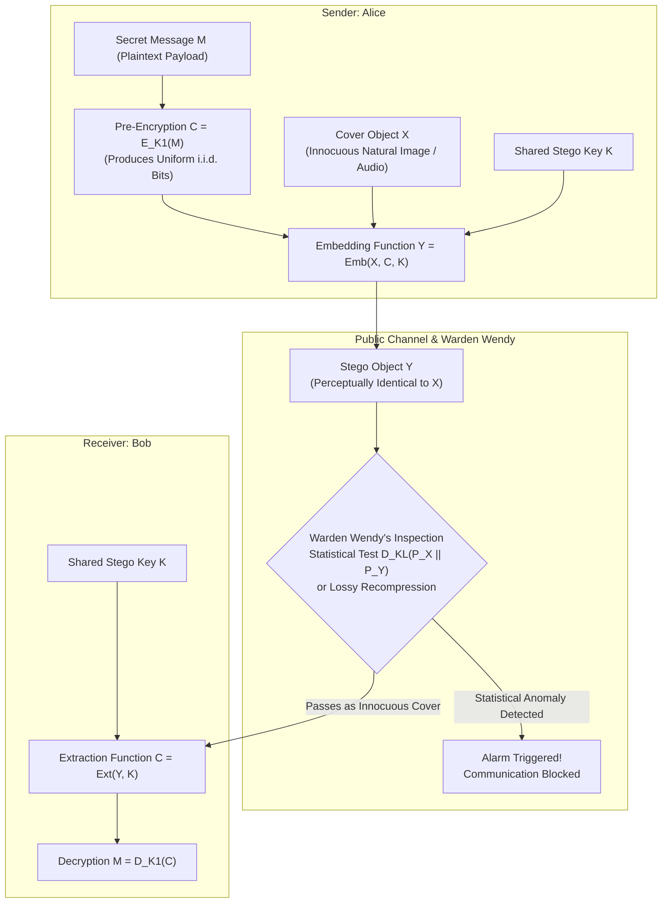
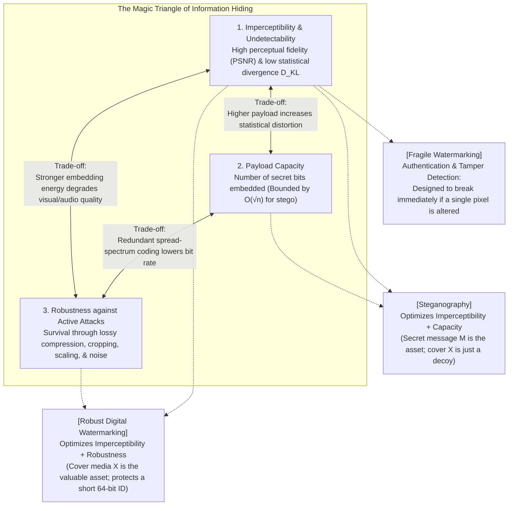

## 1. Hiding "Meaning" vs. Hiding "Existence": Cryptography and Steganography

When we think about protecting sensitive information across a network, our immediate instinct is to turn to <strong>cryptography</strong>. If Alice encrypts a plaintext message $M$ using a secret key $K$ to produce a ciphertext $C = E_K(M)$, any eavesdropper Eve intercepting the channel sees only an incomprehensible stream of high-entropy bits. Modern symmetric ciphers such as AES-256 and ChaCha20, alongside public-key systems based on elliptic curves or algebraic lattices, provide formidable mathematical guarantees that Eve cannot recover $M$ without $K$.

Yet cryptography suffers from a fundamental blind spot: <strong>while it conceals the meaning of a message, it blatantly advertises the fact that a secret communication is taking place.</strong>

To a network censor, an intelligence agency, or an automated firewall, an encrypted payload stands out like a flashing neon beacon. Its high Shannon entropy and lack of structural headers immediately reveal that Alice and Bob are exchanging confidential data. Under authoritarian censorship regimes, encrypted traffic does not need to be broken—it is simply blocked at the router level. Worse still, in coercive scenarios often termed <strong>rubber-hose cryptanalysis</strong>, an adversary who proves that Alice possesses an encrypted file or transmitted an encrypted stream can legally or physically compel her to surrender the decryption key. Cryptography protects semantic content, but it offers zero plausible deniability regarding the <strong>existence of communication</strong>.

To overcome this barrier—to conceal not merely what is being said, but the very fact that anything secret is being communicated at all—we enter the domain of <strong>steganography</strong>.

### Historical Lineage: From Shaved Skulls and Wax Tablets to Microdots

Etymologically, the word *steganography* derives from the Greek roots $\sigma\tau\varepsilon\gamma\alpha\nu\acute{o}\varsigma$ (*steganos*, meaning "covered" or "concealed") and $\gamma\rho\alpha\phi\varepsilon\iota\nu$ (*graphein*, meaning "to write"), standing in sharp contrast to *cryptography* ($\kappa\rho\upsilon\pi\tau\acute{o}\varsigma$, "hidden writing").

The earliest documented accounts of steganography appear in the fifth century BCE in the *Histories* of Herodotus, who recorded two ingenious episodes during the Greco-Persian Wars. In the first, Histiaeus, the tyrant of Miletus held under soft detention at the Persian court in Susa, wished to send a covert order of insurrection to his son-in-law Aristagoras. Knowing that Persian guards searched every courier along the royal roads, Histiaeus <strong>shaved the head of his most trusted slave, tattooed the secret message directly onto the man's bare scalp, and waited several weeks for his hair to grow back</strong> before dispatching him. Upon reaching Miletus, the slave simply instructed Aristagoras to shave his head and read the skin—an early demonstration of trading transmission latency for complete undetectability inside an innocent biological carrier.

In the second episode, Demaratus, an exiled Spartan king living in Persia, learned that King Xerxes was preparing a massive military invasion of Greece. To warn Sparta without arousing the suspicion of Persian border patrols, Demaratus took a hinged wooden writing tablet (*delton*) normally coated with wax. He <strong>scraped off the wax, carved the warning of Xerxes's invasion directly into the bare wood underneath, and then poured fresh liquid wax back over the carved wood</strong>. To every guard who inspected the courier, the object was nothing more than a blank, unused wax tablet.

During the Renaissance, the German Benedictine abbot Johannes Trithemius authored his famous three-volume treatise *Steganographia* (written ca. 1499, published in 1606). Ostensibly, the book read like a grimoire of black magic and angelology, detailing how to summon spirits to transmit messages across vast distances—a disguise so convincing that the Catholic Church placed it on the *Index Librorum Prohibitorum* (List of Prohibited Books) for centuries. In reality, Trithemius's prayers were sophisticated <strong>null ciphers (text steganography)</strong>: extracting specific letters (such as every second letter of every even-numbered word) from a pious Latin prayer revealed the hidden plaintext. The book itself was a meta-steganographic masterpiece, hiding a textbook on cryptography inside an occult text.

In the twentieth century, World War II espionage brought steganography into the optical domain through the <strong>microdot</strong>, perfected by German intelligence (*Abwehr*). Agents photographed typewritten pages of classified blueprints and optically reduced the negative in two stages down to a circular film disk roughly $1\,\text{mm}$ in diameter—the exact size of a typewriter period (`.`). Cemented with collodion atop a punctuation mark inside an ordinary postcard or business letter, a single dot carried thousands of words past postal censors.

### Gustavus Simmons and "The Prisoners' Problem" (1983)

The rigorous mathematical formulation of modern steganography was established in 1983 by Gustavus J. Simmons of Sandia National Laboratories in his seminal paper, *The Prisoners' Problem and the Subliminal Channel*.

Simmons framed the problem as follows: two accomplices, Alice and Bob, are arrested and locked in separate, isolated prison cells. They wish to coordinate an escape plan, but their only means of communication is exchanging messages through the prison's trustee, <strong>Warden Wendy</strong>. Wendy knows Alice and Bob are prone to conspire. Therefore, she inspects every single message passing between them. If Alice sends an encrypted message (incomprehensible ciphertext) or anything that looks statistically unusual, Wendy immediately confiscates it and terminates their communication privileges.

To succeed, Alice must take an innocuous-looking <strong>cover object (or carrier) $X \in \mathcal{X}$</strong>—such as a casual family photograph, an audio recording, or a mundane letter—and use a shared secret stego key $K \in \mathcal{K}$ together with an embedding function $\text{Emb}$ to hide her secret message $M \in \mathcal{M}$, producing a <strong>stego object $Y \in \mathcal{X}$</strong>:

$$Y = \text{Emb}(X, M, K)$$

If $Y$ passes Warden Wendy's inspection, Bob applies the extraction function $\text{Ext}$ using the shared key $K$ to recover the secret payload:

$$M = \text{Ext}(Y, K)$$

In the literature of information hiding, Warden Wendy's capabilities are classified into three distinct threat models:

1. <strong>The Passive Warden</strong>: Wendy only observes the transmitted object $Z$ and performs statistical tests—known as <strong>steganalysis</strong>—to decide whether $Z$ is an untouched cover object $X$ or a modified stego object $Y$. She does not alter the data passing through the channel unless she detects a secret and blocks it entirely.
2. <strong>The Active Warden</strong>: Even when Wendy detects nothing suspicious, she preemptively modifies every object passing through the channel within perceptual limits—for example, adding slight Gaussian noise, applying lossy JPEG recompression, resizing images, or low-pass filtering audio—with the explicit goal of wiping out any fragile subliminal channel without destroying the overt perceptual content. Modern social media platforms (Instagram, X, WhatsApp, Discord), which automatically strip metadata and recompress every uploaded image into optimized JPEG or WebP formats, act as ubiquitous unintentional Active Wardens.
3. <strong>The Malicious Warden</strong>: Wendy actively attempts to impersonate Alice, fabricating fake stego messages or probing Bob's extraction mechanism to trap the prisoners.

Note a crucial architectural best practice shown in the diagram above: before embedding $M$ into $X$, Alice almost always compresses and encrypts $M$ into a ciphertext $C = E_{K_1}(M)$. This serves two vital purposes. First, compression maximizes payload density while encryption transforms structured language into a stream of <strong>statistically uniform, independent and identically distributed (i.i.d.) bits</strong> where $\Pr(b_i = 0) = \Pr(b_i = 1) = 1/2$, preventing linguistic patterns in $M$ from leaking into the statistical distribution of $Y$. Second, if Warden Wendy's steganalysis eventually detects the presence of hidden data, the underlying cryptographic layer ensures that Wendy still cannot read the semantic contents of $M$.

---

## 2. Information-Theoretic Security: Cachin's Definition and Kullback-Leibler Divergence

What does it mean, mathematically, for a steganographic system to be "undetectable"? In 1998, Christian Cachin at IBM Zurich Research Laboratory resolved this question by grounding steganography in Shannon's information theory and statistical hypothesis testing—a framework now universally known as <strong>Cachin's Definition of Steganographic Security</strong>.

### Cover and Stego Probability Distributions

Suppose that all natural, innocent cover objects produced by Alice's camera or recording environment are drawn from a discrete sample space $\mathcal{X}$ according to an underlying probability mass function $P_X(x)$ for $x \in \mathcal{X}$. When Alice runs her steganographic embedding algorithm $\text{Emb}(X, M, K)$ over random covers $X \sim P_X$, messages $M$, and keys $K$, the resulting stego objects $Y$ follow an induced probability distribution $P_Y(x)$ on the same space $\mathcal{X}$.

Cachin observed that the fundamental measure of discrepancy between the natural cover distribution $P_X$ and the stego distribution $P_Y$ is the <strong>Kullback-Leibler (KL) Divergence (or Relative Entropy)</strong>:

$$D_{\text{KL}}(P_X \,\|\, P_Y) = \sum_{x \in \mathcal{X}} P_X(x) \log_2 \frac{P_X(x)}{P_Y(x)}$$

By Gibbs's inequality, $D_{\text{KL}}(P_X \,\|\, P_Y) \ge 0$ always, with equality $D_{\text{KL}}(P_X \,\|\, P_Y) = 0$ if and only if $P_X(x) = P_Y(x)$ for every $x \in \mathcal{X}$. Using this quantity, Cachin established two formal security tiers:

- <strong>Perfect Steganographic Security</strong>: A stegosystem is perfectly secure if $D_{\text{KL}}(P_X \,\|\, P_Y) = 0$. In this case, the probability distribution of transmitted stego objects is identical to that of natural cover objects.
- <strong>$\varepsilon$-Steganographic Security</strong>: For a non-negative real parameter $\varepsilon \ge 0$, a stegosystem is $\varepsilon$-secure if:
  $$D_{\text{KL}}(P_X \,\|\, P_Y) \le \varepsilon$$

### Hypothesis Testing and the Data Processing Inequality

Why does bounding $D_{\text{KL}}(P_X \,\|\, P_Y) \le \varepsilon$ guarantee security against *any* possible detection algorithm Warden Wendy might invent—including deep convolutional neural networks? The proof follows directly from the <strong>Data Processing Inequality</strong> of information theory applied to binary hypothesis testing.

When Warden Wendy intercepts an object $z \in \mathcal{X}$, she faces a binary hypothesis testing problem between two competing hypotheses:
- <strong>Null Hypothesis $H_0$</strong>: $z$ is an innocent cover object drawn from $P_X$.
- <strong>Alternative Hypothesis $H_1$</strong>: $z$ is a secret-carrying stego object drawn from $P_Y$.

Regardless of how complex Wendy's detector is, her decision rule is ultimately a deterministic or randomized mapping $\phi: \mathcal{X} \to \{0, 1\}$, where $\phi(z) = 0$ means "pass as innocent ($H_0$)" and $\phi(z) = 1$ means "flag as stego ($H_1$)". Wendy's detector is characterized by two error probabilities:

1. <strong>False Alarm Probability (Type I Error) $\alpha$</strong>: The probability that Wendy falsely accuses an innocent cover object of containing steganography:
   $$\alpha = P_X(\phi(X) = 1)$$
2. <strong>Missed Detection Probability (Type II Error) $\beta$</strong>: The probability that Wendy fails to detect a genuine stego object and lets it pass:
   $$\beta = P_Y(\phi(Y) = 0)$$

Because applying the function $\phi$ to $X$ or $Y$ is a post-processing Markov step, the Data Processing Inequality states that the KL divergence between the binary output distributions $\text{Bernoulli}(\alpha)$ and $\text{Bernoulli}(1-\beta)$ cannot exceed the KL divergence between the input distributions $P_X$ and $P_Y$. Defining the binary relative entropy function $d(p, q) = p \log_2 \frac{p}{q} + (1-p) \log_2 \frac{1-p}{1-q}$, we obtain the universal bound:

$$d(1 - \alpha, \beta) = (1 - \alpha) \log_2 \frac{1 - \alpha}{\beta} + \alpha \log_2 \frac{\alpha}{1 - \beta} \le D_{\text{KL}}(P_X \,\|\, P_Y) \le \varepsilon$$

Consider the practical constraint where Warden Wendy cannot afford to block innocent traffic ($\alpha = 0$). Setting $\alpha = 0$ reduces the left-hand side to $\log_2(1/\beta)$, yielding:

$$\log_2 \frac{1}{\beta} \le \varepsilon \quad \Longleftrightarrow \quad \beta \ge 2^{-\varepsilon}$$

If $\varepsilon = 0$, then $d(1-\alpha, \beta) = 0$, which forces $1 - \alpha = \beta$, or equivalently $1 - \beta = \alpha$. In words: <strong>Wendy's true positive detection rate $(1 - \beta)$ can never exceed her false alarm rate $\alpha$, meaning her receiver operating characteristic (ROC) curve collapses to the diagonal line of pure random coin-flipping!</strong>

### The Practical Catch: The Unknowable Manifold of Natural Images

If $D_{\text{KL}}(P_X \,\|\, P_Y) = 0$ is achievable in theory (for instance, via rejection sampling from $P_X$), why is real-world steganography so difficult?

The reason is that for real-world empirical covers—such as digital photographs captured by physical CMOS sensors or human speech recorded in acoustic rooms—<strong>no closed-form mathematical expression for the true distribution $P_X$ exists</strong>. A $1000 \times 1000$ grayscale image lives in a state space of size $256^{1,000,000}$. Within this unfathomably vast ambient space, actual natural images occupy a razor-thin, highly non-linear low-dimensional manifold governed by physical optics, continuous object surfaces, sensor shot noise, and color filter array (CFA) demosaicing correlations. When Alice takes a single existing photograph $x$ and modifies its pixels using a naive rule, even if the change is completely invisible to the human eye, she pushes the point $y$ orthogonally off the natural image manifold into a region where $P_X(y) \approx 0$ while $P_Y(y) > 0$—causing $D_{\text{KL}}(P_X \,\|\, P_Y)$ to explode and allowing statistical steganalysis to catch her red-handed.

---

## 3. Spatial-Domain Embedding: LSB Replacement and the Trap of "Pairs of Values" (PoVs)

Nowhere is the gulf between *human visual imperceptibility* and *statistical undetectability* more dramatic than in the most widely taught spatial-domain technique: <strong>Least Significant Bit (LSB) Replacement</strong>.

### Mechanics of LSB Replacement and the Illusion of PSNR = 51.14 dB

Consider an uncompressed 8-bit grayscale image (such as BMP or PNG) composed of $N$ pixels. Each pixel intensity $x_i \in \{0, 1, \dots, 255\}$ is represented in binary by 8 bits $(b_7 b_6 b_5 b_4 b_3 b_2 b_1 b_0)_2$:

$$x_i = \sum_{k=0}^{7} b_k 2^k = 128 b_7 + 64 b_6 + 32 b_5 + 16 b_4 + 8 b_3 + 4 b_2 + 2 b_1 + b_0$$

Flipping the Most Significant Bit (MSB, $b_7$) alters the pixel brightness by $128$, visibly corrupting the image. By contrast, overwriting the <strong>Least Significant Bit (LSB, $b_0$, with weight $2^0 = 1$)</strong> with a secret message bit $m_i \in \{0, 1\}$ changes the pixel intensity by at most $\pm 1$ out of $255$ (roughly $0.39\%$). Mathematically, LSB replacement is defined as:

$$y_i = 2 \left\lfloor \frac{x_i}{2} \right\rfloor + m_i = \begin{cases} x_i & \text{if } \text{LSB}(x_i) = m_i \\ x_i + 1 & \text{if } x_i \text{ is even and } m_i = 1 \\ x_i - 1 & \text{if } x_i \text{ is odd and } m_i = 0 \end{cases}$$

Let us evaluate the perceptual distortion when embedding a pre-encrypted uniform bit stream $m_1, \dots, m_N$ across every pixel in the image (an embedding rate of $1\,\text{bpp}$, bit per pixel). Since $\Pr(m_i = 0) = \Pr(m_i = 1) = 1/2$, half of the pixels already have $\text{LSB}(x_i) = m_i$ and experience zero change ($|y_i - x_i| = 0$), while the other half change by exactly $\pm 1$ ($|y_i - x_i| = 1$). The expected Mean Squared Error (MSE) is therefore:

$$\text{MSE} = \frac{1}{N} \sum_{i=1}^{N} (x_i - y_i)^2 = \frac{1}{2}(0)^2 + \frac{1}{2}(\pm 1)^2 = 0.5$$

Substituting $\text{MSE} = 0.5$ into the standard formula for Peak Signal-to-Noise Ratio (PSNR) yields:

$$\text{PSNR} = 10 \log_{10} \left( \frac{\text{MAX}_I^2}{\text{MSE}} \right) = 10 \log_{10} \left( \frac{255^2}{0.5} \right) = 10 \log_{10}(130050) \approx 51.14\,\text{dB}$$

Because the Human Visual System (HVS) cannot distinguish image degradation above roughly $38\text{--}40\,\text{dB}$ PSNR, a $51.14\,\text{dB}$ stego image looks 100% identical to the original cover image under any visual inspection. Furthermore, a single Full HD ($1920 \times 1080$) 24-bit RGB image provides $1920 \times 1080 \times 3 = 6,220,800$ LSBs, allowing Alice to hide $777.6\,\text{KB}$ of secret data. The exact same principle applies to 16-bit PCM WAV audio files ($s_i \in [-32768, 32767]$), where replacing the LSB yields an inaudible Signal-to-Noise Ratio exceeding $90\,\text{dB}$.

### Why Naive LSB Replacement Fails Instantly: Westfeld & Pfitzmann's $\chi^2$ Attack (1999)

For years, software developers assumed that because LSB replacement changes pixel values by at most $\pm 1$, it was undetectable without possessing the original cover image for comparison. In 1999, Andreas Westfeld and Andreas Pfitzmann at TU Dresden shattered this assumption by introducing the <strong>Chi-Square ($\chi^2$) Steganalysis Attack</strong>.

Westfeld and Pfitzmann noticed a fatal structural flaw: <strong>LSB replacement is strictly asymmetric.</strong> Look closely at how even and odd pixel values behave under LSB replacement:

- An <strong>even pixel value $2k$</strong> (e.g., $100 = \text{01100100}_2$) can only ever remain $2k$ ($100$) or be incremented to $2k + 1$ ($101 = \text{01100101}_2$). It can *never* be decremented to $99$ ($\text{01100011}_2$).
- An <strong>odd pixel value $2k + 1$</strong> (e.g., $101 = \text{01100101}_2$) can only ever remain $2k + 1$ ($101$) or be decremented to $2k$ ($100$). It can *never* be incremented to $102$ ($\text{01100110}_2$).

Consequently, the set of 256 grayscale intensities $\{0, 1, \dots, 255\}$ is partitioned into 128 disjoint, closed <strong>Pairs of Values (PoVs)</strong>: $\{2k, 2k+1\}$ for $k \in \{0, 1, \dots, 127\}$. Under LSB replacement, pixels only ever swap places *within* their respective pair $\{2k, 2k+1\}$; no pixel ever crosses the boundary into an adjacent pair!

Let $h_X(v)$ denote the histogram count (frequency) of intensity $v$ in the original cover image, and let $h_Y(v)$ denote the histogram count in the stego image. Because pixels never leave their pair $\{2k, 2k+1\}$, the <strong>sum of histogram counts within each pair is an exact invariant</strong> before and after embedding:

$$h_Y(2k) + h_Y(2k + 1) = h_X(2k) + h_X(2k + 1) = \text{constant}$$

Now consider what happens when Alice embeds random encrypted bits $m_i$ where $\Pr(m_i = 0) = \Pr(m_i = 1) = 1/2$. Regardless of how unequal $h_X(2k)$ and $h_X(2k+1)$ were in the natural cover image, overwriting their LSBs with fair coin flips redistributes the total pair population $h_X(2k) + h_X(2k+1)$ equally between $2k$ and $2k+1$! In the resulting stego histogram, every adjacent pair of bars $\{2k, 2k+1\}$ becomes unnaturally equalized into twin step-functions:

$$E[h_Y(2k)] = E[h_Y(2k + 1)] = \bar{h}_k = \frac{h_X(2k) + h_X(2k + 1)}{2} = \frac{h_Y(2k) + h_Y(2k + 1)}{2}$$

Crucially, Warden Wendy does <strong>not</strong> need the original cover histogram $h_X$ to know the theoretical expected count $\bar{h}_k$—she can compute $\bar{h}_k = \frac{h_Y(2k) + h_Y(2k+1)}{2}$ directly from the observed image $Y$! Westfeld and Pfitzmann constructed Pearson's <strong>Chi-Square test statistic</strong> across all $128$ pairs (with $\nu = 127$ degrees of freedom):

$$\chi^2 = \sum_{k=0}^{127} \frac{\left( h_Y(2k) - \bar{h}_k \right)^2}{\bar{h}_k}, \quad \text{where } \bar{h}_k = \frac{h_Y(2k) + h_Y(2k + 1)}{2}$$

In a natural cover image, $h_X(2k)$ and $h_X(2k+1)$ differ naturally, producing a large $\chi^2$ value and a $p$-value near $0$. In an LSB-replaced stego image, $h_Y(2k) \approx \bar{h}_k$, driving $\chi^2 \to 0$ and pushing the $p$-value of embedding to $1.0$ ($100\%$ certainty of steganography).

### Fridrich's RS Steganalysis (2001) and LSB Matching ($\pm 1$ Embedding)

To evade the $\chi^2$ attack, steganographers quickly stopped embedding sequentially from the top-left corner at $100\%$ capacity. Instead, they embedded smaller payloads (say, $10\%$ of pixels) scattered pseudo-randomly across the image using a key-seeded PRNG. At low embedding rates, first-order histogram equalization is too weak for the $\chi^2$ test to distinguish from natural histogram variance.

In 2001, Jessica Fridrich, Miroslav Goljan, and Rui Du at SUNY Binghamton introduced <strong>RS (Regular-Singular) Steganalysis</strong>, which defeated pseudo-randomly scattered LSB replacement down to rates as low as $0.03\,\text{bpp}$.

Instead of looking at isolated single-pixel histogram counts (first-order statistics), RS steganalysis exploits <strong>second-order spatial correlations between neighboring pixels</strong>. The image is divided into small groups of $n$ adjacent pixels $G = (x_1, x_2, \dots, x_n)$ (e.g., $n = 4$ horizontal neighbors), and a smoothness discrimination function $f(G) = \sum_{i=1}^{n-1} |x_{i+1} - x_i|$ is defined to measure local roughness. Two invertible flipping operations are then applied to selected pixels within each group via a mask $M$:

- <strong>Positive Flipping $F_1$</strong>: Swaps values within standard LSB pairs $2k \leftrightarrow 2k+1$ ($0 \leftrightarrow 1, 2 \leftrightarrow 3, \dots, 254 \leftrightarrow 255$).
- <strong>Shifted Flipping $F_{-1}$</strong>: Swaps values across shifted pairs $2k-1 \leftrightarrow 2k$ ($-1 \leftrightarrow 0, 1 \leftrightarrow 2, 3 \leftrightarrow 4, \dots, 255 \leftrightarrow 256$).

Under flipping, a pixel group $G$ is classified as <strong>Regular ($R$)</strong> if flipping increases its roughness ($f(F(G)) > f(G)$), and <strong>Singular ($S$)</strong> if flipping decreases its roughness ($f(F(G)) < f(G)$). Because natural images are locally smooth, adding random flipping noise normally increases roughness, so $R > S$. Moreover, in an untouched natural image, there is no physical preference for even-odd boundaries over odd-even boundaries, so positive and shifted flipping yield virtually identical proportions:

$$R_M \approx R_{-M} \quad \text{and} \quad S_M \approx S_{-M}$$

However, when LSB replacement embeds secret bits, it exclusively randomizes the $F_1$ pairs $\{2k, 2k+1\}$. As the embedding rate $p$ increases toward $1\,\text{bpp}$, the difference $R_M - S_M$ shrinks toward zero (at $100\%$ LSB replacement, $F_1$ becomes statistically idempotent so $R_M = S_M$), while the shifted difference $R_{-M} - S_{-M}$ diverges sharply! By intentionally flipping bits in the test image under four states ($0, p/2, 1-p/2, 1$) and solving the resulting quadratic curves for $R_M(p) = S_M(p)$, RS steganalysis estimates the exact length of the hidden message with remarkable precision.

To permanently eliminate the PoV asymmetry exploited by both $\chi^2$ and RS steganalysis, steganographers replaced LSB replacement with <strong>LSB Matching (also known as $\pm 1$ Embedding)</strong>. When $\text{LSB}(x_i) \neq m_i$, instead of deterministically flipping the LSB, Alice randomly adds $+1$ or $-1$ with equal probability $1/2$ (clamping at boundary values $0 \to 1$ and $255 \to 254$):

$$y_i = \begin{cases} x_i & \text{if } \text{LSB}(x_i) = m_i \\ x_i + 1 & \text{with probability } 1/2 \text{ if } \text{LSB}(x_i) \neq m_i \\ x_i - 1 & \text{with probability } 1/2 \text{ if } \text{LSB}(x_i) \neq m_i \end{cases}$$

Under LSB matching, an even value $2k$ transitions equally to $2k-1$ and $2k+1$, completely dissolving the closed PoV pairs and rendering both $\chi^2$ and RS attacks ineffective. (In response, steganalysts developed higher-order attacks such as the Histogram Characteristic Function Center of Mass [HCF-COM] and Subtractive Pixel Adjacency Matrix [SPAM], which model pixel differences $d_i = x_{i+1} - x_i$ as first- and second-order Markov chains).

---

## 4. Surviving Lossy Compression: Transform-Domain Embedding, JPEG DCT, and F5 Matrix Encoding

Spatial-domain LSB methods share an Achilles' heel far more mundane than statistical steganalysis: <strong>they are completely fragile against lossy compression.</strong>

### Why Saving as JPEG Wipes Out Spatial LSBs

In modern digital ecosystems, uncompressed BMP files and huge lossless PNGs are rarely used for everyday photography. Sending a massive BMP file is itself suspicious, and uploading any image to social media or messaging platforms triggers an automatic server-side re-encoding into <strong>JPEG, WebP, or HEIC</strong>. Similarly, WAV audio is routinely compressed into <strong>MP3, AAC, or Opus</strong>.

Lossy compression works by transforming spatial or temporal signals into the <strong>frequency domain</strong> and aggressively quantizing (rounding off) high-frequency components to which the human eye or ear is insensitive. Because spatial LSB modifications ($\pm 1$ from pixel to pixel) behave mathematically as high-frequency spatial white noise, the quantization step of JPEG or MP3 compression obliterates them entirely. If Bob decodes a JPEG-compressed spatial LSB image, his extracted bit error rate is $50\%$—the secret message is completely destroyed.

### Mathematical Walkthrough of the JPEG Pipeline and 2D-DCT

```mermaid
flowchart TD
    subgraph JPEGEncode["JPEG Compression Pipeline & Transform-Domain Steganography"]
        RGB["Input Image (RGB Spatial Domain)<br/>*Spatial LSBs embedded here will be destroyed!*"]
        YCbCr["1. Color Space Conversion (RGB → YCbCr)<br/>+ Chroma Subsampling (4:2:0)"]
        Block["2. 8×8 Pixel Block Partitioning<br/>Level Shift f(x,y) ∈ [-128, 127]"]
        DCT["3. 2D Discrete Cosine Transform (2D-DCT)<br/>Orthogonal Mapping to Real Coefficients F(u,v)"]
        Quant["4. Quantization F_Q(u,v) = round(F(u,v) / Q(u,v))<br/>[LOSSY STEP: High-frequency spatial noise wiped out]"]
        StegoEmb["★ Transform-Domain Steganographic Embedding ★<br/>(JSteg / OutGuess / F5 / J-UNIWARD)<br/>Modify Integer Quantized DCT Coefficients F_Q(u,v)"]
        Entropy["5. Zig-Zag Scan, RLE & Huffman Coding<br/>[100% LOSSLESS ENTROPY STEP]"]
        JPEGFile["Output Stego JPEG File (.jpg)<br/>Embedded DCT bits survive intact!"]

        RGB --> YCbCr
        YCbCr --> Block
        Block --> DCT
        DCT --> Quant
        Quant --> StegoEmb
        StegoEmb --> Entropy
        Entropy --> JPEGFile
    end
```

To build steganography that survives JPEG storage, Alice must embed her secret bits *inside* the JPEG compression pipeline—specifically, <strong>after the lossy quantization step</strong>. Let us trace the mathematics of JPEG compression:

1. <strong>Color Space Conversion & Chroma Subsampling</strong>: The $\text{RGB}$ pixels are transformed into luminance ($Y$) and chrominance ($Cb, Cr$) channels, and the $Cb, Cr$ planes are typically downsampled by a factor of 2 horizontally and vertically ($4:2:0$).
2. <strong>$8 \times 8$ Block Partitioning & 2D Discrete Cosine Transform (2D-DCT)</strong>: Each channel is partitioned into disjoint $8 \times 8$ pixel blocks, shifted by $-128$ so $f(x, y) \in [-128, 127]$ for $x, y \in \{0, \dots, 7\}$. Each block is then transformed into 64 spatial frequency coefficients $F(u, v)$ ($u, v \in \{0, \dots, 7\}$) via the orthogonal <strong>2D Discrete Cosine Transform</strong>:

$$F(u, v) = \frac{1}{4} C(u) C(v) \sum_{x=0}^{7} \sum_{y=0}^{7} f(x, y) \cos\left( \frac{(2x + 1)u\pi}{16} \right) \cos\left( \frac{(2y + 1)v\pi}{16} \right)$$

where $C(0) = \frac{1}{\sqrt{2}}$ and $C(u) = 1$ for $u > 0$. Here, $F(0, 0)$ is the zero-frequency <strong>DC coefficient</strong> (proportional to the average brightness of the $8 \times 8$ block), while the remaining 63 coefficients are <strong>AC coefficients</strong> representing horizontal, vertical, and diagonal spatial frequencies of increasing fineness toward $F(7, 7)$.

3. <strong>Quantization (The Lossy Bottleneck)</strong>: Each real-valued DCT coefficient $F(u, v)$ is divided by the corresponding entry of an $8 \times 8$ <strong>quantization table $Q(u, v)$</strong> and rounded to the nearest integer:

$$F_Q(u, v) = \text{round}\!\left( \frac{F(u, v)}{Q(u, v)} \right)$$

Because the human eye scarcely notices high-frequency detail, $Q(u, v)$ has small step sizes ($10\text{--}16$) in the upper-left low frequencies and large step sizes ($60\text{--}120$) in the lower-right high frequencies. Consequently, most high-frequency AC coefficients are rounded down to $0$, discarding spatial LSBs forever.

4. <strong>Lossless Entropy Coding</strong>: Finally, the integer quantized DCT coefficients $F_Q(u, v)$ are ordered along a zig-zag path, run-length encoded (RLE) for consecutive zeros, and compressed losslessly using Huffman or arithmetic coding.

Because Step 4 is <strong>completely lossless</strong>, any secret message embedded directly into the <strong>integer quantized DCT coefficients $F_Q(u, v)$</strong> immediately after Step 3 will be preserved bit-for-bit inside the `.jpg` file!

### Evolution of JPEG Steganography: JSteg, OutGuess, and Westfeld's F5 Algorithm

Embedding inside $F_Q(u, v)$ triggered a classic arms race between steganographers and steganalysts:

#### 1. JSteg (Derek Upham)
<strong>JSteg</strong> embeds secret bits by sequentially replacing the LSBs of quantized AC DCT coefficients $F_Q(u, v)$, skipping all coefficients equal to $0$ or $1$ (modifying $0$s breaks zero run-lengths, inflating file size and introducing visible ringing artifacts). However, unperturbed AC DCT coefficients follow a sharply peaked, zero-centered generalized Gaussian (Laplacian-like) distribution. Applying LSB replacement to $F_Q(u, v)$ creates the exact same PoV step-function equalization $\{2k, 2k+1\}$ in the DCT histogram, making JSteg trivially detectable via Westfeld's $\chi^2$ attack on DCT coefficients.

#### 2. OutGuess (Niels Provos, 2001)
To defeat DCT histogram steganalysis, <strong>OutGuess</strong> embeds secret bits into at most half of the available non-zero DCT coefficients selected via a PRNG, and then uses the remaining unmodified coefficients to make compensatory $\pm 1$ adjustments that <strong>restore the global DCT coefficient histogram to match the original cover histogram exactly</strong>. While this blinded first-order $\chi^2$ detectors, Fridrich et al. broke OutGuess by measuring <strong>spatial blockiness artifacts</strong> across $8 \times 8$ block boundaries, using a "calibration" technique (cropping the stego image by 4 pixels and recompressing it to estimate the original cover's baseline blockiness).

#### 3. The F5 Algorithm (Andreas Westfeld, 2001) and Matrix Encoding
In 2001, Andreas Westfeld introduced the landmark <strong>F5 algorithm</strong>, which revolutionized JPEG steganography through two foundational innovations:

<strong>Innovation 1: Decrementing the Absolute Value (No PoV Swapping)</strong>
Instead of flipping the LSB between pairs $\{2k, 2k+1\}$, whenever F5 needs to change the bit value of a non-zero coefficient $F_Q$, it <strong>always decrements the coefficient's absolute value by $1$</strong> (if $F_Q > 0$, it becomes $F_Q - 1$; if $F_Q < 0$, it becomes $F_Q + 1$). Because the Laplacian histogram of DCT coefficients is monotonically decreasing away from zero, shifting modified coefficients uniformly toward zero preserves the smooth, unimodal shape of the DCT histogram without creating any pairwise stairs! (Note: When $F_Q = \pm 1$ is decremented, it becomes $0$—a phenomenon called <strong>shrinkage</strong>. Because the receiver skips all zeros, F5 detects whenever shrinkage occurs during embedding and simply re-embeds the same message bit into the next non-zero coefficient).

<strong>Innovation 2: Matrix Encoding via $(1, 2^k - 1, k)$ Hamming Syndrome Coding</strong>
Westfeld realized that the true driver of statistical detectability is the total number of coefficient modifications. Following an idea proposed by Ron Crandall (1998), F5 introduced <strong>Matrix Encoding</strong>, which uses the parity-check matrix of a binary Hamming code to embed $k$ message bits into $n = 2^k - 1$ non-zero DCT coefficients by modifying <strong>at most $1$ coefficient</strong>!

Let $\mathbf{x} = (x_1, x_2, \dots, x_n)^T \in \{0, 1\}^n$ be the LSBs of $n = 2^k - 1$ non-zero DCT coefficients, and let $\mathbf{m} \in \{0, 1\}^k$ be the $k$-bit secret message block to embed. Let $H$ be the $k \times (2^k - 1)$ binary matrix whose $j$-th column $\mathbf{h}_j$ is the $k$-bit binary representation of the integer $j \in \{1, 2, \dots, 2^k - 1\}$. For example, when $k = 3$ and $n = 2^3 - 1 = 7$:

$$H = \begin{pmatrix} 0 & 0 & 0 & 1 & 1 & 1 & 1 \\ 0 & 1 & 1 & 0 & 0 & 1 & 1 \\ 1 & 0 & 1 & 0 & 1 & 0 & 1 \end{pmatrix}$$

The receiver Bob extracts the $k$-bit message from the received $n$-bit stego block $\mathbf{y}$ simply by computing the matrix-vector product modulo $2$:

$$\mathbf{m} = H \mathbf{y} \pmod 2$$

To construct $\mathbf{y}$ from $\mathbf{x}$ with at most one bit flip, Alice computes the difference syndrome:

$$\mathbf{s} = \mathbf{m} \oplus H \mathbf{x} \pmod 2$$

- If $\mathbf{s} = \mathbf{0}$ (which happens with probability $2^{-k}$), then $H\mathbf{x} = \mathbf{m}$ already holds, so Alice leaves $\mathbf{y} = \mathbf{x}$ completely untouched (<strong>$0$ modifications!</strong>).
- If $\mathbf{s} \neq \mathbf{0}$ (which happens with probability $1 - 2^{-k}$), let $j \in \{1, \dots, 2^k - 1\}$ be the unique column index whose column vector equals $\mathbf{s}$ ($\mathbf{h}_j = \mathbf{s}$). Alice flips <strong>only the single coefficient bit $x_j$</strong>, setting $\mathbf{y} = \mathbf{x} \oplus \mathbf{e}_j$. Then:

$$H \mathbf{y} = H(\mathbf{x} \oplus \mathbf{e}_j) = H\mathbf{x} \oplus \mathbf{h}_j = H\mathbf{x} \oplus (\mathbf{m} \oplus H\mathbf{x}) = \mathbf{m} \pmod 2$$

Thus, $k$ bits are always embedded using at most $1$ change per $n = 2^k - 1$ coefficients! The expected number of changes per block is $1 - 2^{-k}$, yielding an <strong>embedding efficiency $e(k)$</strong> (in bits embedded per coefficient modification) of:

$$e(k) = \frac{k}{1 - 2^{-k}} \quad \text{[bits per change]}$$

For $k = 1, n = 1$ (naive embedding), efficiency is $2.0$ bits per change. For $k = 3, n = 7$, efficiency rises to $3 / (7/8) \approx 3.43$ bits per change. For $k = 6, n = 63$, efficiency reaches $6 / (63/64) \approx 6.10$ bits per change while modifying only $1.56\%$ of coefficients!

### Modern Content-Adaptive Steganography (WOW, S-UNIWARD, J-UNIWARD) and Syndrome-Trellis Codes (STC)

Today's state-of-the-art steganography combines syndrome coding with <strong>Content-Adaptive Distortion Minimization</strong>.

Modifying a pixel or DCT coefficient in a flat, smooth region (such as a clear blue sky) creates an obvious spike in high-pass prediction residuals, which modern steganalysis—such as Fridrich's Spatial Rich Models (SRM) or deep learning architectures like <strong>SRNet, XuNet, and EfficientNet</strong>—detects immediately. Conversely, modifying pixels in complex, noisy textures (foliage, gravel, fur, water ripples) is statistically undetectable because even the best predictors cannot model the high-entropy local variance.

Algorithms such as <strong>WOW (Wavelet Obtained Weights, 2012)</strong> and <strong>S-UNIWARD / J-UNIWARD (Universal Wavelet Relative Distortion, Holub & Fridrich, 2014)</strong> pass the cover image through directional wavelet filter banks (horizontal, vertical, diagonal Daubechies 8-tap wavelets) and assign each cover element $x_i$ a local <strong>distortion cost $\rho_i \in [0, \infty)$</strong> inversely proportional to local texture energy. Then, using <strong>Syndrome-Trellis Codes (STC, Filler, Judas, & Fridrich, 2011)</strong>—which generalize F5's Hamming matrix $H$ to sparse banded convolutional parity-check matrices decoded via the Viterbi algorithm—Alice solves the constrained optimization problem:

$$\min_{\mathbf{y}} D(\mathbf{x}, \mathbf{y}) = \sum_{i=1}^{n} \rho_i |x_i - y_i| \quad \text{subject to} \quad H \mathbf{y} = \mathbf{m} \pmod 2$$

This concentrates 100% of the steganographic modifications deep inside noisy edges and textures while approaching the theoretical rate-distortion bound.

---

## 5. The Square Root Law of Steganographic Capacity

Suppose Alice can safely hide $1\,\text{KB}$ of data inside a $1$-megapixel ($n = 10^6$) image while keeping the statistical detectability $D_{\text{KL}}$ below a safe threshold $\varepsilon$. If she upgrades to a $100$-megapixel ($n = 10^8$) camera—increasing the number of pixels by a factor of $100$—how much secret data can she safely hide at the same security level $\varepsilon$?

Intuition derived from Shannon's channel coding theorem suggests the capacity should scale linearly as $O(n)$, allowing $100\,\text{KB}$. Yet in 2008, Tomáš Filler, Andrew D. Ker, and Jessica Fridrich proved one of the most profound theorems in information hiding: <strong>The Square Root Law (SRL) of Steganographic Capacity</strong>. Safe steganographic payload scales <strong>not linearly as $O(n)$, but only with the square root of the cover size, $O(\sqrt{n})$!</strong> Increasing image resolution by $100\times$ increases safe payload capacity by only $\sqrt{100} = 10\times$.

### Mathematical Proof via Taylor Expansion of KL Divergence

Let us derive the Square Root Law directly from Cachin's KL divergence formula. Model an $n$-pixel cover image $X^{(n)} = (X_1, \dots, X_n)$ as a sequence of $n$ independent and identically distributed (i.i.d.) random variables drawn from a marginal distribution $P(x)$. Suppose Alice modifies $m$ pixels out of $n$ to embed her secret payload, corresponding to a per-pixel change rate $\beta = \frac{m}{n}$.

When a pixel is modified, its distribution changes from $P(x)$ to $Q(x)$. Therefore, in the stego image $Y^{(n)}$, each pixel $Y_i$ follows the mixture distribution:

$$P_\beta(x) = (1 - \beta) P(x) + \beta Q(x) = P(x) + \beta \big( Q(x) - P(x) \big)$$

Let us expand the single-pixel KL divergence $D_{\text{KL}}(P \,\|\, P_\beta)$ in a Taylor series around $\beta = 0$ using $\ln(1 + u) = u - \frac{1}{2}u^2 + O(u^3)$:

$$\begin{aligned}
D_{\text{KL}}(P \,\|\, P_\beta) &= -\sum_{x \in \mathcal{X}} P(x) \ln \left( 1 + \beta \frac{Q(x) - P(x)}{P(x)} \right) \\
&= -\sum_{x \in \mathcal{X}} P(x) \left[ \beta \frac{Q(x) - P(x)}{P(x)} - \frac{1}{2} \beta^2 \left( \frac{Q(x) - P(x)}{P(x)} \right)^2 + O(\beta^3) \right]
\end{aligned}$$

Notice what happens to the first-order term in $\beta$:

$$\sum_{x \in \mathcal{X}} P(x) \cdot \beta \frac{Q(x) - P(x)}{P(x)} = \beta \left( \sum_{x \in \mathcal{X}} Q(x) - \sum_{x \in \mathcal{X}} P(x) \right) = \beta(1 - 1) = 0$$

Because both $P$ and $Q$ are valid probability distributions summing to $1$, <strong>the linear $O(\beta)$ term vanishes identically!</strong> The leading term of the single-pixel KL divergence is strictly quadratic in $\beta$:

$$D_{\text{KL}}(P \,\|\, P_\beta) = \frac{1}{2} \beta^2 \sum_{x \in \mathcal{X}} \frac{(Q(x) - P(x))^2}{P(x)} + O(\beta^3) = \frac{1}{2} I(0) \beta^2 + O(\beta^3)$$

where $I(0) = \sum_x \frac{(Q(x)-P(x))^2}{P(x)} > 0$ is the Fisher information of the mixture family at $\beta = 0$.

Now, by the chain rule of relative entropy over $n$ independent pixels, the total KL divergence between the $n$-pixel cover distribution $P_X^{(n)}$ and the $n$-pixel stego distribution $P_Y^{(n)}$ is $n$ times the single-pixel divergence. Substituting $\beta = \frac{m}{n}$ yields:

$$D_{\text{KL}}\!\left( P_X^{(n)} \,\Big\|\, P_Y^{(n)} \right) = n \cdot D_{\text{KL}}(P \,\|\, P_\beta) \approx \frac{1}{2} I(0) \cdot n \beta^2 = \frac{1}{2} I(0) \cdot n \left( \frac{m}{n} \right)^2 = \frac{1}{2} I(0) \frac{m^2}{n}$$

For the steganographic communication to remain $\varepsilon$-secure ($D_{\text{KL}}(P_X^{(n)} \,\|\, P_Y^{(n)}) \le \varepsilon$ as $n$ grows), we must have:

$$\frac{1}{2} I(0) \frac{m^2}{n} \le \varepsilon \quad \Longleftrightarrow \quad m \le \sqrt{\frac{2\varepsilon}{I(0)}} \cdot \sqrt{n} = O(\sqrt{n})$$

Intuitively, from the Central Limit Theorem, Warden Wendy sums log-likelihood ratios across all $n$ pixels. While the expected signal per pixel scales as $\beta$, the standard deviation of the sum across $n$ pixels grows as $\sqrt{n}$, meaning Wendy's test statistic has a signal-to-noise ratio proportional to $\frac{n\beta}{\sqrt{n}} = \sqrt{n}\beta = \frac{m}{\sqrt{n}}$. If Alice embeds a constant rate $\beta = \text{const}$ ($m \propto n$), larger images give Wendy more statistical samples, driving her detection accuracy to $100\%$. To prevent Wendy's statistical power from growing with $n$, Alice must shrink her embedding rate as $\beta \propto 1/\sqrt{n}$, capping total safe capacity at $O(\sqrt{n})$.

---

## 6. Digital Watermarking, Fingerprinting, and the Magic Triangle of Information Hiding

While steganography is the art of covert point-to-point communication, its sister discipline—<strong>Digital Watermarking and Fingerprinting</strong>—uses similar signal-embedding mathematics for a fundamentally different purpose.

### The Magic Triangle of Information Hiding

Every information-hiding system operates within a strict three-way trade-off known as the <strong>Magic Triangle of Information Hiding</strong>:

The table below contrasts Cryptography, Steganography, and Digital Watermarking across their core dimensions:

| Feature / Dimension | Cryptography | Steganography | Robust Digital Watermarking |
| :--- | :--- | :--- | :--- |
| <strong>Primary Goal</strong> | Hide the <strong>semantic meaning</strong> of the message | Hide the <strong>very existence</strong> of the message | Protect <strong>copyright, provenance, or authenticity</strong> of the cover media |
| <strong>Role of Cover Object $X$</strong> | None (transmits high-entropy ciphertext $C$ directly) | Cover $X$ has no intrinsic value; it is merely an <strong>innocuous decoy</strong> | <strong>Cover $X$ itself is the high-value asset</strong> being protected |
| <strong>Typical Payload Size</strong> | Unlimited (same length as plaintext $M$) | Moderate to High (kilobytes, subject to $O(\sqrt{n})$ bound) | Very Small (typically <strong>$32\text{--}256$ bits</strong> for an owner/buyer ID) |
| <strong>Adversary's Objective</strong> | <strong>Decrypt</strong> $C$ to recover plaintext $M$ | <strong>Detect</strong> statistically whether $Y$ contains hidden data | <strong>Remove or destroy</strong> the watermark without ruining media quality |
| <strong>Corner of Magic Triangle</strong> | Computational / Information Security | <strong>Imperceptibility + Capacity</strong> | <strong>Robustness + Perceptual Fidelity</strong> |

When unique watermarks identifying individual buyers are embedded into copies of a movie or confidential document to trace the source of an unauthorized leak, the technique is specifically called <strong>Digital Fingerprinting (or Traitor Tracing)</strong>. Conversely, <strong>Fragile Watermarking</strong> intentionally minimizes robustness so that any tampering with a medical scan or evidentiary photograph breaks the watermark and localizes the forged region.

### Mathematical Pillars of Robust Watermarking and Real-World Deployments

How can a watermark survive aggressive signal processing attacks by an Active Warden?

#### 1. Spread-Spectrum Watermarking (Ingemar Cox et al., 1997)
In 1997, Ingemar Cox, Joe Kilian, Tom Leighton, and Talal Shamoon introduced <strong>Spread-Spectrum Watermarking</strong>. Their key insight was profound: if you hide a watermark in insignificant high-frequency components (like spatial LSBs), a simple low-pass filter or JPEG recompression wipes it out without harming the image. Therefore, <strong>a robust watermark must be embedded directly into the most perceptually significant components of the signal (the low-to-mid frequency skeleton of the image or audio)!</strong> That way, any attacker who tries to add enough noise or filtering to destroy the watermark is forced to destroy the visual or auditory quality of the media itself.

Specifically, Cox's method computes the full-frame 2D-DCT of an image, selects the $L$ (e.g., $L = 1000$) largest-magnitude low-to-mid frequency AC coefficients $\mathbf{v} = (v_1, \dots, v_L)$, and embeds a Gaussian pseudo-random watermark sequence $\mathbf{w} \sim \mathcal{N}(\mathbf{0}, \mathbf{I}_L)$ scaled by a small perceptual strength factor $\alpha \approx 0.1$:

$$v'_i = v_i (1 + \alpha w_i) \quad (i = 1, 2, \dots, L)$$

Because the watermark energy is spread across $L = 1000$ coefficients, each individual modification is below the human Just Noticeable Difference (JND) threshold. Yet when the detector correlates the attacked coefficients $\mathbf{v}^*$ against the secret sequence $\mathbf{w}$ via normalized correlation:

$$Z = \frac{\langle \mathbf{v}^*, \mathbf{w} \rangle}{\|\mathbf{v}^*\| \|\mathbf{w}\|}$$

the coherent inner product achieves a $\sqrt{L}$ <strong>spreading gain</strong>, producing a sharp detection spike even after heavy JPEG compression, cropping, dithering, or printing-and-scanning.

#### 2. Quantization Index Modulation (QIM — Chen & Wornell, 2001)
In blind watermark detection (where the detector does not have access to the original unwatermarked cover $\mathbf{v}$), standard spread-spectrum suffers from massive self-noise from the cover signal itself. Inspired by Max Costa's information-theoretic paper *"Writing on Dirty Paper"* (1983)—which proved that interference known in advance to the transmitter does not reduce channel capacity—Brian Chen and Gregory Wornell invented <strong>Quantization Index Modulation (QIM)</strong>.

To embed a bit $m \in \{0, 1\}$, QIM quantizes the cover feature $x$ using one of two staggered uniform quantizers shifted by $\Delta / 2$:
- For $m = 0$: $y = Q_0(x) = \Delta \cdot \text{round}\!\left(\frac{x}{\Delta}\right)$
- For $m = 1$: $y = Q_1(x) = \Delta \cdot \text{round}\!\left(\frac{x - \Delta/2}{\Delta}\right) + \frac{\Delta}{2}$

Because $x$ is snapped directly onto the grid of $Q_0$ or $Q_1$, the cover signal's own magnitude is completely cancelled out at the receiver (<strong>host-interference rejection</strong>), allowing minimum-distance decoding to achieve vastly higher capacity-robustness trade-offs than linear spread-spectrum.

#### 3. Audio Echo Hiding and Cepstrum Analysis
In audio watermarking, <strong>Echo Hiding</strong> exploits the <strong>Haas Effect (Precedence Effect)</strong> of the Human Auditory System: an echo arriving within $0.5\text{--}2.0\,\text{ms}$ of the direct sound is fused perceptually into the original timbre rather than heard as a distinct echo. An encoder embeds bits $m \in \{0, 1\}$ by filtering audio frames with a weak echo kernel $y(t) = s(t) + \alpha s(t - \tau_m)$ using delay $\tau_0$ (e.g., $0.8\,\text{ms}$ for bit $0$) or $\tau_1$ (e.g., $1.2\,\text{ms}$ for bit $1$). To extract the bit, the receiver computes the <strong>cepstrum</strong>—the inverse Fourier transform of the logarithm of the magnitude spectrum:

$$c(\tau) = \mathcal{F}^{-1} \Big\{ \ln \big| \mathcal{F}\{y(t)\} \big| \Big\}$$

The logarithmic transform converts the convolution of the source signal $s(t)$ and the echo impulse response into a sum, producing a sharp, easily detected spike at quefrency $\tau = \tau_0$ or $\tau = \tau_1$ that survives MP3 compression and digital-to-analog conversion.

#### 4. Ubiquitous Real-World Watermarks: Printer Tracking Dots, EURion, and Generative AI (SynthID & LLM Watermarking)
Information hiding operates silently all around us every day:

- <strong>Printer Yellow Tracking Dots (Machine Identification Codes / MIC)</strong>: Virtually every commercial color laser printer embeds an invisible spatial watermark onto every printed page—a microscopic grid of $0.1\,\text{mm}$ <strong>yellow toner dots</strong> that are invisible to the naked eye against white paper but glow clearly under blue light or blue-channel scanning. This dot matrix encodes the printer's manufacturer, serial number, and exact UTC timestamp of printing with row/column parity checks, enabling forensic investigators to trace leaked documents back to the exact physical machine.
- <strong>The EURion Constellation (Omron Rings)</strong>: Banknotes worldwide (including US dollars, euros, Japanese yen, and British pounds) incorporate a specific geometric arrangement of five small $1\,\text{mm}$ rings hidden among decorative graphics. Color photocopiers and image editors (such as Adobe Photoshop) run pattern-recognition detectors that recognize the invariant distance ratios of the EURion constellation and immediately refuse to copy or open images of currency.
- <strong>Watermarking Generative AI (Google DeepMind SynthID & LLM Green-Red List Watermarking)</strong>: To combat deepfakes and establish AI provenance, modern generative models embed mathematical watermarks directly during synthesis. For images and audio, <strong>SynthID</strong> uses deep encoder-decoder networks trained end-to-end against JPEG compression, cropping, and color filters to embed imperceptible frequency-domain watermarks. For Large Language Models (LLMs), <strong>statistical token watermarking (Kirchenbauer et al., 2023)</strong> hashes the preceding token $w_{t-1}$ at each generation step to pseudo-randomly partition the model's vocabulary into a "Green List" and a "Red List," adding a small positive bias $+\delta$ to the logits of Green List tokens before softmax sampling. While the generated text reads completely naturally to humans, a verifier holding the hash key can perform a one-sided binomial $z$-test on the fraction of Green tokens:

$$z = \frac{|S_{\text{Green}}| - \gamma T}{\sqrt{T \gamma (1 - \gamma)}}$$

Across just a few hundred words ($T \approx 200$), an LLM-generated passage yields a $z$-score so high ($p < 10^{-10}$) that its synthetic origin is proven with mathematical certainty.

---

## 7. Conclusion: The Unending Duel in High-Dimensional Probability Space

From shaved skulls in ancient Miletus and Trithemius's disguised Latin prayers to syndrome-trellis codes and AI provenance watermarks, steganography and information hiding reveal a deep truth about communication: <strong>what humans perceive as a deterministic image, sound, or text is, to a mathematician, a vast stochastic canvas teeming with degrees of freedom.</strong>

Let us summarize the core principles uncovered in this exploration:

1. <strong>Cryptography vs. Steganography</strong>: Cryptography protects semantic meaning ($M \to C$) while exposing the existence of secret traffic; steganography embeds encrypted payloads into innocuous cover objects ($X \to Y$) to hide the very existence of communication from Warden Wendy.
2. <strong>Cachin's Information-Theoretic Security</strong>: Bounded KL divergence $D_{\text{KL}}(P_X \,\|\, P_Y) \le \varepsilon$ guarantees via the Data Processing Inequality $d(1-\alpha, \beta) \le \varepsilon$ that no statistical detector can distinguish stego objects from natural covers significantly better than random guessing.
3. <strong>Spatial LSB vs. Statistical Steganalysis</strong>: Naive LSB replacement achieves an imperceptible $\text{PSNR} \approx 51.14\,\text{dB}$ visually, but equalizes adjacent histogram Pairs of Values $\{2k, 2k+1\}$, making it immediately vulnerable to Westfeld's $\chi^2$ attack and Fridrich's RS steganalysis.
4. <strong>Transform-Domain Survival & Matrix Encoding</strong>: Embedding into quantized integer 2D-DCT coefficients $F_Q(u, v)$ allows secrets to survive lossy JPEG storage. Westfeld's F5 $(1, 2^k-1, k)$ Hamming matrix encoding and modern content-adaptive schemes (J-UNIWARD + STC) achieve high embedding efficiency $\frac{k}{1-2^{-k}}$ while confining changes to unpredictable noisy textures.
5. <strong>The Square Root Law of Capacity</strong>: Because the linear $O(\beta)$ term of $D_{\text{KL}}(P \,\|\, P_\beta)$ vanishes identically, total divergence scales as $n\beta^2 = m^2/n$, forcing safe steganographic capacity in an $n$-pixel cover to scale only as $m = O(\sqrt{n})$.
6. <strong>Digital Watermarking & The Magic Triangle</strong>: Trading payload capacity for extreme robustness via Spread-Spectrum or Quantization Index Modulation (QIM) enables copyright protection, physical forensic tracking, and mathematical provenance for generative AI.
