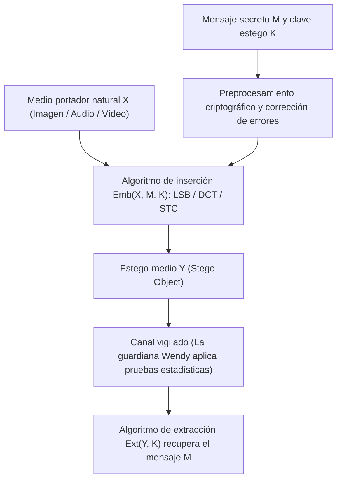
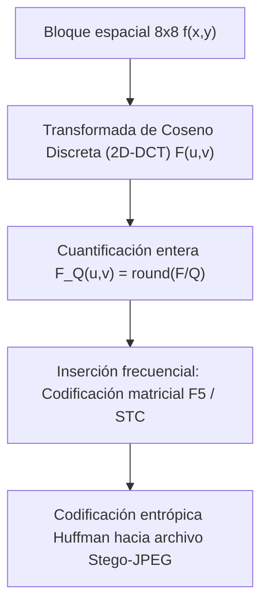

## 1. Criptografía frente a Esteganografía: ¿ocultar el «contenido» u ocultar la «existencia»?

En el ámbito de la seguridad de la información, la <strong>criptografía</strong> y la <strong>esteganografía</strong> abordan dos dimensiones fundamentalmente ortogonales. El objetivo de la criptografía es transformar un texto en claro $M$ mediante una clave secreta $K$ en un texto cifrado ininteligible $C = E_K(M)$. Cuando un adversario intercepta $C$, no puede leer su significado semántico, pero <strong>el hecho mismo de que existe una comunicación secreta y cifrada queda completamente expuesto</strong>. Bajo regímenes de censura estricta o vigilancia masiva de redes, el simple envío de tráfico de alta entropía (como bloques PGP o flujos TLS no estándar) basta para disparar alarmas, bloquear el canal o incriminar a los participantes.

Por el contrario, la <strong>esteganografía</strong> (del griego *steganos*, «cubierto, oculto», y *graphein*, «escribir») tiene como propósito <strong>borrar toda evidencia de que la comunicación secreta siquiera está ocurriendo</strong>. Desde los relatos clásicos de Heródoto en la antigua Grecia (mensajes tatuados en el cuero cabelludo afeitado de un mensajero o escritos en la madera bajo la cera de una tablilla) y el tratado *Steganographia* (1499) de Johannes Trithemius, hasta la inserción digital moderna dentro de fotografías cotidianas, pistas de audio o paquetes de red, la esteganografía incrusta un mensaje secreto $M$ dentro de un <strong>objeto portador o cubierta (Cover Object) $X$</strong> de aspecto inocente para producir un <strong>estego-objeto (Stego Object) $Y$</strong>.

En 1983, Gustavus J. Simmons formuló el célebre <strong>«Problema de los prisioneros (The Prisoners’ Problem)»</strong>, piedra angular de la esteganografía moderna: dos prisioneros, Alice y Bob, desean coordinar un plan de fuga, pero toda su correspondencia es inspeccionada por la guardiana Wendy (Warden). Si Wendy detecta texto cifrado o cualquier anomalía estadística en las cartas, cortará de inmediato la comunicación. Por tanto, Alice debe ocultar los bits secretos dentro de una imagen aparentemente normal $Y$ de modo que Wendy no pueda distinguir estadísticamente entre la distribución de medios naturales $P_X$ y la distribución de estego-medios $P_Y$.

En 1998, Christian Cachin estableció la definición matemática rigurosa de la seguridad esteganográfica utilizando la <strong>divergencia de Kullback-Leibler (divergencia KL / entropía relativa)</strong>. Sea $P_X$ la distribución de probabilidad de los objetos portadores naturales en el espacio $\mathcal{X}$ y $P_Y$ la distribución de los estego-objetos generados. Un sistema esteganográfico es $\varepsilon$-seguro (y perfectamente seguro cuando $\varepsilon = 0$) si cumple:

$$D_{\text{KL}}(P_X \,\|\, P_Y) = \sum_{x \in \mathcal{X}} P_X(x) \log_2 \frac{P_X(x)}{P_Y(x)} \le \varepsilon$$

Por la <strong>desigualdad de procesamiento de datos (Data-Processing Inequality)</strong>, independientemente de cuán sofisticado sea el clasificador estadístico o la red neuronal profunda empleada por la guardiana Wendy, su tasa de falsos positivos $\alpha$ (error de tipo I) y su tasa de falsos negativos $\beta$ (error de tipo II) están acotadas por la entropía relativa binaria:

$$d(1-\alpha, \beta) = (1-\alpha)\log_2 \frac{1-\alpha}{\beta} + \alpha \log_2 \frac{\alpha}{1-\beta} \le D_{\text{KL}}(P_X \,\|\, P_Y) \le \varepsilon$$

Cuando $\varepsilon \to 0$, se cumple $\alpha + \beta \to 1$, lo que significa que el detector de Wendy no tiene mayor poder discriminatorio que lanzar una moneda al aire.

| Dimensión de comparación | Criptografía (Cryptography) | Esteganografía (Steganography) | Marca de agua digital (Watermarking) |
|---|---|---|---|
| <strong>Objetivo primordial</strong> | Ocultar el <strong>contenido semántico</strong> | Ocultar la <strong>existencia misma de la comunicación</strong> | Proteger la <strong>autoría, copyright e integridad</strong> |
| <strong>Visibilidad del secreto</strong> | Pública (el texto cifrado de alta entropía es visible) | Estrictamente oculta (camuflada como archivo normal) | Visible o invisible (prioriza la imposibilidad de borrado) |
| <strong>Modelo de atacante</strong> | Criptoanálisis (descifrado sin clave) | <strong>Estegoanálisis</strong>: detección estadística $P_X \ne P_Y$ | <strong>Ataques de eliminación</strong>: compresión, recorte, ruido |
| <strong>Métrica clave</strong> | Indistinguibilidad computacional (IND-CPA) | Indetectabilidad estadística ($D_{\text{KL}} \to 0$) y capacidad | <strong>Robustez (Robustness)</strong> frente a distorsiones |

---

## 2. Dominio espacial: sustitución del bit menos significativo (LSB) y el ataque $\chi^2$

En imágenes sin compresión o con compresión sin pérdida (como BMP de 24 bits, PNG o audio WAV PCM de 16 bits), la técnica espacial más elemental es la <strong>sustitución del bit menos significativo (Least Significant Bit Replacement, LSB Replacement)</strong>. En una imagen en escala de grises de 8 bits, la intensidad de cada píxel $x_i \in \{0, 1, \dots, 255\}$ se descompone en 8 bits:

$$x_i = \sum_{b=0}^{7} a_{i,b} \, 2^b = 128 a_{i,7} + 64 a_{i,6} + \dots + 2 a_{i,1} + a_{i,0}$$

Mientras que el bit más significativo (MSB, $a_{i,7}$) altera el brillo en $128$ niveles, el bit menos significativo (LSB, $a_{i,0} = x_i \bmod 2$) solo produce una variación de $\pm 1$. Si sustituimos directamente el LSB por un bit secreto cifrado y uniformemente distribuido $m_i \in \{0, 1\}$:

$$y_i = 2 \left\lfloor \frac{x_i}{2} \right\rfloor + m_i$$

a máxima capacidad ($1\,\text{bit por píxel, bpp}$), la mitad de los píxeles permanece intacta y la otra mitad cambia en $\pm 1$. El error cuadrático medio (MSE) y la relación señal/ruido pico (PSNR) resultan:

$$\text{MSE} = \frac{1}{N}\sum_{i=1}^{N} (x_i - y_i)^2 = 0.5, \qquad \text{PSNR} = 10 \log_{10}\!\left(\frac{255^2}{\text{MSE}}\right) \approx 51.14\,\text{dB}$$

El sistema visual humano (HVS) no percibe diferencias por encima de $40\,\text{dB}$. Sin embargo, <strong>¡lo que es invisible para el ojo humano puede ser clamorosamente obvio para la estadística!</strong>

En 1999, Andreas Westfeld y Andreas Pfitzmann formularon el demoledor <strong>ataque chi-cuadrado ($\chi^2$ Steganalysis Attack)</strong>. Su fundamento radica en la <strong>asimetría de la sustitución LSB</strong>: un valor par $2k$ solo puede transformarse en $2k$ o $2k+1$, y un valor impar $2k+1$ solo puede pasar a $2k$ o $2k+1$; jamás ocurre una transición entre $2k-1$ y $2k$. Por consiguiente, cada par $\{2k, 2k+1\}$ forma un conjunto cerrado denominado <strong>«Par de Valores (Pairs of Values, PoVs)»</strong>. Dado que los bits cifrados tienen probabilidad $P(0)=P(1)=0.5$, las frecuencias del histograma $h_Y(2k)$ y $h_Y(2k+1)$ en la imagen estego se igualan forzosamente a su promedio aritmético:

$$\mathbb{E}[h_Y(2k)] = \mathbb{E}[h_Y(2k+1)] = \frac{h_X(2k) + h_X(2k+1)}{2} = \bar{h}_k$$

Al evaluar el estadístico $\chi^2$ de Pearson sobre los 128 pares:

$$\chi^2 = \sum_{k=0}^{127} \frac{\bigl(h_Y(2k) - \bar{h}_k\bigr)^2}{\bar{h}_k}$$

una fotografía natural arroja un valor $\chi^2$ grande ($p \approx 0$), mientras que una imagen con sustitución LSB exhibe barras de histograma emparejadas en escalones idénticos ($\chi^2 \to 0, \; p \to 1$), delatando de inmediato la inserción. Más aún, el <strong>estegoanálisis RS (Regular-Singular)</strong> de Jessica Fridrich detecta tasas de apenas $0.02\,\text{bpp}$ midiendo la correlación espacial entre píxeles adyacentes. Para eliminar los PoVs, el método <strong>LSB Matching ($\pm 1$ Embedding)</strong> suma o resta $1$ al azar cuando $m_i \ne \text{LSB}(x_i)$, suavizando el histograma sin crear escalones emparejados.

---

## 3. Dominio transformado y codificación matricial: DCT en JPEG, F5 y códigos STC

En las comunicaciones reales por Internet, la esteganografía espacial fracasa ante la <strong>compresión con pérdida (Lossy Compression)</strong>: al enviar una imagen por redes sociales o mensajería, se recodifica como <strong>JPEG</strong>, destruyendo los LSB espaciales. Por ello, la esteganografía moderna opera directamente en el <strong>dominio de la frecuencia (Transform Domain)</strong>.

El estándar JPEG divide la imagen (en el espacio $\text{YCbCr}$) en bloques de $8 \times 8$ píxeles $f(x,y)$, aplica la <strong>Transformada de Coseno Discreta bidimensional (2D-DCT)</strong> para obtener 64 coeficientes frecuenciales $F(u,v)$, y luego los divide por una matriz de cuantificación $Q(u,v)$ redondeando a enteros $F_Q(u,v)$:

$$F(u,v) = \frac{1}{4} C(u) C(v) \sum_{x=0}^{7} \sum_{y=0}^{7} f(x,y) \cos\!\left(\frac{(2x+1)u\pi}{16}\right) \cos\!\left(\frac{(2y+1)v\pi}{16}\right), \qquad F_Q(u,v) = \text{round}\!\left(\frac{F(u,v)}{Q(u,v)}\right)$$

En 2001, Andreas Westfeld transformó la disciplina con el <strong>algoritmo F5</strong>, introduciendo dos avances fundamentales:
1. <strong>Decremento del valor absoluto</strong>: en lugar de intercambiar LSBs en los coeficientes cuantificados (como hacía JSteg), F5 reduce siempre la magnitud absoluta del coeficiente modificado (positivos $-1$, negativos $+1$), respetando la distribución laplaciana monótona centrada en cero de los coeficientes DCT naturales.
2. <strong>Codificación matricial (Matrix Encoding mediante códigos de Hamming)</strong>: para incrustar $k$ bits secretos $\mathbf{m} \in \{0,1\}^k$ en $n = 2^k - 1$ coeficientes no nulos $\mathbf{x} \in \{0,1\}^n$, se emplea la matriz de control de paridad $\mathbf{H} \in \{0,1\}^{k \times (2^k-1)}$ de un código de Hamming binario. El síndrome $\mathbf{s} = \mathbf{m} \oplus \mathbf{H}\mathbf{x}$ señala directamente el índice $j$ del <strong>único coeficiente $x_j$ que debe modificarse</strong> para cumplir $\mathbf{H}\mathbf{y} = \mathbf{m}$ (o ninguno si $\mathbf{s} = \mathbf{0}$). Así, la <strong>eficiencia de inserción (Embedding Efficiency)</strong> se eleva a:

$$e(k) = \frac{k}{1 - 2^{-k}} = \frac{k \cdot 2^k}{2^k - 1}\,\text{bits por modificación}$$

Los algoritmos adaptativos de última generación (<strong>WOW, S-UNIWARD, J-UNIWARD, HILL</strong>) combinan funciones de distorsión local $\rho_i$ con <strong>Códigos de Trellis por Síndrome (Syndrome-Trellis Codes, STC, Filler et al. 2011)</strong>, utilizando el algoritmo de Viterbi para confinar los cambios exclusivamente en regiones de textura compleja (follaje, espuma, tejidos) donde los modelos estadísticos y las redes neuronales de estegoanálisis (como SRNet) tienen alta incertidumbre.

---

## 4. La Ley de la Raíz Cuadrada de la capacidad esteganográfica y las Marcas de Agua

¿Crece la carga útil secreta segura $m$ de forma lineal con el número total de píxeles $n$ de la imagen portadora ($m = O(n)$)? En 2008, Tomáš Filler, Andrew D. Ker y Jessica Fridrich demostraron la célebre <strong>Ley de la Raíz Cuadrada de la Capacidad Esteganográfica (Square Root Law)</strong>: si se modifica una fracción $\beta = m / n$ de $n$ píxeles independientes con información de Fisher $I_F > 0$, la expansión de Taylor de segundo orden de la divergencia KL acumulada satisface:

$$D_{\text{KL}}\!\left(P_X^{(n)} \,\big\|\, P_Y^{(n)}\right) = \frac{1}{2} n \beta^2 I_F + O(n\beta^3) = \frac{I_F}{2} \frac{m^2}{n} + O\!\left(\frac{m^3}{n^2}\right)$$

Para mantener $D_{\text{KL}}^{(n)} \le \varepsilon$ acotada y evitar la detección estadística, el número máximo de bits seguros $m_{\text{safe}}(n)$ <strong>solo puede crecer proporcionalmente a la raíz cuadrada del tamaño del portador</strong>:

$$m_{\text{safe}}(n) = O\!\left(\sqrt{n}\right)$$

Por último, dentro del <strong>«Triángulo Mágico de la Ocultación de Información» (Capacidad, Imperceptibilidad, Robustez)</strong>, la <strong>marca de agua digital (Digital Watermarking)</strong> representa el polo complementario a la esteganografía: técnicas como el <strong>espectro ensanchado (Spread-Spectrum Watermarking)</strong> de Ingemar Cox, la <strong>modulación de índice de cuantificación (QIM)</strong>, la <strong>constelación EURion</strong> en billetes bancarios o <strong>SynthID</strong> de Google DeepMind para autenticar imágenes y textos generados por IA sacrifican la capacidad a unas pocas docenas de bits para garantizar una <strong>robustez extrema</strong> capaz de sobrevivir a compresiones agresivas, recortes y transformaciones geométricas.
