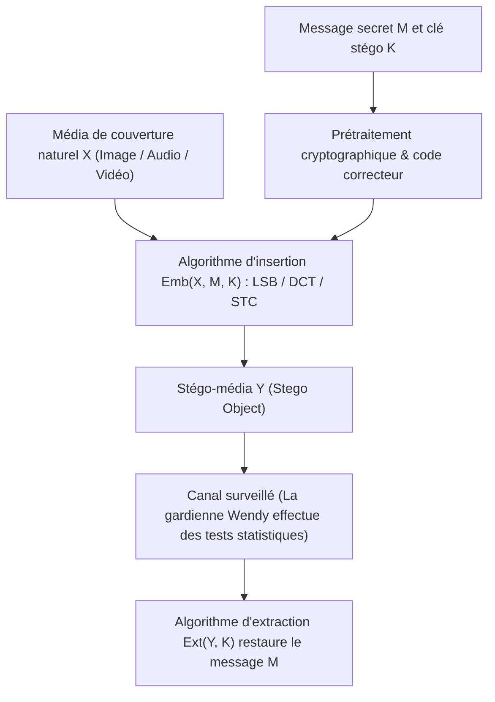
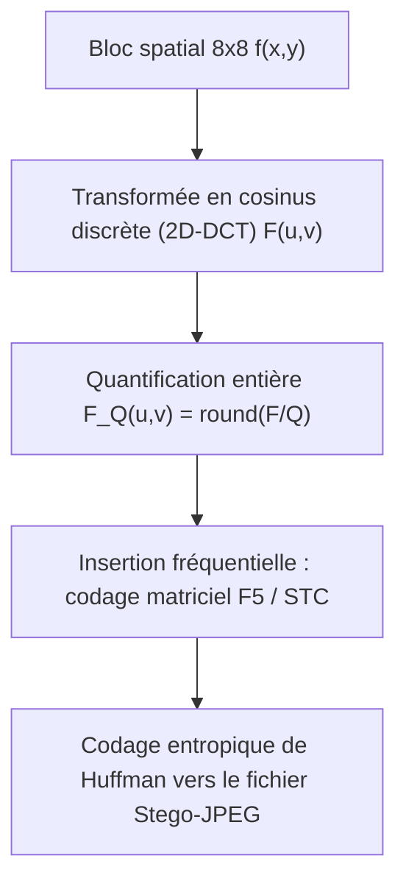

## 1. Cryptographie vs Stéganographie : dissimuler le « contenu » ou l’« existence » ?

En sécurité de l’information, la <strong>cryptographie</strong> et la <strong>stéganographie</strong> poursuivent deux objectifs fondamentalement orthogonaux. La cryptographie transforme un message en clair $M$ à l’aide d’une clé secrète $K$ en un texte chiffré inintelligible $C = E_K(M)$. Si un adversaire intercepte $C$, il ne peut pas en lire le contenu sémantique, mais <strong>le fait même qu’une communication secrète et chiffrée ait lieu est totalement visible</strong>. Dans des environnements soumis à une censure stricte ou à une surveillance réseau omniprésente, le simple envoi d’un flux à haute entropie (comme un bloc PGP ou un canal TLS suspect) suffit à déclencher une alerte, couper la liaison ou compromettre les interlocuteurs.

À l’inverse, la <strong>stéganographie</strong> (du grec ancien *steganos*, « couvert, dissimulé », et *graphein*, « écrire ») vise à <strong>effacer toute trace de l’existence même de la communication</strong>. Des récits d’Hérodote dans l’Antiquité grecque (message tatoué sur le crâne rasé d’un esclave ou gravé sur le bois sous la cire d’une tablette) au traité *Steganographia* (1499) de Johannes Trithemius, jusqu’aux techniques numériques modernes dissimulant des données au cœur de photographies anodines ou de flux audio, la stéganographie incorpore un message secret $M$ dans un <strong>objet de couverture (Cover Object) $X$</strong> d’apparence innocente afin de produire un <strong>stégo-objet (Stego Object) $Y$</strong>.

En 1983, Gustavus J. Simmons a formalisé ce paradigme à travers le célèbre <strong>« Problème des prisonniers (The Prisoners’ Problem) »</strong> : deux détenus, Alice et Bob, cherchent à coordonner un plan d’évasion, mais tous leurs messages sont inspectés par la gardienne Wendy (Warden). Si Wendy détecte le moindre texte chiffré ou une anomalie statistique suspecte, elle bloque immédiatement la communication. Alice doit donc dissimuler ses bits secrets dans une image ordinaire $Y$ de telle sorte que Wendy soit incapable de distinguer statistiquement un média naturel $X$ d’un stégo-média $Y$.

En 1998, Christian Cachin a formulé la définition mathématique rigoureuse de la sécurité stéganographique à l’aide de la <strong>divergence de Kullback-Leibler (divergence KL / entropie relative)</strong>. Soit $P_X$ la distribution de probabilité des objets de couverture naturels sur l’espace $\mathcal{X}$ et $P_Y$ celle des stégo-objets. Un système stéganographique est dit $\varepsilon$-sûr (et parfaitement sûr lorsque $\varepsilon = 0$) si :

$$D_{\text{KL}}(P_X \,\|\, P_Y) = \sum_{x \in \mathcal{X}} P_X(x) \log_2 \frac{P_X(x)}{P_Y(x)} \le \varepsilon$$

En vertu de l’<strong>inégalité de traitement des données (Data-Processing Inequality)</strong>, quel que soit le test d’hypothèse statistique ou le réseau neuronal profond utilisé par la gardienne Wendy, sa probabilité de fausse alarme $\alpha$ (erreur de première espèce) et sa probabilité de non-détection $\beta$ (erreur de seconde espèce) sont liées par l’entropie relative binaire :

$$d(1-\alpha, \beta) = (1-\alpha)\log_2 \frac{1-\alpha}{\beta} + \alpha \log_2 \frac{\alpha}{1-\beta} \le D_{\text{KL}}(P_X \,\|\, P_Y) \le \varepsilon$$

Lorsque $\varepsilon \to 0$, on obtient $\alpha + \beta \to 1$, ce qui réduit le détecteur de Wendy à un simple tirage à pile ou face.

| Dimension comparée | Cryptographie (Cryptography) | Stéganographie (Steganography) | Tatouage numérique (Watermarking) |
|---|---|---|---|
| <strong>Objectif principal</strong> | Masquer le <strong>contenu sémantique</strong> | Masquer l’<strong>existence de la communication</strong> | Prouver le <strong>droit d’auteur et l’intégrité</strong> |
| <strong>Visibilité du secret</strong> | Publique (le chiffré à haute entropie est visible) | Strictement cachée (déguisée en fichier normal) | Visible ou invisible (priorité à l’indélébilité) |
| <strong>Modèle d’adversaire</strong> | Cryptanalyse (déchiffrement sans la clé) | <strong>Stéganalyse</strong> : détection statistique $P_X \ne P_Y$ | <strong>Attaques de suppression</strong> : compression, recadrage, bruit |
| <strong>Métrique clé</strong> | Indistinguabilité calculatoire (IND-CPA) | Indétectabilité statistique ($D_{\text{KL}} \to 0$) & capacité | <strong>Robustesse (Robustness)</strong> aux distorsions du signal |

---

## 2. Domaine spatial : substitution du bit de poids faible (LSB) et attaque du $\chi^2$

Dans les images numériques non compressées ou compressées sans perte (BMP 24 bits, PNG, ou audio WAV PCM 16 bits), la méthode spatiale la plus classique est la <strong>substitution du bit de poids faible (Least Significant Bit Replacement, LSB Replacement)</strong>. Dans une image en niveaux de gris sur 8 bits, chaque pixel $x_i \in \{0, 1, \dots, 255\}$ s’écrit en base 2 :

$$x_i = \sum_{b=0}^{7} a_{i,b} \, 2^b = 128 a_{i,7} + 64 a_{i,6} + \dots + 2 a_{i,1} + a_{i,0}$$

Alors que le bit de poids fort (MSB, $a_{i,7}$) modifie la luminance de $128$, le bit de poids faible (LSB, $a_{i,0} = x_i \bmod 2$) ne fait varier l’intensité que de $\pm 1$. Si l’on remplace directement le LSB par un bit secret chiffré $m_i \in \{0, 1\}$ selon :

$$y_i = 2 \left\lfloor \frac{x_i}{2} \right\rfloor + m_i$$

la moitié des pixels reste inchangée en moyenne et l’autre moitié varie de $\pm 1$. Pour un taux d’insertion maximal de $1\,\text{bit par pixel (bpp)}$, l’erreur quadratique moyenne (MSE) et le rapport signal sur bruit crête (PSNR) valent :

$$\text{MSE} = \frac{1}{N}\sum_{i=1}^{N} (x_i - y_i)^2 = 0.5, \qquad \text{PSNR} = 10 \log_{10}\!\left(\frac{255^2}{\text{MSE}}\right) \approx 51.14\,\text{dB}$$

Le système visuel humain (HVS) est incapable de percevoir une dégradation lorsque le $\text{PSNR}$ dépasse $40\,\text{dB}$. Pourtant, <strong>l’invisibilité à l’œil nu ne garantit nullement l’indétectabilité statistique</strong> !

En 1999, Andreas Westfeld et Andreas Pfitzmann ont publié la redoutable <strong>attaque du khi-deux ($\chi^2$ Steganalysis Attack)</strong>. Son principe repose sur l’<strong>asymétrie structurelle de la substitution LSB</strong> : une valeur paire $2k$ ne peut être transformée qu’en $2k$ ou $2k+1$, et une valeur impaire $2k+1$ ne peut elle aussi devenir que $2k$ ou $2k+1$. Il n’existe aucun échange entre $2k-1$ et $2k$ ! Les paires $\{2k, 2k+1\}$ forment donc 128 <strong>« paires de valeurs (Pairs of Values, PoVs) »</strong> totalement cloisonnées. Comme le flux chiffré $m_i$ est uniformément distribué ($P(0)=P(1)=0.5$), les effectifs de l’histogramme $h_Y(2k)$ et $h_Y(2k+1)$ deviennent statistiquement égaux après insertion, quelle qu’ait été leur différence initiale dans l’image naturelle :

$$\mathbb{E}[h_Y(2k)] = \mathbb{E}[h_Y(2k+1)] = \frac{h_X(2k) + h_X(2k+1)}{2} = \bar{h}_k$$

En calculant la statistique du $\chi^2$ de Pearson sur les 128 paires :

$$\chi^2 = \sum_{k=0}^{127} \frac{\bigl(h_Y(2k) - \bar{h}_k\bigr)^2}{\bar{h}_k}$$

une image naturelle présente un $\chi^2$ élevé ($p \approx 0$), tandis qu’une image modifiée par substitution LSB affiche un histogramme en « marches d’escalier par paires » ($\chi^2 \to 0, \; p \to 1$), trahissant instantanément la présence du message ! De plus, la <strong>stéganalyse RS (Regular-Singular)</strong> de Jessica Fridrich exploite les corrélations spatiales entre pixels voisins pour détecter des taux d’insertion aussi faibles que $0.02\,\text{bpp}$. Pour briser cette asymétrie, l’<strong>appariement LSB (LSB Matching / $\pm 1$ Embedding)</strong> ajoute ou soustrait aléatoirement $1$ lorsque $m_i \ne \text{LSB}(x_i)$, détruisant ainsi les paires PoVs.

---

## 3. Domaine fréquentiel et codage matriciel : DCT JPEG, F5 et codes STC

Sur Internet, la stéganographie spatiale se heurte à un obstacle majeur : la <strong>compression avec perte (Lossy Compression)</strong>. Lorsqu’une image est partagée sur un réseau social ou une messagerie, elle est presque systématiquement réencodée au format <strong>JPEG</strong>, ce qui détruit les bits LSB spatiaux. Il est donc indispensable d’opérer directement dans le <strong>domaine fréquentiel (Transform Domain)</strong>.

Le pipeline JPEG découpe l’image (convertie en espace $\text{YCbCr}$) en blocs de $8 \times 8$ pixels $f(x,y)$, applique la <strong>transformée en cosinus discrète bidimensionnelle (2D-DCT)</strong> pour obtenir 64 coefficients fréquentiels $F(u,v)$, puis les divise par une matrice de quantification $Q(u,v)$ avant d’arrondir à l’entier le plus proche $F_Q(u,v)$ :

$$F(u,v) = \frac{1}{4} C(u) C(v) \sum_{x=0}^{7} \sum_{y=0}^{7} f(x,y) \cos\!\left(\frac{(2x+1)u\pi}{16}\right) \cos\!\left(\frac{(2y+1)v\pi}{16}\right), \qquad F_Q(u,v) = \text{round}\!\left(\frac{F(u,v)}{Q(u,v)}\right)$$

En 2001, Andreas Westfeld a révolutionné la stéganographie JPEG avec l’<strong>algorithme F5</strong>, qui introduit deux innovations majeures :
1. <strong>Décrémentation de la valeur absolue</strong> : au lieu d’échanger des paires LSB dans les coefficients DCT (ce que faisait JSteg), F5 diminue toujours la valeur absolue des coefficients non nuls modifiés (les positifs diminuent de $1$, les négatifs augmentent de $1$), préservant la forme laplacienne monotone de l’histogramme DCT.
2. <strong>Codage matriciel (Matrix Encoding par syndromes de Hamming)</strong> : pour insérer $k$ bits secrets $\mathbf{m} \in \{0,1\}^k$ dans un bloc de $n = 2^k - 1$ coefficients non nuls $\mathbf{x} \in \{0,1\}^n$, on utilise la matrice de parité $\mathbf{H} \in \{0,1\}^{k \times (2^k-1)}$ d’un code de Hamming binaire. Le syndrome $\mathbf{s} = \mathbf{m} \oplus \mathbf{H}\mathbf{x}$ indique directement l’indice $j$ du <strong>seul coefficient $x_j$ à modifier</strong> (ou aucun si $\mathbf{s} = \mathbf{0}$) pour satisfaire $\mathbf{H}\mathbf{y} = \mathbf{m}$ ! L’<strong>efficacité d’insertion (Embedding Efficiency)</strong> atteint alors :

$$e(k) = \frac{k}{1 - 2^{-k}} = \frac{k \cdot 2^k}{2^k - 1}\,\text{bits par modification}$$

Les schémas modernes (<strong>WOW, S-UNIWARD, J-UNIWARD, HILL</strong>) associent ensuite des <strong>coûts de distorsion adaptatifs $\rho_i$</strong> aux <strong>codes en treillis à syndrome (Syndrome-Trellis Codes, STC, Filler et al. 2011)</strong> : l’algorithme de Viterbi concentre toutes les modifications dans les zones de texture complexe (feuillages, vagues) où les résidus d’ondelettes sont imprévisibles, tout en laissant intactes les régions lisses.

---

## 4. La loi de la racine carrée de la capacité stéganographique et le tatouage numérique

La quantité de données secrètes $m$ que l’on peut cacher en toute sécurité croît-elle linéairement avec le nombre de pixels $n$ d’une image ? En 2008, Tomáš Filler, Andrew D. Ker et Jessica Fridrich ont démontré la célèbre <strong>loi de la racine carrée de la capacité stéganographique (Square Root Law)</strong> : pour un taux de modification par pixel $\beta = m / n$ et une information de Fisher $I_F > 0$, le développement de Taylor au second ordre de la divergence KL globale sur $n$ pixels indépendants donne :

$$D_{\text{KL}}\!\left(P_X^{(n)} \,\big\|\, P_Y^{(n)}\right) = \frac{1}{2} n \beta^2 I_F + O(n\beta^3) = \frac{I_F}{2} \frac{m^2}{n} + O\!\left(\frac{m^3}{n^2}\right)$$

Pour maintenir $D_{\text{KL}}^{(n)} \le \varepsilon$ constant face au stéganalyste, la charge utile sûre $m_{\text{safe}}(n)$ <strong>ne peut croître que proportionnellement à la racine carrée $\sqrt{n}$ du nombre de pixels</strong> :

$$m_{\text{safe}}(n) = O\!\left(\sqrt{n}\right)$$

Enfin, dans le <strong>« Triangle magique de la dissimulation d’information » (Capacité, Imperceptibilité, Robustesse)</strong>, le <strong>tatouage numérique (Digital Watermarking)</strong> occupe le pôle opposé à la stéganographie : qu’il s’agisse du tatouage par <strong>étalement de spectre (Spread-Spectrum Watermarking)</strong> d’Ingemar Cox, de la <strong>modulation d’indice de quantification (QIM)</strong>, de la <strong>constellation EURion</strong> sur les billets de banque, ou de <strong>SynthID</strong> développé par Google DeepMind pour authentifier les images et textes générés par l’IA, le tatouage sacrifie la capacité à quelques dizaines de bits afin de garantir une <strong>robustesse extrême</strong> face à la compression, au recadrage et aux altérations malveillantes.
