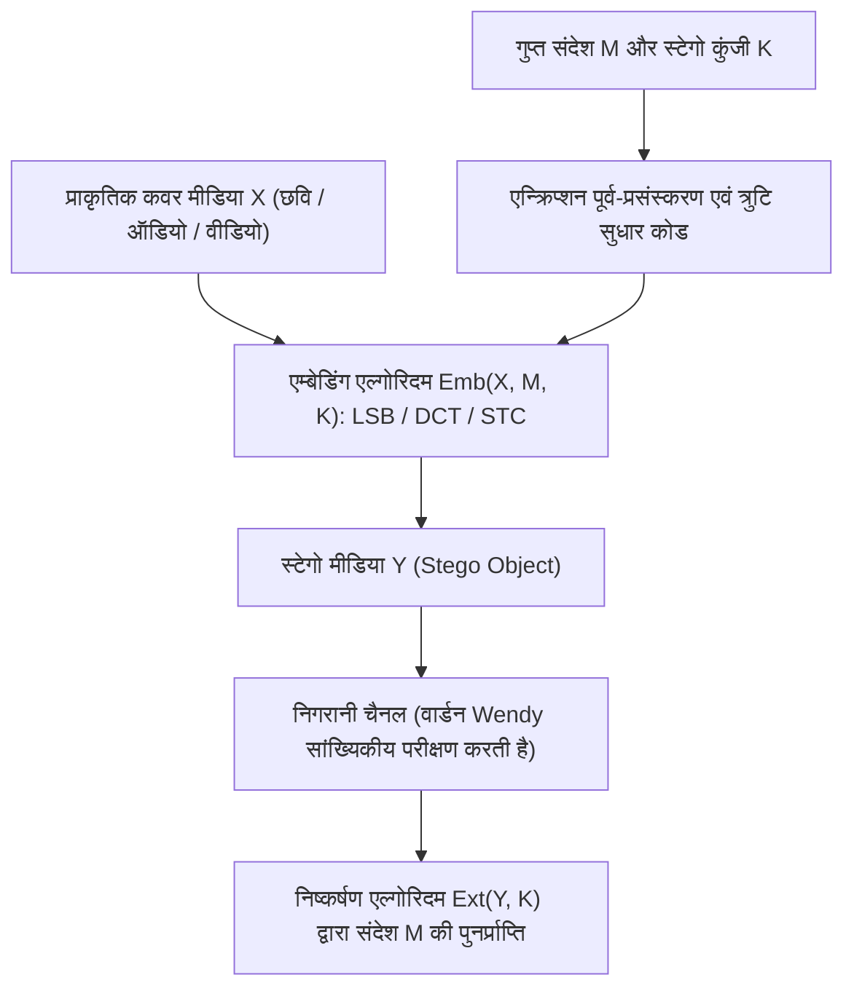
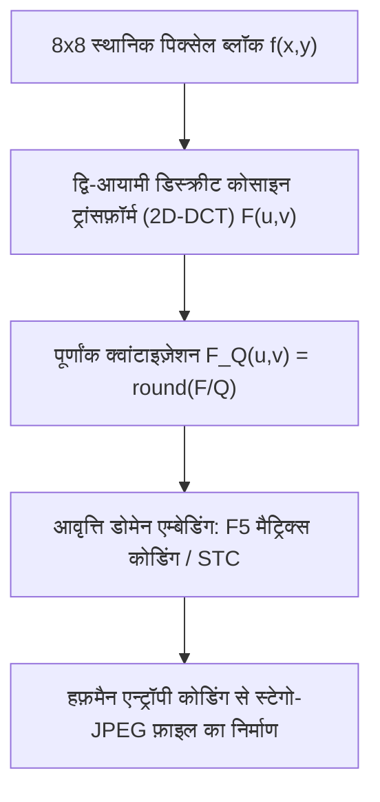

## 1. क्रिप्टोग्राफ़ी बनाम स्टेग्नोग्राफ़ी: 'सामग्री' को छिपाना या 'अस्तित्व' को छिपाना?

सूचना सुरक्षा (Information Security) के क्षेत्र में <strong>क्रिप्टोग्राफ़ी (Cryptography)</strong> और <strong>स्टेग्नोग्राफ़ी (Steganography)</strong> दो परस्पर लंबवत (orthogonal) लक्ष्यों का पीछा करते हैं। क्रिप्टोग्राफ़ी का उद्देश्य किसी सादे संदेश (plaintext) $M$ को गुप्त कुंजी (key) $K$ की सहायता से अपठनीय कूट-पाठ (ciphertext) $C = E_K(M)$ में बदलना है। जब कोई अवरोधक $C$ को पकड़ता है, तो वह उसका अर्थ तो नहीं समझ पाता, किंतु <strong>"दो पक्षों के बीच गुप्त कूटबद्ध संचार हो रहा है" — यह तथ्य पूरी तरह उजागर हो जाता है</strong>। कठोर सेंसरशिप या सघन नेटवर्क निगरानी व्यवस्था में केवल उच्च-एन्ट्रॉपी ट्रैफ़िक (जैसे PGP ब्लॉक या असामान्य TLS स्ट्रीम) भेजना ही अलार्म बजाने और संचार लाइन काटने के लिए पर्याप्त होता है।

इसके विपरीत, प्राचीन ग्रीक शब्द *steganos* (ढका हुआ, गुप्त) और *graphein* (लिखना) से बनी <strong>स्टेग्नोग्राफ़ी (Steganography)</strong> का लक्ष्य <strong>गुप्त संचार के अस्तित्व के हर निशान को मिटा देना है</strong>। प्राचीन यूनान के इतिहासकार हेरोडोटस (Herodotus) द्वारा वर्णित कथाओं (संदेशवाहक के मुंडे हुए सिर पर संदेश गोदकर बालों के उगने की प्रतीक्षा करना, या मोम की पट्टी के नीचे लकड़ी पर लिखना) और 1499 में जोहान्स ट्रिथेमियस की पुस्तक *Steganographia* से लेकर आधुनिक डिजिटल युग में सामान्य तस्वीरों, ऑडियो फ़ाइलों या नेटवर्क पैकेटों में डेटा छिपाने तक, स्टेग्नोग्राफ़ी गुप्त संदेश $M$ को एक निर्दोष दिखने वाले <strong>कवर ऑब्जेक्ट (Cover Object) $X$</strong> में पिरोकर <strong>स्टेगो ऑब्जेक्ट (Stego Object) $Y$</strong> का निर्माण करती है।

1983 में गुस्तावस जे. सिमंस (Gustavus J. Simmons) ने प्रसिद्ध <strong>"कैदियों की समस्या (The Prisoners’ Problem)"</strong> प्रस्तुत की, जो आधुनिक स्टेग्नोग्राफ़ी की आधारशिला है: जेल में बंद दो कैदी ऐलिस और बॉब भागने की योजना बनाना चाहते हैं, परंतु उनके बीच का हर पत्र वार्डन वेंडी (Wendy) की जाँच से गुज़रता है। यदि वेंडी को कोई कूटबद्ध पाठ या सांख्यिकीय असामान्यता दिखती है, तो वह तुरंत संचार बंद कर देगी। इसलिए ऐलिस को गुप्त बिट्स एक साधारण छवि $Y$ में इस प्रकार छिपाने होंगे कि वेंडी प्राकृतिक मीडिया वितरण $P_X$ और स्टेगो मीडिया वितरण $P_Y$ के बीच सांख्यिकीय रूप से अंतर न कर सके।

1998 में क्रिश्चियन कैशिन (Christian Cachin) ने सूचना सिद्धांत के <strong>कुलबैक-लीब्लर डाइवर्जेंस (Kullback-Leibler Divergence / सापेक्ष एन्ट्रॉपी)</strong> का उपयोग करके स्टेग्नोग्राफ़िक सुरक्षा की सटीक गणितीय परिभाषा दी। यदि प्राकृतिक कवर स्पेस $\mathcal{X}$ पर प्रायिकता वितरण $P_X$ और स्टेगो ऑब्जेक्ट्स का वितरण $P_Y$ हो, तो प्रणाली $\varepsilon$-सुरक्षित (और $\varepsilon = 0$ पर पूर्णतः सुरक्षित) कहलाती है यदि:

$$D_{\text{KL}}(P_X \,\|\, P_Y) = \sum_{x \in \mathcal{X}} P_X(x) \log_2 \frac{P_X(x)}{P_Y(x)} \le \varepsilon$$

सूचना सिद्धांत की <strong>डेटा-प्रोसेसिंग असमिका (Data-Processing Inequality)</strong> के अनुसार, वार्डन वेंडी चाहे कितनी भी उन्नत सांख्यिकीय परिकल्पना जाँच या डीप लर्निंग क्लासिफ़ायर (CNN) लगा ले, उसकी झूठे अलार्म की प्रायिकता $\alpha$ (Type-I error) और चूकने की प्रायिकता $\beta$ (Type-II error) द्विआधारी सापेक्ष एन्ट्रॉपी से बँधी होती है:

$$d(1-\alpha, \beta) = (1-\alpha)\log_2 \frac{1-\alpha}{\beta} + \alpha \log_2 \frac{\alpha}{1-\beta} \le D_{\text{KL}}(P_X \,\|\, P_Y) \le \varepsilon$$

जब $\varepsilon \to 0$, तब $\alpha + \beta \to 1$, अर्थात् वेंडी का डिटेक्टर सिक्का उछालकर अंधाधुंध अनुमान लगाने से बेहतर काम नहीं कर सकता।

| तुलना का आयाम | क्रिप्टोग्राफ़ी (Cryptography) | स्टेग्नोग्राफ़ी (Steganography) | डिजिटल वॉटरमार्किंग (Watermarking) |
|---|---|---|---|
| <strong>मुख्य सुरक्षा लक्ष्य</strong> | संदेश की <strong>अर्थगत सामग्री</strong> छिपाना | गुप्त संचार के <strong>अस्तित्व को ही</strong> छिपाना | मीडिया के <strong>कॉपीराइट एवं अखंडता</strong> की रक्षा |
| <strong>रहस्य की दृश्यता</strong> | सार्वजनिक (उच्च-एन्ट्रॉपी साइफ़रटेक्स्ट दिखता है) | पूर्णतः गुप्त (सामान्य फ़ाइल के रूप में छद्मवेश) | दृश्य या अदृश्य (अमिट होने पर मुख्य ज़ोर) |
| <strong>आक्रमणकारी मॉडल</strong> | क्रिप्टएनालिसिस (बिना कुंजी के डिक्रिप्शन) | <strong>स्टेग्नालिसिस (Steganalysis)</strong>: $P_X \ne P_Y$ की पहचान | <strong>वॉटरमार्क विलोपन आक्रमण</strong>: संपीड़न, क्रॉप, शोर |
| <strong>प्रमुख मानदंड</strong> | संगणकीय अविभेद्यता (IND-CPA / CCA2) | सांख्यिकीय अपता्यता ($D_{\text{KL}} \to 0$) एवं क्षमता | सिग्नल विकृति के विरुद्ध <strong>मज़बूती (Robustness)</strong> |

---

## 2. स्थानिक डोमेन (Spatial Domain): LSB प्रतिस्थापन और काई-स्क्वायर ($\chi^2$) आक्रमण

असंपीड़ित या दोषरहित (lossless) छवियों (जैसे 24-बिट BMP, PNG या 16-बिट WAV ऑडियो) में सबसे प्रचलित स्थानिक विधि <strong>न्यूनतम सार्थक बिट प्रतिस्थापन (Least Significant Bit Replacement, LSB Replacement)</strong> है। 8-बिट ग्रेस्केल छवि में प्रत्येक पिक्सेल का मान $x_i \in \{0, 1, \dots, 255\}$ 8 बाइनरी बिट्स से बना होता है:

$$x_i = \sum_{b=0}^{7} a_{i,b} \, 2^b = 128 a_{i,7} + 64 a_{i,6} + \dots + 2 a_{i,1} + a_{i,0}$$

जहाँ उच्चतम सार्थक बिट (MSB, $a_{i,7}$) चमक को $128$ से बदलता है, वहीं न्यूनतम सार्थक बिट (LSB, $a_{i,0} = x_i \bmod 2$) केवल $\pm 1$ का सूक्ष्म अंतर पैदा करता है। यदि हम LSB को समान रूप से वितरित गुप्त बिट $m_i \in \{0, 1\}$ से प्रतिस्थापित करें:

$$y_i = 2 \left\lfloor \frac{x_i}{2} \right\rfloor + m_i$$

तो पूर्ण क्षमता ($1\,\text{bpp}$) पर औसतन आधे पिक्सेल अपरिवर्तित रहते हैं और आधे $\pm 1$ से बदलते हैं। इससे माध्य वर्ग त्रुटि (MSE) और शिखर सिग्नल-टू-नॉइज़ अनुपात (PSNR) प्राप्त होते हैं:

$$\text{MSE} = \frac{1}{N}\sum_{i=1}^{N} (x_i - y_i)^2 = 0.5, \qquad \text{PSNR} = 10 \log_{10}\!\left(\frac{255^2}{\text{MSE}}\right) \approx 51.14\,\text{dB}$$

मानव दृश्य प्रणाली (HVS) $40\,\text{dB}$ से ऊपर के अंतर को नहीं पकड़ सकती। किंतु <strong>नग्न आँखों से अदृश्य होना सांख्यिकीय सुरक्षा की गारंटी बिल्कुल नहीं है!</strong>

1999 में एंड्रियास वेस्टफ़ेल्ड और एंड्रियास पफ़ित्ज़मैन ने विनाशकारी <strong>काई-स्क्वायर आक्रमण ($\chi^2$ Steganalysis Attack)</strong> प्रस्तुत किया। इसका गणितीय आधार <strong>LSB प्रतिस्थापन की संरचनात्मक असममिति</strong> है: सम पिक्सेल मान $2k$ केवल $2k$ या $2k+1$ बन सकता है, और विषम मान $2k+1$ भी केवल $2k$ या $2k+1$ ही बन सकता है; $2k-1$ और $2k$ के बीच कभी कोई आदान-प्रदान नहीं होता! अतः युग्म $\{2k, 2k+1\}$ 128 बंद <strong>"मान युग्म (Pairs of Values, PoVs)"</strong> बनाते हैं। चूँकि एन्क्रिप्टेड बिट्स के लिए $P(0)=P(1)=0.5$ होता है, स्टेगो छवि के हिस्टोग्राम में $h_Y(2k)$ और $h_Y(2k+1)$ की आवृत्तियाँ बलपूर्वक बराबर हो जाती हैं:

$$\mathbb{E}[h_Y(2k)] = \mathbb{E}[h_Y(2k+1)] = \frac{h_X(2k) + h_X(2k+1)}{2} = \bar{h}_k$$

सभी 128 युग्मों पर पियर्सन काई-स्क्वायर सांख्यिकी की गणना करने पर:

$$\chi^2 = \sum_{k=0}^{127} \frac{\bigl(h_Y(2k) - \bar{h}_k\bigr)^2}{\bar{h}_k}$$

प्राकृतिक छवि में उच्च $\chi^2$ ($p \approx 0$) मिलता है, जबकि LSB प्रतिस्थापित छवि का हिस्टोग्राम युग्मित सीढ़ियों जैसा सपाट हो जाता है ($\chi^2 \to 0, \; p \to 1$), जिससे गोपन तुरंत पकड़ा जाता है! इसके अलावा, जेसिका फ़्रिडरिच का <strong>RS स्टेग्नालिसिस (Regular-Singular)</strong> पड़ोसी पिक्सेल सहसंबंधों के माध्यम से $0.02\,\text{bpp}$ जितनी कम दर को भी पकड़ लेता है। इस दोष को मिटाने के लिए <strong>LSB मैचिंग ($\pm 1$ Embedding)</strong> $m_i \ne \text{LSB}(x_i)$ होने पर यादृच्छिक रूप से $+1$ या $-1$ जोड़ता है।

---

## 3. आवृत्ति डोमेन और मैट्रिक्स कोडिंग: JPEG 2D-DCT, F5 और STC एल्गोरिदम

वास्तविक इंटरनेट संचार में स्थानिक LSB स्टेग्नोग्राफ़ी <strong>हानिपूर्ण संपीड़न (Lossy Compression)</strong> के सामने विफल हो जाती है: सोशल मीडिया या मैसेंजर पर छवि अपलोड करते ही वह <strong>JPEG</strong> में पुनः कोडित हो जाती है, जिससे स्थानिक LSB नष्ट हो जाते हैं। इसलिए आधुनिक स्टेग्नोग्राफ़ी सीधे <strong>आवृत्ति रूपांतरण डोमेन (Transform Domain)</strong> में कार्य करती है।

JPEG पाइपलाइन छवि ($\text{YCbCr}$ स्पेस में) को $8 \times 8$ पिक्सेल ब्लॉकों $f(x,y)$ में बाँटती है, <strong>द्वि-आयामी डिस्क्रीट कोसाइन ट्रांसफ़ॉर्म (2D-DCT)</strong> द्वारा 64 आवृत्ति गुणांक $F(u,v)$ निकालती है, और उन्हें क्वांटाइज़ेशन मैट्रिक्स $Q(u,v)$ से भाग देकर पूर्णांक $F_Q(u,v)$ में पूर्णांकित करती है:

$$F(u,v) = \frac{1}{4} C(u) C(v) \sum_{x=0}^{7} \sum_{y=0}^{7} f(x,y) \cos\!\left(\frac{(2x+1)u\pi}{16}\right) \cos\!\left(\frac{(2y+1)v\pi}{16}\right), \qquad F_Q(u,v) = \text{round}\!\left(\frac{F(u,v)}{Q(u,v)}\right)$$

2001 में एंड्रियास वेस्टफ़ेल्ड ने <strong>F5 एल्गोरिदम</strong> द्वारा JPEG स्टेग्नोग्राफ़ी में दो क्रांतिकारी सुधार किए:
1. <strong>निरपेक्ष मान में कमी</strong>: DCT गुणांकों के LSB बदलने (जैसे JSteg में) के बजाय, F5 हमेशा अशून्य गुणांक के निरपेक्ष मान को शून्य की ओर 1 घटाता है, जिससे DCT हिस्टोग्राम का प्राकृतिक लाप्लास आकार सुरक्षित रहता है।
2. <strong>मैट्रिक्स कोडिंग (हैमिंग कोड द्वारा Matrix Encoding)</strong>: $n = 2^k - 1$ अशून्य गुणांकों $\mathbf{x} \in \{0,1\}^n$ में $k$ गुप्त बिट्स $\mathbf{m} \in \{0,1\}^k$ छिपाने के लिए बाइनरी हैमिंग कोड के पैरिटी-चेक मैट्रिक्स $\mathbf{H} \in \{0,1\}^{k \times (2^k-1)}$ का उपयोग किया जाता है। सिंड्रोम $\mathbf{s} = \mathbf{m} \oplus \mathbf{H}\mathbf{x}$ सीधे उस <strong>एकमात्र गुणांक $x_j$</strong> का सूचकांक बताता है जिसे बदलने पर $\mathbf{H}\mathbf{y} = \mathbf{m}$ संतुष्ट हो जाता है! इससे <strong>एम्बेडिंग दक्षता (Embedding Efficiency)</strong> बढ़कर हो जाती है:

$$e(k) = \frac{k}{1 - 2^{-k}} = \frac{k \cdot 2^k}{2^k - 1}\,\text{bits per modification}$$

आधुनिक अनुकूली विधियाँ (<strong>WOW, S-UNIWARD, J-UNIWARD, HILL</strong>) स्थानीय विरूपण लागत $\rho_i$ को <strong>सिंड्रोम-ट्रेलिस कोड (Syndrome-Trellis Codes, STC, Filler et al. 2011)</strong> और विटरबी (Viterbi) एल्गोरिदम के साथ जोड़ती हैं, जिससे सभी बदलाव केवल जटिल बनावट (पत्ते, पानी की लहरें) वाले क्षेत्रों में सीमित रहते हैं जहाँ डीप लर्निंग स्टेग्नालिसिस नेटवर्क (SRNet) सटीक पूर्वानुमान नहीं लगा सकते।

---

## 4. स्टेग्नोग्राफ़िक क्षमता का वर्गमूल नियम (Square Root Law) और डिजिटल वॉटरमार्किंग

क्या सुरक्षित गुप्त डेटा की मात्रा $m$ छवि के कुल पिक्सेल $n$ के साथ रैखिक रूप से ($m = O(n)$) बढ़ती है? 2008 में तोमाश फ़िलर, एंड्रयू केर और जेसिका फ़्रिडरिच ने <strong>स्टेग्नोग्राफ़िक क्षमता का वर्गमूल नियम (Square Root Law)</strong> सिद्ध किया: प्रति पिक्सेल परिवर्तन दर $\beta = m / n$ और फ़िशर सूचना $I_F > 0$ होने पर, $n$ स्वतंत्र पिक्सेलों के कुल KL-डाइवर्जेंस का द्वितीय-कोटि टेलर विस्तार दर्शाता है:

$$D_{\text{KL}}\!\left(P_X^{(n)} \,\big\|\, P_Y^{(n)}\right) = \frac{1}{2} n \beta^2 I_F + O(n\beta^3) = \frac{I_F}{2} \frac{m^2}{n} + O\!\left(\frac{m^3}{n^2}\right)$$

सांख्यिकीय पहचान से बचने के लिए कुल डाइवर्जेंस $D_{\text{KL}}^{(n)} \le \varepsilon$ को अचर रखना आवश्यक है, इसलिए सुरक्षित पेलोड $m_{\text{safe}}(n)$ <strong>केवल पिक्सेल संख्या के वर्गमूल $\sqrt{n}$ के समानुपाती बढ़ सकता है</strong>:

$$m_{\text{safe}}(n) = O\!\left(\sqrt{n}\right)$$

अंत में, <strong>"सूचना गोपन के जादुई त्रिभुज" (क्षमता, अदृश्यता, मज़बूती)</strong> में <strong>डिजिटल वॉटरमार्किंग (Digital Watermarking)</strong> स्टेग्नोग्राफ़ी के विपरीत ध्रुव पर खड़ा है: इंगमार कॉक्स की <strong>स्प्रेड-स्पेक्ट्रम वॉटरमार्किंग</strong>, <strong>क्वांटाइज़ेशन इंडेक्स मॉड्यूलेशन (QIM)</strong>, बैंकनोटों पर <strong>EURion नक्षत्र</strong>, या AI जनित छवियों व पाठ की पहचान के लिए Google DeepMind का <strong>SynthID</strong> — ये सभी क्षमता को कुछ दर्जन बिट्स तक सीमित रखकर संपीड़न, क्रॉपिंग और शोर के विरुद्ध <strong>अत्यधिक मज़बूती (Robustness)</strong> सुनिश्चित करते हैं।
