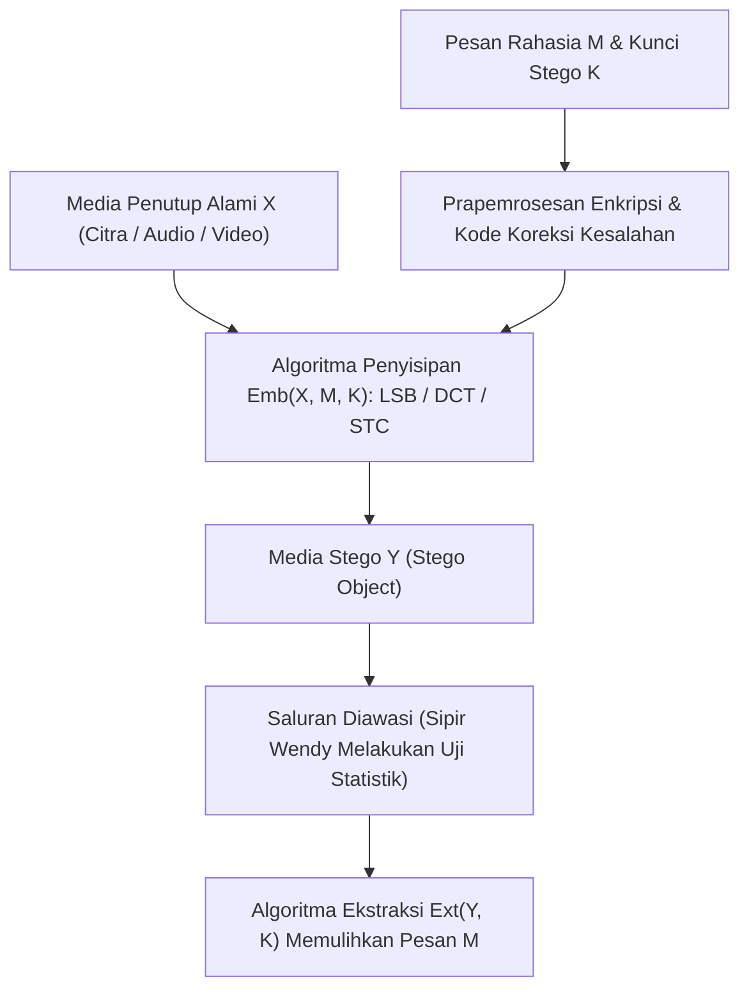
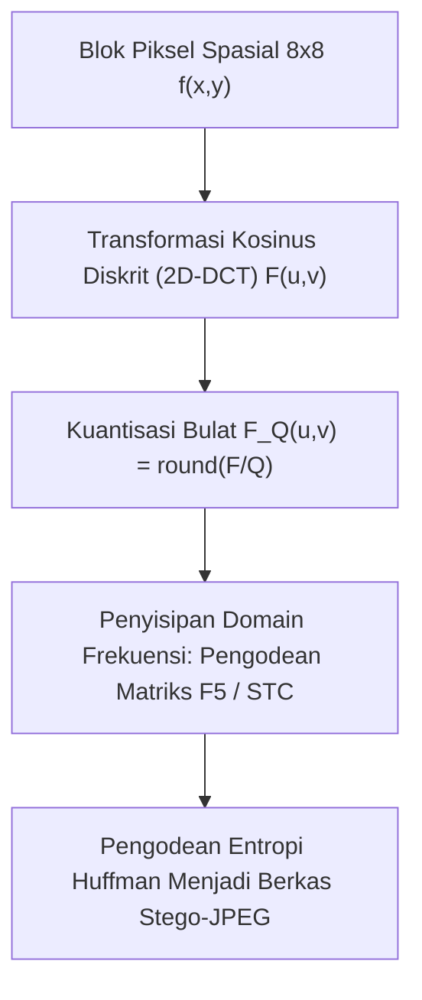

## 1. Kriptografi vs. Steganografi: Menyembunyikan "Isi" atau Menyembunyikan "Keberadaan"?

Dalam keamanan informasi, <strong>kriptografi (Cryptography)</strong> dan <strong>steganografi (Steganography)</strong> mengejar dua tujuan yang saling ortogonal. Kriptografi mengubah teks biasa (plaintext) $M$ menggunakan kunci rahasia $K$ menjadi teks sandi (ciphertext) $C = E_K(M)$ yang tidak dapat dibaca. Ketika penyadap menangkap $C$, ia memang tidak dapat memahami isi pesan tersebut, tetapi <strong>fakta bahwa komunikasi rahasia sedang berlangsung terlihat dengan sangat jelas</strong>. Di bawah rezim sensor ketat atau pengawasan jaringan totaliter, sekadar mengirimkan lalu lintas berentropi tinggi (seperti blok PGP atau aliran TLS mencurigakan) sudah cukup untuk memicu alarm, memutus saluran komunikasi, atau mengundang interogasi.

Sebaliknya, <strong>steganografi</strong> (dari bahasa Yunani Kuno *steganos* yang berarti "tertutup/tersembunyi" dan *graphein* yang berarti "menulis") bertujuan untuk <strong>menghapus вся jejak bahwa komunikasi rahasia itu sendiri sedang terjadi</strong>. Mulai dari kisah Herodotus di Yunani Kuno (menato pesan di kulit kepala budak yang dicukur lalu menunggu rambutnya tumbuh, atau menulis di kayu di bawah lapisan lilin tablet) dan risalah *Steganographia* (1499) karya Johannes Trithemius, hingga teknik digital modern yang menyisipkan data ke dalam foto pemandangan biasa, berkas audio, atau paket jaringan, steganografi menyematkan pesan rahasia $M$ ke dalam <strong>objek penutup (Cover Object) $X$</strong> yang tampak tidak berdosa untuk menghasilkan <strong>objek stego (Stego Object) $Y$</strong>.

Pada tahun 1983, Gustavus J. Simmons merumuskan <strong>"Masalah Tahanan (The Prisoners’ Problem)"</strong> yang menjadi kerangka dasar steganografi modern: dua tahanan, Alice dan Bob, ingin merencanakan pelarian dari penjara, tetapi setiap surat yang mereka kirim diperiksa oleh sipir Wendy (Warden). Jika Wendy menemukan teks terenkripsi atau anomali statistik apa pun, ia akan langsung memblokir komunikasi. Oleh karena itu, Alice harus menyembunyikan bit rahasia di dalam citra biasa $Y$ sedemikian rupa sehingga Wendy tidak dapat membedakan secara statistik antara distribusi media alami $P_X$ dan distribusi media stego $P_Y$.

Pada tahun 1998, Christian Cachin memberikan definisi keamanan steganografi secara matematis menggunakan <strong>Divergensi Kullback-Leibler (Divergensi KL / Entropi Relatif)</strong>. Misalkan $P_X$ adalah distribusi probabilitas objek penutup alami pada ruang $\mathcal{X}$ dan $P_Y$ adalah distribusi objek stego. Sistem steganografi disebut $\varepsilon$-aman (dan aman sempurna jika $\varepsilon = 0$) apabila memenuhi:

$$D_{\text{KL}}(P_X \,\|\, P_Y) = \sum_{x \in \mathcal{X}} P_X(x) \log_2 \frac{P_X(x)}{P_Y(x)} \le \varepsilon$$

Berdasarkan <strong>Ketaksamaan Pemrosesan Data (Data-Processing Inequality)</strong> dalam teori informasi, seberapa canggih pun uji hipotesis statistik atau jaringan saraf tiruan mendalam (CNN) yang digunakan sipir Wendy, probabilitas alarm palsu $\alpha$ (galat tipe I) dan probabilitas gagal deteksi $\beta$ (galat tipe II) dibatasi secara ketat oleh entropi relatif biner:

$$d(1-\alpha, \beta) = (1-\alpha)\log_2 \frac{1-\alpha}{\beta} + \alpha \log_2 \frac{\alpha}{1-\beta} \le D_{\text{KL}}(P_X \,\|\, P_Y) \le \varepsilon$$

Ketika $\varepsilon \to 0$, maka $\alpha + \beta \to 1$, yang berarti detektor Wendy tidak lebih baik daripada tebakan lempar koin acak.

| Dimensi Perbandingan | Kriptografi (Cryptography) | Steganografi (Steganography) | Watermarking Digital (Watermarking) |
|---|---|---|---|
| <strong>Tujuan Utama</strong> | Menyembunyikan <strong>isi semantik pesan</strong> | Menyembunyikan <strong>keberadaan komunikasi</strong> | Melindungi <strong>hak cipta & integritas media</strong> |
| <strong>Visibilitas Rahasia</strong> | Terlihat publik (ciphertext berentropi tinggi tampak jelas) | Sangat tersembunyi (disamarkan sebagai berkas normal) | Terlihat atau tak terlihat (fokus pada ketahanan) |
| <strong>Model Penyerang</strong> | Kriptanalisis (dekripsi tanpa kunci) | <strong>Steganalisis</strong>: deteksi statistik $P_X \ne P_Y$ | <strong>Serangan penghapusan</strong>: kompresi, pemotongan, derau |
| <strong>Metrik Kunci</strong> | Ketakterbedaan komputasional (IND-CPA) | Ketakterdeteksian statistik ($D_{\text{KL}} \to 0$) & kapasitas | <strong>Ketangguhan (Robustness)</strong> terhadap distorsi sinyal |

---

## 2. Domain Spasial: Penggantian Bit Paling Tidak Signifikan (LSB) dan Serangan $\chi^2$

Pada citra digital tanpa kompresi atau kompresi nirrugi (BMP 24-bit, PNG, atau audio WAV PCM 16-bit), metode domain spasial yang paling populer adalah <strong>Penggantian Bit Paling Tidak Signifikan (Least Significant Bit Replacement, LSB Replacement)</strong>. Dalam citra skala abu-abu 8-bit, nilai intensitas setiap piksel $x_i \in \{0, 1, \dots, 255\}$ dinyatakan dalam biner sebagai:

$$x_i = \sum_{b=0}^{7} a_{i,b} \, 2^b = 128 a_{i,7} + 64 a_{i,6} + \dots + 2 a_{i,1} + a_{i,0}$$

Sementara bit paling signifikan (MSB, $a_{i,7}$) mengubah kecerahan sebesar $128$, bit paling tidak signifikan (LSB, $a_{i,0} = x_i \bmod 2$) hanya mengubah intensitas sebesar $\pm 1$. Jika kita mengganti LSB dengan bit rahasia terenkripsi $m_i \in \{0, 1\}$ yang berdistribusi seragam:

$$y_i = 2 \left\lfloor \frac{x_i}{2} \right\rfloor + m_i$$

pada kapasitas penuh ($1\,\text{bit per piksel, bpp}$), rata-rata separuh piksel tetap tidak berubah dan separuh lainnya hanya berubah $\pm 1$. Galat kuadrat rata-rata (MSE) dan rasio sinyal terhadap derau puncak (PSNR) adalah:

$$\text{MSE} = \frac{1}{N}\sum_{i=1}^{N} (x_i - y_i)^2 = 0.5, \qquad \text{PSNR} = 10 \log_{10}\!\left(\frac{255^2}{\text{MSE}}\right) \approx 51.14\,\text{dB}$$

Sistem visual manusia (HVS) tidak mampu membedakan perubahan di atas $40\,\text{dB}$. Namun, <strong>tak terlihat oleh mata telanjang sama sekali tidak berarti aman secara statistik!</strong>

Pada tahun 1999, Andreas Westfeld dan Andreas Pfitzmann memperkenalkan <strong>Serangan Chi-Kuadrat ($\chi^2$ Steganalysis Attack)</strong> yang langsung membongkar penggantian LSB. Kelemahan utamanya terletak pada <strong>asimetri struktural penggantian LSB</strong>: nilai piksel genap $2k$ hanya dapat berubah menjadi $2k$ atau $2k+1$, dan nilai ganjil $2k+1$ juga hanya dapat menjadi $2k$ atau $2k+1$; tidak pernah terjadi perpindahan antara $2k-1$ dan $2k$! Akibatnya, pasangan $\{2k, 2k+1\}$ membentuk 128 <strong>"Pasangan Nilai (Pairs of Values, PoVs)"</strong> yang tertutup. Karena bit terenkripsi memiliki probabilitas $P(0)=P(1)=0.5$, frekuensi histogram $h_Y(2k)$ dan $h_Y(2k+1)$ pada citra stego akan dipaksa menjadi sama rata:

$$\mathbb{E}[h_Y(2k)] = \mathbb{E}[h_Y(2k+1)] = \frac{h_X(2k) + h_X(2k+1)}{2} = \bar{h}_k$$

Dengan menghitung statistik $\chi^2$ Pearson di seluruh 128 pasangan:

$$\chi^2 = \sum_{k=0}^{127} \frac{\bigl(h_Y(2k) - \bar{h}_k\bigr)^2}{\bar{h}_k}$$

citra alami menghasilkan nilai $\chi^2$ yang besar ($p \approx 0$), sedangkan citra hasil penggantian LSB menampilkan histogram berpasangan yang rata seperti anak tangga ($\chi^2 \to 0, \; p \to 1$). Bahkan pada laju penyisipan rendah, <strong>steganalisis RS (Regular-Singular)</strong> karya Jessica Fridrich sanggup mendeteksi penyisipan hingga $0.02\,\text{bpp}$. Untuk mengatasi asimetri ini, metode <strong>LSB Matching ($\pm 1$ Embedding)</strong> menambahkan atau mengurangkan $1$ secara acak ketika $m_i \ne \text{LSB}(x_i)$.

---

## 3. Domain Frekuensi dan Pengodean Matriks: DCT JPEG, Algoritma F5, dan Kode STC

Di dunia nyata Internet, steganografi spasial hancur oleh <strong>kompresi مه (Lossy Compression)</strong>: saat gambar diunggah ke media sosial atau aplikasi pesan, gambar dikodekan ulang menjadi <strong>JPEG</strong>, yang menghapus seluruh LSB spasial. Oleh sebab itu, steganografi modern bekerja langsung di <strong>domain transformasi frekuensi (Transform Domain)</strong>.

Proses kompresi JPEG membagi citra (dalam ruang $\text{YCbCr}$) menjadi blok $8 \times 8$ piksel $f(x,y)$, menerapkan <strong>Transformasi Kosinus Diskrit dua dimensi (2D-DCT)</strong> untuk menghasilkan 64 koefisien frekuensi $F(u,v)$, lalu membaginya dengan matriks kuantisasi $Q(u,v)$ dan membulatkannya menjadi bilangan bulat $F_Q(u,v)$:

$$F(u,v) = \frac{1}{4} C(u) C(v) \sum_{x=0}^{7} \sum_{y=0}^{7} f(x,y) \cos\!\left(\frac{(2x+1)u\pi}{16}\right) \cos\!\left(\frac{(2y+1)v\pi}{16}\right), \qquad F_Q(u,v) = \text{round}\!\left(\frac{F(u,v)}{Q(u,v)}\right)$$

Pada tahun 2001, Andreas Westfeld merevolusi steganografi JPEG melalui <strong>algoritma F5</strong> dengan dua terobosan:
1. <strong>Penurunan Nilai Absolut</strong>: alih-alih menukar LSB koefisien DCT (seperti pada JSteg), F5 selalu mengurangi magnitudo absolut koefisien tak-nol sebesar 1 menuju nol, sehingga menjaga bentuk distribusi Laplace alami histogram DCT.
2. <strong>Pengodean Matriks (Matrix Encoding menggunakan kode Hamming)</strong>: untuk menyisipkan $k$ bit rahasia $\mathbf{m} \in \{0,1\}^k$ ke dalam $n = 2^k - 1$ koefisien tak-nol $\mathbf{x} \in \{0,1\}^n$, digunakan matriks cek paritas $\mathbf{H} \in \{0,1\}^{k \times (2^k-1)}$ dari kode Hamming biner. Sindrom $\mathbf{s} = \mathbf{m} \oplus \mathbf{H}\mathbf{x}$ langsung menunjuk indeks $j$ dari <strong>satu-satunya koefisien $x_j$ yang perlu diubah</strong> agar $\mathbf{H}\mathbf{y} = \mathbf{m}$ terpenuhi! Dengan demikian, <strong>efisiensi penyisipan (Embedding Efficiency)</strong> meningkat menjadi:

$$e(k) = \frac{k}{1 - 2^{-k}} = \frac{k \cdot 2^k}{2^k - 1}\,\text{bit per modifikasi}$$

Algoritma adaptif mutakhir (<strong>WOW, S-UNIWARD, J-UNIWARD, HILL</strong>) menggabungkan fungsi biaya distorsi lokal $\rho_i$ dengan <strong>Syndrome-Trellis Codes (STC, Filler et al. 2011)</strong>, menggunakan algoritma Viterbi untuk memusatkan seluruh modifikasi hanya pada area bertekstur rumit (dedaunan, riak air) di mana jaringan saraf steganalisis (seperti SRNet) memiliki ketidakpastian prediksi yang tinggi.

---

## 4. Hukum Akar Kuadrat Kapasitas Steganografi dan Watermarking Digital

Apakah kapasitas pesan rahasia yang aman $m$ tumbuh secara linear seiring bertambahnya jumlah piksel $n$ ($m = O(n)$)? Pada tahun 2008, Tomáš Filler, Andrew D. Ker, dan Jessica Fridrich membuktikan <strong>Hukum Akar Kuadrat Kapasitas Steganografi (Square Root Law)</strong>: dengan laju perubahan per piksel $\beta = m / n$ dan informasi Fisher $I_F > 0$, ekspansi Taylor orde kedua dari total divergensi KL pada $n$ piksel independen memenuhi:

$$D_{\text{KL}}\!\left(P_X^{(n)} \,\big\|\, P_Y^{(n)}\right) = \frac{1}{2} n \beta^2 I_F + O(n\beta^3) = \frac{I_F}{2} \frac{m^2}{n} + O\!\left(\frac{m^3}{n^2}\right)$$

Agar total divergensi $D_{\text{KL}}^{(n)} \le \varepsilon$ tetap konstan di bawah ambang deteksi statistik, muatan rahasia yang aman $m_{\text{safe}}(n)$ <strong>hanya dapat tumbuh sebanding dengan akar kuadrat jumlah piksel $\sqrt{n}$</strong>:

$$m_{\text{safe}}(n) = O\!\left(\sqrt{n}\right)$$

Terakhir, dalam <strong>"Segitiga Ajaib Penyembunyian Informasi" (Kapasitas, Ketakterlihatan, Ketangguhan)</strong>, <strong>watermark digital (Digital Watermarking)</strong> menempati kutub kebalikan dari steganografi: teknik seperti <strong>Spread-Spectrum Watermarking</strong> karya Ingemar Cox, <strong>Quantization Index Modulation (QIM)</strong>, <strong>konstelasi EURion</strong> pada uang kertas, hingga <strong>SynthID</strong> dari Google DeepMind untuk menandai gambar dan teks buatan AI, mengorbankan kapasitas menjadi hanya puluhan bit demi menjamin <strong>ketangguhan ekstrem (robustness)</strong> terhadap kompresi, pemotongan, dan distorsi sinyal.
