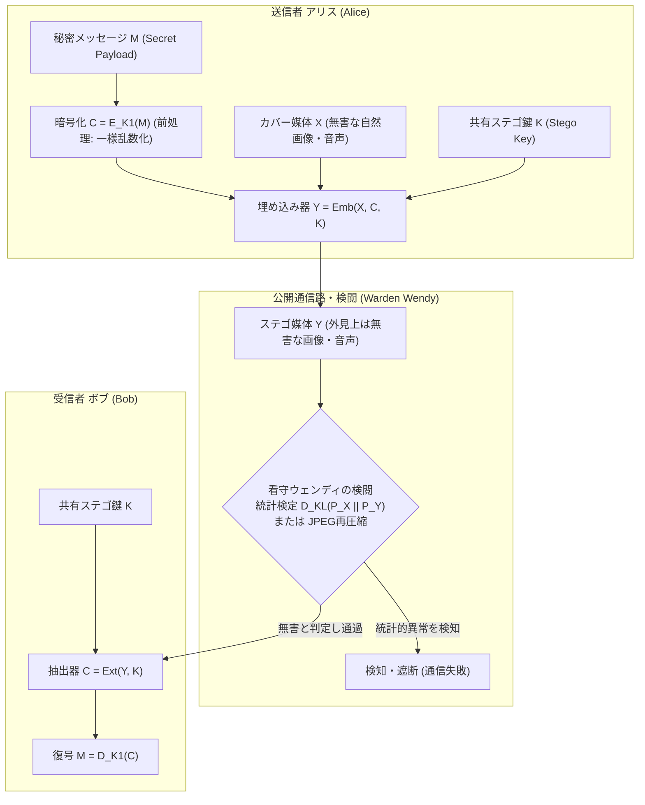
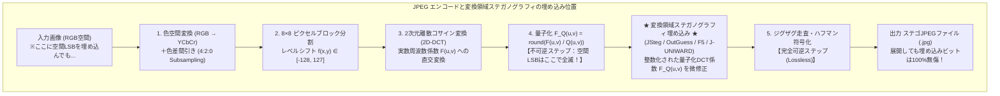
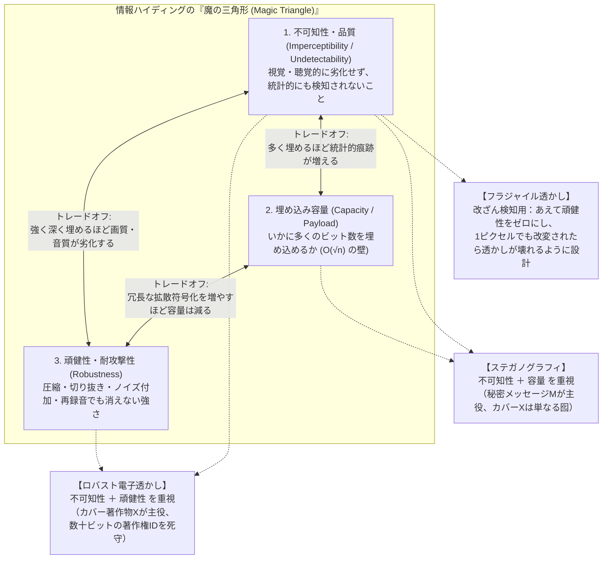

## 1. 「意味」を隠す暗号、「存在」を隠すステガノグラフィ

私たちがインターネット上で機密情報を送るとき、真っ先に思い浮かぶ防衛手段は<strong>暗号（Cryptography）</strong>である。送信者アリス（Alice）が平文メッセージ $M$ を暗号鍵 $K$ で変換し、暗号文 $C = E_K(M)$ として通信路へ送り出せば、鍵を持たない盗聴者イヴ（Eve）にとって $C$ は意味をなさないランダムなビット列にしか見えない。AES-256 や ChaCha20 といった現代の共通鍵暗号、あるいは RSA や楕円曲線暗号、格子暗号といった公開鍵暗号が数学的にどれほど堅牢であるかは疑いようがない。

しかし、暗号には根本的な死角がひとつ存在する。それは<strong>「暗号文 $C$ が通信路を流れているという事実そのものは、誰の目にも明白に露呈している」</strong>という点である。

高エントロピーの乱数塊である暗号文は、検閲官やネットワーク監視システムから見れば「ここでアリスとボブが何か重大な秘密をやり取りしている」という赤色灯を点滅させているに等しい。権威主義的な検閲体制下では、暗号化されたパケットは解読されるまでもなくその場で遮断（ブロック）される。さらに過酷な状況では、監視者がアリスを拘束し、「この暗号ファイルの復号鍵を渡せ」と物理的・法的に強制する<strong>ゴムホース解読（Rubber-hose cryptanalysis）</strong>が行われることもある。暗号が守るのはメッセージの<strong>意味内容（Semantic Content）</strong>だけであり、<strong>通信の存在（Existence of Communication）</strong>までは隠してくれないのである。

この限界を突破し、「そもそも秘密のメッセージが存在すること自体を誰にも気づかせない」ことを目指す情報隠蔽の科学が<strong>ステガノグラフィ（Steganography）</strong>である。

### 歴史的系譜：剃られた頭皮からマイクロドットまで

ステガノグラフィという語は、ギリシャ語の $\sigma\tau\varepsilon\gamma\alpha\nu\acute{o}\varsigma$（steganos：覆われた・隠された）と $\gamma\rho\alpha\phi\varepsilon\iota\nu$（graphein：書く）を組み合わせた造語であり、暗号（Cryptography：$\kappa\rho\upsilon\pi\tau\acute{o}\varsigma$＝秘匿された書くこと）と明確に対比される。

歴史上最も古い記録は、紀元前5世紀の古代ギリシャの歴史家ヘロドトスが著書『歴史（Historiai）』に記した二つの劇的な逸話に遡る。ひとつは、ペルシア帝国の首都スサに軟禁されていたミレトスの僭主ヒスティアイオスが、娘婿アリスタゴラスへ反乱決起の密命を送った方法である。街道のすべてにペルシア軍の検問が敷かれていたため、手紙を持たせれば必ず発見される。そこでヒスティアイオスは最も信頼できる奴隷の頭髪を剃り上げ、その<strong>頭皮に直接「反乱せよ」と刺青（タトゥー）を彫り込み</strong>、奴隷の髪が再び生え揃うまで何週間も待ってから送り出した。ミレトスに到着した奴隷は「私の髪を剃って頭皮を見よ」とだけ伝え、密命は無事に届いた。これは生体をカバー媒体とし、通信の遅延時間（レイテンシ）と引き換えに絶対的な秘匿性を得た最初の記録である。

もうひとつの逸話は、スパルタからペルシアへ亡命していた元王デマラトスが、クセルクセス大王によるギリシャ侵攻計画を祖国スパルタへ急報した方法である。当時、連絡には木製の二つ折り書字板（デルトン）の表面に蜜蝋を塗ったものが使われていた。デマラトスはまず<strong>板から蜜蝋をすべて削り落とし、露出した木の地肌に直接ナイフで「ペルシア軍が侵攻する」と刻み込んだ後、その上から再び溶かした蜜蝋を平らに塗り直した</strong>。検問の兵士たちが手にしたのは、何も書かれていない「新品の空白の蝋板」だけであった。

ルネサンス期に入ると、1499年にドイツのベネディクト会修道院長ヨハネス・トリテミウス（Johannes Trithemius）が著書『ステガノグラフィア（Steganographia）』（1606年刊行）を執筆した。この書物は一見すると、天使や精霊の名前を呼び出して遠隔地へ思いを届けるオカルト・黒魔術の祈祷書のように書かれていたため、長らくカトリック教会の禁書目録（Index Librorum Prohibitorum）に指定されていた。しかし実際には、ラテン語の祈祷文の特定の位置（例：偶数番目の単語の2文字目など）を抜き出すと秘密の平文が浮かび上がる高度な<strong>テキスト・ステガノグラフィ（Null Cipher）</strong>の数学的解説書であり、本そのものが「魔術書のふりをして暗号学の知識を隠す」という二重のステガノグラフィになっていたのである。

さらに近代の第二次世界大戦では、ドイツの情報機関アプヴェーアが<strong>マイクロドット（Microdot）</strong>技術を実用化した。スパイが撮影した機密文書の写真を光学的に段階縮小し、直径わずか $1\,\text{mm}$ ほどの極小フィルムに仕上げて、絵葉書や商業手紙のタイプライターで打たれたピリオド（`.`）の上にコロジオン接着剤で貼り付けるという手法である。これも「無害な日常の手紙」というカバーの中に「機密文書」を物理的に埋め込むステガノグラフィの典型であった。

### シモンズの「囚人の問題」（1983年）

現代の情報科学および暗号理論の枠組みでステガノグラフィを厳密に定式化したのは、1983年に米サンディア国立研究所のグスタフス・シモンズ（Gustavus J. Simmons）が発表した記念碑的論文『囚人の問題とサブリミナル・チャネル（The Prisoners' Problem and the Subliminal Channel）』である。

シモンズは次のような思考実験を提示した。共謀罪で逮捕されたアリス（Alice）とボブ（Bob）が、離れた別々の独房に収監されている。二人は協力して脱獄計画を練りたいが、二人の間で交わされるすべてのメッセージは、刑務所の<strong>看守ウェンディ（Warden Wendy）</strong>によって厳重に検閲される。ウェンディは「暗号化された意味不明な文字列」や「少しでも不審な統計的異常を含む通信」を見つけると、即座にそのメッセージを没収・遮断し、二人を通信禁止の懲罰房へ放り込む。

この状況下でアリスがボブに秘密メッセージ $M \in \mathcal{M}$ を届けるには、看守ウェンディの目には「天気や体調を気遣うごく普通の世間話」や「ただの風景写真・音楽データ」にしか見えない無害な<strong>カバーオブジェクト（Cover Object / Carrier）$X \in \mathcal{X}$</strong> を用意し、事前にボブと共有していた秘密鍵 $K \in \mathcal{K}$ を用いて、埋め込み関数（Embedding Function）により<strong>ステゴオブジェクト（Stego Object）$Y \in \mathcal{X}$</strong> を生成しなければならない。

$$Y = \text{Emb}(X, M, K)$$

検問を通過した $Y$ を受け取ったボブは、抽出関数（Extraction Function）と共有鍵 $K$ を用いて秘密メッセージを取り出す。

$$M = \text{Ext}(Y, K)$$

一方、検閲を行う看守ウェンディの振る舞いは、その権限と攻撃能力に応じて次の3つのモデルに分類される。

1. <strong>受動的看守（Passive Warden）</strong>：通信路を流れるオブジェクト $Z$ を観察・記録し、統計的な検査（<strong>ステガナリシス：Steganalysis</strong>）を行うだけで、データ自体は改変しない。秘密が埋め込まれていると判定したときのみ通信を遮断する。
2. <strong>能動的看守（Active Warden）</strong>：たとえ不審な点が検出されなくても、予防措置としてすべての通過データに対して視覚的・聴覚的な意味を損なわない程度の軽微な改変（画像への微小ノイズの付加、JPEG再圧縮、ローパスフィルタリング、リサイズ、テキストの同義語置換など）を強制的に施し、背後に潜んでいるかもしれない潜在通信路（Subliminal Channel）を握り潰そうとする。現代のSNSプラットフォーム（X, Instagram, LINEなど）がアップロード画像を自動的に再圧縮・リサイズする処理は、意図せずしてこの「能動的看守」として機能している。
3. <strong>悪意ある看守（Malicious Warden）</strong>：アリスになりすまして偽のステゴオブジェクトを作成し、ボブを罠にかける能動的攻撃者である。

ここで重要な実務上の原則がある。ステガノグラフィを行う際、アリスは平文 $M$ をそのままカバー $X$ に埋め込むことはせず、まず暗号鍵 $K_1$ で $M$ を暗号化（および圧縮）して<strong>統計的に一様独立な擬似乱数ビット列（シェノン・エントロピーが最大化された状態）</strong>に変換してから、ステゴ鍵 $K_2$ で埋め込みを行うのが鉄則である。なぜなら、平文のテキストには文字頻度の偏りや冗長性があるため、そのまま埋め込むとステゴ画像側に特有の統計的パターンが転写されてしまう上、万が一ステガナリシスによってデータの存在を見破られたとしても、第2の防衛線である暗号によってメッセージの「意味」だけは最後まで守り抜くことができるからである。

---

## 2. 情報理論的安全性：カルバック・ライブラー情報量と仮説検定の限界

では、「看守ウェンディに決して見破られないステガノグラフィ」とは、数学的にどのような状態を指すのだろうか？ この問いに対して1998年、IBMチューリッヒ研究所のクリスチャン・カシン（Christian Cachin）は情報理論と統計的決定理論に基づく厳密な安全性定義（<strong>カシンの安全性定義：Cachin's Definition of Steganographic Security</strong>）を与えた。

### 確率分布としてのカバーとステゴ

自然界のカメラやマイク、あるいはアリスの通常の制作環境から生成されるすべての無害なカバーオブジェクトの集合を $\mathcal{X}$ とし、その上で定義される真の確率分布（確率質量関数）を $P_X(x)$（$x \in \mathcal{X}$）とする。例えば、「アリスがスマートフォンで撮影した $1000 \times 1000$ 画素の風景写真」が従う高次元の確率分布が $P_X$ である。

これに対し、アリスが秘密メッセージを埋め込むことで生成されるステゴオブジェクトが従う確率分布を $P_Y(x)$ とする。もし埋め込み操作によって画素の統計的な性質が少しでも変化すれば、分布 $P_Y$ は元の自然画像の分布 $P_X$ からわずかにズレることになる。

カシンは、2つの確率分布 $P_X$ と $P_Y$ の間の「見分けやすさ（距離のような尺度）」を測る指標として、情報理論における<strong>カルバック・ライブラー情報量（Kullback-Leibler Divergence / 相対エントロピー）</strong>を導入した。

$$D_{\text{KL}}(P_X \,\|\, P_Y) = \sum_{x \in \mathcal{X}} P_X(x) \log_2 \frac{P_X(x)}{P_Y(x)}$$

カルバック・ライブラー情報量 $D_{\text{KL}}(P_X \,\|\, P_Y)$ は常に非負（$D_{\text{KL}} \ge 0$）であり、等号が成り立つ（$D_{\text{KL}} = 0$）のは、すべての $x \in \mathcal{X}$ において $P_X(x) = P_Y(x)$ が厳密に一致するとき、かつそのときに限られる（ギブスの不等式）。カシンはこれを用いて次のように定義した。

- <strong>完全安全性（Perfect Security）</strong>：$D_{\text{KL}}(P_X \,\|\, P_Y) = 0$ が成り立つとき、そのステガノグラフィ方式は情報理論的に「完全に安全」である。
- <strong>$\varepsilon$-安全性（$\varepsilon$-Security）</strong>：ある小さな正の定数 $\varepsilon > 0$ に対して $D_{\text{KL}}(P_X \,\|\, P_Y) \le \varepsilon$ が成り立つとき、そのステガノグラフィ方式は $\varepsilon$-安全である。

### データ処理不等式が保証する「看守の検出限界」

なぜ $D_{\text{KL}}(P_X \,\|\, P_Y) \le \varepsilon$ であれば安全と言えるのか？ それは、受動的看守ウェンディが行ういかなるステガナリシス（統計検定、サポートベクターマシン、あるいは数億パラメータの深層畳み込みニューラルネットワークであっても）も、情報理論の<strong>データ処理不等式（Data Processing Inequality）</strong>を超えることが絶対にできないからである。

看守ウェンディの仕事は、観測したデータ $z \in \mathcal{X}$ に対して次の二値仮説検定（Binary Hypothesis Testing）を行い、判定関数 $\phi: \mathcal{X} \to \{0, 1\}$（$0$: 無害なカバーと判定、$1$: ステゴと判定して遮断）を下すことである。

- <strong>帰無仮説 $H_0$</strong>：$z$ は無害なカバー分布 $P_X$ から生成された（秘密通信なし）。
- <strong>対立仮説 $H_1$</strong>：$z$ はステゴ分布 $P_Y$ から生成された（秘密通信あり）。

このとき、ウェンディが犯す2種類の誤り確率を定義する。
1. <strong>第1種の過誤（False Alarm / 誤検知率）$\alpha$</strong>：本当は無害なカバー画像なのに、誤ってステゴと判定し遮断してしまう確率。
   $$\alpha = P_X(\phi(X) = 1)$$
2. <strong>第2種の過誤（Missed Detection / 見逃し率）$\beta$</strong>：本当は秘密が入ったステゴ画像なのに、無害と見誤って通過させてしまう確率。
   $$\beta = P_Y(\phi(Y) = 0)$$

任意の確率変数に対して決定関数 $\phi$ を適用する操作はマルコフ連鎖 $X \to \phi(X)$ を成すため、データ処理不等式より、変換後のベルヌーイ分布間のKL情報量は変換前のKL情報量以下になる。したがって、二値相対エントロピー関数 $d(p, q) = p \log_2 \frac{p}{q} + (1-p) \log_2 \frac{1-p}{1-q}$ を用いると、必ず次の不等式が成立する。

$$d(1 - \alpha, \beta) = (1 - \alpha)\log_2 \frac{1 - \alpha}{\beta} + \alpha \log_2 \frac{\alpha}{1 - \beta} \le D_{\text{KL}}(P_X \,\|\, P_Y) \le \varepsilon$$

もし看守ウェンディが「無実の市民の通常の通信を誤って遮断してはならない（誤検知率 $\alpha = 0$）」という制約の下で運用しているならば、左辺は $\log_2(1/\beta)$ に簡約されるため、直ちに次の下界が得られる。

$$\log_2 \frac{1}{\beta} \le \varepsilon \quad \Longleftrightarrow \quad \beta \ge 2^{-\varepsilon}$$

たとえば $\varepsilon = 0.001$ であれば、ウェンディがいかに無限の計算資源を投入しようとも、見逃し確率 $\beta$ は $2^{-0.001} \approx 99.93\%$ 以上となり、ステゴ画像をほぼ全く捕捉できないことが数学的に保証される。さらに $D_{\text{KL}}(P_X \,\|\, P_Y) = 0$ ならば $1 - \alpha = \beta$、すなわち<strong>「検知成功確率 $(1-\beta)$ は誤検知率 $\alpha$ と完全に等しい（コイントスで適当に当て推量するのと全く同じ）」</strong>となる。

### 理論と現実のギャップ：なぜ「自然画像の真の分布 $P_X$」は扱えないのか？

情報理論的には、もしアリスがカバー分布 $P_X$ を完全に知っており、そこから自由にサンプリングできるならば、カバー集合 $\mathcal{X}$ をハッシュ関数で等確率のバケットに分割し、送りたい秘密メッセージ $m$ に対応するバケットが出るまで $P_X$ から棄却サンプリング（Rejection Sampling）を繰り返すだけで、$D_{\text{KL}}(P_X \,\|\, P_Y) = 0$ の完全安全なステガノグラフィを作ることができる。

しかし、現実のデジタル画像や音声においてこれは不可能に近い。なぜなら、私たちが普段使っているステガノグラフィは「ゼロから画像を確率生成する」のではなく、<strong>「手元にある1枚の既存の実写画像 $x$ の画素を少しだけ書き換えて $y$ を作る」</strong>という操作だからである。

1枚の自然画像（たとえば $1000 \times 1000$ 画素のグレースケール画像）は、$256^{1,000,000}$ 次元という途方もない状態空間 $\mathcal{X}$ の中の一点である。自然界の光学系、被写体の連続的なエッジ、カメラのCMOSセンサーのショットノイズやデモザイキング処理を経て生まれた「本物の自然画像」が占める領域（サポート）は、この広大な空間の中の極めて薄い低次元の多様体（Manifold）に集中している。人間が「肉眼では絶対に気づかないだろう」と考えて各画素値を $\pm 1$ だけ無造作にいじると、人間の目（視覚系）は騙せても、生成されたデータ点 $y$ は自然画像の多様体から垂直方向に飛び出してしまい、統計的ステガナリシスによって一瞬で「自然界にはあり得ない人工的な確率分布 $P_Y$」として看破されてしまうのである。

---

## 3. 空間領域への埋め込み：LSB置換と「隣り合う値のペア（PoVs）」の罠

この「人間の目には見えないが、統計的には丸見えになる」という現象を最も鮮やかに示すのが、最も古典的かつ広く使われてきた空間領域（Spatial Domain）の手法である<strong>最下位ビット置換（LSB Replacement: Least Significant Bit Replacement）</strong>とその破られ方である。

### LSB置換の仕組みと PSNR 51.14 dB の錯覚

非圧縮（あるいは可逆圧縮）の8ビット・グレースケール画像（BMPやPNG形式）を考えよう。画像を構成する $N$ 個の各ピクセル $x_i$ は、$0$（黒）から $255$（白）までの整数値をとり、2進数8ビット $(b_7 b_6 b_5 b_4 b_3 b_2 b_1 b_0)_2$ で表現される。

$$x_i = \sum_{k=0}^{7} b_k 2^k = 128 b_7 + 64 b_6 + 32 b_5 + 16 b_4 + 8 b_3 + 4 b_2 + 2 b_1 + b_0$$

ここで最上位ビット（MSB: $b_7$）を書き換えれば輝度が $128$ も激変するため画像は無惨に崩れるが、一番右端の<strong>最下位ビット（LSB: $b_0$、重み $2^0 = 1$）</strong>を書き換えても、輝度の変化は最大でも $255$ 段階中のわずか $\pm 1$（約 $0.39\%$）にとどまる。24ビットRGBカラー画像であれば、1ピクセルあたり R, G, B の3チャネルそれぞれのLSBに1ビットずつ、計3ビットを埋め込むことができる。

秘密メッセージのビット列 $m_1, m_2, \dots, m_N \in \{0, 1\}$（事前に暗号化されており、$0$ と $1$ が確率 $1/2$ ずつで出現する一様乱数とする）を全画素に1ビットずつ（埋め込み率 $1\,\text{bpp}$: bit per pixel）LSB置換で埋め込む操作は、数式で次のように書ける。

$$y_i = 2 \left\lfloor \frac{x_i}{2} \right\rfloor + m_i = \begin{cases} x_i & \text{if } \text{LSB}(x_i) = m_i \\ x_i + 1 & \text{if } x_i \text{ is even and } m_i = 1 \\ x_i - 1 & \text{if } x_i \text{ is odd and } m_i = 0 \end{cases}$$

このとき、元のカバー画像 $X$ とステゴ画像 $Y$ の間の画質劣化を定量評価してみよう。秘密ビット $m_i$ は元の画素の $\text{LSB}(x_i)$ と独立であるため、確率 $1/2$ で $\text{LSB}(x_i) = m_i$ となって画素値は変化せず（$|y_i - x_i| = 0$）、残りの確率 $1/2$ で画素値が $\pm 1$ だけ変化する（$|y_i - x_i| = 1$）。したがって、1画素あたりの平均二乗誤差（MSE: Mean Squared Error）の期待値は極めて小さい。

$$\text{MSE} = \frac{1}{N} \sum_{i=1}^{N} (x_i - y_i)^2 \approx \frac{1}{2} \cdot 0^2 + \frac{1}{2} \cdot (\pm 1)^2 = 0.5$$

画像処理で標準的に用いられるピーク信号対雑音比（PSNR: Peak Signal-to-Noise Ratio）を計算すると次のようになる。

$$\text{PSNR} = 10 \log_{10} \left( \frac{\text{MAX}_I^2}{\text{MSE}} \right) = 10 \log_{10} \left( \frac{255^2}{0.5} \right) = 10 \log_{10}(130050) \approx 51.14\,\text{dB}$$

人間の視覚系（HVS: Human Visual System）は、通常 $\text{PSNR}$ が $38 \sim 40\,\text{dB}$ を超えるとオリジナル画像との差異を知覚できない。$\text{PSNR} \approx 51.14\,\text{dB}$ という数値は、オリジナル画像とステゴ画像を並べて拡大鏡で見比べても、人間には100%識別不可能であることを意味する。しかもフルHD（$1920 \times 1080$ 画素）の24ビットRGB画像であれば、$1920 \times 1080 \times 3 = 6,220,800\,\text{bits} \approx 777.6\,\text{KB}$ もの大容量データを、見た目には一切の痕跡を残さずに隠せる計算になる。同様の原理は、16ビット・リニアPCM音声（WAVファイル、サンプリング周波数 $44.1\,\text{kHz}$）のサンプル値 $s_i \in [-32768, 32767]$ のLSB置換でも成り立ち、信号対雑音比 $\text{SNR} \approx 90\,\text{dB}$ 以上という人間の耳には絶対に聞こえない領域に毎秒十数キロバイトの秘密データを潜ませることができる。

### なぜ単純なLSB置換は一瞬で見破られるのか？——Westfeld & Pfitzmann のカイ二乗攻撃（1999年）

「肉眼でも耳でも絶対に分からないのだから、これで完璧なステガノグラフィができた」と初期のツール開発者たちは考えた。しかし1999年、ドレスデン工科大学のアンドレアス・ヴェストフェルト（Andreas Westfeld）とアンドレアス・プフィッツマン（Andreas Pfitzmann）が発表した論文によって、単純なLSB置換は<strong>統計的ステガナリシスの前で文字通り一瞬にして崩壊した</strong>。

彼らが突き止めたLSB置換のアキレス腱は、<strong>「変化の非対称性（Asymmetry of LSB Replacement）」</strong>である。先ほどの埋め込み式をもう一度注意深く見てほしい。

- 画素値が<strong>偶数 $2k$</strong>（例：$100$、2進数 `01100100`）のとき、LSBを書き換えて変化し得る先は <strong>$2k + 1$（$101$、2進数 `01100101`）だけ</strong>である。決して $99$（`01100011`）にはならない。
- 画素値が<strong>奇数 $2k + 1$</strong>（例：$101$、2進数 `01100101`）のとき、LSBを書き換えて変化し得る先は <strong>$2k$（$100$、2進数 `01100100`）だけ</strong>である。決して $102$（`01100110`）にはならない。

つまり、$0$ から $255$ までの全256階調は、LSB置換という操作の下で、互いに決して交わることのない128組の閉じたペア——<strong>「値のペア（Pairs of Values: PoVs）」</strong> $\{2k, 2k+1\}$（$k = 0, 1, \dots, 127$）——へと完全に分断されているのである！

元のカバー画像において、画素値 $2k$ の出現度数（ヒストグラムのカウント数）を $h_X(2k)$、画素値 $2k+1$ の出現度数を $h_X(2k+1)$ としよう。LSB置換を行っても、ペア $\{2k, 2k+1\}$ の外から画素が入ってくることも、外へ出ていくこともないため、<strong>ペアの合計度数は埋め込み前後で1ピクセルたりとも変わらない不変量（Invariant）</strong>となる。

$$h_Y(2k) + h_Y(2k+1) = h_X(2k) + h_X(2k+1) = \text{const}$$

ところが、埋め込まれる暗号化メッセージビット $m_i$ は $0$ と $1$ が厳密に確率 $1/2$ ずつで出現する。すると、ペア $\{2k, 2k+1\}$ に属するすべての画素は、元の値が $2k$ であったか $2k+1$ であったかに無関係に、ちょうど半分が $2k$（LSB=0）に、もう半分が $2k+1$（LSB=1）に振り分けられる！ その結果、ステゴ画像のヒストグラムでは、元の自然画像にあった滑らかな勾配やランダムなばらつきが消え去り、<strong>すべての隣接ペア $\{2k, 2k+1\}$ の度数が不気味わるいほど双子のように等しくなる（ヒストグラムの階段状平坦化：Pairwise Equalization）</strong>という異常事態が発生する。

$$E[h_Y(2k)] = E[h_Y(2k+1)] = \bar{h}_k = \frac{h_X(2k) + h_X(2k+1)}{2} = \frac{h_Y(2k) + h_Y(2k+1)}{2}$$

重要なのは、看守ウェンディは<strong>元のカバー画像の度数 $h_X$ を一切知らなくても</strong>、手元にある検査対象画像の度数 $h_Y(2k)$ と $h_Y(2k+1)$ を足して2で割るだけで、埋め込み後の理論的期待度数 $\bar{h}_k$ を正確に計算できてしまうという点である。ヴェストフェルトらは、この128個のペアに対してピアソンの<strong>カイ二乗統計量（Chi-Square Statistic、自由度 $\nu = 127$）</strong>を構成した。

$$\chi^2 = \sum_{k=0}^{127} \frac{\left( h_Y(2k) - \bar{h}_k \right)^2}{\bar{h}_k}, \quad \text{where } \bar{h}_k = \frac{h_Y(2k) + h_Y(2k+1)}{2}$$

通常の自然画像では $h_X(2k)$ と $h_X(2k+1)$ の間には自然な差があるため $\chi^2$ は大きな値をとり、カイ二乗分布から計算されるステゴ存在確率 $p$-値はほぼ $0$ になる。しかしLSB置換でメッセージが埋め込まれた領域では $h_Y(2k) \approx \bar{h}_k$ となるため $\chi^2$ が $0$ に急接近し、$p$-値が $1.0$（$100\%$ ステゴ画像）に張り付く。こうして、人間の目には $\text{PSNR} = 51.14\,\text{dB}$ で完璧に隠れていたはずの秘密は、わずか数行のヒストグラム計算によって完全に暴かれたのである。

### Fridrich の RS ステガナリシスと LSBマッチング（$\pm 1$ 埋め込み）への進化

カイ二乗攻撃を回避するため、ステガノグラフィ側はすぐに改良を加えた。「画像の先頭から順番に全画素へ埋めるからヒストグラム全体が平坦化するのだ。メッセージ長を画像容量の $10\%$ 以下に抑え、秘密鍵 $K$ で駆動する擬似乱数生成器（PRNG）を使って画像全体にまばらに（ランダムスキャッタリングで）埋め込めば、ヒストグラムの階段は目立たなくなるはずだ」と考えたのである。実際、全体の $10\sim 20\%$ しか埋め込まれていない場合、単純なヒストグラム全体のカイ二乗検定では検出力が大きく低下する。

しかし2001年、ニューヨーク州立大学ビンガムトン校のジェシカ・フリドリヒ（Jessica Fridrich）らの研究グループが発表した <strong>RSステガナリシス（Regular-Singular Steganalysis）</strong> は、このランダム分散型LSB置換さえも完全に打ち砕いた。

フリドリヒらは、単一画素のヒストグラム（1次統計量）ではなく、<strong>隣接する複数画素のグループ $G = (x_1, x_2, \dots, x_n)$（例えば4画素）の局所的な滑らかさ（空間相関）</strong>に着目した。グループ内の画素値の変動量（ノイズ度合い）を測る識別関数 $f(G) = \sum_{i=1}^{n-1} |x_{i+1} - x_i|$ を定義し、次の2種類の可逆なビット反転操作をグループに作用させる。

- <strong>正フリップ操作 $F_1$</strong>：通常のLSB置換と同じく、偶数と奇数のペア $0 \leftrightarrow 1, 2 \leftrightarrow 3, \dots, 254 \leftrightarrow 255$ を入れ替える操作。
- <strong>シフトフリップ操作 $F_{-1}$</strong>：ペアの組み合わせを1つずらし、$-1 \leftrightarrow 0, 1 \leftrightarrow 2, 3 \leftrightarrow 4, \dots, 255 \leftrightarrow 256$ を入れ替える操作。

自然画像の画素には強い空間的相関（隣り合う画素は似た値を持つ）があるため、グループ $G$ にフリップ操作を加えてランダムなLSBノイズを注入すると、通常は変動量 $f(F(G)) > f(G)$ となってノイズが増加する（このようなグループを <strong>Regular: $R$</strong> と呼ぶ）。逆に、たまたまノイズが減少する $f(F(G)) < f(G)$ グループを <strong>Singular: $S$</strong> と呼ぶ。

無害なカバー画像では、正フリップ $F_1$ をかけたときの比率 $R_M, S_M$ と、シフトフリップ $F_{-1}$ をかけたときの比率 $R_{-M}, S_{-M}$ は統計的にほぼ等しくなる（$R_M \approx R_{-M}$ かつ $S_M \approx S_{-M}$）。なぜなら自然界の光子には「偶数と奇数のペア $\{2k, 2k+1\}$ だけを特別扱いする理由」など存在しないからである。ところが、LSB置換によって秘密ビットが埋め込まれると、ペア $\{2k, 2k+1\}$ の方向（$F_1$ 方向）にだけ選択的にランダム化が進むため、$R_M$ と $S_M$ の差が急速に縮まる一方で、直交する $F_{-1}$ 方向の差 $R_{-M} - S_{-M}$ は逆に拡大していく。RSステガナリシスは、検査画像に対して意図的にさらにLSB反転を加えたときの $R, S$ 曲線の2次方程式の交点を解くことで、<strong>わずか $0.03 \sim 0.05\,\text{bpp}$（数パーセントの埋め込み率）の微小なLSB置換でさえ、埋め込まれた秘密メッセージの正確なバイト数まで誤差1%以内で推定</strong>してみせたのである。

この「PoV（値のペア）の非対称性」という呪縛を根本から断ち切るために考案されたのが、<strong>LSBマッチング（LSB Matching、別名 $\pm 1$ Embedding）</strong>である。LSBマッチングでは、カバー画素 $x_i$ のLSBが埋め込みたい秘密ビット $m_i$ と一致しないとき、単純にLSBを上書きするのではなく、<strong>コインを投げて確率 $1/2$ で $+1$ を足すか、確率 $1/2$ で $-1$ を引くか</strong>をランダムに選択する（ただし端点 $x_i=0$ では $+1$、$x_i=255$ では $-1$ とする）。

$$y_i = \begin{cases} x_i & \text{if } \text{LSB}(x_i) = m_i \\ x_i + 1 & \text{with prob. } 1/2 \text{ if } \text{LSB}(x_i) \neq m_i \\ x_i - 1 & \text{with prob. } 1/2 \text{ if } \text{LSB}(x_i) \neq m_i \end{cases}$$

このたった一つの工夫によって、偶数 $2k$ は $2k+1$ だけでなく $2k-1$ へも均等に遷移するようになり、ペア $\{2k, 2k+1\}$ の閉じた構造は完全に消滅する。その結果、カイ二乗攻撃もRSステガナリシスも、LSBマッチングに対しては完全に無力化された。（ただし、LSBマッチングを行うと画像のヒストグラム $h_Y$ は元のヒストグラム $h_X$ に平滑化カーネル $[p/4, 1-p/2, p/4]$ を畳み込んだものになるため、ヒストグラムのフーリエ変換である特性関数（HCF: Histogram Characteristic Function）の高周波エネルギー減衰や、隣接画素差分のマルコフ遷移確率行列を解析する SPAM（Subtractive Pixel Adjacency Matrix）などの2次・高次統計解析との新たな攻防へと舞台が移ることになった）。

---

## 4. 不可逆圧縮という大敵と周波数変換領域（Transform Domain）への埋め込み

ここまで見てきた空間領域（BMPやPNGのピクセル値直接操作）のステガノグラフィには、統計的検出とは別に、実用上の致命的な弱点がある。それは<strong>「JPEGなどの不可逆圧縮（Lossy Compression）を通過すると、隠した情報が1ビット残らず消滅する」</strong>という問題である。

### なぜJPEG保存やSNS送信で空間LSBは全滅するのか？

現代のインターネットにおいて、数十メガバイトもある未圧縮のBMPファイルや巨大なPNGファイルをメールや掲示板でやり取りすることはまずない。少し大きなサイズのPNGを送りつければ、それ自体が「なぜわざわざ非圧縮フォーマットを使っているのか？」という看守ウェンディの猜疑心を招く。さらに決定的であるのは、現代のコミュニケーションの主戦場であるSNSやメッセージングアプリ（X, Instagram, Facebook, WhatsApp, LINEなど）に画像をアップロードすると、サーバ側（能動的看守）で自動的に<strong>JPEGやWebPへの不可逆再圧縮</strong>が実行されることである。

不可逆圧縮の基本哲学とは何か？ それは「人間の視覚系（HVS）や聴覚系（HAS）が鈍感な<strong>高周波成分（空間的に細かく振動する微小な変化）</strong>を、無意味なノイズとみなして丸め捨て（量子化し）、データ容量を劇的に削減する」ことである。空間領域のLSB置換やLSBマッチングが書き換えている「ピクセルごとの $\pm 1$ のランダムな変動」とは、信号処理の言葉で言えば<strong>最高空間周波数のホワイトノイズそのもの</strong>にほかならない。したがって、空間LSBに秘密を隠した画像を一度でもJPEG形式で保存すれば、量子化ステップによってLSBの変動はことごとく削ぎ落とされ、ボブが取り出したビット列はビット誤り率（BER）$50\%$ の完全なゴミデータと化す。

### JPEG圧縮パイプラインと2次元離散コサイン変換（2D-DCT）

不可逆圧縮を生き延びるステガノグラフィを構築するには、圧縮アルゴリズムの内部構造そのものに入り込み、<strong>「不可逆な丸め捨てが終わった後の世界」</strong>に情報を埋め込む必要がある。その代表格であるJPEG圧縮パイプラインの数学的構造を追ってみよう。

1. <strong>色空間変換とクロマ・サブサンプリング</strong>：入力された $\text{RGB}$ 画像を、輝度（Luminance）$Y$ と2つの色差（Chrominance）$Cb, Cr$ に変換する。人間の目は明るさの変化（$Y$）には敏感だが色の細かい変化（$Cb, Cr$）には鈍感であるため、多くの場合、色差チャネルの解像度を縦横半分に間引く（$4:2:0$ サブサンプリング）。この時点ですでにRGB空間のLSBは大きく破壊される。
2. <strong>$8 \times 8$ ブロック分割と2次元離散コサイン変換（2D-DCT）</strong>：各チャネルの画像を $8 \times 8$ ピクセル（64画素）の小さなブロックに分割し、各画素値から $128$ を引いて $f(x, y) \in [-128, 127]$（$x, y \in \{0, 1, \dots, 7\}$）にレベルシフトする。続いて、この $8 \times 8$ の空間ブロックに対して<strong>2次元離散コサイン変換（2D-DCT: Two-Dimensional Discrete Cosine Transform）</strong>を施し、64個の空間周波数係数 $F(u, v)$（$u, v \in \{0, 1, \dots, 7\}$）へ直交変換する。

$$F(u, v) = \frac{1}{4} C(u) C(v) \sum_{x=0}^{7} \sum_{y=0}^{7} f(x, y) \cos\left( \frac{(2x + 1)u\pi}{16} \right) \cos\left( \frac{(2y + 1)v\pi}{16} \right)$$

ここで正規化定数は $C(0) = \frac{1}{\sqrt{2}}$、$C(u) = 1 \ (u > 0)$ である。左上の $F(0, 0)$ はブロック全体の平均輝度を表す<strong>直流成分（DC係数）</strong>であり、残りの63個は縦・横・斜めの縞模様（空間周波数）の強さを表す<strong>交流成分（AC係数）</strong>である。右下（$u, v$ が大きい領域）へ行くほど高周波成分に対応する。

3. <strong>量子化（Quantization）——不可逆性の核心</strong>：2D-DCT自体は直交変換なので（浮動小数点の丸め誤差を除けば）可逆である。JPEGが不可逆圧縮である理由は、直後のこの<strong>量子化ステップ</strong>にある。実数値のDCT係数 $F(u, v)$ を、人間の視覚感度特性に基づいて設計された $8 \times 8$ の<strong>量子化テーブル $Q(u, v)$</strong> の各要素で割り算し、最も近い整数へと丸める（四捨五入する）。

$$F_Q(u, v) = \text{round}\!\left( \frac{F(u, v)}{Q(u, v)} \right)$$

量子化テーブル $Q(u, v)$ の値は、低周波（左上）では $10 \sim 16$ 程度と小さいが、高周波（右下）では $80 \sim 120$ といった非常に大きな値に設定されている。そのため、高周波の微小なDCT係数は割り算と丸めによって容赦なくすべて $0$ に潰される。空間領域のLSBがJPEG保存で消滅するのは、まさにこの $\text{round}(F/Q)$ の丸め操作によって切り捨てられるからである。

4. <strong>エントロピー符号化（Entropy Coding）</strong>：量子化された整数DCT係数 $F_Q(u, v)$ を左上からジグザグ順に1次元配列へ並べ替え、連続する $0$ の個数をまとめるランレングス符号化（RLE）とハフマン符号化（Huffman Coding）によってビットストリームに圧縮する。<strong>この第4ステップは100%可逆（Lossless）である。</strong>

ここに変換領域（Transform Domain）ステガノグラフィの決定的な突破口がある。第3ステップの「量子化」が終わった直後の<strong>整数化された量子化DCT係数 $F_Q(u, v)$ のビットを操作</strong>して秘密メッセージを埋め込み、それを第4ステップのハフマン符号化でJPEGファイルとして出力すれば、ボブがそのJPEGファイルを受け取ってハフマン復号したとき、埋め込まれた整数DCT係数 $F_Q(u, v)$ を1ビットの狂いもなく完全に復元できるのである！

### JSteg から OutGuess、そして F5 アルゴリズム（マトリクス符号化）へ

量子化DCT係数 $F_Q(u, v)$ にどうやって秘密ビットを埋め込むかという問題においても、ステガノグラフィとステガナリシスの間で熾烈な数学的進化が繰り広げられた。

#### 1. JSteg（Derek Upham）とその弱点
初期の代表的なJPEGステガノグラフィツールである <strong>JSteg</strong> は、量子化後のDCT係数 $F_Q(u, v)$ のうち、DC係数および値が $0$ と $1$ のものをスキップし、<strong>残りのすべての非ゼロAC係数（$F_Q \notin \{0, 1\}$）のLSBを秘密メッセージビットで順番に置換</strong>した。（なぜ $0$ に埋め込まないかというと、JPEGのランレングス符号化は「非ゼロ係数の前に $0$ が何個連続するか」で圧縮しているため、大量の $0$ を $1$ に書き換えるとファイルサイズが異常に膨張し、画質も急激に劣化するからである）。
しかし、JStegは空間領域のLSB置換と全く同じ罠に落ちた。自然画像の量子化DCT係数のヒストグラムは、$0$ を中心として左右対称に鋭く尖ったラプラス分布（一般化ガウス分布）に従うが、JStegでLSB置換を行うと、DCT係数ヒストグラムの上でペア $\{2k, 2k+1\}$（例：$\{2, 3\}, \{4, 5\}, \{-2, -1\}$）の度数が階段状に平坦化してしまう。ヴェストフェルトらのカイ二乗攻撃をDCT係数ヒストグラムに適用すると、JStegはひとたまりもなく検出された。

#### 2. OutGuess（Niels Provos, 2001年）のヒストグラム復元
このカイ二乗攻撃を打ち破るため、ニールス・プロヴォスが開発した <strong>OutGuess</strong> は巧妙な二段階戦略をとった。まず利用可能な非ゼロDCT係数のうち最大でも半分以下の係数だけに擬似乱数順序でLSB置換を行い、続いて<strong>残りの未使用のDCT係数を意図的に $\pm 1$ 書き換えることで、埋め込みによって崩れたDCT係数ヒストグラムを元のカバー画像のヒストグラムと完全に一致するように事後補正（Histogram Restoration）</strong>したのである。これにより、DCT係数の1次統計量（ヒストグラム）だけを監視するカイ二乗攻撃は完全に盲目となった。（しかし直後にフリドリヒらによって、DCT係数の変更が $8 \times 8$ ブロックの境界に微小な不連続性＝<strong>ブロッキネス（Blockiness Artifacts）</strong>の増加をもたらすことが突き止められ、画像を4画素ずらして再クロップした参照画像と比較するキャリブレーション攻撃によってOutGuessもまた攻略された）。

#### 3. F5 アルゴリズム（Andreas Westfeld, 2001年）の2大革新
カイ二乗攻撃の発견者であるアンドレアス・ヴェストフェルト自身が2001年に設計した <strong>F5 アルゴリズム</strong> は、現代のステガノグラフィの基礎となる2つの革命的な概念を導入した。

<strong>第1の革新：絶対値減算（Decrementing the Absolute Value）</strong>
F5は「偶数と奇数のペアを入れ替えるLSB置換」を全面的に廃止した。その代わり、非ゼロDCT係数 $F_Q$ のビットを変更する必要があるときは、常に<strong>その係数の絶対値を $1$ 減らす</strong>（$F_Q > 0$ なら $F_Q - 1$ にし、$F_Q < 0$ なら $F_Q + 1$ にする）。DCT係数のヒストグラムは $0$ に向かって単調に増加する釣鐘型をしているため、すべての変更を $0$ の方向へのシフトに統一すると、ヒストグラム全体の形状がわずかに中央へ収縮するだけで、<strong>階段状の段差（ペアの平坦化）が原理的に一切発生しない</strong>のである！（※ただし、値が $+1$ や $-1$ の係数の絶対値を $1$ 減らすと $0$ になってしまい、受信側のボブが「元から $0$ だった係数」と区別できずにスキップしてしまう<strong>シュリンケージ（Shrinkage：収縮）</strong>現象が起きる。F5ではシュリンケージが発生した場合、同じ秘密ビットを直後の次の非ゼロ係数にもう一度埋め込み直すことでこの問題をエレガントに解決している）。

<strong>第2の革新：マトリクス符号化（Matrix Encoding / ハミング・シンドローム符号化）</strong>
ヴェストフェルトはこう考えた。「そもそもステガナリシスに見つかる最大の原因は、係数を書き換える回数（変更数）が多すぎることにある。もし送りたい秘密メッセージが画像容量より小さいなら、<strong>最小限の係数変更だけでより多くのビットを表現する方法</strong>はないか？」
その答えとしてF5が導入したのが、誤り訂正符号である $(1, n, k)$ ハミング符号（$n = 2^k - 1$）の双対性を利用した<strong>マトリクス符号化（Matrix Encoding、ロナルド・クランダムが1998年に提唱）</strong>である。

仕組みを具体例で確認しよう。いま、$k$ ビットの秘密メッセージ $\mathbf{m} = (m_1, \dots, m_k)^T \in \{0, 1\}^k$ を、$n = 2^k - 1$ 個の非ゼロDCT係数のLSBベクトル $\mathbf{x} = (x_1, x_2, \dots, x_n)^T \in \{0, 1\}^n$ に埋め込みたいとする。ここで、$1$ から $n = 2^k - 1$ までの整数を $k$ 桁の2進数で表した列ベクトルを並べた $k \times n$ の2元パリティ検査行列 $H$ を用意する。たとえば $k = 3, n = 2^3 - 1 = 7$ のとき、行列 $H$ は次のようになる。

$$H = \begin{pmatrix} 0 & 0 & 0 & 1 & 1 & 1 & 1 \\ 0 & 1 & 1 & 0 & 0 & 1 & 1 \\ 1 & 0 & 1 & 0 & 1 & 0 & 1 \end{pmatrix}$$

受信者のボブは、受け取った7個の係数ビットベクトル $\mathbf{y}$ にこの行列 $H$ を左から掛け算（$\bmod 2$ の排他的論理和）するだけで、3ビットの秘密メッセージ $\mathbf{m}$ を取り出すという約束にしておく。

$$\mathbf{m} = H \mathbf{y} \pmod 2$$

では、送信者のアリスは元のカバーベクトル $\mathbf{x}$ をどう変更して $\mathbf{y}$ を作ればよいか？ アリスはまず現在のシンドロームと目標メッセージの差分ベクトル $\mathbf{s}$ を計算する。

$$\mathbf{s} = \mathbf{m} \oplus H \mathbf{x} \pmod 2$$

- もし運良く $\mathbf{s} = (0, 0, 0)^T$ であれば（確率 $2^{-k} = 1/8$）、すでに $H\mathbf{x} = \mathbf{m}$ が成り立っているため、アリスは<strong>7個の係数を1つも書き換えることなく（変更数ゼロで！）</strong>3ビットの送信を完了する。
- もし $\mathbf{s} \neq \mathbf{0}$ であれば（確率 $1 - 2^{-k} = 7/8$）、行列 $H$ の第1列から第7列の中には、必ずベクトル $\mathbf{s}$ と完全に一致する列 $\mathbf{h}_j = \mathbf{s}$ がただ1つ存在する（実際、$\mathbf{s}$ を2進数として読んだときの数値 $j \in \{1, \dots, 7\}$ がそのまま列番号になっている！）。アリスは<strong>その第 $j$ 番目の係数 $x_j$ ただ1個だけを反転</strong>させたベクトル $\mathbf{y} = \mathbf{x} \oplus \mathbf{e}_j$ を出力すればよい。なぜなら、

$$H \mathbf{y} = H(\mathbf{x} \oplus \mathbf{e}_j) = H\mathbf{x} \oplus \mathbf{h}_j = H\mathbf{x} \oplus (\mathbf{m} \oplus H\mathbf{x}) = \mathbf{m} \pmod 2$$

が常に厳密に成り立つからである！

驚くべき結果である。通常の1対1埋め込みでは、3ビットのメッセージを送るのに平均 $3 \times 0.5 = 1.5$ 個の係数を変更する必要があった。しかし $(1, 2^k - 1, k)$ マトリクス符号化を使えば、$n = 2^k - 1$ 個のブロックの中で<strong>最大でもたった1個（平均 $1 - 2^{-k}$ 個）の係数を変更するだけで、$k$ ビットのメッセージを確実に埋め込むことができる</strong>。変更1回あたりに埋め込めるビット数である<strong>埋め込み効率（Embedding Efficiency）$e(k)$</strong> は次式で与えられる。

$$e(k) = \frac{k}{1 - 2^{-k}} \quad \text{[bits / change]}$$

- $k = 1, n = 1$（通常埋め込み）：変更率 $50\%$、効率 $e(1) = \frac{1}{1/2} = 2.00$ ビット/変更。
- $k = 3, n = 7$：変更率 $\frac{7/8}{7} = 12.5\%$、効率 $e(3) = \frac{3}{7/8} \approx 3.43$ ビット/変更。
- $k = 6, n = 63$：変更率 $\frac{63/64}{63} \approx 1.56\%$、効率 $e(6) = \frac{6}{63/64} \approx 6.10$ ビット/変更。
- $k = 9, n = 511$：変更率 $\approx 0.195\%$、効率 $e(9) = \frac{9}{511/512} \approx 9.02$ ビット/変更。

つまり、隠したいメッセージの量が少なければ少ないほど、より大きなパラメータ $k$ を選ぶことができ、カバー画像に加える変更箇所を指数関数的に減らして統計的ステガナリシスの網の目をすり抜けることができるのである。

### 現代の最前線：コンテンツ適応型ステガノグラフィ（UNIWARD）と STC

2010年代以降、ステガノグラフィはさらに高度な段階——<strong>コンテンツ適応型ステガノグラフィ（Content-Adaptive Steganography）</strong>——へと進化した。

従来のF5などは「画像内のどの非ゼロDCT係数も同等に扱う（一様にランダム選択する）」という前提に立っていた。しかし、実際の写真には<strong>「変更するとすぐにバレる場所」と「変更しても絶対にバレない場所」</strong>が存在する。たとえば、雲ひとつない澄み切った青空やスタジオの白い壁のような<strong>平坦領域（Smooth / Flat Region）</strong>では、周囲のピクセルがほぼ同じ値を持っているため、1ピクセルでも値を $\pm 1$ 変えると、隣接画素からの予測誤差（残差：Prediction Residual）がスパイク状に跳ね上がる。現代のステガナリシス（Rich Models: SRM や、畳み込みニューラルネットワークを用いた <strong>SRNet / XuNet / EfficientNet</strong>）は、最初に固定または学習されたハイパスフィルタ層で画像のコンテンツ成分を打ち消し、この微小な予測残差の共起統計量だけを狙い撃ちにして検出を行う。

逆に、鬱蒼と茂る木の葉、砂利道、波立つ水面、動物の毛並みといった<strong>複雑なテクスチャ・エッジ領域（Complex Textured Region）</strong>では、元々の画素値が激しく不規則に変動しているため、いかなる高次マルコフモデルやディープラーニングモデルであっても「その画素の本来の値が $142$ なのか $143$ なのか」を周囲の画素から予測することが原理的にできない（局所エントロピーが飽和している）。

そこでボイチェフ・ホルブ（Vojtěch Holub）とジェシカ・フリドリヒらが開発した <strong>WOW（Wavelet Obtained Weights, 2012）</strong> や <strong>S-UNIWARD / J-UNIWARD（Universal Wavelet Relative Distortion, 2014）</strong> では、画像に対して水平・垂直・対角の3方向のウェーブレット・フィルタバンク（Daubechies 8-tap Waveletなど）を適用し、各画素（または各DCT係数）を変更したときにウェーブレット係数が相対的にどれだけ変化するかを計算して、画素ごとの<strong>歪みコスト（Distortion Cost）$\rho_i \in [0, \infty)$</strong> を割り当てる。平坦な青空のピクセルには $\rho_i \to \infty$（絶対に変更禁止）、複雑な木の葉のピクセルには極めて小さな $\rho_i$（変更コスト極小）が設定される。

そして、F5のハミング符号を一般の畳み込みトレリス構造へと発展させた<strong>シンドローム・トレリス符号（STC: Syndrome-Trellis Codes — Filler, Judas, Fridrich, 2011）</strong>を用い、ビタビ・アルゴリズム（Viterbi Algorithm）によって次の制約付き歪み最小化問題を解く。

$$\min_{\mathbf{y} \in \{0, 1\}^n} D(\mathbf{x}, \mathbf{y}) = \sum_{i=1}^{n} \rho_i |x_i - y_i| \quad \text{subject to} \quad H \mathbf{y} = \mathbf{m} \pmod 2$$

この「UNIWARDによる局所コスト設計 ＋ STCによる理論限界近くの最適符号化」の組み合わせこそが、現在における空間領域およびJPEG領域ステガノグラフィのゴールドスタンダードとなっており、最新の深層学習ステガナリシスとの間で $0.1\sim 0.4\,\text{bpp}$ を巡る極限の攻防を繰り広げている。

---

## 5. ステガノグラフィ容量の「平方根則」（The Square Root Law）

ここで、情報理論における最も直感に反する、しかし極めて美しい定理を紹介しよう。

いま、あなたが $100$ 万画素（$1\,\text{MP}$）のカバー画像を持っており、看守ウェンディの統計検定に対して一定の安全性（たとえばKL情報量 $D_{\text{KL}} \le \varepsilon$）を保ったまま、最大で $1\,\text{KB}$ の秘密メッセージを埋め込めるとしよう。では、カメラを買い替えて画素数が <strong>$100$ 倍の $1$ 億画素（$100\,\text{MP}$）</strong>の画像を用意したら、同じ安全性を保ったまま何キロバイトの秘密を隠せるだろうか？

私たちの素朴な直感は「画素数が $100$ 倍になったのだから、同じ埋め込み率（画素あたりのビット数）で $100$ 倍の $100\,\text{KB}$ を隠せるはずだ」と答える。通常の通信路容量（シャノンの通信路符号化定理）では、通信路の使用回数 $n$ に比例して送信可能な情報量 $O(n)$ が線形に増えるからである。

しかし2008年、トーマス・フィラー（Tomáš Filler）、アンドリュー・カー（Andrew D. Ker）、ジェシカ・フリドリヒの3人が証明した<strong>「ステガノグラフィ容量の平方根則（The Square Root Law of Steganographic Capacity）」</strong>は、この直感を真っ向から否定した。<strong>画素数が $100$ 倍になっても、安全に隠せる秘密の量は $100$ 倍ではなく、その平方根である $\sqrt{100} = 10$ 倍（$10\,\text{KB}$）にしか増えないのである！</strong>

### なぜ $O(n)$ ではなく $O(\sqrt{n})$ になるのか？——テイラー展開による厳密な導出

なぜこのような劇的な現象が起きるのか、第2章で学んだカルバック・ライブラー情報量 $D_{\text{KL}}$ の数式から直接導出してみよう。

カバー画像が $n$ 個の独立同一分布（i.i.d.）に従う要素（ピクセルまたはDCT係数）$X^{(n)} = (X_1, X_2, \dots, X_n)$ から成り、各要素が確率分布 $P(x)$ に従っているとする。アリスは $n$ 個の要素のうち $m$ 個を変更して秘密を埋め込む（マトリクス符号化を併用しても、埋め込みビット数は変更数 $m$ に緩やかな対数因子を掛けたものに比例する）。このとき、1要素あたりの<strong>変更率（Change Rate）を $\beta = \frac{m}{n}$</strong> とおく。

要素が変更されたときの確率分布を $Q(x)$ とすると、ステゴ画像の各要素 $Y_i$ が従う周辺確率分布 $P_\beta(x)$ は、確率 $1 - \beta$ で元の分布 $P(x)$、確率 $\beta$ で変更後の分布 $Q(x)$ となる混合分布で表される。

$$P_\beta(x) = (1 - \beta) P(x) + \beta Q(x) = P(x) + \beta \big( Q(x) - P(x) \big)$$

いま、1要素あたりのカルバック・ライブラー情報量 $d(\beta) = D_{\text{KL}}(P \,\|\, P_\beta)$ を計算し、変更率 $\beta$ が非常に小さい（$\beta \ll 1$）として $\beta = 0$ の周りでテイラー展開（マクローリン展開）してみよう。自然対数 $\ln(1 + u) = u - \frac{1}{2}u^2 + O(u^3)$ を用いると、

$$\begin{aligned}
D_{\text{KL}}(P \,\|\, P_\beta) &= \sum_{x \in \mathcal{X}} P(x) \ln \frac{P(x)}{P(x) + \beta (Q(x) - P(x))} \\
&= -\sum_{x \in \mathcal{X}} P(x) \ln \left( 1 + \beta \frac{Q(x) - P(x)}{P(x)} \right) \\
&= -\sum_{x \in \mathcal{X}} P(x) \left[ \beta \frac{Q(x) - P(x)}{P(x)} - \frac{1}{2} \beta^2 \left( \frac{Q(x) - P(x)}{P(x)} \right)^2 + O(\beta^3) \right]
\end{aligned}$$

ここで第1項（$\beta$ の1次の項）の総和を計算すると、確率分布の正規化条件 $\sum_x P(x) = 1$ および $\sum_x Q(x) = 1$ より、

$$\sum_{x \in \mathcal{X}} P(x) \cdot \beta \frac{Q(x) - P(x)}{P(x)} = \beta \left( \sum_{x \in \mathcal{X}} Q(x) - \sum_{x \in \mathcal{X}} P(x) \right) = \beta (1 - 1) = 0$$

となって、<strong>$\beta$ の1次の項は恒等的にゼロになって完全に消滅する！</strong> したがって、残る主要項は $\beta^2$ に比例する<strong>2次の項（$\beta=0$ におけるフィッシャー情報量 $I(0)$ に相当）</strong>となる。

$$D_{\text{KL}}(P \,\|\, P_\beta) = \frac{1}{2} \beta^2 \sum_{x \in \mathcal{X}} \frac{(Q(x) - P(x))^2}{P(x)} + O(\beta^3) = \frac{1}{2} I(0) \beta^2 + O(\beta^3)$$

さて、画像全体は $n$ 個の独立な要素から成るため、カバー画像全体の同時分布 $P_X^{(n)}$ とステゴ画像全体の同時分布 $P_Y^{(n)}$ の間の総カルバック・ライブラー情報量は、KL情報量の加法性により1要素あたりの値のちょうど $n$ 倍になる。ここに $\beta = \frac{m}{n}$ を代入すると、決定的な式が現れる。

$$D_{\text{KL}}\!\left( P_X^{(n)} \,\Big\|\, P_Y^{(n)} \right) = n \cdot D_{\text{KL}}(P \,\|\, P_\beta) \approx \frac{1}{2} I(0) \cdot n \beta^2 = \frac{1}{2} I(0) \cdot n \left( \frac{m}{n} \right)^2 = \frac{1}{2} I(0) \frac{m^2}{n}$$

この式が物語る事実は衝撃的である。看守ウェンディに対して統計的な安全性を維持する、すなわち全体のKL情報量 $D_{\text{KL}}(P_X^{(n)} \,\|\, P_Y^{(n)})$ をある一定の安全閾値 $\varepsilon$ 以下に抑えるための必要十分条件は、

$$\frac{1}{2} I(0) \frac{m^2}{n} \le \varepsilon \quad \Longleftrightarrow \quad m \le \sqrt{\frac{2\varepsilon}{I(0)}} \cdot \sqrt{n} = O(\sqrt{n})$$

となる！

これを統計検定（中心極限定理）の視点から直感的に解釈するとさらに分かりやすい。看守ウェンディが画像の各画素から「ステゴらしさ（対数尤度比）」を測るとき、1画素ごとのステゴ信号の強さは変更率 $\beta = m/n$ に比例する。しかし画像には $n$ 個の画素があるため、ウェンディが $n$ 個の標本平均をとると、大数の法則・中心極限定理によって背景の自然なランダム揺らぎ（標準偏差）が $\frac{1}{\sqrt{n}}$ に縮小し、検出力（信号対雑音比）が $\sqrt{n}$ 倍に増幅されるのである。したがって、もしアリスが画像サイズ $n$ に比例して $m \propto n$（一定の変更率 $\beta = \text{const}$）で秘密を埋め込み続けると、画像が大きくなるほどウェンディの手元には膨大な統計サンプルが集まり、$D_{\text{KL}} \propto n \to \infty$ となって100%確実に逮捕される。ウェンディの $\sqrt{n}$ 倍の統計的増幅力と引き分けるためには、アリスは変更率を $\beta \propto \frac{1}{\sqrt{n}}$ に減らさなければならず、結果として隠せる総情報量は $m = n \beta = O(\sqrt{n})$ に縛られるのである。

---

## 6. 電子透かし（Digital Watermarking）と情報ハイディングの「魔の三角形」

最後に、ステガノグラフィと双子の関係にありながら、その目的と設計思想が全く異なるもうひとつの情報隠蔽技術——<strong>電子透かし（Digital Watermarking）およびデジタル・フィンガープリンティング（Fingerprinting）</strong>——との違いを整理しよう。

### 情報ハイディングの「魔の三角形（Magic Triangle）」

マルチメディア信号（画像、音声、動画、テキスト、3Dメッシュ）の中に別のデータを埋め込む技術全般を総称して<strong>情報ハイディング（Information Hiding / Data Hiding）</strong>と呼ぶ。あらゆる情報ハイディング技術は、互いに激しく衝突する次の3つの性能指標のトレードオフ——<strong>「情報ハイディングの魔の三角形（Magic Triangle）」</strong>——の支配下にある。

以下の比較表を見ると、暗号、ステガノグラフィ、電子透かしの3者の立ち位置の違いが一目で理解できる。

| 比較項目 | 暗号（Cryptography） | ステガノグラフィ（Steganography） | ロバスト電子透かし（Digital Watermarking） |
| :--- | :--- | :--- | :--- |
| <strong>隠蔽する対象</strong> | メッセージの<strong>「意味内容」</strong> | 通信・メッセージの<strong>「存在そのもの」</strong> | コンテンツの<strong>「権利情報・出所・真贋」</strong> |
| <strong>カバー媒体 $X$ の価値</strong> | カバー媒体は用いない（ランダムな暗号文を直接送る） | カバー自体には価値はない（秘密 $M$ を運ぶための<strong>単なる囮・器</strong>） | <strong>カバー媒体そのものが守るべき高価値の著作物・資産</strong> |
| <strong>埋め込み容量（Payload）</strong> | 制限なし（平文と同じサイズ） | 比較的大きい（数KB〜数十KB、ただし安全限界は $O(\sqrt{n})$） | 極めて小さい（著作権者IDや購入者IDなど<strong>数十〜数百ビット</strong>で十分） |
| <strong>想定する攻撃者の目的</strong> | 暗号文 $C$ から平文 $M$ を<strong>解読（Decrypt）</strong>すること | カバーの中に秘密が潜んでいる事実を<strong>検出（Detect）</strong>すること | コンテンツの品質を保ったまま透かしだけを<strong>消去・無効化（Remove）</strong>すること |
| <strong>重視する頂点</strong> | 計算量的・情報理論的秘匿性 | <strong>不可知性（Undetectability）＋ 容量</strong> | <strong>頑健性（Robustness）＋ 知覚的品質</strong> |

ステガノグラフィでは「看守に存在を気づかれた時点で負け」であるが、電子透かしでは「この映画や音楽、AI画像には電子透かしが入っている」という事実自体は最初から公表されていることが多い。その代わり、海賊版業者や悪意あるユーザ（能動的看守）が、透かしを消そうとして画像のトリミング（切り抜き）、回転、拡大縮小、JPEG高圧縮、フィルタ加工、さらには映画館での画面盗撮（カムコーディング）や印刷・スキャン（D/A・A/D変換）といった過酷な信号処理攻撃を加えても、<strong>コンテンツとしての鑑賞価値が残っている限り、埋め込まれた数十ビットのIDが絶対に消えずに生き残る「頑健性（Robustness）」</strong>が最優先されるのである。（なお、同一の映画や音楽を購入者ごとに異なる固有の透かしIDを入れて配信し、違法流出が起きた際にどの購入者が流出源かを特定する技術は、特に<strong>デジタル・フィンガープリンティング（Digital Fingerprinting / Traitor Tracing）</strong>と呼ばれる）。

### 頑健な電子透かしを実現する数理技術と実世界での応用

悪意ある攻撃によっても消えない電子透かしは、どのようにして作られるのだろうか。代表的な4つのアプローチを見てみよう。

#### 1. スペクトラム拡散透かし（Spread-Spectrum Watermarking — Cox et al., 1997年）
NEC研究所のインゲマル・コックス（Ingemar J. Cox）らが1997年に提唱した、電子透かしの最も基本となる手法である。彼らはこう洞察した。「もし透かしを画像の微細な高周波成分（空間LSBや高周波DCT係数）に埋め込めば、攻撃者が簡単なローパスフィルタやJPEG圧縮をかけるだけで透かしは簡単に消えてしまう。<strong>透かしを絶対に消せないようにするには、人間にとって最も重要な『画像の骨格そのもの（低〜中周波の最大エネルギー成分）』に埋め込まなければならない！</strong> そうすれば、攻撃者が透かしを破壊しようとすれば、必ず画像そのものが視覚的に破壊されて商品価値を失うことになる」。

具体的には、画像全体に対して2D-DCT（または離散ウェーブレット変換 DWT）を施し、DC成分を除く<strong>絶対値が最も大きい上位 $L$ 個（例：$L = 1000$）の低〜中周波DCT係数</strong> $\mathbf{v} = (v_1, v_2, \dots, v_L)$ を抽出する。そこへ、秘密鍵から生成した平均 $0$・分散 $1$ のガウス分布 $\mathcal{N}(0, 1)$ に従う擬似乱数透かしベクトル $\mathbf{w} = (w_1, w_2, \dots, w_L)$ を、微小な強度パラメータ $\alpha$（例：$\alpha = 0.1$）で乗算的に重畳する。

$$v'_i = v_i (1 + \alpha w_i) \quad (i = 1, 2, \dots, L)$$

1つ1つの係数に加えられる変化 $\alpha w_i$ は人間の視覚のマスキング閾値（JND: Just Noticeable Difference）以下に抑えられているため、見た目には全く分からない。しかし、これを $L = 1000$ 個の周波数成分にわたって広く薄く拡散（Spread Spectrum）させているため、攻撃を受けた後の画像から抽出した係数ベクトル $\mathbf{v}^*$ と透かし系列 $\mathbf{w}$ の内積（正規化相関係数）を計算すると、

$$Z = \frac{\langle \mathbf{v}^*, \mathbf{w} \rangle}{\|\mathbf{v}^*\| \|\mathbf{w}\|} = \frac{\sum_{i=1}^{L} v^*_i w_i}{\sqrt{\sum_{i=1}^{L} (v^*_i)^2} \sqrt{\sum_{i=1}^{L} w_i^2}}$$

ランダムな攻撃ノイズは互いに打ち消し合う一方で、透かし成分は $\sqrt{L}$ 倍の<strong>拡散利得（Spreading Gain）</strong>によって鋭い相関ピークとして浮かび上がり、激しいJPEG圧縮やノイズ付加の後でも確実に検出される。

#### 2. 量子化インデックス変調（QIM: Quantization Index Modulation — Chen & Wornell, 2001年）
スペクトラム拡散透かしには、ブラインド検出（元のカバー画像を持たずに透かしだけを検出する場合）において「元のカバー画像 $\mathbf{v}$ 自体が巨大な背景ノイズ（Host Signal Interference）として邪魔をする」という弱点があった。MITのブライアン・チェンとグレゴリー・ウォーネルが開発した <strong>QIM（量子化インデックス変調）</strong> は、情報理論におけるマックス・コスタ（Max Costa, 1983）の<strong>「汚れた紙への書き込み（Writing on Dirty Paper）」定理</strong>——送信側が事前に知っている干渉ノイズは、通信路容量を一切減少させないという驚異の定理——を電子透かしに応用した手法である。

QIMでは、埋め込みたいビット $m \in \{0, 1\}$ に応じて、互いに半ステップ（$\Delta / 2$）だけずれた2種類の量子化器（格子点集合）$Q_0(x)$ と $Q_1(x)$ を用意する。
- $m = 0$ を送るときは、信号値 $x$ を最も近い偶数倍の格子点 $Q_0(x) = \Delta \cdot \text{round}\!\left(\frac{x}{\Delta}\right)$ に丸める。
- $m = 1$ を送るときは、信号値 $x$ を最も近い半整数倍の格子点 $Q_1(x) = \Delta \cdot \text{round}\!\left(\frac{x - \Delta/2}{\Delta}\right) + \frac{\Delta}{2}$ に丸める。

受信側は、受け取った信号値が「$Q_0$ の格子点と $Q_1$ の格子点のどちらにより近いか（最小距離復号）」を判定するだけでよい。元のカバー信号 $x$ がどれほど大きな値を持っていようとも、最寄りの格子点にピタリと引き込まれるため、<strong>カバー信号自体による自己干渉ノイズが完全にゼロ（Host-Interference Rejection）</strong>となり、高い容量と強い耐ノイズ性を両立できる。

#### 3. 音声へのエコーハイディング（Echo Hiding）とケプストラム解析
オーディオ信号に対する電子透かしでは、人間の聴覚系（HAS: Human Auditory System）の心理音響学的特性が巧みに利用される。音楽CDやストリーミング音源の著作権保護で有名なのが<strong>エコーハイディング（Echo Hiding）</strong>である。

人間の耳には、直接音の直後（約 $1 \sim 2\,\text{ms}$ 以内）に到達する微弱な反射音（エコー）を独立した「こだま」としては知覚できず、元の音が少し豊かに響いたようにしか感じない<strong>ハース効果（Haas Effect / 先行音効果）</strong>という性質がある。エコーハイディングでは、音声を短いフレームに分割し、ビット $0$ を埋め込む区間では遅延時間 $\tau_0$（例：$\tau_0 = 0.8\,\text{ms}$）、ビット $1$ を埋め込む区間では遅延時間 $\tau_1$（例：$\tau_1 = 1.2\,\text{ms}$）の微弱な減衰エコー（振幅減衰率 $\alpha \approx 0.1 \sim 0.2$）を原音信号 $s(t)$ に畳み込む。

$$y(t) = s(t) + \alpha \, s(t - \tau_m), \quad m \in \{0, 1\}$$

人間の耳には全く同じ自然な音楽に聞こえるが、周波数領域でフーリエ変換をとると $|Y(\omega)|^2 = |S(\omega)|^2 (1 + \alpha^2 + 2\alpha \cos(\omega \tau_m))$ となり、スペクトル包絡に周期 $\frac{2\pi}{\tau_m}$ の微細なリップル（波打ち）が刻まれる。受信側で<strong>ケプストラム解析（Cepstrum Analysis：フーリエ変換の絶対値の対数をとり、さらに逆フーリエ変換する操作）</strong>

$$c(\tau) = \mathcal{F}^{-1} \Big\{ \ln \big| \mathcal{F}\{y(t)\} \big| \Big\}$$

を実行すると、原音成分 $S(\omega)$ とエコー伝達関数が対数によって加法的に分離され、ケプストラム領域（ケフレンシー軸 $\tau$）の $\tau = \tau_0$ または $\tau = \tau_1$ の位置に鋭いスパイクが立ち現れる。この手法はMP3やAAC圧縮、さらにはスピーカーから鳴らした音をマイクで再録音する空中伝搬（Acoustic Channel）に対しても高い頑健性を示す。

#### 4. 私たちの身の回りに実在する物理・AI透かし
ステガノグラフィや電子透かしは、決してスパイ映画や研究室の中だけの技術ではない。実は私たちが毎日手にしている紙やデジタルデータの中にも、すでに無数の情報が密かに埋め込まれている。

- <strong>カラーレーザープリンターの「黄色い追跡ドット（Yellow Tracking Dots / Machine Identification Codes: MIC）」</strong>：主要メーカーのほぼすべてのカラーレーザープリンターやカラーコピー機は、文書を印刷する際、白い紙の全面にわたって直径わずか $0.1\,\text{mm}$ 程度の極小の<strong>イエロー（黄色）トナーのドットマトリクス</strong>を自動的に印字している。白地の上の黄色い極小点は人間の肉眼では全く識別できないが、青色LEDライトを当てたり高解像度スキャナで青色チャネルを強調したりすると、15×8などの格子パターンが浮かび上がる。ここには誤り訂正パリティ付きで<strong>「そのプリンターの製造メーカー・機種・固有シリアル番号」および「印刷した年月日時分（タイムスタンプ）」</strong>が空間ステガノグラフィとして正確に符号化されており、機密文書の漏洩源の特定や犯罪捜査における物証として実際に機能している。
- <strong>紙幣の「ユーリオン星座（EURion Constellation / オムロンリング）」</strong>：千円札や一万円札、ユーロ紙幣、米ドル紙幣の表面をルーペで注意深く観察すると、桜の花びらや音符、幾何学模様の中に、直径 $1\,\text{mm}$ ほどの小さな5つのリングがオリオン座のような特定の距離・角度比で配置されたパターンが隠されているのに気づく。これは日本のオムロン社が開発した偽造防止技術であり、カラーコピー機やスキャナ、Adobe Photoshopなどの画像編集ソフトの内部アルゴリズムがこの空間配置を検出すると、即座に紙幣と判定して印刷やファイル展開を強制ロックする。
- <strong>生成AI時代の電子透かし（Google DeepMind SynthID と LLM 透かし）</strong>：ディープフェイク画像やAI生成文章が氾濫する現代において、コンテンツが「人間が作ったものか、AIが生成したものか」を判別する電子透かしが社会インフラとして急速に実装されている。画像・音声向けの <strong>SynthID</strong> は、生成モデルのピクセル・波形出力段において、JPEG圧縮やクロップ、色調補正にも耐える深層学習ベースの不可視透かしを周波数領域へ直接埋め込む。さらに、ChatGPT や Gemini などの<strong>大規模言語モデル（LLM）が生成するテキストへの電子透かし（Kirchenbauer et al., 2023 の Green-Red List Watermarking など）</strong>では、AIが次の単語（トークン）を予測する際、直前のトークンの暗号学的ハッシュ値をシードとして語彙辞書全体を「Greenリスト」と「Redリスト」に2分割し、Greenリストに属する単語の選択確率（Logits）にだけ微小な正のバイアス $+\delta$ を加えてサンプリングを行う。人間が読んでも文章の自然さや意味は一切変わらないが、数百単語の文章を集めて「Greenリストの単語が統計的偶然（$50\%$）を超えてどれだけ多く含まれているか」の $z$-検定を行えば、元のプロンプトを知らなくても極めて高い確度（$p < 10^{-10}$）でAI生成テキストであることを数学的に証明できるのである。

---

## 7. まとめ：見えない情報の攻防が切り拓く未来

古代ギリシャの剃られた頭皮や蜜蝋の書字板から始まったステガノグラフィは、情報理論、統計的仮説検定、直交変換（DCT・ウェーブレット）、誤り訂正符号（マトリクス符号化・STC）、そして深層学習を巻き込みながら、極めて精緻な数理科学へと発展を遂げた。

本稿で解き明かした重要な原理を最後に振り返っておこう。

1. <strong>暗号とステガノグラフィの役割分担</strong>：暗号はメッセージの「意味」を隠すが通信の「存在」を露呈させる。ステガノグラフィはカバー媒体 $X$ の中に秘密を埋め込み、通信の「存在そのもの」を隠蔽する。
2. <strong>情報理論的安全性（カシンの定義）</strong>：カバー分布 $P_X$ とステゴ分布 $P_Y$ のカルバック・ライブラー情報量 $D_{\text{KL}}(P_X \,\|\, P_Y) \le \varepsilon$ が小さければ、データ処理不等式 $d(1-\alpha, \beta) \le \varepsilon$ によって、いかなる看守ウェンディも秘密通信の存在を統計的に検知できない。
3. <strong>空間LSBの錯覚と統計的ステガナリシス</strong>：画像の最下位ビット（LSB）を単純置換すると $\text{PSNR} \approx 51.14\,\text{dB}$ で肉眼には全く見えないが、「値のペア（PoVs）$\{2k, 2k+1\}$」の度数が平坦化するため、カイ二乗攻撃やRSステガナリシスによって一瞬で看破される。
4. <strong>不可逆圧縮を突破する変換領域とマトリクス符号化</strong>：JPEG圧縮の量子化ステップは空間LSBを全滅させるが、量子化後の整数DCT係数 $F_Q(u,v)$ に埋め込めば可逆なハフマン符号化を経て情報が生き残る。F5アルゴリズムの $(1, 2^k-1, k)$ マトリクス符号化や現代の UNIWARD＋STC は、わずか1箇所の変更で複数ビットを複雑なテクスチャ領域のみに埋め込み、変更痕跡を極限まで抑え込む。
5. <strong>ステガノグラフィ容量の平方根則</strong>：KL情報量の1次項が消え2次項 $n\beta^2 = m^2/n$ が支配的になるため、安全に隠せる情報量 $m$ はカバーサイズ $n$ に比例せず、<strong>平方根 $O(\sqrt{n})$</strong> にしか成長しない。
6. <strong>電子透かしと魔の三角形</strong>：存在の秘匿と容量を追求するステガノグラフィに対し、電子透かしは「コンテンツの骨格（低〜中周波成分）」へのスペクトラム拡散やQIMによって、激しい信号処理攻撃にも消えない「頑健性」を実現し、著作権保護や生成AIの真贋証明を支えている。

私たちが日々目にする何気ない1枚の写真、1曲の音楽、あるいは自然な一節のテキスト。その背後に「本当に何も隠されていないのか」を完全に証明することは、高次元確率分布の深淵において今なお最も挑戦的な数理問題であり続けているのである。
