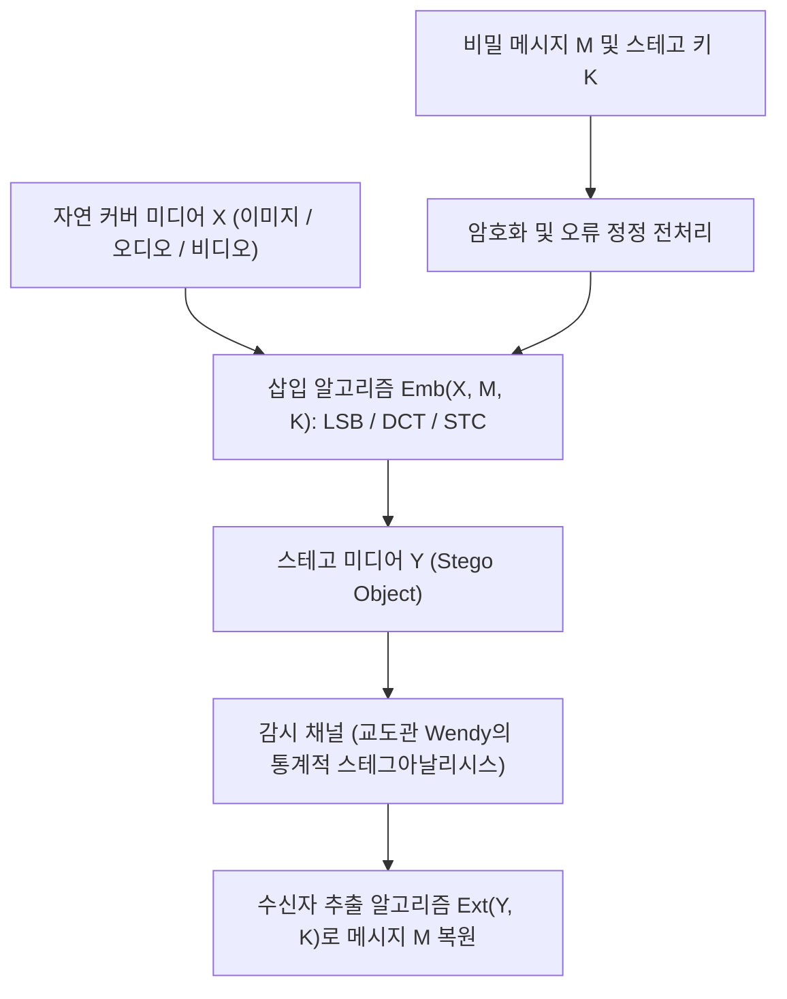
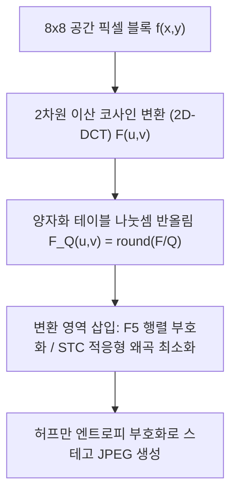

## 1. 암호학과 스테가노그래피의 근본적 차이: '내용'의 은닉인가, '존재'의 은닉인가?

정보 보안에서 <strong>암호학(Cryptography)</strong>과 <strong>스테가노그래피(Steganography, 심층 암호술/정보 은닉)</strong>는 서로 직교하는 두 가지 목표를 추구합니다. 암호학은 평문 $M$을 비밀 키 $K$를 사용해 해독할 수 없는 암호문 $C = E_K(M)$으로 변환합니다. 도청자가 암호문 $C$를 가로채면 그 의미는 알 수 없지만, <strong>"두 당사자가 비밀스러운 암호 통신을 주고받고 있다"는 사실 자체는 명백히 노출</strong>됩니다. 강력한 검열 체제나 감시 네트워크에서는 고엔트로피 암호화 트래픽(PGP 메시지나 비정상적인 TLS 스트림)을 전송하는 것만으로도 즉각적인 차단이나 의심을 부를 수 있습니다.

반면, 그리스어 *steganos*(덮인, 감춰진)와 *graphein*(쓰다)에서 유래한 <strong>스테가노그래피(Steganography)</strong>는 <strong>비밀 통신이 존재한다는 사실 자체를 완벽히 은폐</strong>하는 기술입니다. 고대 그리스 역사가 헤로도토스(Herodotus)가 기록한 '노예의 머리를 밀고 문신을 새긴 뒤 머리카락이 자라기를 기다린 사례'나 '밀랍 서판의 나무 바닥에 글을 쓰고 밀랍을 다시 덮은 사례'부터, 1499년 요하네스 트리테미우스(Johannes Trithemius)의 저서 《Steganographia》를 거쳐, 오늘날 평범한 풍경 사진이나 오디오 파일 속에 비밀 데이터를 심는 디지털 기술에 이르기까지, 스테가노그래피는 비밀 메시지 $M$을 무해해 보이는 <strong>커버 객체(Cover Object) $X$</strong> 내부에 삽입하여 <strong>스테고 객체(Stego Object) $Y$</strong>를 생성합니다.

1983년 구스타부스 시몬스(Gustavus J. Simmons)는 현대 스테가노그래피의 표준 모델인 <strong>'죄수의 문제(The Prisoners' Problem)'</strong>를 정식화했습니다. 감옥에 갇힌 죄수 Alice와 Bob이 탈옥 계획을 주고받으려 하지만, 모든 편지는 교도관 Wendy(Warden)의 검열을 거칩니다. 만약 Wendy가 암호화된 문자열이나 통계적으로 수상한 패턴을 발견하면 즉시 통신을 차단하고 두 사람을 독방에 가둡니다. 따라서 Alice는 평범한 일상 서신이나 사진 $Y$ 속에 비밀 비트를 숨겨, Wendy가 자연 미디어 분포 $P_X$와 스테고 미디어 분포 $P_Y$를 통계적으로 구별할 수 없게 만들어야 합니다.

1998년 크리스티안 카신(Christian Cachin)은 정보이론의 <strong>쿨백-라이블러 발산(Kullback-Leibler Divergence, 상대 엔트로피)</strong>을 이용해 스테가노그래피의 보안성을 수학적으로 엄밀하게 정의했습니다. 자연 커버 공간 $\mathcal{X}$의 확률 분포를 $P_X$, 스테고 객체의 확률 분포를 $P_Y$라 할 때, 다음 조건을 만족하면 이 시스템은 $\varepsilon$-안전(완전 안전은 $\varepsilon = 0$)하다고 부릅니다.

$$D_{\text{KL}}(P_X \,\|\, P_Y) = \sum_{x \in \mathcal{X}} P_X(x) \log_2 \frac{P_X(x)}{P_Y(x)} \le \varepsilon$$

정보이론의 <strong>데이터 처리 부등식(Data-Processing Inequality)</strong>에 의해, 교도관 Wendy가 어떤 정교한 통계적 가설 검정이나 딥러닝 분류기를 동원하더라도 제1종 오류율(오탐률 $\alpha$)과 제2종 오류율(미탐률 $\beta$)은 반드시 다음 이진 상대 엔트로피 부등식에 구속됩니다.

$$d(1-\alpha, \beta) = (1-\alpha)\log_2 \frac{1-\alpha}{\beta} + \alpha \log_2 \frac{\alpha}{1-\beta} \le D_{\text{KL}}(P_X \,\|\, P_Y) \le \varepsilon$$

즉 $\varepsilon \to 0$이면 $\alpha + \beta \to 1$이 되어, 감시자의 탐지 능력은 동전 던지기 수준의 무작위 추측으로 무력화됩니다.

| 비교 항목 | 암호학 (Cryptography) | 스테가노그래피 (Steganography) | 디지털 워터마킹 (Digital Watermarking) |
|---|---|---|---|
| <strong>핵심 보호 대상</strong> | 메시지의 <strong>의미적 내용(Content)</strong> 은닉 | 비밀 통신의 <strong>존재 자체(Existence)</strong> 은닉 | 미디어의 <strong>저작권 소유권 및 무결성</strong> 입증 |
| <strong>통신의 가시성</strong> | 공개됨 (암호문 자체는 고엔트로피로 노출) | 철저히 은폐됨 (정상 파일로 위장) | 가시적 또는 비가시적 (제거 불가능성 중시) |
| <strong>공격자의 목표</strong> | 키 복구 및 평문 해독 (암호 해독) | <strong>스테그아날리시스(Steganalysis)</strong>: $P_X \ne P_Y$ 탐지 | <strong>워터마크 파괴 공격</strong>: 압축, 크롭, 노이즈, 회전 |
| <strong>핵심 설계 지표</strong> | 계산적 구별 불가능성 (IND-CPA / CCA2) | 통계적 비탐지성 ($D_{\text{KL}} \to 0$) 및 삽입 용량 | <strong>강인성(Robustness)</strong> 및 지각적 투명성 |

---

## 2. 공간 영역 기법: 최하위 비트(LSB) 치환과 카이제곱($\chi^2$) 공격의 수리적 원리

무압축 또는 무손실 압축 이미지(24비트 BMP, PNG)나 16비트 PCM WAV 오디오에서 가장 널리 알려진 공간 영역(Spatial Domain) 기법은 <strong>최하위 비트 치환(Least Significant Bit Replacement, LSB Replacement)</strong>입니다. 8비트 그레이스케일 이미지의 픽셀 밝기 값 $x_i \in \{0, 1, \dots, 255\}$는 다음과 같이 8개의 이진 비트로 표현됩니다.

$$x_i = \sum_{b=0}^{7} a_{i,b} \, 2^b = 128 a_{i,7} + 64 a_{i,6} + \dots + 2 a_{i,1} + a_{i,0}$$

여기서 최상위 비트(MSB, $a_{i,7}$)는 전체 밝기 윤곽을 좌우하지만, 최하위 비트(LSB, $a_{i,0} = x_i \bmod 2$)는 고작 $\pm 1$의 밝기 차이만 만듭니다. 사전 암호화된 균등 분포 비밀 비트 $m_i \in \{0, 1\}$로 픽셀의 LSB를 치환하면 다음과 같습니다.

$$y_i = 2 \left\lfloor \frac{x_i}{2} \right\rfloor + m_i$$

픽셀당 1비트($1\,\text{bpp}$)를 가득 채워 삽입할 때, 절반의 픽셀은 원래 값 그대로 유지되고 나머지 절반만 $\pm 1$만큼 변하므로, 평균 제곱 오차(MSE)와 최대 신호 대 잡음비(PSNR)는 다음과 같이 계산됩니다.

$$\text{MSE} = \frac{1}{N}\sum_{i=1}^{N} (x_i - y_i)^2 = 0.5 \times 0^2 + 0.5 \times (\pm 1)^2 = 0.5, \qquad \text{PSNR} = 10 \log_{10}\!\left(\frac{255^2}{\text{MSE}}\right) \approx 51.14\,\text{dB}$$

인간의 시각 체계(HVS)는 $\text{PSNR} > 40\,\text{dB}$ 이상의 차이를 맨눈으로 결코 구별할 수 없습니다. 그러나 <strong>"인간의 눈에 보이지 않는다"는 것이 "통계적으로 안전하다"는 뜻은 절대 아닙니다!</strong>

1999년 안드레아스 베스트펠트(Andreas Westfeld)와 안드레아스 피츠만(Andreas Pfitzmann)은 LSB 치환을 단숨에 무너뜨리는 <strong>카이제곱 공격($\chi^2$ Attack)</strong>을 발표했습니다. 핵심 원리는 LSB 치환의 <strong>비대칭적 전이 구조</strong>에 있습니다. 짝수 픽셀 값 $2k$는 LSB가 바뀌어도 $2k$ 또는 $2k+1$이 될 뿐이고, 홀수 픽셀 값 $2k+1$ 역시 $2k$ 또는 $2k+1$로만 변합니다. 즉 $2k$와 $2k+1$은 외부 값($2k-1$이나 $2k+2$)과 절대 섞이지 않는 닫힌 쌍인 <strong>'값의 쌍(Pairs of Values, PoVs)' $\{2k, 2k+1\}$</strong>을 형성합니다! 원본 이미지의 히스토그램 빈도 $h_X(2k)$와 $h_X(2k+1)$이 아무리 달랐더라도, 균등 분포($P(0)=P(1)=0.5$)를 따르는 암호화 비트를 LSB에 덮어쓰면 스테고 이미지의 두 빈도 기댓값은 완벽히 같아집니다.

$$\mathbb{E}[h_Y(2k)] = \mathbb{E}[h_Y(2k+1)] = \frac{h_X(2k) + h_X(2k+1)}{2} = \bar{h}_k$$

따라서 피어슨 카이제곱 통계량:

$$\chi^2 = \sum_{k=0}^{127} \frac{\bigl(h_Y(2k) - \bar{h}_k\bigr)^2}{\bar{h}_k}$$

을 계산하면, 자연 이미지는 인접 밝기 빈도의 차이로 인해 $\chi^2$ 값이 매우 크게 나타나는 반면, LSB 치환 이미지는 히스토그램이 2칸씩 계단 모양으로 평탄화되어 $\chi^2 \approx 0$ (즉 $p \to 1$)으로 수렴하며 즉각 적발됩니다! 나아가 제시카 프리드리히(Jessica Fridrich) 연구팀의 <strong>RS 스테그아날리시스(Regular-Singular Analysis)</strong>는 인접 픽셀 간의 공간적 상관관계를 분석하여 $0.02\,\text{bpp}$ 미만의 극미량 LSB 치환까지 탐지해 냅니다. 이를 극복하기 위해 등장한 <strong>LSB 매칭(LSB Matching / $\pm 1$ Embedding)</strong>은 $m_i \ne \text{LSB}(x_i)$일 때 무작위로 $+1$ 또는 $-1$을 가산함으로써 $\{2k, 2k+1\}$의 닫힌 경계를 허물고 카이제곱 공격을 무력화합니다.

---

## 3. 주파수 변환 영역과 행렬 부호화: JPEG 2D-DCT, F5 및 STC 알고리즘

실제 인터넷 환경에서 공간 영역 LSB 기법은 치명적인 약점을 안고 있습니다. 바로 <strong>손실 압축(Lossy Compression)</strong>입니다. 이미지를 메신저나 SNS에 업로드하면 대부분 <strong>JPEG</strong> 포맷으로 재인코딩되면서 공간 영역의 미세한 LSB 정보가 완전히 파괴됩니다. 따라서 손실 압축 환경에서 살아남거나 JPEG 파일 자체에 정보를 숨기려면 압축 과정의 핵심인 <strong>주파수 변환 영역(Transform Domain)</strong>에 직접 개입해야 합니다.

JPEG 압축 파이프라인은 RGB 이미지를 $\text{YCbCr}$ 색공간으로 변환한 뒤, $8 \times 8$ 픽셀 블록 $f(x,y)$마다 <strong>2차원 이산 코사인 변환(2D-DCT)</strong>을 수행하여 64개의 주파수 계수 $F(u,v)$를 얻고, 이를 양자화 행렬 $Q(u,v)$로 나누어 반올림한 <strong>양자화 DCT 정수 계수 $F_Q(u,v)$</strong>를 생성합니다.

$$F(u,v) = \frac{1}{4} C(u) C(v) \sum_{x=0}^{7} \sum_{y=0}^{7} f(x,y) \cos\!\left(\frac{(2x+1)u\pi}{16}\right) \cos\!\left(\frac{(2y+1)v\pi}{16}\right), \qquad F_Q(u,v) = \text{round}\!\left(\frac{F(u,v)}{Q(u,v)}\right)$$

초기 <strong>JSteg</strong> 알고리즘은 0과 1이 아닌 양자화 AC 계수 $F_Q(u,v)$의 LSB를 단순 치환했다가 DCT 히스토그램의 카이제곱 공격에 발각되었습니다. 이에 2001년 안드레아스 베스트펠트는 <strong>F5 알고리즘</strong>을 통해 두 가지 혁명적 기법을 도입했습니다.
1. <strong>절댓값 감소 연산</strong>: 비트 변경이 필요할 때 양수 계수는 $1$을 빼고 음수 계수는 $1$을 더해 0 방향으로 수축시킴으로써 라플라스 분포 형태의 단조 감소 대칭성을 보존합니다.
2. <strong>행렬 부호화(Matrix Encoding / 해밍 신드롬 부호화)</strong>: $n = 2^k - 1$개의 변경 가능한 비영(non-zero) 계수 벡터 $\mathbf{x} \in \{0,1\}^n$에 $k$개의 비밀 비트 $\mathbf{m} \in \{0,1\}^k$를 숨긴다고 합시다. $(2^k-1, 2^k-1-k)$ 이진 해밍 부호의 패리티 검사 행렬 $\mathbf{H} \in \{0,1\}^{k \times n}$를 사용하여 신드롬 차이 $\mathbf{s} = \mathbf{m} \oplus \mathbf{H}\mathbf{x}$를 계산합니다. $\mathbf{s} = \mathbf{0}$이면 단 하나의 계수도 건드리지 않고 $k$비트가 이미 표현된 것이며, $\mathbf{s} \ne \mathbf{0}$이면 $\mathbf{s}$의 이진수 값이 가리키는 열 인덱스 $j$번째 계수 <strong>단 1개만 반전</strong>시키면 $\mathbf{H}\mathbf{y} = \mathbf{m}$이 성립합니다!
즉, <strong>$2^k - 1$개의 계수 중 최대 1개만 수정하여 $k$비트를 삽입</strong>할 수 있으며, 수정 1회당 삽입되는 평균 비트 수인 <strong>삽입 효율(Embedding Efficiency)</strong>은 다음과 같습니다.

$$e(k) = \frac{k}{1 - 2^{-k}} = \frac{k \cdot 2^k}{2^k - 1}$$

현대 최신 스테가노그래피(<strong>WOW, S-UNIWARD, J-UNIWARD, HILL</strong>)는 여기서 한 걸음 더 나아가 <strong>내용 적응형 왜곡 함수(Content-Adaptive Distortion)</strong>와 <strong>신드롬-트렐리스 부호(Syndrome-Trellis Codes, STC)</strong>를 결합합니다. 평탄한 하늘 영역의 계수에는 무한대에 가까운 수정 비용 $\rho_i \to \infty$를 부여하여 건드리지 않고, 나뭇잎이나 물결처럼 예측 잔차의 분산이 큰 복잡한 텍스처 영역에만 낮은 비용 $\rho_i$를 부여한 뒤, 비터비(Viterbi) 알고리즘으로 총 왜곡 $\sum \rho_i |x_i - y_i|$를 최소화하는 해밍 신드롬 경로를 찾아냅니다.

---

## 4. 스테가노그래피 용량의 제곱근 법칙(Square Root Law)과 디지털 워터마킹

고해상도 이미지의 픽셀 수 $n$이 커질수록 안전하게 숨길 수 있는 비밀 데이터의 양 $m$도 $n$에 비례해 선형적으로($O(n)$) 늘어날까요? 2008년 토마시 필러(Tomáš Filler), 앤드루 커(Andrew D. Ker), 제시카 프리드리히는 스테가노그래피 학계를 뒤흔든 <strong>스테가노그래피 용량의 제곱근 법칙(Square Root Law of Steganographic Capacity)</strong>을 증명했습니다.

픽셀당 평균 변경 확률을 $\beta = m / n$이라 할 때, 피셔 정보량(Fisher Information) $I_F$를 이용한 KL 발산의 2차 테일러 전개에 의해 $n$개 독립 픽셀 전체의 누적 상대 엔트로피는 다음과 같이 증가합니다.

$$D_{\text{KL}}\!\left(P_X^{(n)} \,\big\|\, P_Y^{(n)}\right) = \frac{1}{2} n \beta^2 I_F + O(n\beta^3) = \frac{I_F}{2} \frac{m^2}{n} + O\!\left(\frac{m^3}{n^2}\right)$$

감시자의 통계 검정으로부터 안전하려면 누적 KL 발산 $D_{\text{KL}}^{(n)} \le \varepsilon$이 일정한 상수 이하로 유지되어야 하므로, 안전한 최대 은닉 비트 수 $m_{\text{safe}}(n)$은 반드시 다음 법칙을 따릅니다.

$$m_{\text{safe}}(n) = O\!\left(\sqrt{n}\right)$$

즉 이미지 픽셀 수 $n$이 100배로 커져도 안전하게 숨길 수 있는 비밀 메시지의 길이는 $\sqrt{100} = 10$배밖에 늘어나지 않으며, 큰 이미지일수록 픽셀당 삽입 밀도 $\beta = m/n = O(1/\sqrt{n})$를 오히려 줄여야만 대수의 법칙에 의한 통계적 발각을 피할 수 있습니다!

마지막으로, 스테가노그래피와 자주 비교되는 <strong>디지털 워터마킹(Digital Watermarking)</strong>은 정보 은닉의 <strong>'마법의 삼각형(용량 Capacity, 비가시성 Imperceptibility, 강인성 Robustness)'</strong>에서 정반대의 꼭짓점을 선택합니다. 스테가노그래피가 은밀성과 대용량을 위해 강인성을 포기한다면, 디지털 워터마킹(Ingemar Cox의 <strong>대역확산 워터마킹 Spread-Spectrum Watermarking</strong>, <strong>양자화 인덱스 변조 QIM</strong>, 지폐의 <strong>EURion 위조방지 별자리</strong>, 컬러 프린터의 미세 황색 추적 점, 그리고 Google DeepMind가 AI 생성 이미지·텍스트 식별을 위해 개발한 <strong>SynthID</strong>)은 수십 비트의 저작권/출처 식별자를 저주파·중주파 핵심 대역 전체에 분산 삽입하여, 손실 압축이나 화면 캡처, 노이즈 공격을 겪은 뒤에도 상관관계 검출기로 끈질기게 살아남도록 설계됩니다.
