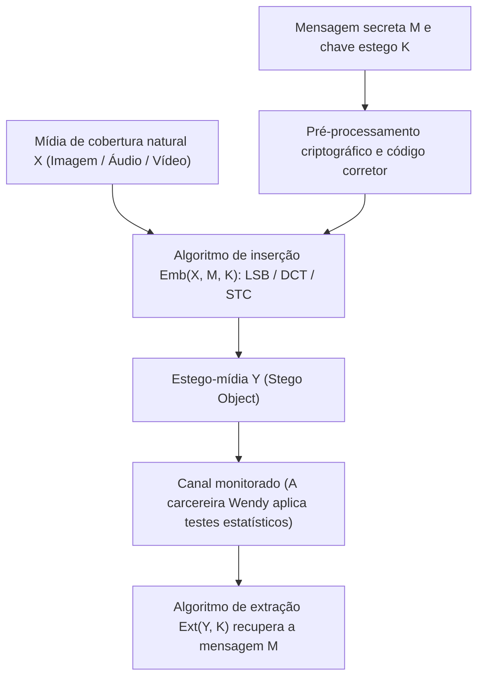
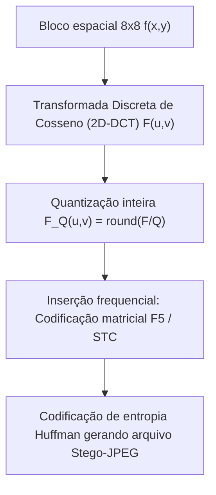

## 1. Criptografia vs. Esteganografia: ocultar o «conteúdo» ou ocultar a «existência»?

Na segurança da informação, a <strong>criptografia</strong> e a <strong>esteganografia</strong> atuam em duas dimensões fundamentalmente ortogonais. O objetivo da criptografia é transformar um texto claro $M$, por meio de uma chave secreta $K$, em um texto cifrado ininteligível $C = E_K(M)$. Quando um interceptador captura $C$, não consegue ler o seu conteúdo semântico, mas <strong>o próprio fato de que uma comunicação secreta e cifrada está ocorrendo fica totalmente exposto</strong>. Em redes submetidas a censura severa ou vigilância governamental, o simples envio de tráfego de alta entropia (como blocos PGP ou fluxos TLS não convencionais) basta para acionar alertas, bloquear a conexão ou incriminar os comunicantes.

Em contrapartida, a <strong>esteganografia</strong> (do grego *steganos*, «coberto, oculto», e *graphein*, «escrever») visa <strong>eliminar qualquer vestígio de que a comunicação secreta sequer existe</strong>. Dos relatos clássicos de Heródoto na Grécia Antiga (mensagens tatuadas no couro cabeludo raspado de um escravo ou gravadas na madeira sob a cera de uma tabuleta) e do tratado *Steganographia* (1499) de Johannes Trithemius, até a incorporação digital moderna dentro de fotografias comuns, arquivos de áudio ou pacotes de rede, a esteganografia embute uma mensagem secreta $M$ dentro de um <strong>objeto portador ou de cobertura (Cover Object) $X$</strong> de aparência inocente para gerar um <strong>estego-objeto (Stego Object) $Y$</strong>.

Em 1983, Gustavus J. Simmons formulou o famoso <strong>«Problema dos Prisioneiros (The Prisoners’ Problem)»</strong>, que estrutura toda a esteganografia moderna: dois prisioneiros, Alice e Bob, desejam planejar uma fuga, mas todas as mensagens trocadas passam pela inspeção da carcereira Wendy (Warden). Se Wendy detectar texto cifrado ou qualquer anomalia estatística suspeita, interromperá imediatamente a comunicação. Alice deve, portanto, esconder os bits secretos dentro de uma imagem cotidiana $Y$ de tal forma que Wendy seja incapaz de distinguir estatisticamente entre a distribuição de mídias naturais $P_X$ e a distribuição de estego-mídias $P_Y$.

Em 1998, Christian Cachin estabeleceu a definição matemática rigorosa de segurança esteganográfica utilizando a <strong>divergência de Kullback-Leibler (divergência KL / entropia relativa)</strong>. Seja $P_X$ a distribuição de probabilidade dos objetos de cobertura naturais no espaço $\mathcal{X}$ e $P_Y$ a distribuição dos estego-objetos. Um sistema esteganográfico é dito $\varepsilon$-seguro (e perfeitamente seguro quando $\varepsilon = 0$) se satisfizer:

$$D_{\text{KL}}(P_X \,\|\, P_Y) = \sum_{x \in \mathcal{X}} P_X(x) \log_2 \frac{P_X(x)}{P_Y(x)} \le \varepsilon$$

Pela <strong>desigualdade de processamento de dados (Data-Processing Inequality)</strong>, independentemente do teste de hipóteses estatístico ou da rede neural profunda utilizada pela carcereira Wendy, a probabilidade de alarme falso $\alpha$ (erro tipo I) e a probabilidade de omissão $\beta$ (erro tipo II) estão estritamente limitadas pela entropia relativa binária:

$$d(1-\alpha, \beta) = (1-\alpha)\log_2 \frac{1-\alpha}{\beta} + \alpha \log_2 \frac{\alpha}{1-\beta} \le D_{\text{KL}}(P_X \,\|\, P_Y) \le \varepsilon$$

Quando $\varepsilon \to 0$, tem-se $\alpha + \beta \to 1$, reduzindo qualquer detector de Wendy a um simples cara ou coroa aleatório.

| Dimensão de comparação | Criptografia (Cryptography) | Esteganografia (Steganography) | Marca d'água digital (Watermarking) |
|---|---|---|---|
| <strong>Objetivo central</strong> | Ocultar o <strong>conteúdo semântico</strong> | Ocultar a <strong>própria existência da comunicação</strong> | Comprovar <strong>direitos autorais e integridade</strong> |
| <strong>Visibilidade do segredo</strong> | Pública (o texto cifrado de alta entropia é visível) | Estritamente oculta (camuflada como arquivo normal) | Visível ou invisível (prioriza a não remoção) |
| <strong>Modelo de adversário</strong> | Criptoanálise (decifração sem a chave) | <strong>Esteganálise</strong>: detecção estatística $P_X \ne P_Y$ | <strong>Ataques de remoção</strong>: compressão, corte, ruído |
| <strong>Métrica principal</strong> | Indistinguibilidade computacional (IND-CPA) | Indetectabilidade estatística ($D_{\text{KL}} \to 0$) e capacidade | <strong>Robustez (Robustness)</strong> contra distorções de sinal |

---

## 2. Domínio espacial: substituição do bit menos significativo (LSB) e o ataque $\chi^2$

Em imagens digitais sem compressão ou com compressão sem perdas (BMP de 24 bits, PNG ou áudio WAV PCM de 16 bits), o método espacial mais clássico é a <strong>substituição do bit menos significativo (Least Significant Bit Replacement, LSB Replacement)</strong>. Em uma imagem em tons de cinza de 8 bits, o valor de cada pixel $x_i \in \{0, 1, \dots, 255\}$ é representado em binário por:

$$x_i = \sum_{b=0}^{7} a_{i,b} \, 2^b = 128 a_{i,7} + 64 a_{i,6} + \dots + 2 a_{i,1} + a_{i,0}$$

Enquanto o bit mais significativo (MSB, $a_{i,7}$) altera a luminância em $128$ níveis, o bit menos significativo (LSB, $a_{i,0} = x_i \bmod 2$) provoca uma variação de apenas $\pm 1$. Substituindo diretamente o LSB por um bit secreto cifrado e uniformemente distribuído $m_i \in \{0, 1\}$:

$$y_i = 2 \left\lfloor \frac{x_i}{2} \right\rfloor + m_i$$

na capacidade máxima ($1\,\text{bit por pixel, bpp}$), metade dos pixels permanece inalterada e a outra metade muda em $\pm 1$. O erro quadrático médio (MSE) e a relação sinal-ruído de pico (PSNR) resultam em:

$$\text{MSE} = \frac{1}{N}\sum_{i=1}^{N} (x_i - y_i)^2 = 0.5, \qquad \text{PSNR} = 10 \log_{10}\!\left(\frac{255^2}{\text{MSE}}\right) \approx 51.14\,\text{dB}$$

O sistema visual humano (HVS) não distingue diferenças acima de $40\,\text{dB}$. Contudo, <strong>invisibilidade a olho nu jamais significa segurança estatística!</strong>

Em 1999, Andreas Westfeld e Andreas Pfitzmann apresentaram o devastador <strong>ataque qui-quadrado ($\chi^2$ Steganalysis Attack)</strong>. A falha reside na <strong>assimetria estrutural da substituição LSB</strong>: um valor par $2k$ só pode se tornar $2k$ ou $2k+1$, e um valor ímpar $2k+1$ também só pode se tornar $2k$ ou $2k+1$; nunca há transição entre $2k-1$ e $2k$. Assim, os pares $\{2k, 2k+1\}$ formam 128 <strong>«Pares de Valores (Pairs of Values, PoVs)»</strong> fechados. Como os bits cifrados seguem $P(0)=P(1)=0.5$, as contagens do histograma $h_Y(2k)$ e $h_Y(2k+1)$ na imagem estego igualam-se forçosamente à sua média:

$$\mathbb{E}[h_Y(2k)] = \mathbb{E}[h_Y(2k+1)] = \frac{h_X(2k) + h_X(2k+1)}{2} = \bar{h}_k$$

Calculando a estatística $\chi^2$ de Pearson sobre os 128 pares:

$$\chi^2 = \sum_{k=0}^{127} \frac{\bigl(h_Y(2k) - \bar{h}_k\bigr)^2}{\bar{h}_k}$$

uma foto natural exibe um $\chi^2$ elevado ($p \approx 0$), enquanto uma imagem submetida à substituição LSB apresenta barras de histograma emparelhadas em degraus idênticos ($\chi^2 \to 0, \; p \to 1$), denunciando imediatamente a manipulação. Além disso, a <strong>esteganálise RS (Regular-Singular)</strong> de Jessica Fridrich detecta taxas de apenas $0.02\,\text{bpp}$ analisando correlações espaciais entre pixels vizinhos. Para eliminar os PoVs, o <strong>LSB Matching ($\pm 1$ Embedding)</strong> soma ou subtrai $1$ aleatoriamente quando $m_i \ne \text{LSB}(x_i)$.

---

## 3. Domínio da frequência e codificação matricial: DCT em JPEG, F5 e códigos STC

Na prática da Internet, a esteganografia espacial sucumbe diante da <strong>compressão com perdas (Lossy Compression)</strong>: ao enviar uma foto por redes sociais ou aplicativos de mensagens, ela é recodificada em <strong>JPEG</strong>, destruindo os LSBs espaciais. Por isso, a esteganografia moderna atua diretamente no <strong>domínio da transformação (Transform Domain)</strong>.

O pipeline JPEG divide a imagem (no espaço $\text{YCbCr}$) em blocos de $8 \times 8$ pixels $f(x,y)$, aplica a <strong>Transformada Discreta de Cosseno bidimensional (2D-DCT)</strong> gerando 64 coeficientes de frequência $F(u,v)$, e os divide por uma matriz de quantização $Q(u,v)$ arredondando para inteiros $F_Q(u,v)$:

$$F(u,v) = \frac{1}{4} C(u) C(v) \sum_{x=0}^{7} \sum_{y=0}^{7} f(x,y) \cos\!\left(\frac{(2x+1)u\pi}{16}\right) \cos\!\left(\frac{(2y+1)v\pi}{16}\right), \qquad F_Q(u,v) = \text{round}\!\left(\frac{F(u,v)}{Q(u,v)}\right)$$

Em 2001, Andreas Westfeld revolucionou a esteganografia JPEG com o <strong>algoritmo F5</strong>, introduzindo duas inovações cruciais:
1. <strong>Decremento do valor absoluto</strong>: em vez de trocar LSBs nos coeficientes DCT (como fazia o JSteg), o F5 reduz sempre o módulo do coeficiente modificado (positivos $-1$, negativos $+1$), preservando a forma laplaciana monótona centrada em zero do histograma DCT natural.
2. <strong>Codificação matricial (Matrix Encoding via códigos de Hamming)</strong>: para embutir $k$ bits secretos $\mathbf{m} \in \{0,1\}^k$ em $n = 2^k - 1$ coeficientes não nulos $\mathbf{x} \in \{0,1\}^n$, utiliza-se a matriz de paridade $\mathbf{H} \in \{0,1\}^{k \times (2^k-1)}$ de um código de Hamming binário. O síndrome $\mathbf{s} = \mathbf{m} \oplus \mathbf{H}\mathbf{x}$ indica diretamente o índice $j$ do <strong>único coeficiente $x_j$ que precisa ser alterado</strong> para satisfazer $\mathbf{H}\mathbf{y} = \mathbf{m}$! Assim, a <strong>eficiência de inserção (Embedding Efficiency)</strong> sobe para:

$$e(k) = \frac{k}{1 - 2^{-k}} = \frac{k \cdot 2^k}{2^k - 1}\,\text{bits por modificação}$$

Os algoritmos adaptativos modernos (<strong>WOW, S-UNIWARD, J-UNIWARD, HILL</strong>) aliam custos de distorção local $\rho_i$ aos <strong>Códigos em Treliça por Síndrome (Syndrome-Trellis Codes, STC, Filler et al. 2011)</strong>, usando o algoritmo de Viterbi para concentrar todas as alterações em regiões de textura complexa (folhagens, ondas), onde redes neurais de esteganálise (como SRNet) têm baixa precisão preditiva.

---

## 4. A Lei da Raiz Quadrada da capacidade esteganográfica e as Marcas d'Água Digitais

A carga útil secreta segura $m$ cresce linearmente com o número de pixels $n$ da imagem ($m = O(n)$)? Em 2008, Tomáš Filler, Andrew D. Ker e Jessica Fridrich demonstraram a fundamental <strong>Lei da Raiz Quadrada da Capacidade Esteganográfica (Square Root Law)</strong>: para uma taxa de modificação $\beta = m / n$ em $n$ pixels independentes com informação de Fisher $I_F > 0$, a expansão de Taylor de segunda ordem da divergência KL total satisfaz:

$$D_{\text{KL}}\!\left(P_X^{(n)} \,\big\|\, P_Y^{(n)}\right) = \frac{1}{2} n \beta^2 I_F + O(n\beta^3) = \frac{I_F}{2} \frac{m^2}{n} + O\!\left(\frac{m^3}{n^2}\right)$$

Para manter $D_{\text{KL}}^{(n)} \le \varepsilon$ constante e escapar da detecção estatística, o número máximo de bits seguros $m_{\text{safe}}(n)$ <strong>só pode crescer proporcionalmente à raiz quadrada do número de pixels</strong>:

$$m_{\text{safe}}(n) = O\!\left(\sqrt{n}\right)$$

Por fim, no <strong>«Triângulo Mágico da Ocultação de Informação» (Capacidade, Imperceptibilidade, Robustez)</strong>, a <strong>marca d'água digital (Digital Watermarking)</strong> ocupa o vértice oposto à esteganografia: métodos como o <strong>espalhamento espectral (Spread-Spectrum Watermarking)</strong> de Ingemar Cox, a <strong>modulação de índice de quantização (QIM)</strong>, a <strong>constelação EURion</strong> em cédulas bancárias ou o <strong>SynthID</strong> do Google DeepMind para identificar imagens e textos gerados por IA reduzem a carga útil a poucas dezenas de bits para garantir <strong>robustez extrema</strong> contra compressão com perdas, cortes e distorções geométricas.
