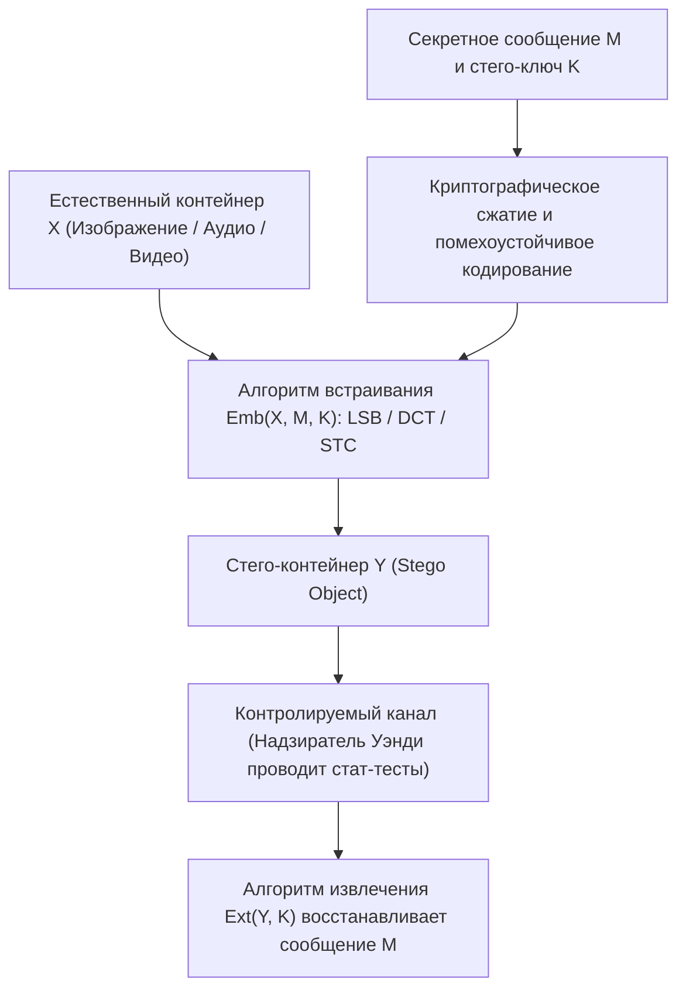
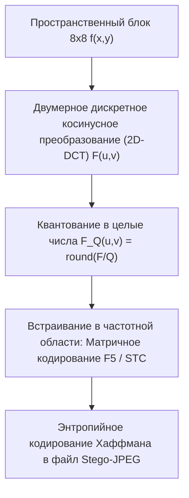

## 1. Криптография против стеганографии: сокрытие «содержания» или сокрытие «существования»?

В сфере информационной безопасности <strong>криптография</strong> и <strong>стеганография</strong> решают две ортогональные задачи. Криптография преобразует открытый текст $M$ с помощью секретного ключа $K$ в нечитаемый шифротекст $C = E_K(M)$. Когда перехватчик получает $C$, он не может прочесть семантическое содержание сообщения, однако <strong>сам факт того, что стороны ведут секретную зашифрованную переписку, остается полностью очевидным</strong>. В условиях жесткой цензуры или тотального сетевого мониторинга одна лишь передача высокоэнтропийного трафика (например, блоков PGP или нестандартных TLS-потоков) немедленно вызывает подозрение, блокировку канала или преследование.

Напротив, <strong>стеганография</strong> (от древнегреческого *steganos* — «скрытый, покрытый» и *graphein* — «писать») ставит своей целью <strong>полностью скрыть сам факт существования тайной коммуникации</strong>. От описанных Геродотом хитростей Древней Греции (татуировка на обритой голове раба или надпись на деревянной основе под слоем воска) и трактата Иоганна Тритемия *Steganographia* (1499) до современных алгоритмов встраивания данных в безобидные фотографии, аудиозаписи или сетевые пакеты — стеганография внедряет секретное сообщение $M$ внутрь ничем не примечательного <strong>контейнера-оригинала (Cover Object) $X$</strong>, формируя <strong>стего-объект (Stego Object) $Y$</strong>.

В 1983 году Густавус Симмонс (Gustavus J. Simmons) сформулировал знаменитую <strong>«Задачу о заключенных (The Prisoners’ Problem)»</strong>, ставшую классической моделью современной стеганографии: заключенные Алиса и Боб хотят согласовать план побега из тюрьмы, но вся их переписка проходит через надзирателя Уэнди (Warden). Если Уэнди заметит шифротекст или статистические аномалии в письмах или фотографиях, она немедленно пресечет связь и отправит обоих в карцер. Следовательно, Алиса должна спрятать секретные биты в обычном изображении $Y$ так, чтобы Уэнди не смогла статистически отличить распределение естественных контейнеров $P_X$ от распределения стего-контейнеров $P_Y$.

В 1998 году Кристиан Кэшин (Christian Cachin) дал строгое математическое определение стеганографической стойкости через <strong>дивергенцию Кульбака — Лейблера (KL-дивергенцию / относительную энтропию)</strong>. Пусть $P_X$ — вероятностное распределение пустых контейнеров на множестве $\mathcal{X}$, а $P_Y$ — распределение стего-объектов. Стегосистема называется $\varepsilon$-стойкой (и совершенно стойкой при $\varepsilon = 0$), если:

$$D_{\text{KL}}(P_X \,\|\, P_Y) = \sum_{x \in \mathcal{X}} P_X(x) \log_2 \frac{P_X(x)}{P_Y(x)} \le \varepsilon$$

Согласно <strong>неравенству обработки данных (Data-Processing Inequality)</strong> теории информации, какой бы сложный статистический критерий или глубокую нейросеть ни применяла надзиратель Уэнди, вероятность ложной тревоги $\alpha$ (ошибка I рода) и вероятность пропуска цели $\beta$ (ошибка II рода) жестко ограничены бинарной относительной энтропией:

$$d(1-\alpha, \beta) = (1-\alpha)\log_2 \frac{1-\alpha}{\beta} + \alpha \log_2 \frac{\alpha}{1-\beta} \le D_{\text{KL}}(P_X \,\|\, P_Y) \le \varepsilon$$

При $\varepsilon \to 0$ неизбежно $\alpha + \beta \to 1$, то есть любой детектор Уэнди работает не лучше случайного подбрасывания монеты.

| Критерий сравнения | Криптография (Cryptography) | Стеганография (Steganography) | Цифровые водяные знаки (Watermarking) |
|---|---|---|---|
| <strong>Главная цель</strong> | Сокрытие <strong>содержания (семантики)</strong> | Сокрытие <strong>самого факта коммуникации</strong> | Защита <strong>авторских прав и целостности</strong> |
| <strong>Видимость секрета</strong> | Открытая (высокоэнтропийный шифротекст виден) | Строго скрытая (маскировка под обычный файл) | Видимая или невидимая (приоритет — неудаляемость) |
| <strong>Модель противника</strong> | Криптоанализ (дешифрование без ключа) | <strong>Стегоанализ</strong>: статистическое обнаружение $P_X \ne P_Y$ | <strong>Атаки удаления</strong>: сжатие, кадрирование, зашумление |
| <strong>Ключевая метрика</strong> | Вычислительная неотличимость (IND-CPA) | Статистическая незаметность ($D_{\text{KL}} \to 0$) и емкость | <strong>Робастность (Robustness)</strong> к искажениям сигнала |

---

## 2. Пространственная область: замена младшего значащего бита (LSB) и атака $\chi^2$

В несжатых изображениях или форматах без потерь (24-битный BMP, PNG или 16-битный звук WAV PCM) простейшим методом встраивания является <strong>замена младшего значащего бита (Least Significant Bit Replacement, LSB Replacement)</strong>. В 8-битном полутоновом изображении яркость каждого пикселя $x_i \in \{0, 1, \dots, 255\}$ записывается в двоичном виде как:

$$x_i = \sum_{b=0}^{7} a_{i,b} \, 2^b = 128 a_{i,7} + 64 a_{i,6} + \dots + 2 a_{i,1} + a_{i,0}$$

Если старший бит (MSB, $a_{i,7}$) меняет яркость на $128$, то младший бит (LSB, $a_{i,0} = x_i \bmod 2$) изменяет значение всего на $\pm 1$. Заменяя LSB каждого пикселя зашифрованным (равномерно распределенным) секретным битом $m_i \in \{0, 1\}$:

$$y_i = 2 \left\lfloor \frac{x_i}{2} \right\rfloor + m_i$$

при полной загрузке ($1\,\text{бит на пиксель, bpp}$) половина пикселей не меняется вовсе, а вторая половина изменяется на $\pm 1$. Среднеквадратичная ошибка (MSE) и пиковое отношение сигнал/шум (PSNR) составляют:

$$\text{MSE} = \frac{1}{N}\sum_{i=1}^{N} (x_i - y_i)^2 = 0.5, \qquad \text{PSNR} = 10 \log_{10}\!\left(\frac{255^2}{\text{MSE}}\right) \approx 51.14\,\text{dB}$$

Человеческий глаз (HVS) не способен заметить искажения при $\text{PSNR} > 40\,\text{dB}$. Но <strong>невидимость для глаза отнюдь не означает статистическую неуязвимость!</strong>

В 1999 году Андреас Вестфельд и Андреас Пфицман предложили сокрушительную <strong>атаку хи-квадрат ($\chi^2$ Steganalysis Attack)</strong>. Её математическая суть кроется в <strong>асимметрии операции LSB-замены</strong>: четное значение яркости $2k$ при замене младшего бита может перейти только в $2k$ или $2k+1$, и нечетное значение $2k+1$ также может перейти только в $2k$ или $2k+1$; переходов между $2k-1$ и $2k$ никогда не происходит! Таким образом, пары $\{2k, 2k+1\}$ образуют 128 замкнутых <strong>«пар значений (Pairs of Values, PoVs)»</strong>. Поскольку биты шифротекста равновероятны ($P(0)=P(1)=0.5$), частоты гистограммы $h_Y(2k)$ и $h_Y(2k+1)$ после встраивания принудительно выравниваются до их полусуммы:

$$\mathbb{E}[h_Y(2k)] = \mathbb{E}[h_Y(2k+1)] = \frac{h_X(2k) + h_X(2k+1)}{2} = \bar{h}_k$$

Вычисляя статистику Пирсона $\chi^2$ по всем 128 парам:

$$\chi^2 = \sum_{k=0}^{127} \frac{\bigl(h_Y(2k) - \bar{h}_k\bigr)^2}{\bar{h}_k}$$

мы мгновенно обнаруживаем LSB-замену: у естественной фотографии $\chi^2$ велико ($p \approx 0$), тогда как у стего-изображения гистограмма превращается в характерные попарные «ступеньки» ($\chi^2 \to 0, \; p \to 1$). Более того, <strong>RS-стегоанализ (Regular-Singular)</strong> Джессики Фридрих обнаруживает LSB-встраивание плотностью от $0.02\,\text{bpp}$ за счет анализа пространственных корреляций соседних пикселей. Чтобы разрушить замкнутые пары PoVs, метод <strong>LSB Matching ($\pm 1$ Embedding)</strong> случайно прибавляет или вычитает $1$ при $m_i \ne \text{LSB}(x_i)$.

---

## 3. Частотная область и матричное кодирование: JPEG 2D-DCT, алгоритм F5 и коды STC

При передаче через современные мессенджеры и соцсети пространственная LSB-стеганография мгновенно разрушается из-за <strong>сжатия с потерями (Lossy Compression)</strong> в формат <strong>JPEG</strong>. Поэтому практическая стеганография работает непосредственно в <strong>частотной (трансформационной) области</strong>.

Стандарт JPEG разбивает изображение (в пространстве $\text{YCbCr}$) на блоки $8 \times 8$ пикселей $f(x,y)$, применяет <strong>двумерное дискретное косинусное преобразование (2D-DCT)</strong> и квантует полученные 64 коэффициента $F(u,v)$ делением на матрицу квантования $Q(u,v)$ с округлением до целых чисел $F_Q(u,v)$:

$$F(u,v) = \frac{1}{4} C(u) C(v) \sum_{x=0}^{7} \sum_{y=0}^{7} f(x,y) \cos\!\left(\frac{(2x+1)u\pi}{16}\right) \cos\!\left(\frac{(2y+1)v\pi}{16}\right), \qquad F_Q(u,v) = \text{round}\!\left(\frac{F(u,v)}{Q(u,v)}\right)$$

В 2001 году Андреас Вестфельд совершил переворот в JPEG-стеганографии, создав <strong>алгоритм F5</strong>, основанный на двух принципах:
1. <strong>Уменьшение абсолютной величины</strong>: вместо замены LSB коэффициентов DCT (как в уязвимом JSteg), F5 всегда уменьшает модуль изменяемого ненулевого коэффициента на 1 по направлению к нулю, сохраняя естественную симметричную лапласовскую форму гистограммы DCT.
2. <strong>Матричное кодирование (Matrix Encoding на основе кодов Хэмминга)</strong>: чтобы встроить $k$ секретных бит $\mathbf{m} \in \{0,1\}^k$ в $n = 2^k - 1$ ненулевых коэффициентов $\mathbf{x} \in \{0,1\}^n$, используется проверочная матрица $\mathbf{H} \in \{0,1\}^{k \times (2^k-1)}$ двоичного кода Хэмминга. Синдром $\mathbf{s} = \mathbf{m} \oplus \mathbf{H}\mathbf{x}$ прямо указывает номер <strong>единственного коэффициента $x_j$</strong>, который нужно изменить для выполнения равенства $\mathbf{H}\mathbf{y} = \mathbf{m}$! Благодаря этому <strong>эффективность встраивания (Embedding Efficiency)</strong> возрастает до:

$$e(k) = \frac{k}{1 - 2^{-k}} = \frac{k \cdot 2^k}{2^k - 1}\,\text{бит на одно изменение}$$

Современные адаптивные алгоритмы (<strong>WOW, S-UNIWARD, J-UNIWARD, HILL</strong>) объединяют локальные функции искажения $\rho_i$ с <strong>синдромно-решетчатыми кодами (Syndrome-Trellis Codes, STC, Filler et al. 2011)</strong>: алгоритм Витерби прячет все изменения исключительно в сложных текстурированных участках (листва, рябь воды), где нейросетевые стегоанализаторы (SRNet) не могут точно предсказать значения соседних пикселей.

---

## 4. Закон квадратного корня для стеганографической емкости и цифровые водяные знаки

Растет ли безопасный объем скрываемых данных $m$ линейно с ростом числа пикселей $n$ ($m = O(n)$)? В 2008 году Томаш Филлер, Эндрю Кер и Джессика Фридрих доказали фундаментальный <strong>Закон квадратного корня для стеганографической емкости (Square Root Law)</strong>: при доле измененных пикселей $\beta = m / n$ и информации Фишера $I_F > 0$ разложение Тейлора второго порядка для суммарной KL-дивергенции по $n$ независимым пикселям дает:

$$D_{\text{KL}}\!\left(P_X^{(n)} \,\big\|\, P_Y^{(n)}\right) = \frac{1}{2} n \beta^2 I_F + O(n\beta^3) = \frac{I_F}{2} \frac{m^2}{n} + O\!\left(\frac{m^3}{n^2}\right)$$

Чтобы суммарная дивергенция $D_{\text{KL}}^{(n)} \le \varepsilon$ оставалась ограниченной константой, безопасная нагрузка $m_{\text{safe}}(n)$ <strong>может расти лишь пропорционально квадратному корню из числа пикселей $\sqrt{n}$</strong>:

$$m_{\text{safe}}(n) = O\!\left(\sqrt{n}\right)$$

Наконец, в <strong>«Магическом треугольнике сокрытия информации» (Емкость, Незаметность, Робастность)</strong> <strong>цифровые водяные знаки (Digital Watermarking)</strong> занимают противоположный полюс по отношению к стеганографии: широкополосные схемы Ингмара Кокса (<strong>Spread-Spectrum Watermarking</strong>), <strong>квантование индекса модуляции (QIM)</strong>, <strong>созвездие Евриона</strong> на банкнотах и система <strong>SynthID</strong> от Google DeepMind для маркировки ИИ-изображений и текстов жертвуют информационной емкостью (оставляя лишь десятки бит) ради <strong>экстремальной живучести (робастности)</strong> при сжатии, кадрировании и фильтрации.
