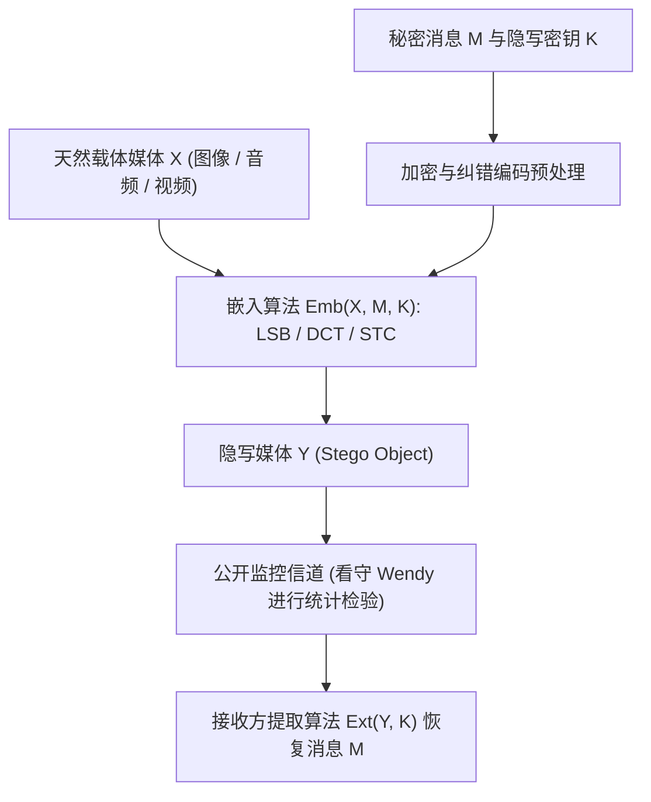
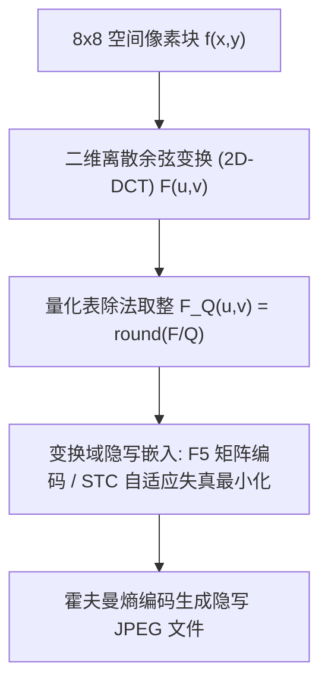

## 1. 密码学与隐写术的根本差异：隐藏“内容”还是隐藏“存在”？

在信息安全领域，<strong>密码学（Cryptography）</strong>与<strong>隐写术（Steganography）</strong>追求的是两个正交的维度。密码学的目标是将明文 $M$ 通过密钥 $K$ 转换为不可读的密文 $C = E_K(M)$。当攻击者截获 $C$ 时，虽然无法直接获知消息的语义内容，但<strong>“双方正在进行加密通信”这一事实本身是完全暴露的</strong>。在严酷的审查环境或极权监控网络中，仅仅发送一段高熵的加密乱码（如 TLS 流量或 PGP 密文）就足以触发警报、导致通信链路被切断甚至招致审讯。

与此相反，源自希腊语 *steganos*（覆盖、隐蔽）与 *graphein*（书写）的<strong>隐写术（Steganography）</strong>，其核心目标是<strong>彻底抹除秘密通信存在的一切痕迹</strong>。从古希腊历史学家希罗多德（Herodotus）记载的“剃发刺字待长发掩盖”与“刮去蜂蜡在木板底层书写”，到1499年约翰内斯·特里塞米乌斯（Johannes Trithemius）出版的《隐写术（Steganographia）》，再到现代数字媒体时代将加密载荷潜藏于无辜的风景照片、音频流或网络数据包中，隐写术将秘密信息 $M$ 嵌入到一个看似完全正常的<strong>载体对象（Cover Object）$X$</strong> 之中，生成<strong>隐写对象（Stego Object）$Y$</strong>。

1983年，古斯塔夫斯·西蒙斯（Gustavus J. Simmons）提出了著名的<strong>“囚徒问题（The Prisoners' Problem）”</strong>，奠定了现代隐写术的理论框架：囚徒 Alice 与 Bob 试图在监狱中策划越狱，但他们之间的所有信件都必须经过看守 Wendy（Warden）的审查。如果 Wendy 发现任何看似密码的乱码，或者察觉信件的统计特征存在异常，她就会立即没收信件并将两人关入禁闭室。因此，Alice 必须将秘密比特隐藏在看似普通日常问候或风景图像 $Y$ 中，使得 Wendy 无法以显著高于随机猜测的概率区分天然载体 $X$ 与隐写载体 $Y$。

1998年，克里斯蒂安·卡钦（Christian Cachin）使用信息论中的<strong>库尔巴克-莱布勒散度（Kullback-Leibler Divergence / 相对熵）</strong>给出了隐写安全性的严格数学定义。设天然载体空间 $\mathcal{X}$ 上的真实概率分布为 $P_X$，经过隐写嵌入算法后生成的隐写对象分布为 $P_Y$。若满足：

$$D_{\text{KL}}(P_X \,\|\, P_Y) = \sum_{x \in \mathcal{X}} P_X(x) \log_2 \frac{P_X(x)}{P_Y(x)} \le \varepsilon$$

则称该隐写系统是 $\varepsilon$-安全的（当 $\varepsilon = 0$ 时称为完美安全隐写）。根据信息论中的<strong>数据处理不等式（Data-Processing Inequality）</strong>，无论被动看守 Wendy 采用何种复杂的二元假设检验（甚至是深度卷积神经网络分类器），其第一类错误率（虚警率 $\alpha$：将正常图像误判为隐写图像）与第二类错误率（漏检率 $\beta$：未能识别出隐写图像）都必然受到二元相对熵的严格约束：

$$d(1-\alpha, \beta) = (1-\alpha)\log_2 \frac{1-\alpha}{\beta} + \alpha \log_2 \frac{\alpha}{1-\beta} \le D_{\text{KL}}(P_X \,\|\, P_Y) \le \varepsilon$$

当 $\varepsilon \to 0$ 时，$\alpha + \beta \to 1$，这意味着看守 Wendy 的检测能力退化为抛硬币式的盲目猜测。

| 比较维度 | 密码学（Cryptography） | 隐写术（Steganography） | 数字水印（Digital Watermarking） |
|---|---|---|---|
| <strong>核心防护目标</strong> | 隐藏消息的<strong>语义内容</strong> | 隐藏秘密通信的<strong>存在本身</strong> | 保护载体媒体的<strong>版权归属与完整性</strong> |
| <strong>秘密的存在性</strong> | 公开可见（密文呈现明显高熵特征） | 严格隐蔽（伪装成普通天然媒体） | 可公开或隐蔽（通常要求难以抹除） |
| <strong>攻击者模型</strong> | 破译密钥或明文（唯密文/已知明文攻击） | <strong>隐写分析（Steganalysis）</strong>：统计检测 $P_X \ne P_Y$ | <strong>水印擦除攻击</strong>：裁剪、压缩、加噪、几何扭曲 |
| <strong>关键性能指标</strong> | 计算不可区分性（IND-CPA / IND-CCA2） | 统计不可检测性（$D_{\text{KL}} \to 0$）与高嵌入载荷 | <strong>鲁棒性（Robustness）</strong>与感官不可见性 |

---

## 2. 空间域隐写：LSB（最低有效位）替换与卡方（$\chi^2$）隐写分析的攻防

在未压缩或无损压缩的数字图像（如 24位真彩色 BMP、PNG 或 16位 PCM WAV 音频）中，最直观的嵌入方式是<strong>空间域最低有效位替换（Least Significant Bit Replacement, LSB Replacement）</strong>。在 8位灰度图像中，每个像素的亮度值 $x_i \in \{0, 1, \dots, 255\}$ 由 8 个二进制位表示：

$$x_i = \sum_{b=0}^{7} a_{i,b} \, 2^b = 128 a_{i,7} + 64 a_{i,6} + \dots + 2 a_{i,1} + a_{i,0}$$

其中最高有效位（MSB, $a_{i,7}$）决定了亮度的宏观结构，而最低有效位（LSB, $a_{i,0} = x_i \bmod 2$）仅代表 $\pm 1$ 的灰阶变化。若将加密后的秘密比特流 $m_i \in \{0, 1\}$ 直接替换像素的最低位：

$$y_i = 2 \left\lfloor \frac{x_i}{2} \right\rfloor + m_i$$

由于加密比特流 $m_i$ 服从均匀分布 $P(m_i=0) = P(m_i=1) = 0.5$，平均而言有一半的像素值保持不变，另一半像素值仅改变 $\pm 1$。计算全满嵌入（每像素 1 比特，即 $1\,\text{bpp}$）时的均方误差（MSE）与峰值信噪比（PSNR）：

$$\text{MSE} = \frac{1}{N}\sum_{i=1}^{N} (x_i - y_i)^2 = 0.5 \times 0^2 + 0.5 \times (\pm 1)^2 = 0.5$$

$$\text{PSNR} = 10 \log_{10}\!\left(\frac{255^2}{\text{MSE}}\right) = 10 \log_{10}(130050) \approx 51.14\,\text{dB}$$

人类视觉系统（HVS）通常无法分辨 $\text{PSNR} > 40\,\text{dB}$ 的微弱差异。然而，<strong>“肉眼不可见”绝不等于“统计学上不可检测”</strong>！

1999年，安德烈亚斯·เว斯特费尔德（Andreas Westfeld）与安德烈亚斯·普菲茨曼（Andreas Pfitzmann）提出了毁灭性的<strong>卡方攻击（$\chi^2$ Steganalysis Attack）</strong>。其数学洞察极为犀利：在 LSB 替换操作中，像素值 $2k$（偶数）只能变成 $2k$ 或 $2k+1$，而像素值 $2k+1$（奇数）也只能变成 $2k$ 或 $2k+1$。两者永远不会跨越到 $2k-1$ 或 $2k+2$！因此，相邻的值对 $\{2k, 2k+1\}$ 构成了一个封闭的<strong>“值对（Pairs of Values, PoVs）”</strong>。设原始图像中灰阶 $v$ 出现的频数为 $h_X(v)$，则无论 $h_X(2k)$ 与 $h_X(2k+1)$ 原本相差多大，一旦将均匀随机的密文比特替换进 LSB，隐写图像中这两个相邻灰阶的期望频数就会被强行拉平：

$$\mathbb{E}[h_Y(2k)] = \mathbb{E}[h_Y(2k+1)] = \frac{h_X(2k) + h_X(2k+1)}{2} = \bar{h}_k$$

通过构造皮尔逊卡方统计量：

$$\chi^2 = \sum_{k=0}^{127} \frac{\bigl(h_Y(2k) - \bar{h}_k\bigr)^2}{\bar{h}_k}$$

在自由度为 $127$ 的卡方分布下，天然图像由于局部色彩相关性，$h_X(2k)$ 与 $h_X(2k+1)$ 存在自然起伏，$\chi^2$ 值极大（导出 $p \approx 0$）；而 LSB 替换后的图像直方图呈现出詭异的“成对阶梯状平坦化”，使得 $p \to 1$，瞬间暴露隐写行为！即便嵌入率较低，杰西卡·弗里德里希（Jessica Fridrich）等人提出的<strong>RS 隐写分析（Regular-Singular Analysis）</strong>与<strong>样本对分析（Sample Pair Analysis, SPA）</strong>也能利用空间相邻像素相关性将检测阈值精确到 $0.02\,\text{bpp}$ 以下。

为了修补 LSB 替换的不对称破绽，研究者提出了<strong>LSB 匹配（LSB Matching / $\pm 1$ Embedding）</strong>：当待嵌入比特 $m_i \ne \text{LSB}(x_i)$ 时，不再死板地执行偶加奇减，而是以 $50\%$ 概率随机执行 $y_i = x_i + 1$ 或 $y_i = x_i - 1$。这一操作打破了 $\{2k, 2k+1\}$ 的封闭配对，在直方图频域上相当于对原始直方图做了一次低通平滑滤波，从而彻底免疫了经典卡方攻击。

---

## 3. 变换域隐写与矩阵编码：JPEG 离散余弦变换（DCT）与 F5 / STC 算法

在互联网实际传输中，空间域 LSB 隐写面临一个致命工程障碍：<strong>有损压缩（Lossy Compression）</strong>。一旦用户将图片上传至社交平台或通过即时通讯软件发送，系统通常会将其重新编码为 <strong>JPEG</strong> 格式。JPEG 压缩通过丢弃高频视觉冗余信息，会将空间域像素的 LSB 彻底洗牌破坏。因此，现代实用隐写术必须深入到压缩算法内部——即<strong>频率变换域（Transform Domain）</strong>。

JPEG 编码的核心流程如下：
1. 将 RGB 图像转换至亮度-色度空间 $\text{YCbCr}$，并对色度通道进行下采样。
2. 将图像分割为 $8 \times 8$ 像素块 $f(x,y)$，执行<strong>二维离散余弦变换（2D-DCT）</strong>，将其从空间域映射到 64 个正交空间频率基底 $F(u,v)$（$u,v \in \{0,\dots,7\}$）：

$$F(u,v) = \frac{1}{4} C(u) C(v) \sum_{x=0}^{7} \sum_{y=0}^{7} f(x,y) \cos\!\left(\frac{(2x+1)u\pi}{16}\right) \cos\!\left(\frac{(2y+1)v\pi}{16}\right)$$

其中 $C(0) = 1/\sqrt{2}$，当 $u>0$ 时 $C(u)=1$。
3. <strong>量化（Quantization）</strong>：用 $8\times 8$ 量化表 $Q(u,v)$ 除以 DCT 系数并四舍五入取整，得到量化后的整数 DCT 系数 $F_Q(u,v) = \text{round}\bigl(F(u,v)/Q(u,v)\bigr)$。这一步是有损压缩的根源。
4. 对量化后的整数系数 $F_Q(u,v)$ 按 Zig-Zag 扫描顺序进行游程编码（RLE）与霍夫曼熵编码。

如果我们在第 3 步之后、第 4 步无损熵编码之前，微调非零交流（AC）量化整数系数 $F_Q(u,v)$，那么只要不再经历二次重压缩，隐藏的信息就能百分之百无损还原！

早期的 <strong>JSteg</strong> 算法直接对 $F_Q(u,v) \notin \{0, 1\}$ 的系数执行 LSB 替换，结果同样被针对 DCT 系数直方图的卡方攻击轻易识破；尼尔·普罗沃斯（Niels Provos）的 <strong>OutGuess</strong> 试图保留一半系数用于修正直方图，但又引入了块边界失真（Blockiness）。

2001年，安德烈亚斯·เว斯特费尔德提出了里程碑式的 <strong>F5 隐写算法</strong>，引入了两项革命性设计：
1. <strong>绝对值递减替代 LSB 替换</strong>：由于自然图像的拉普拉斯分布特性，DCT 系数直方图关于 0 对称且单调递减。F5 在需要翻转比特时，将正系数减 1、负系数加 1（向 0 收缩），彻底消除了成对阶梯效应。
2. <strong>矩阵编码（Matrix Encoding / 汉明伴随式编码）</strong>：假设我们有 $n = 2^k - 1$ 个非零可修改系数 $\mathbf{x} = (x_1, \dots, x_n)^T \in \{0,1\}^n$，要嵌入 $k$ 个秘密比特 $\mathbf{m} \in \{0,1\}^k$。利用阶数为 $k$ 的二元汉明码校验矩阵 $\mathbf{H} \in \{0,1\}^{k \times (2^k-1)}$（其第 $j$ 列恰好是整数 $j$ 的 $k$ 位二进制表示），计算伴随式差值：

$$\mathbf{s} = \mathbf{m} \oplus \mathbf{H}\mathbf{x}$$

若 $\mathbf{s} = \mathbf{0}$，则无需修改任何系数即可表示 $k$ 个比特！若 $\mathbf{s} \ne \mathbf{0}$，则 $\mathbf{s}$ 对应的十进制列索引 $j \in \{1, \dots, 2^k-1\}$ 精确指出了<strong>唯一需要翻转的那 1 个系数 $x_j$</strong>！翻转 $x_j \to x_j \oplus 1$ 后，新的伴随式恰好等于 $\mathbf{H}\mathbf{y} = \mathbf{H}\mathbf{x} \oplus \mathbf{h}_j = \mathbf{H}\mathbf{x} \oplus \mathbf{s} = \mathbf{m}$。
这意味着，<strong>嵌入 $k$ 个秘密比特最多只需修改 $2^k - 1$ 个系数中的 1 个</strong>（且有 $2^{-k}$ 的概率一个都不改）！其<strong>嵌入效率（Embedding Efficiency，平均每修改 1 个系数所嵌入的比特数）</strong>达到：

$$e(k) = \frac{k}{1 - 2^{-k}} = \frac{k \cdot 2^k}{2^k - 1}$$

例如当 $k=3$（每 $7$ 个系数嵌入 $3$ 比特）时，平均每次修改可嵌入 $3 / (7/8) \approx 3.43\,\text{bits}$，修改率降低至原来的三分之一以下！

在此基础上，现代最先进的隐写术（如 <strong>WOW、S-UNIWARD、J-UNIWARD、HILL</strong>）进一步结合了<strong>自适应失真函数（Adaptive Distortion）</strong>与<strong>伴随式网格码（Syndrome-Trellis Codes, STC，Filler 等人 2011年提出）</strong>。算法为每个像素或 DCT 系数赋予一个失真代价 $\rho_i \ge 0$：在平滑天空或纯色背景区域，任何微小改动都会破坏局部马尔可夫预测残差，$\rho_i \to \infty$；而在树叶、毛发、水波等高频复杂纹理区域，预测模型本身具有极高方差，$\rho_i$ 极小。STC 在满足 $\mathbf{H}\mathbf{y} = \mathbf{m}$ 的约束下，利用维特比（Viterbi）算法在网格图上寻找最小化总失真 $D(\mathbf{X}, \mathbf{Y}) = \sum_{i=1}^n \rho_i |x_i - y_i|$ 的最优修改路径，迫使现代深度学习隐写分析网络（如 SRNet、XuNet）也难以捕捉异常。

---

## 4. 隐写容量的极限：平方根定律（The Square Root Law）与数字水印

既然图像像素动辄数千万，我们能否随着载体尺寸 $n$（像素总数）的增长，按线性比例 $m = \beta n$ 无限制地增加秘密载荷呢？2008年，托马斯·菲勒（Tomáš Filler）、安德鲁·克尔（Andrew D. Ker）与杰西卡·弗里德里希证明了令隐写界震惊的<strong>隐写容量平方根定律（Square Root Law of Steganographic Capacity）</strong>。

假设载体包含 $n$ 个相互独立的样本，每个样本以修改率 $\beta = m / n$ 被嵌入扰动。根据费希尔信息（Fisher Information $I_F > 0$）对相对熵进行二阶泰勒展开，全图 $n$ 个样本的累积 KL 散度满足：

$$D_{\text{KL}}\!\left(P_X^{(n)} \,\big\|\, P_Y^{(n)}\right) = n \cdot D_{\text{KL}}(P_X \,\|\, P_Y) = \frac{1}{2} n \beta^2 I_F + O(n\beta^3) = \frac{I_F}{2} \frac{m^2}{n} + O\!\left(\frac{m^3}{n^2}\right)$$

为了保证看守 Wendy 的统计检验无法以高置信度识破隐写（即维持总 KL 散度 $D_{\text{KL}}^{(n)} \le \varepsilon$ 为常数），秘密载荷的比特数 $m(n)$ 必须满足：

$$\frac{m^2}{n} \lesssim \frac{2\varepsilon}{I_F} \quad \implies \quad m_{\text{safe}}(n) = O\!\left(\sqrt{n}\right)$$

这一定律揭示了一个深刻的信息论铁律：<strong>安全隐写容量并不随载体大小 $n$ 线性增长，而是仅仅与像素总数的平方根 $\sqrt{n}$ 成正比</strong>！如果将图片分辨率扩大 4 倍（$n \to 4n$），安全可嵌入的秘密比特数只能扩大 $\sqrt{4} = 2$ 倍；随着图像变大，单位像素的安全嵌入率 $\beta = m/n = O(1/\sqrt{n})$ 必须趋近于 0，否则大数定律与中心极限定理将帮助隐写分析者把微弱的统计偏差累积成铁证！

最后，我们需要将隐写术与它的孪生技术——<strong>数字水印（Digital Watermarking）</strong>加以区分。在信息隐藏的<strong>“魔术三角形（Magic Triangle：容量 Capacity、不可感知性 Imperceptibility、鲁棒性 Robustness）”</strong>中，隐写术为了追求极致的不可感知性与高容量，往往牺牲了鲁棒性；而数字水印（如 Ingemar Cox 提出的<strong>扩频水印 Spread-Spectrum Watermarking</strong> $y_i = x_i + \alpha w_i$、量化索引调制 <strong>QIM</strong>、纸币上的 <strong>EURion 星座防伪环</strong>、彩色激光打印机的黄色追踪微点，以及 Google DeepMind 用于标识 AI 生成内容与大语言模型文本的 <strong>SynthID 水印</strong>）则将仅数十比特的版权标识扩散到整个载体的核心频段，即使经历裁剪、有损压缩、重采样或翻拍，依然能通过相关性检测提取出所有权证明。从古希腊的蜡板到神经网络时代的数字取证，隐写术与隐写分析的数学博弈仍在向更深层的统计极限演进。
