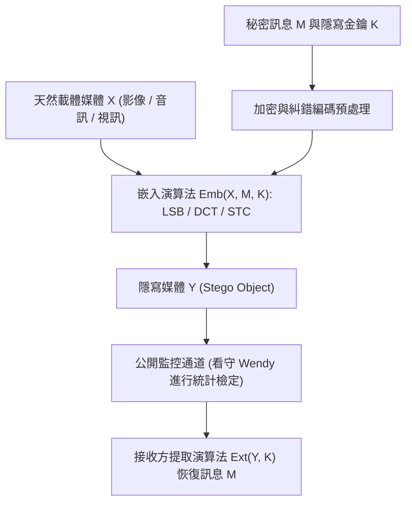
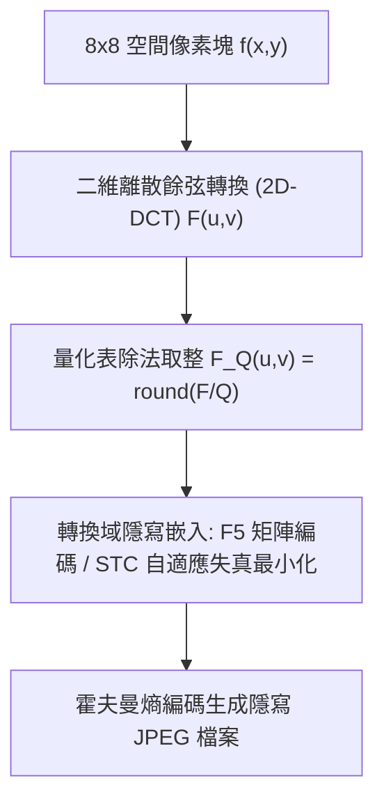

## 1. 密碼學與隱寫術的根本差異：隱藏「內容」還是隱藏「存在」？

在資訊安全領域，<strong>密碼學（Cryptography）</strong>與<strong>隱寫術（Steganography）</strong>追求的是兩個正交的維度。密碼學的目標是將明文 $M$ 透過金鑰 $K$ 轉換為不可讀的密文 $C = E_K(M)$。當攻擊者截獲 $C$ 時，雖然無法直接獲知訊息的語義內容，但<strong>「雙方正在進行加密通訊」這一事實本身是完全暴露的</strong>。在嚴酷的審查環境或極權監控網路中，僅僅發送一段高熵的加密亂碼（如 TLS 流量或 PGP 密文）就足以觸發警報、導致通訊鏈路被切斷甚至招致審訊。

與此相反，源自希臘語 *steganos*（覆蓋、隱蔽）與 *graphein*（書寫）的<strong>隱寫術（Steganography）</strong>，其核心目標是<strong>徹底抹除秘密通訊存在的一切痕跡</strong>。從古希臘歷史學家希羅多德（Herodotus）記載的「剃髮刺字待長髮掩蓋」與「刮去蜂蠟在木板底層書寫」，到1499年約翰內斯·特里塞米烏斯（Johannes Trithemius）出版的《隱寫術（Steganographia）》，再到現代數位媒體時代將加密載荷潛藏於無辜的風景照片、音訊流或網路封包中，隱寫術將秘密資訊 $M$ 嵌入到一個看似完全正常的<strong>載體物件（Cover Object）$X$</strong> 之中，生成<strong>隱寫物件（Stego Object）$Y$</strong>。

1983年，古斯塔夫斯·西蒙斯（Gustavus J. Simmons）提出了著名的<strong>「囚徒問題（The Prisoners' Problem）」</strong>，奠定了現代隱寫術的理論框架：囚徒 Alice 與 Bob 試圖在監獄中策劃越獄，但他們之間的所有信件都必須經過看守 Wendy（Warden）的審查。如果 Wendy 發現任何看似密碼的亂碼，或者察覺信件的統計特徵存在異常，她就會立即沒收信件並將兩人關入禁閉室。因此，Alice 必須將秘密位元隱藏在看似普通日常問候或風景影像 $Y$ 中，使得 Wendy 無法以顯著高於隨機猜測的機率區分天然載體 $X$ 與隱寫載體 $Y$。

1998年，克里斯蒂安·卡欽（Christian Cachin）使用資訊理論中的<strong>庫爾巴克-萊布勒散度（Kullback-Leibler Divergence / 相對熵）</strong>給出了隱寫安全性的嚴格數學定義。設天然載體空間 $\mathcal{X}$ 上的真實機率分佈為 $P_X$，經過隱寫嵌入演算法後生成的隱寫物件分佈為 $P_Y$。若滿足：

$$D_{\text{KL}}(P_X \,\|\, P_Y) = \sum_{x \in \mathcal{X}} P_X(x) \log_2 \frac{P_X(x)}{P_Y(x)} \le \varepsilon$$

則稱該隱寫系統是 $\varepsilon$-安全的（當 $\varepsilon = 0$ 時稱為完美安全隱寫）。根據資訊理論中的<strong>資料處理不等式（Data-Processing Inequality）</strong>，無論被動看守 Wendy 採用何種複雜的二元假設檢定（甚至是深度卷積神經網路分類器），其型一錯誤率（虛警率 $\alpha$：將正常影像誤判為隱寫影像）與型二錯誤率（漏檢率 $\beta$：未能識別出隱寫影像）都必然受到二元相對熵的嚴格約束：

$$d(1-\alpha, \beta) = (1-\alpha)\log_2 \frac{1-\alpha}{\beta} + \alpha \log_2 \frac{\alpha}{1-\beta} \le D_{\text{KL}}(P_X \,\|\, P_Y) \le \varepsilon$$

當 $\varepsilon \to 0$ 時，$\alpha + \beta \to 1$，這意味著看守 Wendy 的檢測能力退化為擲硬幣式的盲目猜測。

| 比較維度 | 密碼學（Cryptography） | 隱寫術（Steganography） | 數位浮水印（Digital Watermarking） |
|---|---|---|---|
| <strong>核心防護目標</strong> | 隱藏訊息的<strong>語義內容</strong> | 隱藏秘密通訊的<strong>存在本身</strong> | 保護載體媒體的<strong>版權歸屬與完整性</strong> |
| <strong>秘密的存在性</strong> | 公開可見（密文呈現明顯高熵特徵） | 嚴格隱蔽（偽裝成普通天然媒體） | 可公開或隱蔽（通常要求難以抹除） |
| <strong>攻擊者模型</strong> | 破譯金鑰或明文（唯密文/已知明文攻擊） | <strong>隱寫分析（Steganalysis）</strong>：統計檢測 $P_X \ne P_Y$ | <strong>浮水印擦除攻擊</strong>：裁剪、壓縮、加噪、幾何扭曲 |
| <strong>關鍵性能指標</strong> | 計算不可區分性（IND-CPA / IND-CCA2） | 統計不可檢測性（$D_{\text{KL}} \to 0$）與高嵌入載荷 | <strong>強健性（Robustness）</strong>與感官不可見性 |

---

## 2. 空間域隱寫：LSB（最低有效位元）替換與卡方（$\chi^2$）隱寫分析的攻防

在未壓縮或無損壓縮的數位影像（如 24位元全彩 BMP、PNG 或 16位元 PCM WAV 音訊）中，最直觀的嵌入方式是<strong>空間域最低有效位元替換（Least Significant Bit Replacement, LSB Replacement）</strong>。在 8位元灰階影像中，每個像素的亮度值 $x_i \in \{0, 1, \dots, 255\}$ 由 8 個二進制位元表示：

$$x_i = \sum_{b=0}^{7} a_{i,b} \, 2^b = 128 a_{i,7} + 64 a_{i,6} + \dots + 2 a_{i,1} + a_{i,0}$$

其中最高有效位元（MSB, $a_{i,7}$）決定了亮度的巨觀結構，而最低有效位元（LSB, $a_{i,0} = x_i \bmod 2$）僅代表 $\pm 1$ 的灰階變化。若將加密後的秘密位元流 $m_i \in \{0, 1\}$ 直接替換像素的最低位元：

$$y_i = 2 \left\lfloor \frac{x_i}{2} \right\rfloor + m_i$$

由於加密位元流 $m_i$ 服從均勻分佈 $P(m_i=0) = P(m_i=1) = 0.5$，平均而言有一半的像素值保持不變，另一半像素值僅改變 $\pm 1$。計算全滿嵌入（每像素 1 位元，即 $1\,\text{bpp}$）時的均方誤差（MSE）與峰值訊噪比（PSNR）：

$$\text{MSE} = \frac{1}{N}\sum_{i=1}^{N} (x_i - y_i)^2 = 0.5 \times 0^2 + 0.5 \times (\pm 1)^2 = 0.5$$

$$\text{PSNR} = 10 \log_{10}\!\left(\frac{255^2}{\text{MSE}}\right) = 10 \log_{10}(130050) \approx 51.14\,\text{dB}$$

人類視覺系統（HVS）通常無法分辨 $\text{PSNR} > 40\,\text{dB}$ 的微弱差異。然而，<strong>「肉眼不可見」絕不等於「統計學上不可檢測」</strong>！

1999年，安德烈亞斯·韋斯特費爾德（Andreas Westfeld）與安德烈亞斯·普菲茨曼（Andreas Pfitzmann）提出了毀滅性的<strong>卡方攻擊（$\chi^2$ Steganalysis Attack）</strong>。其數學洞察極為犀利：在 LSB 替換操作中，像素值 $2k$（偶數）只能變成 $2k$ 或 $2k+1$，而像素值 $2k+1$（奇數）也只能變成 $2k$ 或 $2k+1$。兩者永遠不會跨越到 $2k-1$ 或 $2k+2$！因此，相鄰的值對 $\{2k, 2k+1\}$ 構成了一個封閉的<strong>「值對（Pairs of Values, PoVs）」</strong>。設原始影像中灰階 $v$ 出現的頻數為 $h_X(v)$，則無論 $h_X(2k)$ 與 $h_X(2k+1)$ 原本相差多大，一旦將均勻隨機的密文位元替換進 LSB，隱寫影像中這兩個相鄰灰階的期望頻數就會被強行拉平：

$$\mathbb{E}[h_Y(2k)] = \mathbb{E}[h_Y(2k+1)] = \frac{h_X(2k) + h_X(2k+1)}{2} = \bar{h}_k$$

透過構造皮爾森卡方統計量：

$$\chi^2 = \sum_{k=0}^{127} \frac{\bigl(h_Y(2k) - \bar{h}_k\bigr)^2}{\bar{h}_k}$$

在自由度為 $127$ 的卡方分佈下，天然影像由於局部色彩相關性，$h_X(2k)$ 與 $h_X(2k+1)$ 存在自然起伏，$\chi^2$ 值極大（導出 $p \approx 0$）；而 LSB 替換後的影像直方圖呈現出詭異的「成對階梯狀平坦化」，使得 $p \to 1$，瞬間暴露隱寫行為！即便嵌入率較低，潔西卡·弗里德里希（Jessica Fridrich）等人提出的<strong>RS 隱寫分析（Regular-Singular Analysis）</strong>與<strong>樣本對分析（Sample Pair Analysis, SPA）</strong>也能利用空間相鄰像素相關性將檢測閾值精確到 $0.02\,\text{bpp}$ 以下。

為了修補 LSB 替換的不對稱破綻，研究者提出了<strong>LSB 匹配（LSB Matching / $\pm 1$ Embedding）</strong>：當待嵌入位元 $m_i \ne \text{LSB}(x_i)$ 時，不再死板地執行偶加奇減，而是以 $50\%$ 機率隨機執行 $y_i = x_i + 1$ 或 $y_i = x_i - 1$。這一操作打破了 $\{2k, 2k+1\}$ 的封閉配對，在直方圖頻域上相當於對原始直方圖做了一次低通平滑濾波，從而徹底免疫了經典卡方攻擊。

---

## 3. 轉換域隱寫與矩陣編碼：JPEG 離散餘弦轉換（DCT）與 F5 / STC 演算法

在網際網路實際傳輸中，空間域 LSB 隱寫面臨一個致命工程障礙：<strong>有損壓縮（Lossy Compression）</strong>。一旦使用者將圖片上傳至社群平台或透過即時通訊軟體發送，系統通常會將其重新編碼為 <strong>JPEG</strong> 格式。JPEG 壓縮透過丟棄高頻視覺冗餘資訊，會將空間域像素的 LSB 徹底洗牌破壞。因此，現代實用隱寫術必須深入到壓縮演算法內部——即<strong>頻率轉換域（Transform Domain）</strong>。

JPEG 編碼的核心流程如下：
1. 將 RGB 影像轉換至亮度-色度空間 $\text{YCbCr}$，並對色度通道進行降採樣。
2. 將影像分割為 $8 \times 8$ 像素塊 $f(x,y)$，執行<strong>二維離散餘弦轉換（2D-DCT）</strong>，將其從空間域映射到 64 個正交空間頻率基底 $F(u,v)$（$u,v \in \{0,\dots,7\}$）：

$$F(u,v) = \frac{1}{4} C(u) C(v) \sum_{x=0}^{7} \sum_{y=0}^{7} f(x,y) \cos\!\left(\frac{(2x+1)u\pi}{16}\right) \cos\!\left(\frac{(2y+1)v\pi}{16}\right)$$

其中 $C(0) = 1/\sqrt{2}$，當 $u>0$ 時 $C(u)=1$。
3. <strong>量化（Quantization）</strong>：用 $8\times 8$ 量化表 $Q(u,v)$ 除以 DCT 係數並四捨五入取整，得到量化後的整數 DCT 係數 $F_Q(u,v) = \text{round}\bigl(F(u,v)/Q(u,v)\bigr)$。這一步是有損壓縮的根源。
4. 對量化後的整數係數 $F_Q(u,v)$ 按 Zig-Zag 掃描順序進行游程編碼（RLE）與霍夫曼熵編碼。

如果我們在第 3 步之後、第 4 步無損熵編碼之前，微調非零交流（AC）量化整數係數 $F_Q(u,v)$，那麼只要不再經歷二次重壓縮，隱藏的資訊就能百分之百無損還原！

早期的 <strong>JSteg</strong> 演算法直接對 $F_Q(u,v) \notin \{0, 1\}$ 的係數執行 LSB 替換，結果同樣被針對 DCT 係數直方圖的卡方攻擊輕易識破；尼爾·普羅沃斯（Niels Provos）的 <strong>OutGuess</strong> 試圖保留一半係數用於修正直方圖，但又引入了區塊邊界失真（Blockiness）。

2001年，安德烈亞斯·韋斯特費爾德提出了里程碑式的 <strong>F5 隱寫演算法</strong>，引入了兩項革命性設計：
1. <strong>絕對值遞減替代 LSB 替換</strong>：由於自然影像的拉普拉斯分佈特性，DCT 係數直方圖關於 0 對稱且單調遞減。F5 在需要翻轉位元時，將正係數減 1、負係數加 1（向 0 收縮），徹底消除了成對階梯效應。
2. <strong>矩陣編碼（Matrix Encoding / 漢明伴隨式編碼）</strong>：假設我們有 $n = 2^k - 1$ 個非零可修改係數 $\mathbf{x} = (x_1, \dots, x_n)^T \in \{0,1\}^n$，要嵌入 $k$ 個秘密位元 $\mathbf{m} \in \{0,1\}^k$。利用階數為 $k$ 的二元漢明碼校驗矩陣 $\mathbf{H} \in \{0,1\}^{k \times (2^k-1)}$（其第 $j$ 列恰好是整數 $j$ 的 $k$ 位元二進制表示），計算伴隨式差值：

$$\mathbf{s} = \mathbf{m} \oplus \mathbf{H}\mathbf{x}$$

若 $\mathbf{s} = \mathbf{0}$，則無需修改任何係數即可表示 $k$ 個位元！若 $\mathbf{s} \ne \mathbf{0}$，則 $\mathbf{s}$ 對應的十進制列索引 $j \in \{1, \dots, 2^k-1\}$ 精確指出了<strong>唯一需要翻轉的那 1 個係數 $x_j$</strong>！翻轉 $x_j \to x_j \oplus 1$ 後，新的伴隨式恰好等於 $\mathbf{H}\mathbf{y} = \mathbf{H}\mathbf{x} \oplus \mathbf{h}_j = \mathbf{H}\mathbf{x} \oplus \mathbf{s} = \mathbf{m}$。
這意味著，<strong>嵌入 $k$ 個秘密位元最多只需修改 $2^k - 1$ 個係數中的 1 個</strong>（且有 $2^{-k}$ 的機率一個都不改）！其<strong>嵌入效率（Embedding Efficiency，平均每修改 1 個係數所嵌入的位元數）</strong>達到：

$$e(k) = \frac{k}{1 - 2^{-k}} = \frac{k \cdot 2^k}{2^k - 1}$$

例如當 $k=3$（每 $7$ 個係數嵌入 $3$ 位元）時，平均每次修改可嵌入 $3 / (7/8) \approx 3.43\,\text{bits}$，修改率降低至原來的三分之一以下！

在此基礎上，現代最先進的隱寫術（如 <strong>WOW、S-UNIWARD、J-UNIWARD、HILL</strong>）進一步結合了<strong>自適應失真函數（Adaptive Distortion）</strong>與<strong>伴隨式網格碼（Syndrome-Trellis Codes, STC，Filler 等人 2011年提出）</strong>。演算法為每個像素或 DCT 係數賦予一個失真代價 $\rho_i \ge 0$：在平滑天空或純色背景區域，任何微小改動都會破壞局部馬可夫預測殘差，$\rho_i \to \infty$；而在樹葉、毛髮、水波等高頻複雜紋理區域，預測模型本身具有極高變異數，$\rho_i$ 極小。STC 在滿足 $\mathbf{H}\mathbf{y} = \mathbf{m}$ 的約束下，利用維特比（Viterbi）演算法在網格圖上尋找最小化總失真 $D(\mathbf{X}, \mathbf{Y}) = \sum_{i=1}^n \rho_i |x_i - y_i|$ 的最優修改路徑，迫使現代深度學習隱寫分析網路（如 SRNet、XuNet）也難以捕捉異常。

---

## 4. 隱寫容量的極限：平方根定律（The Square Root Law）與數位浮水印

既然影像像素動輒數千萬，我們能否隨著載體尺寸 $n$（像素總數）的增長，按線性比例 $m = \beta n$ 無限制地增加秘密載荷呢？2008年，托馬斯·菲勒（Tomáš Filler）、安德魯·克爾（Andrew D. Ker）與潔西卡·弗里德里希證明了令隱寫界震驚的<strong>隱寫容量平方根定律（Square Root Law of Steganographic Capacity）</strong>。

假設載體包含 $n$ 個相互獨立的樣本，每個樣本以修改率 $\beta = m / n$ 被嵌入擾動。根據費雪資訊（Fisher Information $I_F > 0$）對相對熵進行二階泰勒展開，全圖 $n$ 個樣本的累積 KL 散度滿足：

$$D_{\text{KL}}\!\left(P_X^{(n)} \,\big\|\, P_Y^{(n)}\right) = n \cdot D_{\text{KL}}(P_X \,\|\, P_Y) = \frac{1}{2} n \beta^2 I_F + O(n\beta^3) = \frac{I_F}{2} \frac{m^2}{n} + O\!\left(\frac{m^3}{n^2}\right)$$

為了保證看守 Wendy 的統計檢定無法以高信賴度識破隱寫（即維持總 KL 散度 $D_{\text{KL}}^{(n)} \le \varepsilon$ 為常數），秘密載荷的位元數 $m(n)$ 必須滿足：

$$\frac{m^2}{n} \lesssim \frac{2\varepsilon}{I_F} \quad \implies \quad m_{\text{safe}}(n) = O\!\left(\sqrt{n}\right)$$

這一定律揭示了一個深刻的資訊理論鐵律：<strong>安全隱寫容量並不隨載體大小 $n$ 線性增長，而是僅僅與像素總數的平方根 $\sqrt{n}$ 成正比</strong>！如果將圖片解析度擴大 4 倍（$n \to 4n$），安全可嵌入的秘密位元數只能擴大 $\sqrt{4} = 2$ 倍；隨著影像變大，單位像素的安全嵌入率 $\beta = m/n = O(1/\sqrt{n})$ 必須趨近於 0，否則大數法則與中央極限定理將幫助隱寫分析者把微弱的統計偏差累積成鐵證！

最後，我們需要將隱寫術與它的孿生技術——<strong>數位浮水印（Digital Watermarking）</strong>加以區分。在資訊隱藏的<strong>「魔術三角形（Magic Triangle：容量 Capacity、不可感知性 Imperceptibility、強健性 Robustness）」</strong>中，隱寫術為了追求極致的不可感知性與高容量，往往犧牲了強健性；而數位浮水印（如 Ingemar Cox 提出的<strong>展頻浮水印 Spread-Spectrum Watermarking</strong> $y_i = x_i + \alpha w_i$、量化索引調變 <strong>QIM</strong>、紙幣上的 <strong>EURion 星座防偽環</strong>、彩色雷射印表機的黃色追蹤微點，以及 Google DeepMind 用於標識 AI 生成內容與大型語言模型文本的 <strong>SynthID 浮水印</strong>）則將僅數十位元的版權標識擴散到整個載體的核心頻段，即使經歷裁剪、有損壓縮、重採樣或翻拍，依然能透過相關性檢測提取出所有權證明。從古希臘的蠟板到神經網路時代的數位鑑識，隱寫術與隱寫分析的數學博弈仍在向更深層的統計極限演進。
