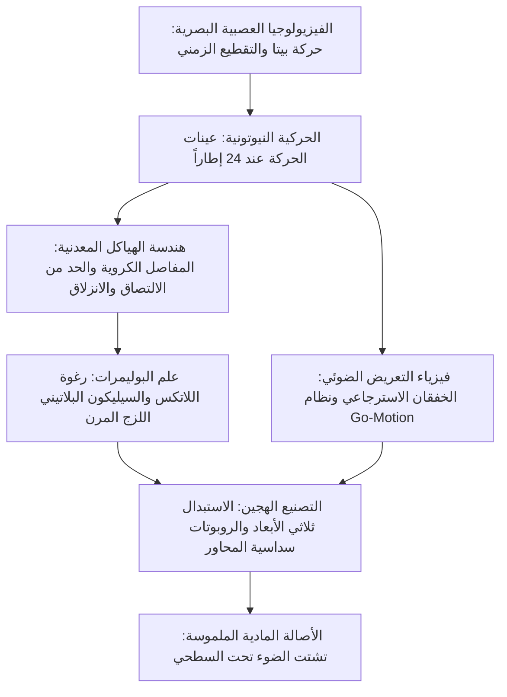

يُنظر أحياناً إلى الرسوم المتحركة بتقنية إيقاف الحركة (Stop-Motion) كحرفة يدوية تقليدية، لكنها في الواقع الصناعي الحديث تمثل هندسة ميكانيكية دقيقة فائقة الصرامة. تجمع هذه التقنية بين التصنيع المحوسب CNC بمعايير الطيران، وعلم الاحتكاك (التريبولوجيا) لمنع ظاهرة الانزلاق الالتصاقي (Stick-Slip)، وفيزياء البوليمرات اللزجة المرنة، وديناميكا الأجسام المتعددة وفق قوانين نيوتن.

لتوليد وهم الحركة الحية بمعدل 24 إطاراً في الثانية (24fps)، يجب على المحرك تحريك مفاصل الدمية بأجزاء من المليمتر دون ارتداد مرن، مع موازنة عزم الانقلاب الجاذبي بدقة عبر أرضيات مسرحية مثقوبة. من فيلم *كينغ كونغ* لويليس أوبراين (1933) وتقنية Dynamation لراي هاريهاوزن إلى نظام Go-Motion المحوسب لدى ILM وملايين أجزاء الوجه المطبوعة ثلاثياً بالألوان لدى استوديوهات لايكا، تقف هذه التقنية شاهداً على التقاء الفيزياء بالفن.

## 1. الفسيولوجيا العصبية للحركة الظاهرية والتقطيع الزمني

يدرك الدماغ البشري الصور المتتالية كحركة انسيابية عبر **حركة بيتا** في القشرة البصرية MT/V5. عند 24 إطاراً في الثانية، تبلغ مدة الإطار الواحد:

$$\Delta t_{\text{frame}} = \frac{1}{24} \approx 41{,}67\text{ ميلي ثانية}$$

تتوافق هذه النافذة الزمنية تماماً مع عتبة التكامل العصبي الحركي. التحريك "على إطارين" (12 وضعية/ثانية) ملائم للحوارات البطيئة، لكنه يسبب ارتعاشاً حركياً مزعجاً في الحركات السريعة.

## 2. هندسة الهياكل وتريبولوجيا المفاصل الكروية

يعتمد الهيكل الداخلي للدمية على **مفاصل كروية وتجويفية** (Ball-and-Socket).
العدو الميكانيكي الأول هو **ظاهرة الالتصاق والانزلاق (Stick-Slip)** الناتجة عن تجاوز معامل الاحتكاك الساكن لنظيره الحركي ($\mu_s \gg \mu_k$). يؤدي ذلك إلى قفز المفصل بصورة مفاجئة متجاوزاً الموضع المطلوب.
الحلول الهندسية:
- كرات من الفولاذ المارتنسيتي فائق الصلابة ومصقول بالمرآة (AISI 440C).
- صفائح تثبيت من برونز الفوسفور ذاتي التزييت (CuSn8).
- تشحيم صلب بثنائي كبريتيد الموليبدينوم ($\text{MoS}_2$) أو حلقات التفلون (PTFE) لضمان $\mu_s \approx \mu_k$.

يُقاوَم عزم الجاذبية $\vec{\tau}_g = \vec{r}_{cm} \times M\vec{g}$ بربط مسامير تثبيت صلبة (**Tie-Downs**) من أسفل المسرح في قاع أقدام الدمى.

## 3. علم المواد: رغوة اللاتكس والسيليكون البلاتيني

- **رغوة اللاتكس (Foam Latex)**: مستحلب مطاط طبيعي يُخفق ميكانيكياً ثم يُعالج بسداسي فلوروسيليكات الصوديوم ويُطهى في الفرن. تتميز بوزنها الخفيف وانعدام القوة الارتدادية المرنة على المفاصل.
- **السيليكون البلاتيني المعالج**: يحاكي تشتت الضوء تحت السطحي للبشرة الحية (Subsurface Scattering). وتضاف إليه ملينات لزجة تعطل ارتداده المرني ليبقى ثابتاً في موضع التحريك بدقة متناهية.

## 4. فيزياء التعريض الضوئي ونظام Go-Motion

تفتقر الرسوم المتحركة التقليدية للدمى إلى **الضبابية الحركية (Motion Blur)** نظراً لسكون الدمية التام أثناء فتح الغالق ($v=0$).
في عام 1980، ابتكر فيل تيبيت نظام **Go-Motion** لفيلم *حرب النجوم: الإمبراطورية تعيد الضربات*: محركات خطوية يتحكم بها الحاسوب تحرك أطراف الدمية فعلياً أثناء فتح الغالق ($1/48\text{ ثانية}$)، مما سجل ضبابية حركية بصرية طبيعية على شريط الفيلم لأول مرة.

## 5. استوديوهات لايكا وثورة الاستبدال ثلاثي الأبعاد

أحدثت استوديوهات لايكا ثورة عبر تقنية الاستبدال الوجهي بالطباعة ثلاثية الأبعاد:
- **بنية الوجه المنقسم**: فصل الوجه أفقياً إلى قسم علوي وسفلي، مما يرفع احتمالات التعبير إلى مليون تعبير بـ 1000 قطعة علوية و 1000 سفلية.
- **التثبيت بمغناطيس النيوديميوم**: تثبيت دقيق بالأجزاء من الميكرون. في فيلم *كوبو*، توفرت أكثر من 48 مليون تركيبة تعبيرية.

| الحقبة | العمل الرائد | الابتكار الهندسي المحوري |
| :--- | :--- | :--- |
| **الثلاثينيات** | *كينغ كونغ* | هياكل فولاذية بمفاصل كروية، أقنعة زجاجية. |
| **الخمسينيات** | *رحلة سندباد السابعة* | **Dynamation**: إسقاط خلفي متزامن مدمج. |
| **الثمانينيات** | *الإمبراطورية تعيد الضربات* | **Go-Motion**: إزاحة حركية آلية أثناء التعريض. |
| **عقد 2010+** | *كورالاين*، *كوبو* | استبدال ثلاثي الأبعاد ملون، أذرع روبوتية 6 محاور. |

تكمن قوة إيقاف الحركة الخالدة في **واقعيتها المادية الملموسة**: تفاعل حقيقي بين فوتونات الضوء وذرات المادة في الفضاء ثلاثي الأبعاد.
