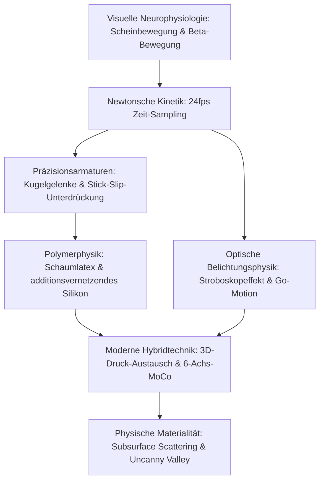

Stop-Motion-Animation wird oft als nostalgisches, handwerkliches Puppenspiel missverstanden. In Wahrheit handelt es sich um eine hochpräzise mikromechanische Ingenieursdisziplin. Sie vereint CNC-gefräste Kugelgelenke, Kontakt-Tribologie zur Unterdrückung von Stick-Slip-Effekten, die Viskoelastizität von Spezialsilikonen und newtonsche Mehrkörperdynamik.

Um bei 24 Bildern pro Sekunde (24fps) die Illusion autonomen Lebens zu erzeugen, müssen Animatoren Gliedmaßen um Bruchteile eines Millimeters biegen, ohne dass elastische Rückstellkräfte oder mechanische Sprünge auftreten. Von Willis O'Briens *King Kong* (1933) über Ray Harryhausens Dynamation und Phil Tippetts motorisierte Go-Motion bis zu den Millionen farbigen 3D-Druck-Gesichtsteilen der Laika Studios steht Stop-Motion an der Schnittstelle von Physik und Kunst.

## 1. Visuelle Neurophysiologie und zeitliche Abtastung

Das menschliche Gehirn interpretiert diskrete Bildfolgen über die **Beta-Bewegung** im visuellen Kortex (Areal MT/V5) als kontinuierliche Bewegung. Bei 24 Bildern pro Sekunde beträgt die Bilddauer exakt:

$$\Delta t_{\text{frame}} = \frac{1}{24} \approx 41{,}67\text{ ms}$$

Dieser Zeitwert fällt perfekt in das neurophysiologische Integrationsfenster. Bei schnellen Bewegungen führt das Schießen auf Zweier-Schritten (Twos, 12 Posen/s) zu spürbarem Bildruckeln (Judder), weshalb dynamische Action immer auf Einsern (Ones, 24 Posen/s) animiert wird.

## 2. Armaturenmechanik und Gelenk-Tribologie

Das metallische Skelett (Armatur) einer Puppe basiert auf **Kugel-Pfanne-Gelenken** (Ball-and-Socket).
Der gefährlichste physikalische Feind ist der **Stick-Slip-Effekt** (Haftgleiteffekt), wenn die Haftreibung die Gleitreibung stark übersteigt ($\mu_s \gg \mu_k$). Beim Überschreiten der Haftreibungskraft schnappt das Gelenk ruckartig nach vorne und zerstört die millimetergenaue Positionierung.
Lösung durch Materialpaarung:
- Kugeln aus hochglanzpoliertem, gehärtetem Edelstahl (AISI 440C, $58\text{--}60\text{ HRC}$).
- Gelenkplatten aus selbstschmierender Phosphorbronze (CuSn8).
- Trockenschmierung mit Molybdändisulfid ($\text{MoS}_2$) oder PTFE-Scheiben, um $\mu_s \approx \mu_k$ zu gewährleisten.

Um das Kippmoment $\vec{\tau}_g = \vec{r}_{cm} \times M\vec{g}$ bei einbeinigen Posen abzufangen, werden die Füße der Puppe von der Unterseite des Bühnenbodens mit **Tie-Down-Schrauben** fest im Lochraster verankert.

## 3. Materialwissenschaft: Schaumlatex und Platin-Silikon

- **Schaumlatex (Foam Latex)**: Durch Aufschlagen von Naturkautschuklatex, Zugabe von Natriumsilikofluorid ($\text{Na}_2\text{SiF}_6$) zur Gelierung und Backen bei ca. $90^\circ\text{C}$ entsteht ein offenporiger Schwamm. Er ist extrem leicht und erzeugt keinerlei elastische Rückstellkraft gegen die Gelenke.
- **Platinvernetzendes Silikon**: Bietet perfekte Lichtstreuung unter der Oberfläche (Subsurface Scattering), die lebender Haut gleicht. Durch Beimischung von bis zu $50\%$ Weichmacher-Deadener wird das Silikon viskoelastisch modifiziert, sodass es mechanisch "tot" bleibt und die Gelenke nicht zurückfedert.

## 4. Optische Belichtungsphysik und "Go-Motion"

Im Gegensatz zum Realfilm fehlt der klassischen Stop-Motion jegliche **Bewegungsunschärfe (Motion Blur)**, da die Puppe während der Belichtung stillsteht ($v=0$). Die extrem scharfen Kanten erzeugen stroboskopische Sprünge auf der Netzhaut.
1980 erfand Phil Tippett bei ILM für *Das Imperium schlägt zurück* das **Go-Motion-Verfahren**: Computergesteuerte Schrittmotoren bewegen die Puppengelenke während der offenen Belichtungszeit ($1/48\text{ s}$) kontinuierlich, wodurch echte optische Bewegungsunschärfe auf dem Filmstreifen entsteht.

## 5. 3D-Druck-Austauschanimation der Laika Studios

Die Laika Studios (*Coraline*, *Kubo*) revolutionierten die Mimik durch hochpräzisen UV-Farbdruck:
- **Horizontale Gesichtsspaltung**: Trennung in Stirn/Augen und Mund/Kinn. Bei 1.000 Ober- und 1.000 Unterteilen ergeben sich $1.000.000$ Kombinationsmöglichkeiten.
- **Neodym-Magnetpassung**: $1{,}5\text{ mm}$ Neodym-Magnete ermöglichen den werkzeuglosen Sekundentausch der Teile mit Submikrometer-Wiederholgenauigkeit. Für *Kubo* standen über 48 Millionen mimische Ausdrücke zur Verfügung.

| Ära | Schlüsselwerk | Ingenieurtechnische Innovation |
| :--- | :--- | :--- |
| **1930er** | *King Kong* | Stahlkugelgelenk-Armaturen, Mehrfachbelichtung mit Glasbildern. |
| **1950er** | *Sindbads 7. Reise* | **Dynamation**: Synchronisierte Rückprojektion mit Spaltmasken. |
| **1980er** | *Das Imperium schlägt zurück* | **Go-Motion**: Motorische Gelenkbewegung während der Belichtung. |
| **2010er** | *Coraline*, *Kubo* | Vollfarb-3D-Druck-Austausch, 6-Achs-Roboterarme, Focus Stacking. |

Die unvergängliche Faszination der Stop-Motion im digitalen Zeitalter beruht auf ihrer **physischen Stofflichkeit**: Echte Photonen, die mit echten Atomen, Silikonporen und Wollfasern interagieren.
