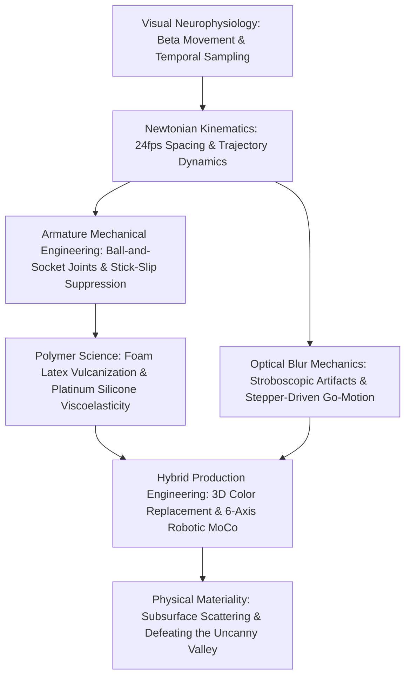
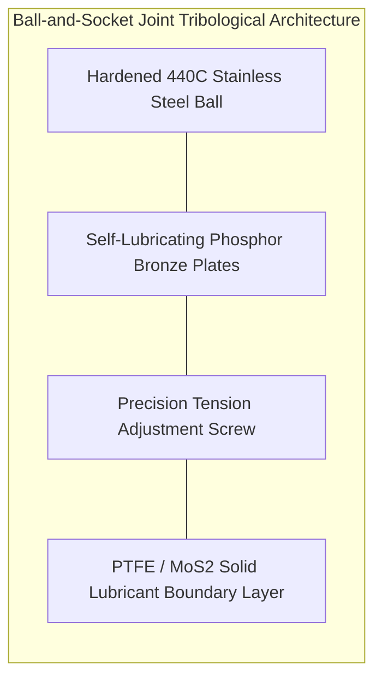
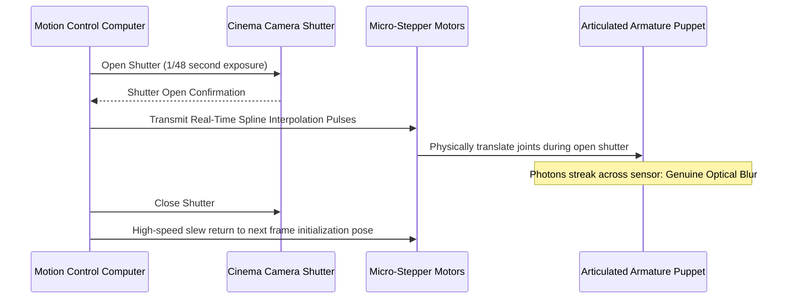

To the casual observer, stop-motion animation might appear to be a charming, quaintly analog craft: an artist gently bending a puppet's arm by hand and capturing photographs one frame at a time. In rigorous physical and industrial reality, however, modern stop-motion is an uncompromising discipline of high-precision micro-engineering. It is an extraordinary convergence of aerospace-grade CNC machining, contact tribology, polymer rheology, Newtonian multi-body kinematics, and diffraction-limited optical cinematography.

To construct the persistent illusion of autonomous life at twenty-four discrete frames per second, an animator must displace mechanical joints by fractions of a millimeter while completely suppressing physical stick-slip bounce. They must anchor structural loads against gravitational tipping moments, isolate complex miniature sets from microscopic thermal expansion drifts, and spend weeks coaxing inanimate physical matter into defying entropy. From Willis O'Brien's 1933 *King Kong* and Ray Harryhausen's pioneering Dynamation to Phil Tippett's motorized Go-Motion and Laika Studios' millions of precision color-3D-printed replacement facial parts, stop-motion has continuously pushed the frontiers of tangible physics and optical technology.

This treatise provides a thorough, multidisciplinary examination of the engineering and physical principles underpinning stop-motion animation, exploring perceptual neurophysiology, ball-and-socket joint tribology, polymer viscoelasticity, optical blur convolutions, inverse kinematics, and modern multi-axis robotic motion control.

---

## 1. Visual Neurophysiology and Temporal Sampling

### Apparent Motion, Beta Movement, and the Phi Phenomenon

The neurophysiological mechanism transforming discrete static images into continuous visual motion was a foundational investigation in early 20th-century Gestalt psychology. In 1912, Max Wertheimer conclusively disproved the naive hypothesis that motion perception is merely a retinal persistence artifact (afterimage). Instead, the perception of continuous movement is an active cortical synthesis primarily computed within the Middle Temporal visual area (Area MT / V5) of the cerebral cortex.

Wertheimer categorized apparent motion into two distinct modes:
1. **Beta Movement**: When two spatially adjacent stimuli are presented alternately across an Inter-Stimulus Interval (ISI) of approximately $40 \text{ to } 60 \text{ ms}$, the visual cortex constructs a single coherent object traversing space continuously. This phenomenon constitutes the perceptual bedrock of cinema and animation.
2. **Phi Phenomenon**: At shorter temporal intervals ($< 30 \text{ ms}$), human observers perceive a pure, objectless illusion of moving light or shadow—a sensation of "pure motion" divorced from spatial shape constancy.

In standard cinematic projection at 24 frames per second, the frame duration is:

$$\Delta t_{\text{frame}} = \frac{1}{24} \approx 0.04167 \text{ s} = 41.67 \text{ ms}$$

This $41.67 \text{ ms}$ temporal slice falls squarely within the optimal neurophysiological window for eliciting robust beta movement, allowing the human brain to bind discrete puppet poses into continuous organic action.

### Temporal Discretization: Shooting on "Ones" vs. "Twos"

Animators modulate the temporal sampling rate according to kinetic requirements:
- **Shooting on Ones (24 discrete poses/sec)**: Essential for high-velocity physical impacts, complex camera tracking through miniature environments, fluid transformations, and rapid sports or martial action. Each frame captures an independent geometric configuration.
- **Shooting on Twos (12 discrete poses/sec, each exposed for two frames)**: Widely employed for deliberate character dialogue and moderate locomotion. While the brain smoothly bridges the $83.33 \text{ ms}$ interval for small angular displacements, high-velocity sweeps executed on twos induce pronounced visual judder (stroboscopic stepping), as retinal displacement exceeds the spatial integration threshold.

---

## 2. Armature Precision Engineering and Joint Tribology

### The Physics of Stick-Slip Phenomenon

At the core of every professional stop-motion puppet lies an internal articulated metal skeleton known as an **armature**. While soft aluminum wire armatures suffice for casual modeling clay, feature-film puppets require CNC-milled **ball-and-socket joints** manufactured to aerospace tolerances ($\pm 5 \;\mu\text{m}$).

The most treacherous mechanical obstacle in puppet fabrication is the **stick-slip phenomenon** governed by contact tribology. When an animator applies a minute force to deflect an articulated limb by a fraction of a degree, the joint must overcome static friction ($F_s = \mu_s N$). If the coefficient of static friction $\mu_s$ substantially exceeds the coefficient of kinetic friction $\mu_k$ ($\mu_s \gg \mu_k$), the joint snaps instantaneously into motion the moment the yield threshold is breached. This sudden drop in frictional resistance produces an uncontrollable overshoot: the limb jerks past the target position, ruining the incremental spacing of the frame.

To eliminate stick-slip and ensure smooth micro-adjustments, high-end armatures enforce the condition $\mu_s \approx \mu_k$ through sophisticated material pairing:
1. **Dissimilar Hard/Soft Metal Interfaces**: The spherical balls are turned from hardened, mirror-polished martensitic stainless steel (e.g., AISI 440C, hardness $58 \text{ to } 60 \text{ HRC}$), while the sandwiching socket plates are machined from bearing-grade phosphor bronze (CuSn8) or aluminum bronze. The bronze acts as a sacrificial, self-bedding bearing surface.
2. **Solid-State Boundary Lubrication**: Wet hydrocarbon greases are strictly avoided because they attract studio dust, migrate into foam latex, and exhibit viscous drag variations over temperature. Instead, animators utilize dry-film coatings of molybdenum disulfide ($\text{MoS}_2$) or thin fluoropolymer (PTFE) shims, ensuring constant torque independent of angular velocity:

$$\tau_{\text{friction}} = \mu_{\text{boundary}} \cdot P \cdot A \cdot r_{\text{eff}} \approx \text{constant}$$

### Statics of Gravitational Torques and Floor Tie-Downs

When a 500-gram puppet balances dynamically on a single foot during a run cycle, its center of mass $\vec{r}_{cm}$ is offset from the contact base by a horizontal vector $\vec{d}$. The gravitational tipping torque $\vec{\tau}_g$ acting on the support ankle is:

$$\vec{\tau}_g = \vec{r}_{cm} \times (M \vec{g})$$

For a puppet with height $h = 25 \text{ cm}$, a mass of $M = 0.5 \text{ kg}$, and a forward lean of $d = 8 \text{ cm}$, the destabilizing torque is:

$$\tau_g = 0.5 \times 9.81 \times 0.08 \approx 0.392 \text{ N}\cdot\text{m} = 39.2 \text{ N}\cdot\text{cm}$$

If the puppet relied purely on gravity and surface friction, it would instantly topple. To maintain static equilibrium, stop-motion sets are constructed from perforated steel plates or high-density Birch plywood drilled with thousands of grid holes. The underside of each puppet foot contains a threaded steel boss (typically 2-56 UNC, 4-40 UNC, or metric M3/M4). 

From beneath the stage floor, an animator threads a high-tensile **tie-down bolt** into the foot and cinches it down with a socket driver. The clamping force $F_{\text{clamp}}$ generates a restoring counter-moment:

$$\tau_{\text{restore}} = F_{\text{clamp}} \cdot w_{\text{foot}} \gg \tau_g$$

Every single step in a walk cycle involves loosening the bolt beneath the set, repositioning the foot by $2 \text{ mm}$, threading a new bolt into the adjacent stage perforation, locking it down, and checking joint deflection with a digital caliper.

| Joint Location | Mechanical Design | Degrees of Freedom (DoF) | Primary Engineering Requirement |
| :--- | :--- | :--- | :--- |
| **Cervical Spine / Neck** | Double ball-and-socket + swivel | 3 DoF (Pitch, Yaw, Roll) | Ultra-smooth micro-torque without drift |
| **Glenohumeral / Shoulder** | Dual ball block + collar extension | 3 DoF + Clavicle lift | High load-bearing capacity against arm leverage |
| **Elbow / Knee** | Single-axis pinned hinge (keyed) | 1 DoF planar flexion ($0^\circ \text{--} 140^\circ$) | Absolute zero lateral play or torsional twist |
| **Wrist / Ankle** | Micro ball-and-socket | 3 DoF | Resisting maximum cantilever bending moments |
| **Lumbar / Pelvis** | Multi-segment ball spine block | Compound multi-axis curvature | Supporting torso and head mass without sag |

---

## 3. Materials Science: Foam Latex and Platinum-Cure Silicone

The articulated metal armature must be encapsulated within an elastomeric body ("flesh") that bends lifelike without tearing, bunching uncharacteristically, or exerting excessive restoring spring-back forces that overpower the armature's friction joints.

### The Polymer Chemistry of Foam Latex

From the 1930s through the late 1990s, **foam latex** was the supreme material of cinematic special effects. Foam latex is an open-cell porous rubber synthesized via a multi-component vulcanization protocol:
1. **Natural Rubber Latex Base**: High-solids aqueous emulsion of cis-1,4-polyisoprene.
2. **Foaming Agent & Curing Agents**: Sodium laureth sulfate mixed with elemental sulfur and vulcanization accelerators (zinc diethyldithiocarbamate, ZDEC).
3. **Mechanical Aeration**: The compound is whipped in an industrial planetary mixer, expanding its volume by 300% to 500% to create microscopic bubble cells.
4. **Gelling Stage**: Sodium silicofluoride ($\text{Na}_2\text{SiF}_6$) is added as a delayed-action acid-releasing gelling agent. Its controlled hydrolysis:
   $$\text{Na}_2\text{SiF}_6 + 4\text{H}_2\text{O} \longrightarrow 2\text{NaF} + 4\text{HF} + \text{Si(OH)}_4$$
   gradually depresses the solution pH from alkaline ($\sim 10.5$) toward neutral ($\sim 7.2$), causing the latex particles to coalesce around the gas bubbles before collapse can occur.
5. **Thermal Vulcanization**: Baked in metal molds at $85^\circ\text{C} \text{ to } 95^\circ\text{C}$ for several hours to establish cross-linking sulfur bridges.

Foam latex is prized for its featherweight density and negligible restoring force: because it is a porous sponge, it compresses into deep skin folds without pushing the joint backward. However, its susceptibility to atmospheric ozone oxidation and UV degradation leads to brittleness over multi-month productions.

### Platinum-Cure Silicone and Viscoelastic Deadening

Modern masterpieces rely on **addition-cure platinum-catalyzed liquid silicone rubber (RTV-2)**. Formed by hydrosilylation between vinyl-terminated polydimethylsiloxane (PDMS) chains and hydride-functional siloxane crosslinkers in the presence of a Karstedt platinum catalyst:

$$\equiv\text{Si-CH=CH}_2 + \text{H-Si}\equiv \xrightarrow{[\text{Pt}]} \equiv\text{Si-CH}_2\text{-CH}_2\text{-Si}\equiv$$

Silicone exhibits chemical inertness, infinite fatigue resistance, and exquisite optical translucency that accurately mimics human skin through **subsurface scattering (SSS)**.

However, crosslinked silicone elastomer behaves as an elastic spring: bending an elbow creates high elastic restoring strain energy ($U = \frac{1}{2} E \epsilon^2$). If the arm is released, the silicone will instantly pull the joint back by several degrees, destroying the animator's carefully positioned increment.
To counteract this, material scientists infuse the formulation with high concentrations ($30\% \text{ to } 60\%$) of **silicone deadener** (unreactive linear siloxanes or fluid polyglycols). The deadener acts as an internal plasticizer that untangles polymer crosslinks, elevating the material's loss modulus $G''$ relative to its storage modulus $G'$. The silicone becomes viscous and "dead," absorbing deformation energy without elastic spring-back and remaining precisely where positioned.

---

## 4. Optical Physics: Motion Blur Absence and "Go-Motion"

### The Stroboscopic Convolution Defect

The fundamental optical signature that visually separates traditional stop-motion from live-action and CGI is the **complete absence of optical motion blur**.

In a physical motion picture camera capturing live action, the shutter remains open across a finite exposure interval (typically $t_{\text{exp}} = 1/48 \text{ s}$ for a standard $180^\circ$ shutter angle). As an object moves across the lens field with velocity $v(t)$, its spatial photon emission profile $O(x, y)$ is integrated over the sensor surface:

$$I(x) = \int_{0}^{t_{\text{exp}}} O(x - v(t) t) \, dt = O(x) * h(x)$$

The point spread function $h(x)$ spreads high spatial frequencies into a smooth gradient of motion blur. 
In conventional stop-motion, however, the puppet is captured in absolute static rest:

$$v(t) = 0 \implies h(x) = \delta(x) \implies I(x) = O(x)$$

Every single frame is recorded with microscopic, razor-sharp edge contrast. When projected sequentially at 24fps, high-contrast moving edges jump across the retina in discrete spatial steps, exciting different retinal receptive fields without temporal overlap. The visual cortex perceives this high-frequency discontinuity as sharp, unsettling **stroboscopic judder**.

### Phil Tippett and the Industrial Light & Magic Go-Motion System

To defeat the stroboscopic curse for *The Empire Strikes Back* (1980) and *Dragonslayer* (1981), creature creator **Phil Tippett** and the engineering team at Industrial Light & Magic (ILM) invented **Go-Motion**.

The revolutionary premise of Go-Motion was to **physically move the puppet's joints during the camera exposure**:
1. Extremely fine, rigid aircraft rods were connected to key anatomical joints within the creature and routed out through the stage to an external rig of multi-axis stepper motors.
2. The animator manually choreographed keyframe positions using a miniature input gantry.
3. A central mainframe (PDP-11 or Apple II) fitted with custom motion-control firmware calculated cubic spline interpolation curves between sequential positions.
4. During each frame exposure ($\Delta t_{\text{exp}} = 1/48 \text{ s}$), the stepper motors accelerated and translated the puppet along the calculated spline vector $v(t)$.

Photons hitting the celluloid film formed authentic, physical motion blur tailored to the creature's velocity. For the first time in cinema history, animated puppets moved with the seamless, heavyweight realism of live-action apex predators. Go-Motion earned Academy Scientific and Technical Awards and served as the direct technological stepping stone toward the digital input devices (DID) used on *Jurassic Park* (1993).

---

## 5. Modern Studio Engineering: Laika and 3D Color Replacement

While British studio Aardman Animations (*Wallace & Gromit*) championed hand-sculpted clay with visible animator fingerprints, Portland-based **Laika Studios** (*Coraline*, *ParaNorman*, *Kubo and the Two Strings*, *Missing Link*) fundamentally revolutionized the discipline by integrating digital parametric modeling and photopolymer 3D printing into physical replacement animation.

### Combinatorial Explosion and Split-Face Architecture

Traditional facial replacement required sculptors to hand-craft separate wooden or clay heads for every phoneme. Laika automated this through high-resolution full-color 3D printers (Objet Connex and Stratasys J750):
1. **Sub-Voxel Color Jetting**: Liquid photopolymers are sprayed in 16-micron layers and cured instantly with ultraviolet lamps, depositing gradients, freckles, and skin tones directly into the resin matrix.
2. **Horizontal Facial Bifurcation**: The puppet's face is bisected horizontally along the bridge of the nose and cheekbones into an **Upper Brow Piece** (eyes, forehead, brows) and a **Lower Mouth Piece** (nose, cheeks, lips, chin).
   - If an animator possesses $M = 1,000$ brow expressions and $N = 1,000$ mouth expressions, the combinatorial variation explodes to:
     $$\text{Total Expressions} = M \times N = 1,000 \times 1,000 = 1,000,000$$
   - For *Kubo and the Two Strings*, over 64,000 discrete 3D-printed facial parts were cataloged, yielding **over 48 million distinct facial expressions**.
3. **Kinematic Magnetic Registration**: The interior skull of the puppet is CNC-machined from aluminum and embedded with precision $1.5 \text{ mm}$ N52 neodymium magnets and guide pins. The printed face pieces snap into position with sub-micron repeatability in less than a second.
4. **Digital Seam Line Retouching**: The microscopic horizontal hairline separating the upper and lower face pieces is digitally painted out in post-production via automated tracking algorithms.

---

## 6. Kinematic Spacing, Ballistic Trajectories, and Inverse Kinematics

Organic animation requires strict adherence to classical mechanics. Every increment of movement plotted on an animator's exposure sheet (X-sheet) reflects the equations of motion.

### Cosine Interpolation for S-Curve Spacing

Linear spacing (constant velocity) appears robotic and dead. To simulate muscle recruitment and inertia, animators employ **ease-in and ease-out** S-curves. To traverse distance $D$ across $N$ frames, discrete positions $x_k$ are governed by cosine harmonic interpolation:

$$x_k = \frac{D}{2} \left[1 - \cos\left(\frac{k \pi}{N}\right)\right], \quad k \in \{0, 1, 2, \dots, N\}$$

The frame-to-frame displacement increment $\Delta x_k = x_k - x_{k-1}$ is:

$$\Delta x_k = D \sin\left(\frac{(2k-1)\pi}{2N}\right) \sin\left(\frac{\pi}{2N}\right)$$

This mathematical distribution guarantees that velocity $\frac{dx}{dt}$ starts at zero, peaks smoothly at $k = N/2$, and decelerates continuously to zero at the destination frame.

### Ballistics of Bouncing Objects and Inelastic Rebound

When a physical prop or character falls under gravity ($g = 9.81 \text{ m/s}^2$) and strikes the ground, its rebound height across successive impacts decays geometrically via the coefficient of restitution $e$:

$$h_k = h_0 \cdot e^{2k}, \qquad T_k = 2 e^k \sqrt{\frac{2 h_0}{g}}$$

Between bounces, the vertical trajectory strictly follows parabolic kinematics:

$$y(t) = y_0 + v_0 t - \frac{1}{2} g t^2$$

During the impact frame, the puppet undergoes an elastic **squash deformation**. Assuming volume conservation (incompressibility condition) for an oblate spheroid:

$$V = \frac{4}{3} \pi a^2 b = \text{constant} \implies a = a_0 \sqrt{\frac{b_0}{b}}$$

As vertical dimension $b$ compresses under impact deceleration, the lateral width $a$ must expand by the inverse square root, preserving perceived physical mass.

---

## 7. Studio Thermodynamic Control and Optical Engineering

Because a 5-second cinematic shot may require three weeks of continuous studio capture, physical environmental stability is paramount.

### Thermal Drift and Coefficient of Linear Expansion

Miniature sets and metal armatures expand and contract with fluctuations in ambient room temperature according to:

$$\Delta L = \alpha \cdot L_0 \cdot \Delta T$$

- Aluminum expansion coefficient: $\alpha_{\text{Al}} \approx 23 \times 10^{-6} \text{ K}^{-1}$
- Structural steel coefficient: $\alpha_{\text{Steel}} \approx 12 \times 10^{-6} \text{ K}^{-1}$

For an aluminum stage gantry of length $L = 2.0 \text{ m}$, a daytime-to-nighttime temperature swing of $\Delta T = 4^\circ\text{C}$ generates:

$$\Delta L = (23 \times 10^{-6}) \times 2.0 \times 4 = 1.84 \times 10^{-4} \text{ m} = 184 \;\mu\text{m}$$

With a digital cinema sensor exhibiting a pixel pitch of $4.5 \;\mu\text{m}$, an expansion of $184 \;\mu\text{m}$ causes the camera to shift by **over 40 sensor pixels**. Over a 200-frame sequence, the set would visibly warp and drift. Consequently, top-tier studios operate under hospital-grade cleanroom HVAC systems maintaining temperature within $\pm 0.5^\circ\text{C}$ and relative humidity within $\pm 2\%$.

### Optical Diffraction Limits in Macro Cinematography

In miniature scale photography, achieving sufficient depth of field (DoF) to hold both a puppet's eyes and its hands in focus requires extremely small aperture settings ($f/16 \text{ to } f/22$). However, geometric optics gives way to wave-optical **Fraunhofer diffraction**. Light passing through a small circular aperture forms an Airy disk whose diameter $d_{\text{Airy}}$ is:

$$d_{\text{Airy}} = 2.44 \cdot \lambda \cdot N$$

At $f/22$ with green light ($\lambda = 550 \text{ nm}$):

$$d_{\text{Airy}} = 2.44 \times (550 \times 10^{-9}) \times 22 \approx 29.5 \;\mu\text{m}$$

Because the Airy disk ($29.5 \;\mu\text{m}$) is over six times larger than the camera sensor's individual pixel pitch ($\sim 4.5 \;\mu\text{m}$), diffraction blur severely softens the entire frame, destroying textural fidelity.

To overcome this fundamental physical bottleneck, modern productions use **Focus Stacking**: the camera is mounted on an automated motorized micro-focus rail, taking 3 to 8 sequential exposures at the lens's optical sweet spot ($f/5.6 \text{ to } f/8$) per animation frame while sweeping the focal plane through the subject. In post-production, depth-slicing algorithms fuse only the sharpest pixels into a single, diffraction-free composite frame.

---

## 8. Summary: The Enduring Power of Physical Materiality

| Technological Era | Landmark Milestone | Core Mechanical Innovation |
| :--- | :--- | :--- |
| **1930s (Classic Era)** | *King Kong* (Willis O'Brien) | Pinned steel ball-and-socket armatures, glass matte multi-pass projection. |
| **1950s (Ray Harryhausen)** | *7th Voyage of Sinbad* | **Dynamation**: Rear-projected live-action synchronization with split-matte miniature integration. |
| **1980s (ILM Go-Motion)** | *The Empire Strikes Back* (Phil Tippett) | Stepper-motor active displacement during open-shutter exposure to create genuine optical motion blur. |
| **1990s (Aardman)** | *Wallace & Gromit* (Nick Park) | Hyper-expressive plasticine modeling clay celebrating physical tactile imperfection and fingerprints. |
| **2010s–Present (Laika)** | *Coraline*, *Kubo* (Travis Knight) | Multi-color photopolymer 3D printing (48 million expressions), 6-axis robotic MoCo, focus stacking. |

In an era saturated with frictionless CGI, stop-motion animation commands profound emotional resonance precisely because of its **tangible physical reality**. The viewer instinctively registers that every ray of key light reflecting off silicone pores, every vibrating wool fiber on a miniature costume, and every micro-shadow cast across the set is a genuine physical interaction between photons and atoms. Stop-motion is the ultimate triumph of human patience and mechanical engineering—a discipline that bridges the laws of classical physics and the divine spark of cinematic imagination.
