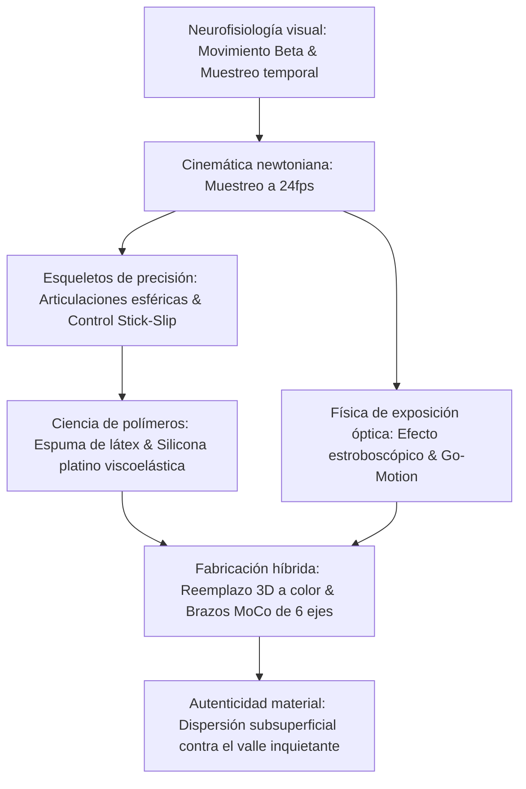

La animación fotograma a fotograma (stop-motion) suele percibirse como un arte puramente artesanal. Sin embargo, en su vertiente industrial moderna constituye una exigente disciplina de ingeniería micromecánica. Combina mecanizado CNC de precisión aeroespacial, tribología de superficies para eliminar el fenómeno de stick-slip, física de polímeros viscoelásticos y dinámica newtoniana de cuerpos rígidos.

Para generar la ilusión de vida autónoma a 24 fotogramas por segundo (24fps), el animador debe desplazar las extremidades fracciones de milímetro sin que surjan rebotes elásticos, equilibrando momentos de vuelco gravitatorio sobre suelos perforados. Desde el *King Kong* de Willis O'Brien (1933) y la técnica Dynamation de Ray Harryhausen hasta el Go-Motion motorizado de ILM y las millones de piezas de reemplazo facial impresas en 3D a color por Laika Studios, el stop-motion celebra el encuentro supremo entre física tangible y cine.

## 1. Neurofisiología del movimiento aparente y muestreo temporal

La percepción continua de imágenes estáticas secuenciales se rige por el **movimiento beta** en el área visual MT/V5 de la corteza cerebral. A 24fps, cada fotograma dura:

$$\Delta t_{\text{frame}} = \frac{1}{24} \approx 41{,}67\text{ ms}$$

Este lapso coincide con la ventana óptima de integración neurofisiológica. Rodar a "doses" (Twos, 12 poses/s) resulta eficiente en diálogos tranquilos, pero en acciones rápidas genera un salto estroboscópico perceptible (judder).

## 2. Ingeniería de armaduras y tribología de rótulas

El esqueleto articulado metálico interno (armature) emplea **articulaciones de rótula esférica** (ball-and-socket).
El enemigo principal es el **efecto stick-slip** (adherencia-deslizamiento), que surge cuando el rozamiento estático supera ampliamente al dinámico ($\mu_s \gg \mu_k$). Al aplicar fuerza para vencer la fricción, la articulación salta bruscamente superando el objetivo.
Medidas de ingeniería:
- Esferas de acero inoxidable martensítico endurecido pulido a espejo (AISI 440C, $58\text{--}60\text{ HRC}$).
- Placas de fricción de bronce fosforoso autolubricante (CuSn8).
- Películas lubricantes secas de disulfuro de molibdeno ($\text{MoS}_2$) o arandelas de teflón (PTFE), garantizando $\mu_s \approx \mu_k$.

El momento de vuelco $\vec{\tau}_g = \vec{r}_{cm} \times M\vec{g}$ se contrarresta fijando la base del pie a través de los orificios del suelo con pernos roscados de amarre (**tie-down bolts**).

## 3. Ciencia de materiales: Espuma de látex y silicona de platino

- **Espuma de látex (Foam Latex)**: Emulsión de caucho natural batida mecánicamente, gelificada con fluosilicato de sodio ($\text{Na}_2\text{SiF}_6$) y horneada a $90^\circ\text{C}$. Su estructura porosa abierta no ejerce fuerzas de retroceso elástico sobre las rótulas.
- **Silicona curada con platino**: Reproduce fielmente la dispersión subsuperficial (Subsurface Scattering) de la piel humana. Mediante la adición de amortiguadores químicos (deadeners), se transforma en un polímero viscoelástico sin retorno elástico, permaneciendo dócil en la posición ajustada.

## 4. Física óptica de exposición y Go-Motion

El stop-motion convencional carece por completo de **desenfoque cinético (Motion Blur)**, ya que el muñeco está inmóvil durante el disparo ($v=0$).
En 1980, Phil Tippett (ILM) creó el **Go-Motion** para *El Imperio contraataca*: motores paso a paso guiados por ordenador desplazan activamente las varillas de la criatura durante la apertura del obturador ($1/48\text{ s}$), registrando desenfoque óptico genuino sobre el celuloide.

## 5. Laika Studios y la revolución del reemplazo 3D

Laika Studios (*Coraline*, *Kubo*) perfeccionó la animación por sustitución facial con resina fotopolimérica:
- **Partición facial horizontal**: Separación entre frente/cejas y boca/mandíbula. Combinando 1.000 piezas superiores e inferiores se obtienen $1.000.000$ de expresiones.
- **Posicionamiento magnético**: Imanes de neodimio de $1{,}5\text{ mm}$ permiten un recambio instantáneo con repetibilidad submicrométrica. En *Kubo y las dos cuerdas mágicas* se lograron más de 48 millones de expresiones.

| Época | Obra representativa | Innovación de ingeniería principal |
| :--- | :--- | :--- |
| **Años 1930** | *King Kong* | Esqueletos articulados de acero, transparencias y máscaras de cristal. |
| **Años 1950** | *Simbad y la princesa* | **Dynamation**: Retroproyección sincronizada e integración de miniaturas. |
| **Años 1980** | *El Imperio contraataca* | **Go-Motion**: Desplazamiento motorizado en obturación abierta. |
| **Años 2010+** | *Coraline*, *Kubo* | Reemplazo facial 3D a color, brazos robotizados MoCo de 6 ejes. |

La vigencia inmortal del stop-motion emana de su **autenticidad física y táctil**: luz real interactuando con materia real en el espacio tridimensional.
