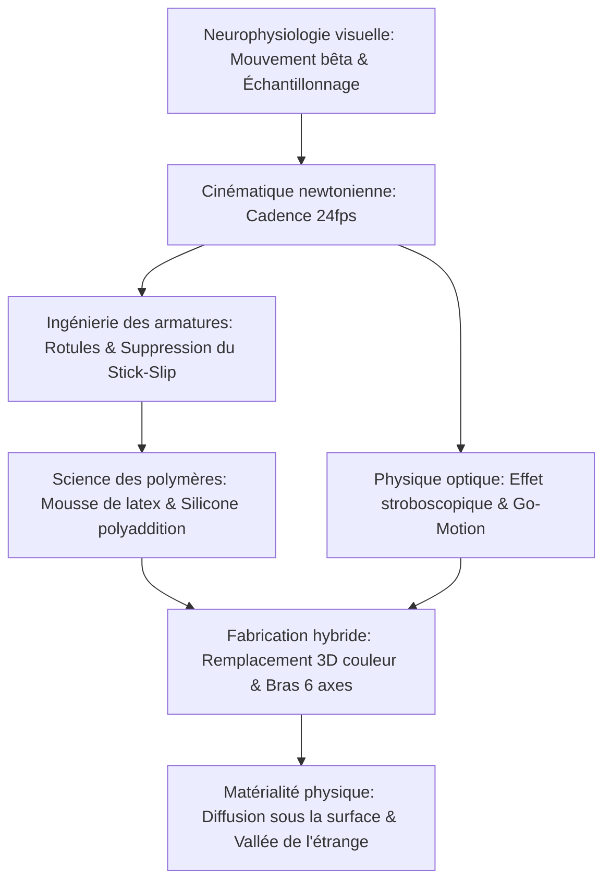

L'animation image par image (stop-motion) est souvent perçue comme un artisanat traditionnel. En réalité, il s'agit d'une ingénierie micromécanique d'une précision absolue, conjuguant usinage CNC aéronautique, tribologie de contact pour supprimer le phénomène de stick-slip, rhéologie des élastomères et dynamique newtonienne.

Pour susciter l'illusion de la vie à 24 images par seconde (24fps), l'animateur manipule les membres de la marionnette au dixième de millimètre sans provoquer de rebond élastique, tout en stabilisant l'armature contre le couple de renversement gravitationnel. De *King Kong* (1933) à la Dynamation de Ray Harryhausen, au Go-Motion motorisé d'ILM et aux millions de pièces faciales imprimées en 3D couleur par les studios Laika, le stop-motion sublime la matière physique.

## 1. Neurophysiologie du mouvement apparent et échantillonnage

Le cerveau humain synthétise les images discrètes grâce au **mouvement bêta** dans l'aire visuelle MT/V5. À 24 images par seconde, l'intervalle d'exposition est :

$$\Delta t_{\text{frame}} = \frac{1}{24} \approx 41{,}67\text{ ms}$$

Cette durée correspond exactement à la fenêtre temporelle optimale de la perception continue. L'animation "à deux images" (Twos, 12 poses/s) est économique pour le dialogue mais génère un scintillement saccadé (judder) lors des mouvements amples et rapides.

## 2. Ingénierie des armatures et tribologie des rotules

L'armature métallique interne repose sur des **articulations à rotule** (ball-and-socket).
L'obstacle physique majeur est le **stick-slip** (broutage), lorsque le frottement statique dépasse largement le frottement dynamique ($\mu_s \gg \mu_k$). Le franchissement du seuil provoque un à-coup violent détruisant la précision du pas d'animation.
Solutions d'ingénierie :
- Billes en acier inoxydable martensitique poli miroir (AISI 440C, $58\text{--}60\text{ HRC}$).
- Plaques de friction en bronze phosphoreux autolubrifiant (CuSn8).
- Lubrifiant solide au bisulfure de molybdène ($\text{MoS}_2$) ou cales en téflon (PTFE), assurant $\mu_s \approx \mu_k$.

Le couple de basculement gravitationnel $\vec{\tau}_g = \vec{r}_{cm} \times M\vec{g}$ est neutralisé par des **vis de fixation (Tie-Downs)** serrées depuis le dessous du plateau perforé dans la plante des pieds.

## 3. Science des matériaux : mousse de latex et silicone platine

- **Mousse de latex (Foam Latex)** : Émulsion de caoutchouc naturel expansée par aération mécanique, gélifiée au fluosilicate de sodium ($\text{Na}_2\text{SiF}_6$) et vulcanisée à chaud. Sa structure alvéolaire offre une légèreté extrême sans force de rappel élastique sur l'armature.
- **Silicone polyaddition platine** : Offre une translucidité optique simulant la diffusion sous-cutanée de la peau (Subsurface Scattering). L'adjonction de fluidifiants dits "deadeners" modifie la viscoélasticité du matériau, annulant le retour élastique pour que la chair reste figée dans la pose exacte.

## 4. Physique de l'exposition optique et Go-Motion

Le stop-motion traditionnel souffre d'une **absence totale de flou de mouvement (Motion Blur)** car la marionnette est immobile lors du déclenchement ($v=0$). Les contours d'une netteté absolue provoquent des sauts visuels désagréables.
En 1980, Phil Tippett (ILM) met au point le **Go-Motion** pour *L'Empire contre-attaque* : des moteurs pas-à-pas reliés à un ordinateur déplacent physiquement les membres de la créature pendant le temps d'exposition de l'obturateur ($1/48\text{ s}$), inscrivant un authentique flou cinétique sur la pellicule.

## 5. Studios Laika et l'animation par remplacement 3D

Les studios Laika (*Coraline*, *Kubo*) ont industrialisé l'animation par remplacement facial grâce à l'impression 3D résine couleur :
- **Architecture de découpe horizontale** : Séparation du visage en deux (sourcils/front et bouche/menton). $1\,000$ pièces supérieures et $1\,000$ pièces inférieures permettent $1\,000\,000$ combinaisons expressives.
- **Indexation par aimants néodyme** : Fixation micrométrique instantanée. *Kubo et l'armure magique* a bénéficié de plus de 48 millions d'expressions possibles.

| Époque | Œuvre clé | Innovation mécanique majeure |
| :--- | :--- | :--- |
| **Années 1930** | *King Kong* | Armatures métalliques à rotules d'acier, caches peints sur verre. |
| **Années 1950** | *Le 7e Voyage de Sinbad* | **Dynamation** : Rétroprojection synchronisée avec double cache. |
| **Années 1980** | *L'Empire contre-attaque* | **Go-Motion** : Déplacement articulé motorisé sous obturateur ouvert. |
| **Années 2010+** | *Coraline*, *Kubo* | Remplacement 3D couleur, bras robotisés MoCo 6 axes, focus stacking. |

La puissance indélébile du stop-motion réside dans sa **matérialité tangible** : la collision réelle des photons avec la matière organique et les pigments synthétiques.
