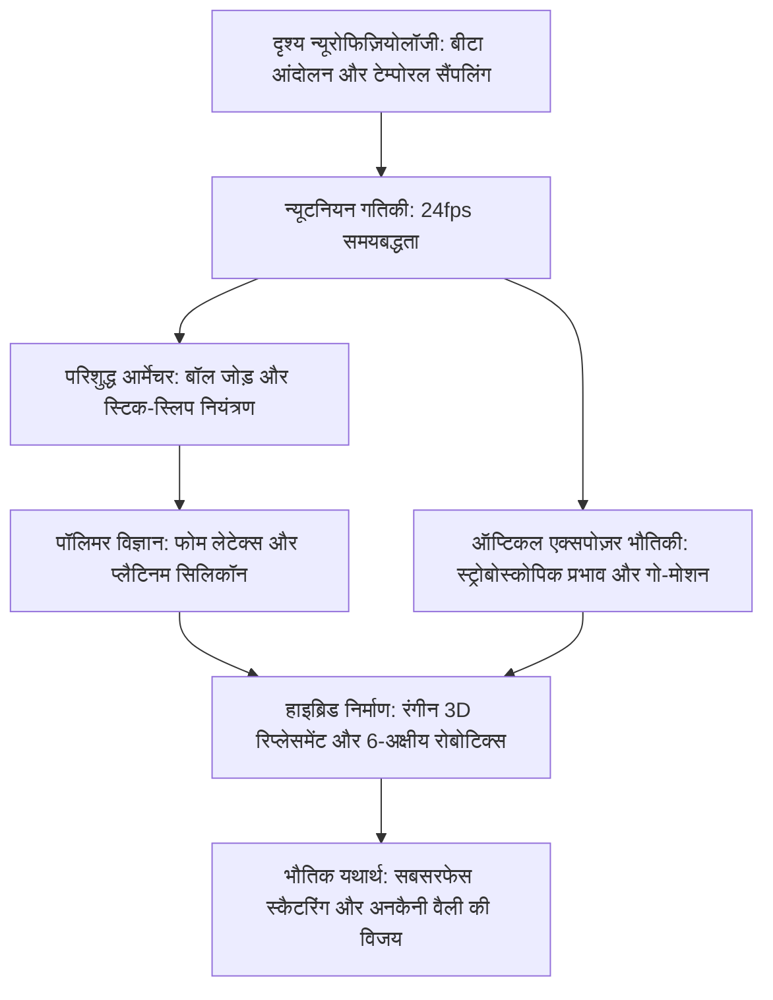

स्टॉप-मोशन एनिमेशन को अक्सर केवल एक पारंपरिक हस्तशिल्प कला के रूप में देखा जाता है। परंतु आधुनिक सिनेमा में यह उच्च-सटीक सूक्ष्म-मैकेनिकल इंजीनियरिंग का शिखर है। इसमें एयरोस्पेस-ग्रेड सीएनसी मशीनिंग, स्टिक-स्लिप (Stick-Slip) घटना को दबाने वाली ट्राइबोलॉजी, विस्कोइलास्टिक पॉलिमर और न्यूटनियन गतिकी का अद्भुत संगम होता है।

प्रति सेकंड 24 फ्रेम (24fps) पर जीवन का सजीव भ्रम उत्पन्न करने के लिए, एनिमेटर को धातु के जोड़ों को मिलीमीटर के अंशों में मोड़ना होता है, लोचदार उछाल (Rebound) को रोकना होता है और छिद्रित मंच पर गुरुत्वाकर्षण असंतुलन को संतुलित करना होता है। 1933 के *किंग कांग* और रे हैरीहॉसन के डायनामेशन से लेकर आईएलएम के मोटर-चालित गो-मोशन और लाइका स्टूडियो के लाखों 3D-प्रिंटेड चेहरों तक, स्टॉप-मोशन ठोस भौतिक विज्ञान का उत्सव मनाता है।

## 1. दृश्य न्यूरोफिज़ियोलॉजी और टेम्पोरल सैंपलिंग

मानव मस्तिष्क **बीटा मूवमेंट** के माध्यम से स्थिर छवियों को निरंतर गति के रूप में जोड़ता है। 24 फ्रेम प्रति सेकंड पर, प्रत्येक फ्रेम की अवधि होती है:

$$\Delta t_{\text{frame}} = \frac{1}{24} \approx 41{,}67\text{ मिलीसेकंड}$$

यह मान निरंतर दृष्टि अनुभूति की सीमा के सर्वथा अनुकूल है। 'टूस' (Twos, 12 पोज़/सेकंड) में रिकॉर्डिंग धीमी बातचीत के लिए उपयुक्त है, परंतु तेज गति में यह दृश्य झटके (Judder) उत्पन्न करती है।

## 2. आर्मेचर मैकेनिक्स और बॉल जोड़ों की ट्राइबोलॉजी

कठपुतली के आंतरिक धातु कंकाल (आर्मेचर) में **बॉल-एंड-सॉकेट जोड़ों** का उपयोग होता है।
सबसे बड़ी भौतिक बाधा **स्टिक-स्लिप प्रभाव** है, जब स्थैतिक घर्षण गतिक घर्षण से बहुत अधिक होता है ($\mu_s \gg \mu_k$)। इससे जोड़ अचानक झटके के साथ आगे निकल जाता है।
इंजीनियरिंग समाधान:
- दर्पण-पॉलिश कठोर स्टेनलेस स्टील बॉल (AISI 440C)।
- स्व-चिकनाई फॉस्फोर कांस्य सॉकेट प्लेटें (CuSn8)।
- मोलिब्डेनम डाइसल्फ़ाइड ($\text{MoS}_2$) शुष्क कोटिंग ताकि $\mu_s \approx \mu_k$ बना रहे।

गुरुत्वाकर्षण टॉर्क $\vec{\tau}_g = \vec{r}_{cm} \times M\vec{g}$ को मंच के नीचे से पैरों में कसे जाने वाले **टाई-डाउन बोल्ट** द्वारा पूरी तरह स्थिर किया जाता है।

## 3. सामग्री विज्ञान: फोम लेटेक्स और प्लैटिनम सिलिकॉन

- **फोम लेटेक्स (Foam Latex)**: प्राकृतिक रबर को झाग बनाकर सोडियम सिलिकोफ्लोराइड से जमाया जाता है और $90^\circ\text{C}$ पर पकाया जाता है। यह अत्यंत हल्का होता है और जोड़ों पर कोई स्प्रिंग-बैक बल नहीं डालता।
- **प्लैटिनम-क्योर सिलिकॉन**: मानव त्वचा जैसा प्रकाश का आंतरिक प्रकीर्णन (Subsurface Scattering) देता है। इसमें रासायनिक डैडनर (Deadener) मिलाकर विस्कोइलास्टिक बनाया जाता है ताकि यह विकृत होने के बाद अपनी जगह पर स्थिर रहे।

## 4. ऑप्टिकल एक्सपोज़र भौतिकी और गो-मोशन

पारंपरिक स्टॉप-मोशन में एक्सपोज़र के समय कठपुतली स्थिर रहती है ($v=0$), जिसके कारण इसमें **मोशन ब्लर (Motion Blur) का पूर्ण अभाव** होता है।
1980 में फिल टिपेट (ILM) ने *द एम्पायर स्ट्राइक्स बैक* के लिए **गो-मोशन** का आविष्कार किया: कंप्यूटर-नियंत्रित स्टेपर मोटरें शटर खुले रहने के दौरान ($1/48\text{ सेकंड}$) कठपुतली के अंगों को सक्रिय रूप से हिलाती हैं, जिससे वास्तविक ऑप्टिकल मोशन ब्लर प्राप्त हुआ।

## 5. लाइका स्टूडियो और 3D प्रिंटिंग रिप्लेसमेंट क्रांति

लाइका स्टूडियो ने रंगीन 3D प्रिंटिंग द्वारा चेहरे की भाव-भंगिमाओं में क्रांति ला दी:
- **विभाजित चेहरा संरचना**: चेहरे को क्षैतिज रूप से ऊपर (भौंहें/माथा) और नीचे (मुंह/ठोड़ी) में बांटना। 1,000 ऊपरी और 1,000 निचले टुकड़ों से $10,00,000$ भाव संभव होते हैं।
- **नियोडिमियम चुंबक**: $1{,}5\text{ मिमी}$ के चुंबकों से कुछ ही सेकंड में बिना किसी उपकरण के चेहरा बदला जा सकता है। *कुबो* फिल्म में 4.8 करोड़ से अधिक भावों के संयोजन उपलब्ध थे।

| युग | प्रमुख कृति | मुख्य इंजीनियरिंग नवाचार |
| :--- | :--- | :--- |
| **1930 का दशक** | *किंग कांग* | स्टील बॉल-सॉकेट आर्मेचर, ग्लास पेंटिंग संयोजन। |
| **1950 का दशक** | *7th वॉयेज ऑफ सिनबाद* | **डायनामेशन**: सिंक्रोनाइज़्ड रियर प्रोजेक्शन। |
| **1980 का दशक** | *द एम्पायर स्ट्राइक्स बैक*| **गो-मोशन**: एक्सपोज़र के दौरान मोटर चालित विस्थापन। |
| **2010 के बाद** | *कोरालाइन*, *कुबो* | रंगीन 3D प्रिंटिंग रिप्लेसमेंट, 6-अक्षीय रोबोटिक MoCo। |

स्टॉप-मोशन का शाश्वत जादू उसकी **ठोस भौतिक यथार्थता** में निहित है: वास्तविक फोटॉन वास्तविक परमाणुओं के साथ क्रिया करके जीवन का निर्माण करते हैं।
