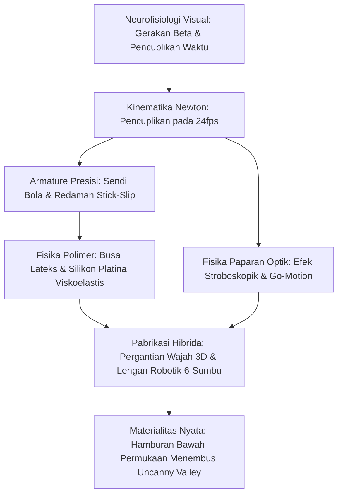

Animasi stop-motion sering disalahpahami sebagai kerajinan tangan kuno. Pada kenyataannya dalam industri modern, stop-motion adalah cabang mikromekanik presisi tinggi yang menggabungkan pemesinan CNC kelas kedirgantaraan, tribologi kontak untuk meredam fenomena stick-slip, fisika polimer viskoelastis, dan dinamika multi-bodi Newton.

Untuk menciptakan ilusi kehidupan pada 24 bingkai per detik (24fps), animator harus menekuk sendi logam dalam fraksi milimeter tanpa memicu pantulan elastis, sambil menahan torsi gravitasi pada panggung berlubang. Dari *King Kong* (1933) karya Willis O'Brien dan Dynamation karya Ray Harryhausen, hingga Go-Motion bermotor ciptaan ILM dan jutaan komponen wajah cetak 3D Studio Laika, stop-motion memadukan materi fisik nyata dengan keajaiban sinematik.

## 1. Neurofisiologi Visual dan Pencuplikan Waktu

Otak manusia merangkai gambar diam menjadi gerakan berkat **gerakan beta** di korteks visual MT/V5. Pada 24fps, durasi tiap bingkai adalah:

$$\Delta t_{\text{frame}} = \frac{1}{24} \approx 41{,}67\text{ ms}$$

Waktu ini berada tepat dalam jendela integrasi penglihatan. Merekam dengan teknik "dua bingkai" (Twos, 12 pose/detik) cocok untuk percakapan santai, tetapi menimbulkan patahan stroboskopik (judder) pada gerakan aksi berkecepatan tinggi.

## 2. Mekanika Armature dan Tribologi Sendi Bola

Kerangka logam internal boneka (armature) menggunakan **sendi bola dan mangkuk** (ball-and-socket).
Musuh mekanis terbesar animator adalah **fenomena stick-slip** saat koefisien gesek statis jauh melampaui dinamis ($\mu_s \gg \mu_k$). Ketika gaya dorong melewati batas, sendi melompat tak terkendali melewati target.
Solusi rekayasa:
- Bola baja tahan karat martensitik yang dipoles cermin (AISI 440C, $58\text{--}60\text{ HRC}$).
- Pelat gesek perunggu fosfor yang dapat melumasi sendiri (CuSn8).
- Pelapis kering molibdenum disulfida ($\text{MoS}_2$) atau cincin teflon (PTFE) untuk menjamin $\mu_s \approx \mu_k$.

Momen guling gravitasi $\vec{\tau}_g = \vec{r}_{cm} \times M\vec{g}$ dinetralkan menggunakan **baut tie-down** yang dikencangkan dari kolong meja panggung berlubang ke telapak kaki boneka.

## 3. Ilmu Material: Busa Lateks dan Silikon Platina

- **Busa Lateks (Foam Latex)**: Emulsi karet alam dikocok hingga mengembang, digelkan dengan natrium silikofluorida ($\text{Na}_2\text{SiF}_6$), lalu dipanggang pada $90^\circ\text{C}$. Struktur pori terbukanya sangat ringan dan tidak melawan sendi logam.
- **Silikon Platina**: Menghasilkan hamburan cahaya bawah kulit (Subsurface Scattering) yang menyerupai kulit asli. Penambahan bahan pelembut (deadener) mengubah polimer menjadi viskoelastis, melenyapkan daya pegas sehingga daging boneka tetap diam di posisi yang ditentukan.

## 4. Fisika Paparan Optik dan Go-Motion

Stop-motion tradisional sama sekali **tidak memiliki blur gerakan (Motion Blur)** karena boneka diam saat rana kamera terbuka ($v=0$). Hal ini menyebabkan efek kedip yang kasar di mata.
Pada 1980, Phil Tippett (ILM) menciptakan sistem **Go-Motion** untuk film *The Empire Strikes Back*: motor stepper bergerak aktif menggeser sendi boneka tepat saat rana kamera terbuka ($1/48\text{ detik}$), menghasilkan blur optik alami pada pita seluloid.

## 5. Studio Laika dan Revolusi Pergantian Wajah 3D

Studio Laika (*Coraline*, *Kubo*) merevolusi ekspresi wajah melalui printer 3D fotopolimer berwarna:
- **Arsitektur Wajah Terbelah**: Pemisahan wajah bagian atas (alis/dahi) dan bawah (mulut/dagu). Kombinasi 1.000 bagian atas dan 1.000 bagian bawah menghasilkan $1.000.000$ ekspresi.
- **Pemasangan Magnet Neodimium**: Magnet $1{,}5\text{ mm}$ memungkinkan penggantian wajah dalam hitungan detik dengan akurasi sub-mikron. Film *Kubo* memiliki lebih dari 48 juta kombinasi ekspresi.

| Era | Karya Penting | Inovasi Rekayasa Kunci |
| :--- | :--- | :--- |
| **1930-an** | *King Kong* | Armature bola baja, pemaparan ganda cat kaca. |
| **1950-an** | *7th Voyage of Sinbad* | **Dynamation**: Sinkronisasi proyeksi latar belakang dengan topeng split. |
| **1980-an** | *The Empire Strikes Back* | **Go-Motion**: Pergeseran motorik aktif saat paparan rana terbuka. |
| **2010-an+**| *Coraline*, *Kubo* | Penggantian 3D berwarna, lengan robot MoCo 6-sumbu, focus stacking. |

Daya pikat abadi stop-motion bersumber pada **materialitas fisiknya**: interaksi nyata foton cahaya dengan atom zat di dunia nyata.
