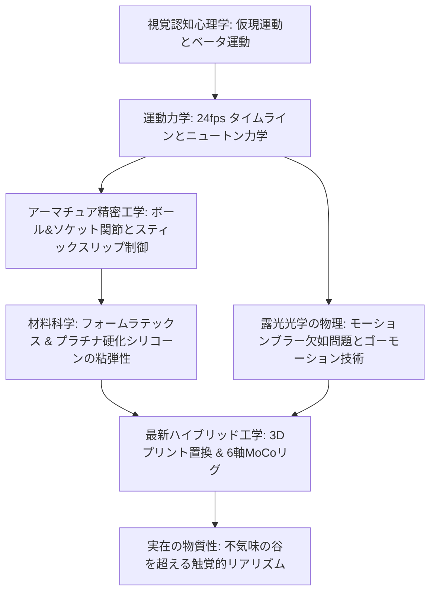
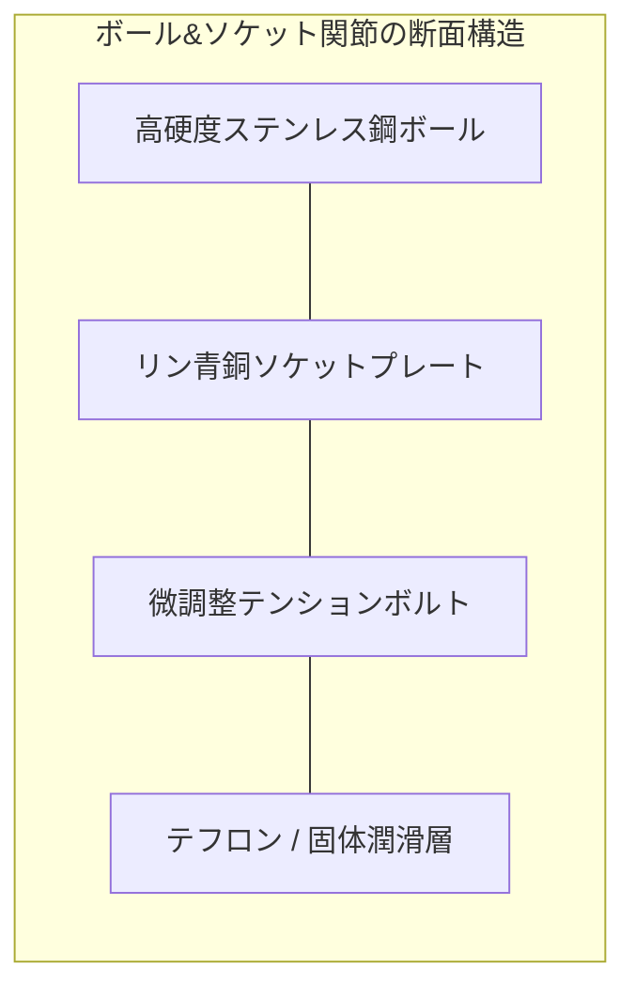
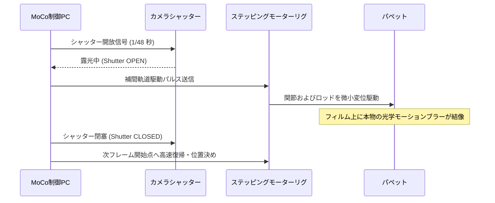
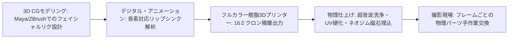

ストップモーション・アニメーション（コマ撮り映画）は、一見すると人形を手で少しずつ動かして撮影する素朴なアナログ芸術に見えます。しかしその実態は、ミクロン単位の位置決めを要求されるロボット工学、関節のスティックスリップ現象を抑制するトライボロジー（摩擦学）、粘弾性ポリマーを操る材料工学、そして重力と慣性を忠実に再現するニュートン力学が高度に結実した、極めて純度の高い「精密物理工学の結晶」です。

1秒間24フレームの錯覚を生み出すために、アニメーターは人形（パペット）の四肢をコンマ数ミリメートル単位で変形・維持させ、カメラと照明の熱膨張によるドリフトを封じ込め、1日かけてわずか数秒の映像を紡ぎ出します。ウィリス・オブライエンの『キング・コング』（1933年）やレイ・ハリーハウゼンのダイナメーションから、スタジオ・ライカ（Laika）の極小フルカラー3Dプリント置換アニメーションに至るまで、ストップモーションは常にその時代の先端科学と手作業の職人技の極限の境界線上で進化を続けてきました。

本稿では、錯視を生み出す視覚心理学と運動力学から出発し、金属アーマチュアの機構設計、パペット皮膚の材料科学、ゴーモーションの光学露光物理、そして現代のマルチ軸モーションコントロール技術に至るまで、ストップモーションを成立させる工学的・物理的基盤を徹底的に解剖します。



---

## 1. 運動錯覚の生理物理学と時間サンプリング

### 仮現運動、ベータ運動、ファイ現象

静止画の連続提示がなぜ滑らかな動画像として認識されるのかという問題は、19世紀末から20世紀初頭にかけてのゲシュタルト心理学と知覚生理学における中心的命題でした。マックス・ヴェルトハイマー（Max Wertheimer, 1912年）は、網膜の残像現象（Afterimage）だけでなく、大脳皮質の視覚野（特に中側頭野：MT/V5野）における高次情報処理が本質的な役割を果たしていることを証明しました。

- **ベータ運動（Beta movement）**: 空間的に近接した2つ以上の刺激が適切な時間間隔（刺激間間隔：ISI $\approx 40 \sim 60 \text{ ms}$）で交互に呈示されたとき、刺激そのものが空間を横切って連続的に移動したと知覚する現象。映画やアニメーションの滑らかな運動知覚の大部分はこのベータ運動に起因します。
- **ファイ現象（Phi phenomenon）**: より短い時間間隔で光が明滅した際、対象の形態を伴わずに「純粋な運動の影」のみが知覚される無形態運動錯覚。

映画の標準フレームレートである24fps（フレーム/秒）において、1フレームの表示持続時間は：

$$\Delta t_{\text{frame}} = \frac{1}{24} \approx 0.04167 \text{ s} = 41.67 \text{ ms}$$

これは人間の視覚系においてベータ運動が最も安定して誘発される時間窓に完全に一致しています。

### 「1コマ打ち（Ones）」と「2コマ打ち（Twos）」の力学

ストップモーションの撮影において、アニメーターは表現意図と制作効率に応じて2種類の時間サンプリングを選択します：

1. **1コマ打ち（Shooting on Ones）**: 毎秒24回の変形と撮影を行う（24フレーム/秒）。高速で俊敏なアクション、カメラがセット内をダイナミックに移動するトラッキングショット、爆発や水滴などの流体シミュレーションにおいて必須となります。
2. **2コマ打ち（Shooting on Twos）**: 1回の変形に対して2フレーム分撮影し、実質12ポーズ/秒で進行する（各ポーズの持続時間は約 $83.3 \text{ ms}$）。通常の対話シーンや緩やかな日常動作では2コマ打ちが多用されます。人間の眼は $80 \text{ ms}$ 程度の離散的な変化であっても滑らかな運動として補間可能ですが、急速なパンニングや高速運動ではストロボ効果による画面のジャダー（Judder: カクつき）が顕著になります。

```mermaid
graph TD
    subgraph 1秒間 (24フレーム) の時間サンプリング
        A[1コマ打ち / Ones: 24ポーズ/秒] --> A1[超高速アクション・カメラ移動に最適・滑らかな連続性]
        B[2コマ打ち / Twos: 12ポーズ/秒] --> B1[標準的な演技・微細なタクト感と制作効率の両立]
    end
```

---

## 2. アーマチュア精密工学：ボール＆ソケット関節と剛性設計

### スティックスリップ現象（Stick-Slip）の撲滅

ストップモーション用の人形（パペット）の内部には、人間の骨格に相当する精密な金属骨格**「アーマチュア（Armature）」**が埋め込まれています。針金（アルミニウムワイヤー）を束ねた簡易的なワイヤーアーマチュアも存在しますが、長編映画の過酷な撮影に耐えるプロフェッショナルなパペットには、航空宇宙基準の金属切削加工による**ボール＆ソケット関節（Ball-and-Socket Joint）**が不可欠です。

パペットアニメーターが直面する最大の物理的敵は、トライボロジーにおける**スティックスリップ現象（Stick-Slip Phenomenon）**です。
関節に力を加えてわずかに角度を変えようとしたとき、静止摩擦係数 $\mu_s$ と動摩擦係数 $\mu_k$ の差（$\mu_s > \mu_k$）が大きいと、静止摩擦力を超えた瞬間に摩擦抵抗が急激に低下し、関節がカクンと跳ねて狙った位置を行き過ぎてしまいます（オーバーシュート）。

関節の摩擦トルクを $T_f$、クランプの締め付け圧力を $P$、接触面積を $A$、摩擦面の平均有効半径を $r$ とすると：

$$T_{f, \text{static}} = \mu_s P A r, \qquad T_{f, \text{kinetic}} = \mu_k P A r$$

跳ね上がりのない滑らかな微小角変位を実現するためには、境界潤滑状態において $\mu_s \approx \mu_k$ を維持しなければなりません。このため、最高級のアーマチュア関節では以下の工学的対策が施されます：
- **異種金属の組み合わせ**: ボール部には鏡面研磨されたマルテンサイト系高硬度ステンレス鋼（SUS440C等）、受け皿（ソケットプレート）には自己潤滑性を持つリン青銅（Phosphor Bronze）やアルミニウム青銅を採用。
- **固体潤滑コーティング**: 微小な二硫化モリブデン（$\text{MoS}_2$）粉末やテフロン（PTFE）ワッシャーを挟み込み、乾燥摩擦状態での焼き付きとスティックスリップを物理的に排除。



### 重力トルクと足裏タイダウン（Tie-Down）の静力学

パペットが片足を上げて前進する瞬間、パペット全体の重量 $M$ による重力モーメントが支持脚の足首関節およびステージ床面に負荷されます。
パペットの重心位置を $\vec{r}_{cm}$、支持脚の足裏接地点を原点 $O$ とすると、転倒モーメント $\vec{\tau}_{\text{gravity}}$ は次式で与えられます：

$$\vec{\tau}_{\text{gravity}} = \vec{r}_{cm} \times (M \vec{g})$$

もし足裏が単に床に置かれているだけなら、法線力中心が足裏の支持基底面の外側に出た瞬間にパペットは即座に倒壊します。
これを防ぐため、ステージ床面には無数の孔（パーフォレーション）があけられたベニヤ板や金属グリッドが敷かれ、足裏の内部に切られた雌ネジ（通常は2-56、4-40、M3などの精密ミリネジ・ユニファイネジ）に対して、ステージの床下から**タイダウンボルト（Tie-Down Bolt）**を六角レンチで締め付けて強固に固定します。

片足立ちの過酷なポーズでは、足首のボール関節にかかる曲げ応力は極めて高くなります。ボール径が $\phi 6 \text{ mm}$ の関節において、締め付けボルトによる垂直抗力 $N$ が十分でないと、重力モーメントによってポーズが撮影中に数ミクロン沈み込み、画面上で不快なジッター（振動）として記録されてしまいます。

| 関節部位 | 採用機構 | 主な自由度 (DoF) | 求められる機械特性 |
| :--- | :--- | :--- | :--- |
| **首・頭部** | ダブルボール＆ソケット | 3軸（ピッチ・ヨー・ロール） | 極めて精密な微小トルク制御 |
| **肩関節** | 2連ボール＋スイベル | 3軸＋鎖骨エレベーション | 広可動域と高耐荷重 |
| **肘・膝** | 単軸ヒンジ（キー溝付き） | 1軸屈曲（0°〜140°） | 側方ガタつきの完全排除 |
| **手首・足首**| コンパクトボール関節 | 3軸 | 最大曲げモーメントへの耐性 |
| **背骨・腰** | 多段ボールブロック | 複合多軸屈曲 | 自重保持と弾性カーブの再現 |

---

## 3. 材料科学：フォームラテックスとシリコーンの粘弾性

金属骨格であるアーマチュアが完成しても、その上に被せる「肉付け（Flesh）」がアーマチュアの自由な屈曲を阻害したり、経年劣化で裂けてしまっては長期間の撮影に耐えられません。パペットの皮膚と筋肉には、極めて特殊な高分子材料科学が適用されます。

### フォームラテックス（Foam Latex）の加硫化学

20世紀半ばから特撮界を支配してきた伝統的な造形材料が、**フォームラテックス**です。フォームラテックスは、天然ゴムラテックス（ポリイソプレンエマルジョン）に発泡剤、加硫剤（硫黄）、加硫促進剤、酸化防止剤、そしてゲル化剤（珪フッ化ナトリウム：$\text{Na}_2\text{SiF}_6$）を混合し、ミキサーで数倍にホイップしたのち、金型に流し込んでオーブンで加熱焼成（約 $85^\circ\text{C} \sim 100^\circ\text{C}$）することで作られます。

$$\text{珪フッ化ナトリウムの加水分解}: \quad \text{Na}_2\text{SiF}_6 + 4\text{H}_2\text{O} \longrightarrow 2\text{NaF} + 4\text{HF} + \text{Si(OH)}_4$$

この反応によってラテックス溶液のpHがアルカリ性から中性へと徐々に低下し、均一微細な独立気泡構造を保ったままゲル化が完了します。
フォームラテックスの最大の利点は、**「圧倒的な軽さ」**と**「伸縮圧縮時の応力残留の小ささ」**です。多孔質スポンジ構造であるため、関節を曲げた際に皮膚の反発弾性トルクがアーマチュアのボール関節を押し戻す力が非常に小さく、ポーズの保持性が極めて高くなります。しかし、大気中のオゾンや紫外線による酸化劣化に弱く、数ヶ月の撮影期間中に硬化・ひび割れを起こしやすいという欠点があります。

### プラチナ硬化シリコーン（Platinum-Cure Silicone）

現代のハイエンドスタジオ（ライカやアードマンなど）で主流となっているのが、**付加重合型プラチナ硬化シリコーン**です。主剤（ビニル基含有ポリジメチルシロキサン）と硬化剤（白金錯体触媒およびヒドリド基含有シロキサン）のヒドロシリル化反応によって室温〜中温で硬化します。

シリコーンは化学的に極めて安定で、経年劣化がほぼ皆無であり、人間の生体皮膚に極めて近い光の半透明性（**皮下散乱：Subsurface Scattering**）を誇ります。
しかし、シリコーンは固体エラストマーであるため、そのままでは曲げ変形に対する反発弾性（スプリングバック力）が強すぎ、アーマチュアの関節を勝手に動かしてしまいます。

この問題を解決するため、シリコーンオイルや**デッドナー（Deadener / 軟化調整剤）**を高比率でブレンドし、材料の損失弾性率 $G''$ を高めて弾性エネルギーを熱散乱させる**「粘弾性（Viscoelasticity）」**を人工的に付与します。これにより、生肉のように柔らかく、変形させた位置にしっとりと留まる理想的なパペット肉体が実現されます。

---

## 4. 露光光学の物理：モーションブラーの欠如と「ゴーモーション」

### ストロボ効果（Stroboscopic Artifact）の数理

ストップモーションアニメーションが、CGや実写映画と視覚的に決定的に異なる最大の物理的要因は、**「モーションブラー（運動ボケ）の完全な欠如」**です。

実写映画のカメラでは、シャッターが開いている時間（露光時間 $t_{\text{exp}} = \frac{1}{48} \text{ s}$、180度シャッター開角度時）の間に被写体が動くため、移動の軌跡が銀塩フィルムやCMOSセンサー上で滑らかにぼやけます（モーションブラー）。数学的には、センサーに記録される輝度分布 $I(x)$ は、対象物の真の空間輝度分布 $O(x)$ と、露光時間内の運動軌跡を表す点広がり関数（PSF: Point Spread Function）$h(x)$ の畳み込み（Convolution）として表現されます：

$$I(x) = O(x) * h(x) = \int_{0}^{t_{\text{exp}}} O(x - v(t) t) \, dt$$

しかし、通常のストップモーションでは、**パペットが完全に静止した状態でシャッターを切る**ため、運動速度 $v(t) = 0$ となり、$h(x) = \delta(x)$（デルタ関数）となります。その結果、どんなに猛スピードで走っているキャラクターであっても、輪郭は1フレームごとにピンボケのない極限のシャープさで記録されます。
これを24fpsで連続再生すると、網膜上での空間周波数スペクトルが不連続に跳躍し、人間の視覚系は激しいストロボ効果（コーミングやジャダー）として違和感を感知してしまいます。

### インダストリアル・ライト＆マジック（ILM）のゴーモーション技術

このストップモーションの宿命的限界を工学的に打ち破ったのが、伝説のSFX職人**フィル・ティペット（Phil Tippett）**とILMのエンジニア陣が映画『ドラゴンスレイヤー』（1981年）や『スター・ウォーズ エピソード5/帝国の逆襲』（1980年のトーントーンやAT-ATウォーカー）のために開発した**「ゴーモーション（Go-Motion）」**システムです。

ゴーモーションの原理はシンプルかつ革命的です。
**「カメラのシャッターが開いている露光時間中に、コンピューター制御のステッピングモーターでパペットの関節を実際に物理的に動かす」**。



パペットの各主要関節（四肢、首、胴体）から極細のロッド（リンケージ）が引き出され、ステージ外のマルチ軸ステッピングモーターアクチュエータに接続されます。
アニメーターは各キーフレームでのパペットのポーズを設定し、制御コンピューター（当時はApple IIやPDP-11）がフレーム間の3次スプライン曲線を計算。シャッターが開いた瞬間、モーターが計算された微小速度プロファイル $v(t)$ でパペットを滑らかに牽引し、物理フィルム上に光学的な本物のモーションブラーを結像させました。

ゴーモーションはストップモーション特有のカクつきを完全に消し去り、まるで本物の巨大生物や四足歩行兵器が目の前に実在しているかのような圧倒的リアリズムを達成しました。この技術は、後のジュラシック・パーク（1993年）におけるデジタル・ダイナソーへの技術的架け橋（DID: デジタル・インプット・デバイス）となりました。

---

## 5. モーションコントロール・シネマトグラフィとデジタル置換アニメーション

### 6軸モーションコントロールリグ（MoCo）と逆運動学（IK）

現代のストップモーション撮影スタジオは、事実上の精密工作機械工場と化しています。カメラは手持ちや簡易三脚ではなく、レール上を走る超高精度な**6軸〜9軸モーションコントロールロボットアーム（MoCo: Motion Control Rig）**に搭載されています。

カメラの位置 $\vec{P} = (x, y, z)^T$ および姿勢オイラー角 $\vec{\Theta} = (\text{roll}, \text{pitch}, \text{yaw})^T$ は、各関節モーターの回転角ベクトル $\vec{\theta} = (\theta_1, \theta_2, \dots, \theta_n)^T$ から順運動学（FK）および逆運動学（IK）計算によってミリ波以下の精度で制御されます。
ヤコビ行列 $J(\vec{\theta})$ を用いた微小変位関係：

$$\Delta \vec{X} = J(\vec{\theta}) \Delta \vec{\theta}$$

により、アニメーターがセット内のパペットの目線にカメラの焦点を完全にロックしたまま、周囲を360度螺旋状に回り込むような複雑極まりないカメラワークが、数週間にわたるコマ撮り撮影の全期間を通じて1ミクロンの狂いもなく再現されます。

### スタジオ・ライカの3Dプリント置換（Replacement）革命

ストップモーションにおける伝統的な顔の表情（フェイシャル・アニメーション）の制作手法には、粘土を直接変形させる手法や、皮膚の下のマイクロギアを精密ドライバーで回して口角を動かす手法がありました。しかしこれらの手法では、微細な感情の機微や正確な母音・子音のリップシンク（発音口形）の再現に限界がありました。

アメリカ・オレゴン州の**スタジオ・ライカ（Laika Studios）**は、映画『コララインとボタンの魔女』（2009年）、『パラノーマン』（2012年）、『KUBO/クボ 二本の弦の秘密』（2016年）において、映画界の歴史を塗り替える**「ラピッドプロトタイピング・フルカラー3Dプリント置換システム」**を確立しました。



1. **フェイシャルリグのデジタル設計**: コンピュータ上でキャラクターの表情をCGで緻密にアニメーションさせ、24fpsの各フレームに対応する顔の形状メッシュを生成。
2. **顔パーツの上下分割**: 眉毛・額・目を含む「上半分」と、鼻・口・顎を含む「下半分」に水平分割。これにより、組み合わせ爆発（Combinatorial Explosion）を利用して、製作パーツ数を指数関数的に節約（例：上顔500種類 $\times$ 下顔500種類 $=$ 250,000通りの表情表現）。
3. **極薄ネオジム磁石によるワンタッチ脱着**: パペットの頭部コア（スカル）と3Dプリントパーツの裏面に、直径 $1.5 \text{ mm}$ のネオジム磁石と位置決めピンを高精度に埋め込み、アニメーターが工具なしで0.1秒でパーツを交換可能に設計。
4. **シームラインのデジタル消去**: 上下パーツの境界線（シームライン）は、完成映像においてデジタルペイント（ロトスコープ）で目立たなく処理。

『KUBO/クボ』の主人公クボの顔パーツは数万点以上が出力され、可能な表情のバリエーションは**4,800万通り**を超えました。手作業のコマ撮りの温もりと質感に、現代のデジタル演算の精度が完全に融合した極致の工学体系です。

---

## 6. 歴史的系譜：職人芸からハイブリッド・サイエンスへ

ストップモーション技術の100年を超える進化の足跡は、常に映像特殊効果のフロンティアを切り拓いてきました。

| 年代 / 作品 | 主導者 / スタジオ | 主な工学的イノベーション |
| :--- | :--- | :--- |
| **1933年**<br>『キング・コング』 | ウィリス・オブライエン<br>(Willis O'Brien) | 金属アーマチュアの本格導入、ガラスペインティングとミニチュアプロジェクションの多重露光合成。 |
| **1958年**<br>『シンバッド七回目の航海』 | レイ・ハリーハウゼン<br>(Ray Harryhausen) | **ダイナメーション（Dynamation）**: リアプロジェクションと前景スプリットマスクを組み合わせ、実写俳優とストップモーション怪獣の完全な空間統合を実現。 |
| **1980年**<br>『帝国の逆襲』 | フィル・ティペット<br>(Phil Tippett / ILM) | **ゴーモーション**: モーター制御による露光中関節移動。実写と見分けのつかない本物の光学モーションブラーの創出。 |
| **1989年〜**<br>『ウォレスとグルミット』 | ニック・パーク<br>(Aardman Animations) | プラスティシン（色粘土）によるクレイアニメーションの極致。アニメーターの指紋を残すことで「手作りの温もり」を芸術的記号化。 |
| **2009年〜**<br>『コラライン』『クボ』 | トラヴィス・ナイト<br>(Laika Studios) | フルカラーUV硬化3Dプリンティングによる置換アニメーション、マルチ軸ロボットアームMoCo、CGとコマ撮りの完全ハイブリッド。 |

---

## 7. 実在の物質性（Tactile Authenticity）が放つ不滅の価値

現代のハリウッド映画では、完全な3Dコンピュータグラフィックス（CGI）を用いれば、物理法則に従う完璧なモーションブラー、光の反射、筋肉の変形をすべてシミュレーション上で計算可能です。しかし、人間は完璧すぎるCGに対して時に冷たい人工感や「不気味の谷（Uncanny Valley）」を本能的に嗅ぎ取ります。

ストップモーションが観客の心を揺さぶり続ける理由は、そこに**「実在する光と物質の対話」**が存在するからです。
- 撮影スタジオの空気中の微粒子によるチンダル現象
- フォームラテックスやウール衣装の繊維が捉える本物の光の散乱（サブサーフェス・スキャタリング）
- アニメーターが指先で込めた魂のような微小な非対称性

ストップモーション・アニメーションとは、極小の箱庭の中にニュートン力学、トライボロジー、高分子化学、光学モーション制御を結集させ、**「無機質な物質に本物の命を吹き込む現代のプロメテウス的工学」**なのです。


---

## 8. 運動力学の数学的定式化：スペーシングと歩行周期のキネマティクス

アニメーターが物理的なパペットを操作する際、その脳内では常にニュートン力学の方程式が無意識的あるいは意識的に演算されています。観客が「パペットに本物の重力と質量が宿っている」と信じ込むためには、パペットの各フレームでの移動量（スペーシング：Spacing）が運動の物理法則と完全に整合していなければなりません。

### イーズイン・イーズアウトの幾何学的スペーシング公式

物体が静止状態から最高速度に達し、再び静止する運動において、等速運動（リニアな移動）を行うと機械的で不自然な印象を与えます。自然界の運動は、筋肉の筋力発生や摩擦抵抗によって滑らかに加速・減速します。

2点間（距離 $D$）を $N$ フレームで移動させる際のスペーシング計算において、最も滑らかな加減速カーブ（S字カーブ）を生成する**コサイン補間（Cosine Interpolation）**の離散位置関数 $x_k$ は次式で表されます：

$$x_k = D \times \frac{1 - \cos\left(\frac{k \pi}{N}\right)}{2} \quad (k = 0, 1, 2, \dots, N)$$

各フレームでの移動増分（フレーム間変位）$\Delta x_k = x_k - x_{k-1}$ は：

$$\Delta x_k = \frac{D}{2} \left[ \cos\left(\frac{(k-1)\pi}{N}\right) - \cos\left(\frac{k \pi}{N}\right) \right] = D \sin\left(\frac{(2k-1)\pi}{2N}\right) \sin\left(\frac{\pi}{2N}\right)$$

この三角関数によるスペーシング配分により、始点付近（$k \approx 0$）および終点付近（$k \approx N$）での変位量は極小となり、中間点（$k = N/2$）で最大速度に達します。アニメーターはこの理論曲線をゲージ付きキャリパーやドラゴンフレームの画面上オニオンスキン機能を用いて、パペットの骨格に0.1ミリ単位で忠実にトレースします。

### バウンド球の衝突力学と非弾性散乱

重力加速度 $g \approx 9.80665 \text{ m/s}^2$ のもとでパペットや小道具が自由落下し、地面で跳ね返る運動は、反発係数（Coefficient of Restitution）$e$ を用いて完全に記述されます。
高さ $h_0$ から初速ゼロで自由落下させた場合、第 $k$ 回目の跳ね返りの頂点高さ $h_k$ および滞空時間 $T_k$ は、幾何級数（等比数列）に従います：

$$h_k = h_0 \cdot e^{2k}, \qquad T_k = 2 \sqrt{\frac{2h_k}{g}} = 2 e^k \sqrt{\frac{2h_0}{g}}$$

衝突直前の速度 $v_k^-$ と衝突直後の初速 $v_k^+$ の関係は：

$$v_k^+ = -e \, v_k^-$$

フレームレート 24fps（タイムステップ $\Delta t = 1/24 \text{ s}$）における各離散時刻 $t_m = m \Delta t$ での位置 $y(t_m)$ は、放物線の方程式：

$$y(t) = y_0 + v_0 t - \frac{1}{2} g t^2$$

を厳密にサンプリングして配置されます。さらに、地面への衝突瞬間（インパクトフレーム）では、ゴムボールや肉体パペットの弾性変形（Squash: 押しつぶし）が発生します。
体積一定の非圧縮性条件のもとでの扁平変形比率：

$$V = \frac{4}{3} \pi a^2 b = \text{const} \implies b \text{ (縦径が減少)} \implies a \text{ (横径が } \sqrt{b_0/b} \text{ 倍に膨張)}$$

このスクワッシュ＆ストレッチ（Squash and Stretch）の幾何学的変形が、剛体ではない有機的な生体組織の躍動感を視覚的に担保します。

### 歩行周期（Walk Cycle）と逆運動学（IK）

人間の二足歩行は、本質的に「制御された前方への連続的転倒運動」です。1歩（コンタクトから次のコンタクトまで）を12フレーム（0.5秒）で歩行する標準的なウォークサイクルでは、パペットの脚部関節は閉リンク機構として振る舞います。

大腿骨長を $L_1$、脛骨長を $L_2$、股関節座標を $(0, H)$、足首座標を $(x_a, y_a)$ とすると、股関節角度 $\theta_1$ および膝関節角度 $\theta_2$ は2連リンクの逆運動学（Inverse Kinematics）により決定されます：

$$\cos \theta_2 = \frac{x_a^2 + (y_a - H)^2 - L_1^2 - L_2^2}{2 L_1 L_2}$$

$$\theta_1 = \arctan2\left(y_a - H, x_a\right) - \arctan2\left(L_2 \sin \theta_2, L_1 + L_2 \cos \theta_2\right)$$

歩行中のパペットの重心（骨盤）は、左右方向および上下方向に二重の正弦波を描いて揺動します（倒立振子モデル：Inverted Pendulum Model）。この微細な重心軌道の上下動（ペルビック・ディップ：Pelvic Dip）を省略すると、パペットは氷の上を滑っているかのような浮遊感を帯びてしまい、地面との相互作用力（接地感・重量感）が即座に喪失します。

---

## 9. スタジオ環境の熱力学と照明光学の超精密制御

ストップモーションの撮影現場において、アニメーターの技術と同等に重要なのが「スタジオ環境の超高精度な物理的安定化」です。映画1シーンの数秒を撮影するために1週間から数ヶ月を要するため、環境のわずかな微視的変動が完成映像において致命的な映像破綻を引き起こします。

### サーマルドリフト（Thermal Drift）と線膨張の物理

金属アーマチュアや木製ステージ、光学レンズは、温度変化に伴って熱膨張・熱収縮を起こします。線膨張係数を $\alpha$、基準長さを $L$、温度変化を $\Delta T$ とすると、長さの変化量 $\Delta L$ は：

$$\Delta L = \alpha L \Delta T$$

- アルミニウムの線膨張係数: $\alpha_{\text{Al}} \approx 23 \times 10^{-6} \text{ K}^{-1}$
- 真鍮の線膨張係数: $\alpha_{\text{Brass}} \approx 19 \times 10^{-6} \text{ K}^{-1}$
- 構造用鋼の線膨張係数: $\alpha_{\text{Steel}} \approx 12 \times 10^{-6} \text{ K}^{-1}$

例えば、高さ $30 \text{ cm}$（$0.3 \text{ m}$）の大型恐竜パペットの金属骨格において、夜間のエアコン停止や照明の点灯・消灯によって室温が $5^\circ\text{C}$ 変動した場合：

$$\Delta L = (23 \times 10^{-6}) \times 0.3 \times 5 \approx 3.45 \times 10^{-5} \text{ m} = 34.5 \;\mu\text{m}$$

わずか $35 \;\mu\text{m}$（マイクロメートル）の微小変位であっても、高解像度4Kセンサー（ピクセルピッチ約 $4 \sim 6 \;\mu\text{m}$）でマクロ撮影を行った場合、画面上で数ピクセルに及ぶ不可解な「位置ズレ（マイクロドリフト）」として記録され、映像がジワジワと歪むアーティファクトを引き起こします。
そのため、プロの撮影スタジオでは、空調システムにより室温を $\pm 0.5^\circ\text{C}$、湿度を $\pm 2\%$ の範囲に24時間365日一定制御する厳密な恒温恒湿クリーンルーム環境が構築されます。

### 回折限界（Diffraction Limit）と過焦点深度の光学

ミニチュアのパペットを撮影するマクロ撮影では、光学系の被写界深度（DoF: Depth of Field）が極端に浅くなります。背景のミニチュアセットからパペットの指先までシャープに結像させるため、撮影監督はレンズの絞りを極限まで絞り込みます（$f/16$ や $f/22$）。

しかし、幾何光学的に被写界深度を深めようとすると、波動光学的な**回折現象（Diffraction）**が壁となります。円形開口を通過した光はエアリーディスク（Airy Disk）を形成し、その中心明斑の直径 $d_{\text{Airy}}$ は次式で与えられます：

$$d_{\text{Airy}} = 2.44 \, \lambda \, N$$

ここで $\lambda$ は可視光の波長（緑色光で約 $550 \text{ nm}$）、$N$ は実効F値です。
$f/22$ で撮影した場合：

$$d_{\text{Airy}} = 2.44 \times (550 \times 10^{-9}) \times 22 \approx 29.5 \;\mu\text{m}$$

最新のデジタルシネマカメラの受光素子ピクセルサイズ（約 $4 \sim 6 \;\mu\text{m}$）に対して、エアリーディスクのサイズが約5倍以上にも達してしまい、画面全体が回折ボケによって解像感を著しく失ってしまいます。
このため現代のストップモーション制作では、回折の起きない開放寄りの最適F値（$f/5.6 \sim f/8$）で撮影しながら、ステッピングモーターでレンズのフォーカスリングを1フレームにつき数ミクロンずつ移動させて複数枚の異なるピント位置の写真を連続撮影し、後処理で深度合成する**「フォーカス・スタッキング（Focus Stacking）」**技術が映画全編にわたって投入されています。

---

## 10. 露出表（X-Sheet）の構造と音声波形解析（Phoneme Analysis）

ストップモーションアニメーターにとっての「航海図」であり「オーケストラスコア」に相当するのが、**露出表（X-Sheet / Exposure Sheet / Dope Sheet）**です。1枚の露出表は通常100〜120フレーム（約4〜5秒間）を縦軸の時間軸として管理し、複数のトラック（列）に分かれています。

| フレーム番号 | 音声トラック（音素） | 口形パーツID | 視線・眼球座標 | パペット主動作（アクション） | カメラMoCo軸位置 | 備考・特殊効果 |
| :--- | :--- | :--- | :--- | :--- | :--- | :--- |
| **001** | `---` (無音) | M-01 (閉口) | (0, 0) 正面 | 直立ポーズ・予備動作開始 | X: 100.0, Y: 50.0 | キーポーズ |
| **002** | `H` (呼気開始) | M-03 (微開) | (0, 0) | 体幹がわずかに沈み込む | X: 100.2, Y: 49.8 | イーズイン |
| **003** | `EH` ("Hello") | M-14 (幅広開口) | (+2, -1) 右下 | 右腕の上昇開始（肘屈曲） | X: 100.8, Y: 49.2 | 加速フェーズ |
| **004** | `EH` | M-14 | (+2, -1) | 骨盤の右側回旋 | X: 101.6, Y: 48.5 | 音声ピーク |
| **005** | `L` (舌接触) | M-08 (歯・舌露出)| (0, 0) 正面 | 右手首のスナップ動作 | X: 102.7, Y: 47.7 | フォロースルー |
| **006** | `OH` ("-lo") | M-22 (円唇後退) | (-1, +1) 左上 | 腕が頂点に到達 | X: 104.0, Y: 47.0 | オーバースイング |
| **007** | `---` | M-02 (自然閉口) | (0, 0) | 静止保持（セトリング） | X: 104.5, Y: 46.8 | イーズアウト |

### 音素解析（Phoneme Breakdown）とリップシンク工学

セリフの発音にパペットの口の動きを正確に同期させるリップシンク（Lip Sync）は、フレーム単位の厳密な音声波形解析から始まります。
アニメーションの黄金律として知られるのが、**「音素の先行法則（Anticipation of Sound）」**です。
人間が発声する際、音として空気振動が発生するよりも $1 \sim 2$ フレーム（約 $40 \sim 80 \text{ ms}$）前に、口腔と唇はすでに目的の音素の形状を形成し終えています。
例えば、破裂音「B」「P」「M」を発音する場合、音が鳴る瞬間に口を開けていたのでは遅すぎます。音が波形として立ち上がる1フレーム前に唇を完全に圧着させ（M-01: 閉口）、破裂した瞬間に口を開く（M-14等）必要があります。この時間的ズレをXシート上で精緻に逆算・プロットすることで、不自然さのない完璧なリップシンクが結実します。
