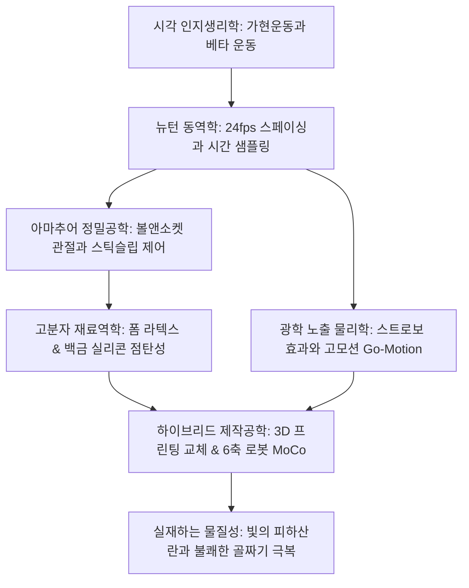
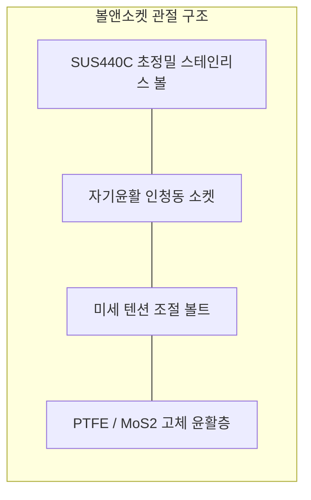

스톱모션 애니메이션은 겉보기에는 인형을 손으로 조금씩 움직여 한 프레임씩 촬영하는 소박한 아날로그 예술처럼 보입니다. 그러나 현대 스톱모션의 실체는 서브밀리미터 단위의 정밀 가공, 관절의 스틱슬립(Stick-Slip) 현상을 억제하는 마찰공학(트라이볼로지), 점탄성 고분자 재료과학, 그리고 중력과 관성을 재현하는 뉴턴 다체역학이 결합된 고도의 정밀 물리공학입니다.

초당 24프레임의 시간 속에서 살아 숨 쉬는 유기적 움직임을 구현하기 위해 애니메이터는 인형의 관절을 0.1mm 단위로 제어하고, 스튜디오의 미세 열팽창 드리프트를 통제합니다. 1933년 윌리스 오브라이언의 《킹콩》, 레이 해리하우젠의 다이내메이션, ILM의 고모션(Go-Motion), 그리고 스튜디오 라이카의 풀컬러 3D 프린팅 치환 기술에 이르기까지 스톱모션은 항상 당대 최고 수준의 물리 기술과 결합해 왔습니다.

## 1. 운동 착시의 생리물리학과 시간 샘플링

정지 이미지의 연속 제시가 매끄러운 움직임으로 지각되는 원리는 시각피질(MT/V5 영역)의 고차 정보 처리에 기인합니다:
- **베타 운동(Beta movement)**: 약 $40 \sim 60 \text{ ms}$ 간격으로 인접한 자극이 교대로 제시될 때 뇌는 물체가 연속적으로 공간을 이동한다고 인식합니다. 24fps의 1프레임 지속시간($41.67 \text{ ms}$)은 베타 운동이 발현되는 최적의 시간창입니다.
- **원스(Ones)와 투스(Twos)**: 1초에 24포즈를 모두 촬영하는 1코마 찍기(Ones)는 역동적인 액션과 카메라 무빙에 필수적이며, 1초에 12포즈를 2프레임씩 노출하는 2코마 찍기(Twos)는 대화 장면에 효율적으로 사용됩니다.

## 2. 아마추어 정밀공학: 볼앤소켓 관절과 마찰역학

퍼핏 내부에는 고강도 금속 골격인 **아마추어(Armature)**가 장착됩니다.
애니메이터의 가장 큰 적인 **스틱슬립 현상(Stick-Slip)**은 정지마찰계수가 운동마찰계수보다 훨씬 클 때($\mu_s \gg \mu_k$) 발생합니다. 관절을 미세하게 꺾으려 할 때 갑작스럽게 저항이 떨어지며 목표 위치를 지나치는 오버슈트가 발생합니다.
이를 방지하기 위해:
1. **이종 금속 조합**: 마텐자이트계 SUS440C 고경도 스테인리스 볼과 자기윤활성을 가진 인청동(Phosphor Bronze) 소켓 플레이트를 결합합니다.
2. **고체 윤활**: 먼지가 붙는 액체 그리스 대신 이황화몰리브덴($\text{MoS}_2$) 분말이나 테프론(PTFE) 패드를 사용하여 $\mu_s \approx \mu_k$를 유지합니다.

### 바닥 고정(Tie-Down) 정역학

외다리로 서 있는 퍼핏의 전복 모멘트($\vec{\tau}_g = \vec{r}_{cm} \times M\vec{g}$)를 견디기 위해 스튜디오 바닥에는 수많은 구멍이 뚫려 있으며, 퍼핏 발바닥의 암나사에 무대 아래에서 **타이다운 볼트(Tie-Down Bolt)**를 체결하여 견고히 지지합니다.

## 3. 재료과학: 폼 라텍스와 백금 실리콘의 점탄성

1. **폼 라텍스(Foam Latex)**: 천연고무 라텍스를 거품기로 수배 팽창시킨 뒤 규불화나트륨($\text{Na}_2\text{SiF}_6$)으로 겔화시키고 가열 가황합니다. 다공성 스펀지 구조로 극도로 가볍고 굽힘 시 관절을 밀어내는 복원력이 없습니다.
2. **백금 경화 실리콘(Platinum-Cure Silicone)**: 생체 피부와 유사한 광학적 피하산란(Subsurface Scattering)을 구현합니다. 순수 실리콘의 강한 탄성 반발력을 억제하기 위해 **데드너(Deadener)**를 다량 첨가하여 재료의 손실탄성률을 높여 점탄성체로 개질합니다.

## 4. 광학 노출 물리학과 '고모션(Go-Motion)'

스톱모션의 가장 큰 시각적 결함은 **모션블러(Motion Blur)의 완전한 결여**입니다. 노출 시간 동안 퍼핏이 정지해 있으므로($v=0$) 모든 프레임의 윤곽선이 면도날처럼 날카로워 재생 시 심한 스트로보 저더가 발생합니다.
1980년 필 티펫(Phil Tippett)과 ILM은 셔터가 열려 있는 $1/48$초 동안 컴퓨터 제어 스테핑 모터로 관절을 물리적으로 움직이는 **고모션(Go-Motion)** 기술을 개발하여 최초로 완벽한 광학적 모션블러를 구현했습니다.

## 5. 라이카 스튜디오와 3D 프린팅 치환 혁명

라이카(Laika)는 풀컬러 광경화 3D 프린터로 제작한 수만 개의 안면 부품을 교체하는 치환 애니메이션을 확립했습니다:
- **상하 안면 분할 구조**: 이마/눈썹과 입/턱을 분할하여 1,000 $\times$ 1,000 = 100만 가지의 표정을 조합.
- **네오디뮴 자석 결합**: $1.5\text{ mm}$ 자석으로 0.1초 만에 미크론 정밀도로 탈부착. 《쿠보와 전설의 악기》에서는 4,800만 가지 이상의 표정을 연출했습니다.

| 시대 | 주요 작품 | 핵심 공학적 혁신 |
| :--- | :--- | :--- |
| **1930년대** | 《킹콩》 | 정밀 볼앤소켓 금속 아마추어, 유리 매트 다중노출. |
| **1950년대** | 《신밧드의 7번째 모험》 | **다이내메이션**: 리어 프로젝션과 마스크 합성을 통한 실사와 괴물의 결합. |
| **1980년대** | 《제국의 역습》 | **고모션**: 모터 제어 노출 중 변위를 통한 광학 모션블러. |
| **2010년대~** | 《코렐라인》《쿠보》 | 풀컬러 3D 프린팅 치환, 6축 로봇 MoCo, 포커스 스태킹. |

스톱모션이 CG 시대에도 독보적인 감동을 선사하는 이유는 실재하는 빛과 물질이 빚어내는 **촉각적 진정성(Tactile Authenticity)**에 있습니다.

## 6. 운동역학의 수학적 정식화: 스페이싱과 튕기는 공의 물리

애니메이터가 퍼핏을 움직일 때 궤적의 가감속은 뉴턴 운동방정식과 완벽히 부합해야 자연스럽습니다.
시작점과 종점 사이를 $N$ 프레임 동안 이동할 때, 가장 부드러운 S자 가감속을 생성하는 **코사인 보간(Cosine Interpolation)** 수식은 다음과 같습니다:

$$x_k = D \times \frac{1 - \cos\left(\frac{k \pi}{N}\right)}{2} \quad (k = 0, 1, 2, \dots, N)$$

중력가속도 $g$ 하에서 자유낙하하는 탄성체의 반발계수(Coefficient of Restitution) $e$에 따른 바운딩 궤적:

$$h_k = h_0 \cdot e^{2k}, \qquad T_k = 2 e^k \sqrt{\frac{2h_0}{g}}$$

충돌 순간 체적 보존 법칙에 의한 편평 변형(Squash):

$$V = \frac{4}{3} \pi a^2 b = \text{const} \implies a = a_0 \sqrt{\frac{b_0}{b}}$$

이러한 물리학적 변형을 X시트(Exposure Sheet)에 매 프레임 정밀하게 기입함으로써 관객에게 생생한 질량감과 생명력을 전달합니다.
