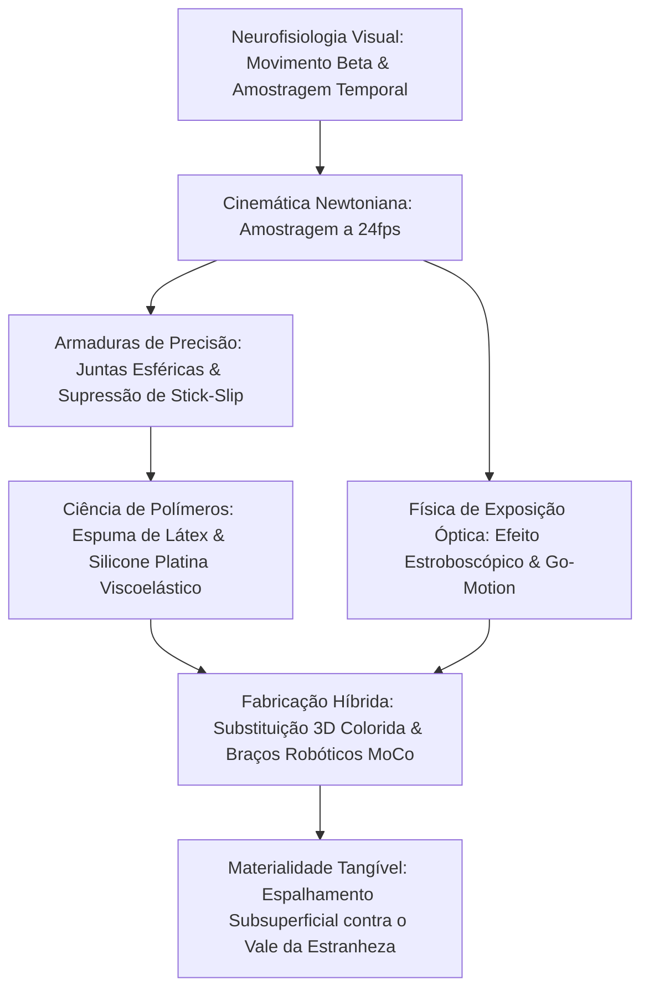

A animação quadro a quadro (stop-motion) é frequentemente imaginada como um ofício puramente artesanal. Sob o rigor da engenharia moderna, contudo, revela-se uma sofisticada disciplina micromecânica. Reúne usinagem CNC de padrão aeroespacial, tribologia de contato para eliminar o efeito stick-slip, mecânica de polímeros viscoelásticos e dinâmica de corpos múltiplos sob a gravidade newtoniana.

Para construir a ilusão contínua de vida a 24 quadros por segundo (24fps), os animadores manipulam articulações metálicas em frações de milímetro, anulando ressaltos elásticos e sustentando torques de tombamento gravitacional sobre plataformas perfuradas. De *King Kong* (1933) e da Dynamation de Ray Harryhausen ao Go-Motion motorizado da ILM e às milhões de peças faciais impressas em 3D coloridas do Studio Laika, o stop-motion desafia os limites da matéria física.

## 1. Neurofisiologia do Movimento Aparente e Amostragem Temporal

A transformação de quadros estáticos em movimento fluido ocorre via **movimento beta** no córtex visual MT/V5. A 24fps, cada quadro dura:

$$\Delta t_{\text{frame}} = \frac{1}{24} \approx 41{,}67\text{ ms}$$

Essa escala temporal encaixa-se com perfeição no limiar neurofisiológico de integração visual. Animar em "dois quadros" (Twos, 12 poses/s) é viável em diálogos tranquilos, mas gera vibração estroboscópica perceptível (judder) em manobras velozes de câmera ou corrida.

## 2. Mecânica de Esqueletos e Tribologia de Juntas

A estrutura metálica interna (armature) utiliza **juntas de esfera e soquete** (ball-and-socket).
O maior desafio físico é o **efeito stick-slip**, que ocorre quando o atrito estático supera muito o dinâmico ($\mu_s \gg \mu_k$). Ao aplicar força para vencer o repouso, a junta salta bruscamente além do alvo.
Soluções de engenharia:
- Esferas de aço inoxidável martensítico temperado polido espelhado (AISI 440C, $58\text{--}60\text{ HRC}$).
- Placas de fricção de bronze fosforoso autolubrificante (CuSn8).
- Lubrificantes secos de dissulfeto de molibdênio ($\text{MoS}_2$) ou calços de teflon (PTFE), garantindo $\mu_s \approx \mu_k$.

O torque de tombamento $\vec{\tau}_g = \vec{r}_{cm} \times M\vec{g}$ é travado por parafusos tensores de ancoragem (**tie-down bolts**) rosqueados sob o piso perfurado da bancada de filmagem.

## 3. Ciência dos Materiais: Espuma de Látex e Silicone Platina

- **Espuma de Látex (Foam Latex)**: Borracha natural aerada mecanicamente, gelificada com fluossilicato de sódio ($\text{Na}_2\text{SiF}_6$) e vulcanizada a $90^\circ\text{C}$. Sua estrutura porosa confere peso reduzido e nula força restauradora elástica contra as juntas.
- **Silicone de Cura por Platina**: Apresenta espalhamento de luz subsuperficial (Subsurface Scattering) idêntico à pele humana. A incorporação de fluidos modificadores (deadeners) ajusta sua viscoelasticidade, eliminando o efeito de mola para manter a pose posicionada sem recuo.

## 4. Física Óptica de Exposição e Go-Motion

O stop-motion tradicional carece de **borrão de movimento (Motion Blur)**, pois o boneco fica estático na exposição ($v=0$). As bordas cortantes geram desconforto estroboscópico.
Em 1980, Phil Tippett (ILM) desenvolveu o **Go-Motion** para *O Império Contra-Ataca*: motores de passo controlados por computador movem fisicamente as hastes da criatura durante o tempo de obturador aberto ($1/48\text{ s}$), fixando borrão óptico autêntico na película fotográfica.

## 5. Studio Laika e a Revolução da Substituição 3D

O Studio Laika (*Coraline*, *Kubo*) reinventou a animação por substituição facial com impressão 3D em fotopolímero colorido:
- **Arquitetura Facial Dividida**: Separação horizontal entre sobrancelhas/testa e boca/queixo. 1.000 peças superiores combinadas a 1.000 inferiores criam $1.000.000$ de expressões faciais.
- **Acoplamento Magnético**: Ímãs de neodímio de $1{,}5\text{ mm}$ asseguram troca em segundos com precisão submicrométrica. Em *Kubo e as Cordas Mágicas*, foram registradas mais de 48 milhões de combinações possíveis.

| Período | Obra Marcante | Principal Inovação Mecânica |
| :--- | :--- | :--- |
| **Anos 1930** | *King Kong* | Esqueletos metálicos de rótula, sobreposição óptica de máscaras em vidro. |
| **Anos 1950** | *O 7º Simbá* | **Dynamation**: Retroprojeção sincronizada e integração de miniaturas. |
| **Anos 1980** | *O Império Contra-Ataca* | **Go-Motion**: Deslocamento motorizado durante a exposição. |
| **Anos 2010+** | *Coraline*, *Kubo* | Substituição 3D colorida, braços robóticos MoCo de 6 eixos. |

O apelo eterno do stop-motion repousa na sua **materialidade tangível**: fótons autênticos interagindo com átomos reais no espaço tridimensional.
