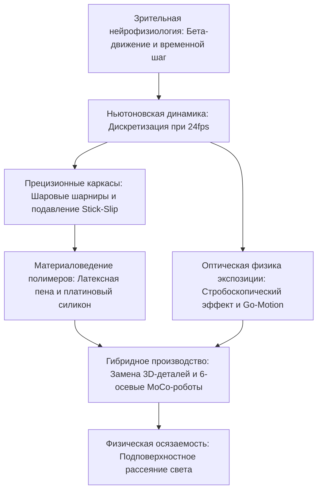

Покадровую анимацию (стоп-моушн) часто воспринимают как архаичное ручное ремесло. Однако в современной кинематографической индустрии это сложнейшая дисциплина прецизионной микромеханики. Она объединяет прецизионное фрезерование ЧПУ аэрокосмического класса, трибологию контактных пар для подавления эффекта прерывистого скольжения (Stick-Slip), реологию вязкоупругих полимеров и ньютоновскую многотельную динамику.

Чтобы при 24 кадрах в секунду (24fps) создать иллюзию органической жизни, аниматор смещает механические шарниры на доли миллиметра, устраняя упругий откат и компенсируя опрокидывающие моменты гравитации. От классического «Кинг-Конга» Уиллиса О'Брайена (1933) и «Динамейшн» Рэя Харрихаузена до моторизованного Go-Motion студии ILM и миллионов цветных 3D-печатных деталей мимики студии Laika — покадровая анимация всегда находилась на острие инженерного искусства.

## 1. Зрительная нейрофизиология и дискретизация времени

Мозг человека интерпретирует последовательность статичных кадров благодаря **бета-движению** в зрительной коре (зона MT/V5). При 24 кадрах в секунду длительность экспозиции одного кадра составляет:

$$\Delta t_{\text{frame}} = \frac{1}{24} \approx 41{,}67\text{ мс}$$

Этот интервал идеально соответствует порогу непрерывного восприятия. Съемка «на двойках» (12 поз/с с удвоением кадра) экономична для диалогов, но при быстром движении порождает сильный стробоскопический скачок (джаддер).

## 2. Механика шарниров и трибология арматур

Основой куклы служит металлический скелет (арматура) с **шаровыми шарнирами** (ball-and-socket).
Главный физический враг аниматора — **эффект прерывистого скольжения (Stick-Slip)**, возникающий, когда коэффициент трения покоя намного превышает коэффициент трения движения ($\mu_s \gg \mu_k$). При превышении предела покоя шарнир резко срывается вперед, нарушая точнейший шаг смещения.
Инженерное решение:
- Шары из закаленной коррозионностойкой стали с зеркальной полировкой (AISI 440C, $58\text{--}60\text{ HRC}$).
- Пластины из самосмазывающейся фосфористой бронзы (CuSn8).
- Сухая смазка дисульфидом молибдена ($\text{MoS}_2$) или фторопластовые (PTFE) шайбы, обеспечивающие $\mu_s \approx \mu_k$.

Опрокидывающий момент силы тяжести $\vec{\tau}_g = \vec{r}_{cm} \times M\vec{g}$ нейтрализуется с помощью **стяжных болтов (Tie-Down)**, вкручиваемых в ступни снизу через перфорацию съемочной площадки.

## 3. Материаловедение: латексная пена и платиновый силикон

- **Латексная пена (Foam Latex)**: Натуральный каучук механически вспенивается, желируется кремнефтористым натрием ($\text{Na}_2\text{SiF}_6$) и запекается при $90^\circ\text{C}$. Открытопористая структура обеспечивает легкий вес и отсутствие упругой отдачи на шарниры.
- **Силикон платиновой сшивки**: Обладает оптическим подповерхностным рассеянием света (Subsurface Scattering), идентичным человеческой коже. Введение химических демпферов (деднеров) переводит силикон в вязкоупругое состояние, полностью исключая возвратное пружинение.

## 4. Оптическая физика экспозиции и Go-Motion

В традиционном стоп-моушене кукла неподвижна во время экспозиции ($v=0$), что полностью исключает **смазывание движения (Motion Blur)**. Идеальная резкость каждого кадра вызывает стробоскопическое мерцание на сетчатке.
В 1980 году Фил Типпетт (ILM) создал систему **Go-Motion** для фильма «Империя наносит ответный удар»: шаговые двигатели под управлением ЭВМ перемещали тяги куклы непосредственно во время открытого затвора ($1/48\text{ с}$), впервые запечатлев на пленке естественный оптический моушн-блюр.

## 5. Студия Laika и революция 3D-печатной замены

Студия Laika (*Коралина*, *Кубо*) механизировала мимику с помощью фотополимерной 3D-печати:
- **Разделение лица на две части**: Разделение по линии носа на верхнюю (глаза/брови) и нижнюю (рот/подбородок). 1000 верхних и 1000 нижних частей дают $1\,000\,000$ комбинаций.
- **Магнитная фиксация**: Неодимовые магниты $1{,}5\text{ мм}$ обеспечивают мгновенную смену мимики с субмикронной точностью. В фильме «Кубо» число вариаций лица превысило 48 миллионов.

| Эпоха | Знаковое произведение | Ключевая инженерная инновация |
| :--- | :--- | :--- |
| **1930-е** | *Кинг-Конг* | Стальные шаровые арматуры, стеклянные маски. |
| **1950-е** | *7-е путешествие Синдбада* | **Dynamation**: Синхронная рир-проекция с масками. |
| **1980-е** | *Империя наносит ответный удар* | **Go-Motion**: Моторизованное смещение шарниров при экспозиции. |
| **2010-е+**| *Коралина*, *Кубо* | Цветная 3D-печать, 6-осевые роботы MoCo, Focus Stacking. |

Вечная магия стоп-моушена коренится в его **физической осязаемости**: реальные фотоны света взаимодействуют с реальными атомами материи.
