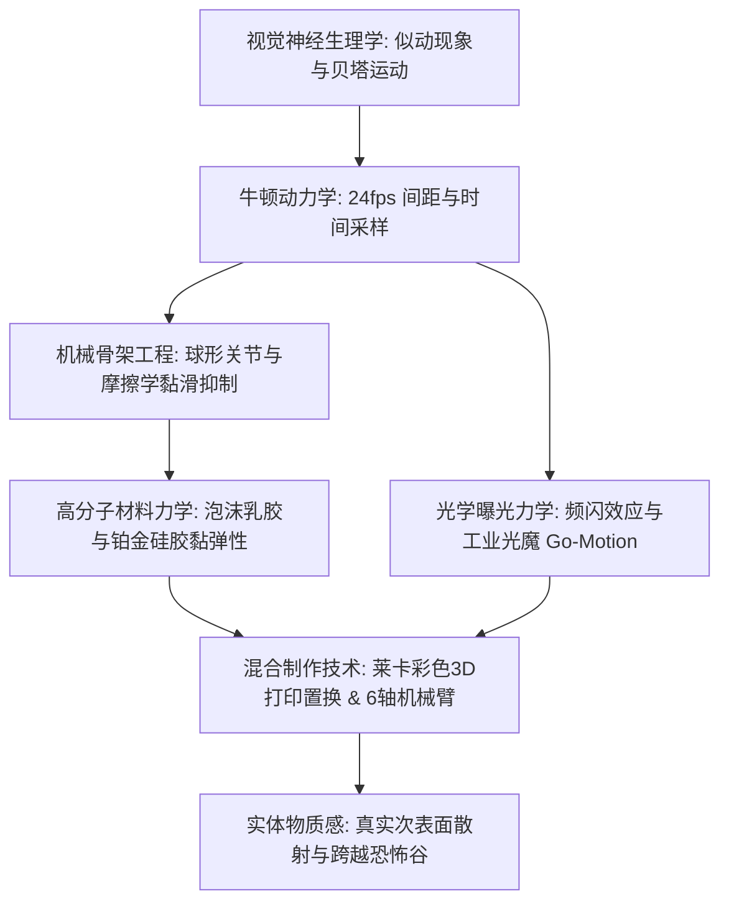
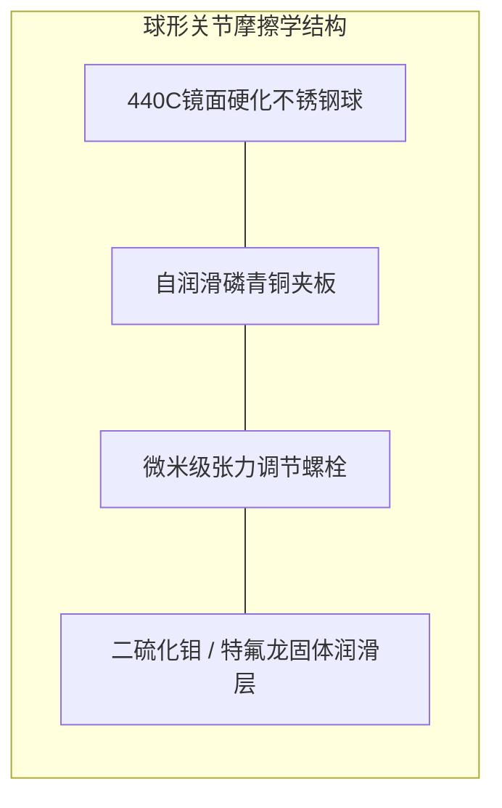

在普通观众眼中，定格动画（Stop-Motion Animation）常被视作一种依靠手工耐心逐帧微调人偶的复古艺术。然而在现代工业与物理工程的严格定义下，它实则是一门极其硬核的微观精密机械工程学。它深度融合了航空航天级CNC精密机械切削、抑制关节黏滑现象（Stick-Slip）的接触摩擦学、黏弹性高分子材料力学、经典牛顿多体动力学以及抗衍射极限的光学摄影系统。

为了在每秒24帧（24fps）的离散时间切片中创造出自主生命的视觉错觉，动画师必须以亚毫米级的精度弯折人偶关节，同时消除机械反弹；必须精确计算重力倾覆力矩并由地板地脚螺栓予以平衡；更要将拍摄现场因温度变化导致的微米级热膨胀完全控制。从1933年威利斯·奥布莱恩的《金刚》、雷·哈里豪森的“动力立体摄影（Dynamation）”，到工业光魔的步进电机“动态定格（Go-Motion）”，再到莱卡工作室（Laika）拥有数千万种表情的彩色3D打印置换技术，定格动画始终代表着实体物理工程与电影视效的巅峰融合。

## 1. 运动错觉的生理物理学与时间采样

静态画面的连续呈现为何能在大脑中转化为连续平滑的运动？1912年格式塔心理学先驱马克斯·韦特海默（Max Wertheimer）实验证明，这绝非单纯的视网膜“视觉暂留”，而是大脑视觉皮层（MT/V5区）对时空刺激的主动综合：

- **贝塔运动（Beta movement）**：当两个空间相邻的刺激以大约 $40 \sim 60 \text{ ms}$ 的时间间隔交替出现时，视觉中枢会主动构建出一个物体在空间中平滑位移的知觉。电影标准24fps的每帧持续时间恰为：
  $$\Delta t_{\text{frame}} = \frac{1}{24} \approx 41.67 \text{ ms}$$
  正好处于诱发贝塔运动的最佳时间敏感窗口内。
- **一拍一（Shooting on Ones）与一拍二（Shooting on Twos）**：每秒拍摄24个独立动作姿态（一拍一）适用于高速动作和动态摄影机运镜；而每秒拍摄12个姿态、每姿态曝光2帧（一拍二）则常用于日常对话。在高速运动下一拍二会因视网膜位移过大而产生明显的视觉颤动（Judder）。

## 2. 机械骨架精密工程：球形关节与摩擦学机制

人偶的内部核心是高精度的金属骨架（Armature）。专业级定格人偶绝不依赖易断裂的铝丝，而是采用航空级金属球形铰链（Ball-and-Socket Joint）。

动画师在物理操作中最致命的敌人是摩擦学中的**黏滑现象（Stick-Slip）**。当静摩擦系数远大于动摩擦系数（$\mu_s \gg \mu_k$）时，一旦推力突破临界阈值，阻力骤降，导致肢体猛烈弹跳过冲，摧毁精密的微米级位移。
顶级骨架必须确保边界润滑条件下的 $\mu_s \approx \mu_k$：
1. **异种金属配合**：关节球采用超镜面抛光的440C高硬度马氏体不锈钢（$58 \sim 60 \text{ HRC}$），而夹板槽座则采用具有自润滑特性的磷青铜（CuSn8）或铝青铜。
2. **干式固体润滑**：严格杜绝液体润滑油（避免吸附灰尘和腐蚀乳胶），代之以二硫化钼（$\text{MoS}_2$）干膜或PTFE特氟龙垫片，保证摩擦阻尼力矩与转速无关且绝对平稳。

### 地板固定（Tie-Down）的静力学平衡

当500克重的人偶单腿奔跑时，偏离支撑底部的重心会产生巨大的重力倾覆力矩：

$$\vec{\tau}_g = \vec{r}_{cm} \times (M \vec{g})$$

为防止人偶倒塌，摄影台下方铺设有精密打孔钢板，人偶脚底预埋有微型螺孔（如美制 2-56 或公制 M3）。动画师在台架下方使用六角扳手将高抗拉强度的**地脚螺栓（Tie-Down Bolt）**旋入脚掌锁死，通过强大的机械预紧力提供恢复力矩，确保每一帧曝光时绝对稳定。

## 3. 材料科学：泡沫乳胶与铂金硅胶的黏弹性

人偶的外层“血肉”必须在经受数万次弯折后不发生塑性疲劳开裂，且不得对骨架产生弹力反弹（Spring-back）：

1. **泡沫乳胶（Foam Latex）**：天然橡胶乳液与硫化促进剂混合，经机械打发膨胀3至5倍后注入金属模具，加入氟硅酸钠（$\text{Na}_2\text{SiF}_6$）缓慢水解中和pH值凝胶化，最后在约 $90^\circ\text{C}$ 下硫化交联。其微观多孔海绵结构赋予其极佳的透气性与极轻的自重，且弯曲时几乎无回弹应力。
2. **铂金固化硅胶（Platinum-Cure Silicone）**：现代莱卡等工作室采用加成型双组分硅胶。硅胶具备天然的次表面光散射（Subsurface Scattering）特性，质感极度接近人类真实皮肤。为了消除纯橡胶高弹性带来的回弹力，配方中加入高达 $40\% \sim 50\%$ 的**软化衰减剂（Deadener）**，大幅提升材料的损耗模量 $G''$，使其表现为黏弹性，塑形后如真实肌肉般静止服帖。

## 4. 曝光光学物理与“动态定格（Go-Motion）”

传统定格动画与实拍电影最显著的物理区别，在于**完全缺乏自然运动模糊（Motion Blur）**。
实拍中快门开启期间（$1/48$ 秒）物体运动会使传感器光子分布卷积形成平滑虚影：

$$I(x) = \int_{0}^{t_{\text{exp}}} O(x - v(t) t) \, dt$$

传统定格中人偶在曝光期间是绝对静止的（$v=0$），每一帧边缘都呈现无虚化的极致锐度，连续播放时会产生刺目的频闪断裂感。

1980年，工业光魔（ILM）传奇特效师菲尔·蒂贝特（Phil Tippett）在《帝国反击战》中发明了**动态定格（Go-Motion）**：计算机控制的多轴步进电机在摄像机快门开启的 $1/48$ 秒时间内，直接牵引人偶内部机械连杆平滑位移，首次在感光胶片上物理记录下真实的光学动态模糊，彻底抹平了传统定格的顿挫感。

## 5. 莱卡工作室与3D打印置换革命

莱卡工作室（Laika）通过数字化与实体制造的融合彻底颠覆了面部表情制作：
- **上下半脸分割架构**：将人偶面部沿眼眶与鼻梁水平切分为上半部分（眉毛额头）与下半部分（嘴唇下巴）。若上脸备有1,000种表情，下脸备有1,000种，组合数即可呈几何级数爆发至 $1,000,000$ 种。
- **高精度磁吸定位**：面部内部嵌有 $1.5 \text{ mm}$ 强力钕铁硼磁铁，动画师可在几秒内无缝更换16微米超薄层厚的彩色光敏树脂面部配件。在《久保与二弦琴》中，主角久保的面部表情组合突破了**4800万种**。

| 技术时代 | 代表作品 | 关键机械与工程创新 |
| :--- | :--- | :--- |
| **1930年代** | 《金刚》 (奥布莱恩) | 双球铰链精密钢骨架，多重曝光实体玻璃绘景。 |
| **1950年代** | 《辛巴达第七次航海》 (哈里豪森) | **Dynamation**：背投联动分幅遮罩，真人与怪兽空间完美嵌套。 |
| **1980年代** | 《帝国反击战》 (蒂贝特 / ILM) | **Go-Motion**：微步进电机实时驱动曝光位移，实现光学运动模糊。 |
| **2010年代至今** | 《鬼妈妈》《久保》 (莱卡) | 全彩光固化3D打印置换、六轴工业机械臂MoCo、焦点堆叠技术。 |

定格动画之所以在全CG时代依然具有不可替代的崇高艺术感染力，正在于其**无可辩驳的实体物质性（Tactile Authenticity）**。光子打在硅胶毛孔、真实羊毛纤维上的次表面散射与微观阴影，是任何纯虚拟算力都难以彻底拟真的物理诗篇。
