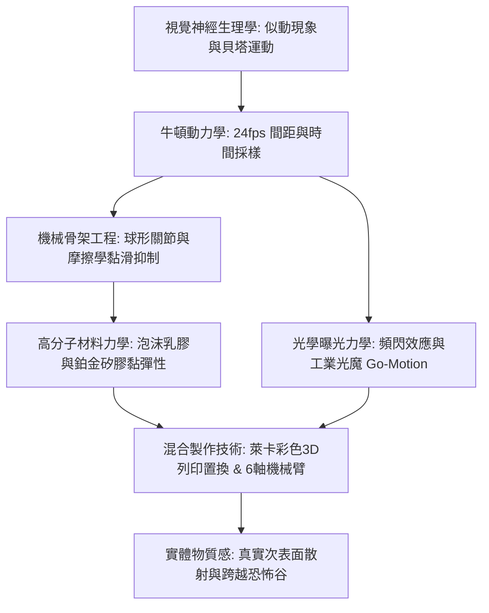
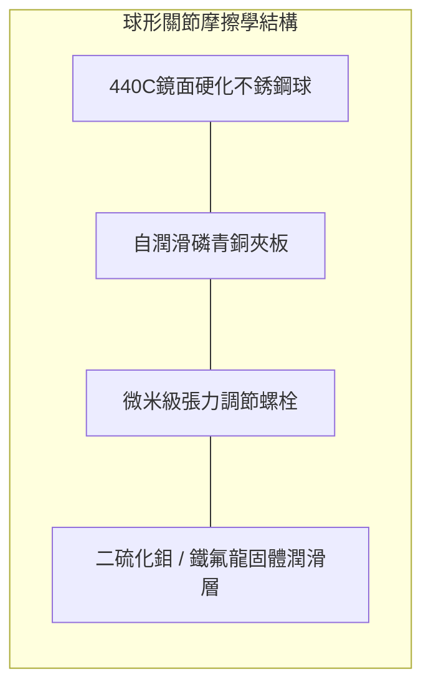

在普通觀眾眼中，逐格偶動畫（Stop-Motion Animation）常被視作一種依靠手工耐心逐幀微調人偶的復古藝術。然而在現代工業與物理工程的嚴格定義下，它實則是一門極其硬核的微觀精密機械工程學。它深度融合了航空航太級CNC精密機械切削、抑制關節黏滑現象（Stick-Slip）的接觸摩擦學、黏彈性高分子材料力學、經典牛頓多體動力學以及抗繞射極限的光學攝影系統。

為了在每秒24幀（24fps）的離散時間切片中創造出自主生命的視覺錯覺，動畫師必須以亞毫米級的精度彎折人偶關節，同時消除機械反彈；必須精確計算重力傾覆力矩並由地板地腳螺栓予以平衡；更要將拍攝現場因溫度變化導致的微米級熱膨脹完全控制。從1933年威利斯·奧布萊恩的《金剛》、雷·哈里豪森的「動力立體攝影（Dynamation）」，到工業光魔的步進馬達「動態定格（Go-Motion）」，再到萊卡工作室（Laika）擁有數千萬種表情的彩色3D列印置換技術，偶動畫始終代表著實體物理工程與電影視效的巔峰融合。

## 1. 運動錯覺的生理物理學與時間採樣

靜態畫面的連續呈現為何能在大腦中轉化為連續平滑的運動？1912年格式塔心理學先驅馬克斯·韋特海默（Max Wertheimer）實驗證明，這絕非單純的視網膜「視覺暫留」，而是大腦視覺皮層（MT/V5區）對時空刺激的主動綜合：

- **貝塔運動（Beta movement）**：當兩個空間相鄰的刺激以大約 $40 \sim 60 \text{ ms}$ 的時間間隔交替出現時，視覺中樞會主動構建出一個物體在空間中平滑位移的知覺。電影標準24fps的每幀持續時間恰為：
  $$\Delta t_{\text{frame}} = \frac{1}{24} \approx 41.67 \text{ ms}$$
  正好處於誘發貝塔運動的最佳時間敏感窗口內。
- **一拍一（Shooting on Ones）與一拍二（Shooting on Twos）**：每秒拍攝24個獨立動作姿態（一拍一）適用於高速動作和動態攝影機運鏡；而每秒拍攝12個姿態、每姿態曝光2幀（一拍二）則常用於日常對話。在高速運動下一拍二會因視網膜位移過大而產生明顯的視覺顫動（Judder）。

## 2. 機械骨架精密工程：球形關節與摩擦學機制

人偶的內部核心是高精度的金屬骨架（Armature）。專業級定格人偶絕不依賴易斷裂的鋁絲，而是採用航空級金屬球形鉸鏈（Ball-and-Socket Joint）。

動畫師在物理操作中最致命的敵人是摩擦學中的**黏滑現象（Stick-Slip）**。當靜摩擦係數遠大於動摩擦係數（$\mu_s \gg \mu_k$）時，一旦推力突破臨界閾值，阻力驟降，導致肢體猛烈彈跳過衝，摧毀精密的微米級位移。
頂級骨架必須確保邊界潤滑條件下的 $\mu_s \approx \mu_k$：
1. **異種金屬配合**：關節球採用超鏡面拋光的440C高硬度麻田散鐵不銹鋼（$58 \sim 60 \text{ HRC}$），而夾板槽座則採用具有自潤滑特性的磷青銅（CuSn8）或鋁青銅。
2. **乾式固體潤滑**：嚴格杜絕液體潤滑油（避免吸附灰塵和腐蝕乳膠），代之以二硫化鉬（$\text{MoS}_2$）乾膜或PTFE鐵氟龍墊片，保證摩擦阻尼力矩與轉速無關且絕對平穩。

### 地板固定（Tie-Down）的靜力學平衡

當500克重的人偶單腿奔跑時，偏離支撐底部的重心會產生巨大的重力傾覆力矩：

$$\vec{\tau}_g = \vec{r}_{cm} \times (M \vec{g})$$

為防止人偶倒塌，攝影台下方鋪設有精密打孔鋼板，人偶腳底預埋有微型螺孔（如美制 2-56 或公制 M3）。動畫師在台架下方使用六角扳手將高抗拉強度的**地腳螺栓（Tie-Down Bolt）**旋入腳掌鎖死，通過強大的機械預緊力提供恢復力矩，確保每一幀曝光時絕對穩定。

## 3. 材料科學：泡沫乳膠與鉑金矽膠的黏彈性

人偶的外層「血肉」必須在經受數萬次彎折後不發生塑性疲勞開裂，且不得對骨架產生彈力反彈（Spring-back）：

1. **泡沫乳膠（Foam Latex）**：天然橡膠乳液與硫化促進劑混合，經機械打發膨脹3至5倍後注入金屬模具，加入氟矽酸鈉（$\text{Na}_2\text{SiF}_6$）緩慢水解中和pH值凝膠化，最後在約 $90^\circ\text{C}$ 下硫化交聯。其微觀多孔海綿結構賦予其極佳的透氣性與極輕的自重，且彎曲時幾乎無回彈應力。
2. **鉑金固化矽膠（Platinum-Cure Silicone）**：現代萊卡等工作室採用加成型雙組分矽膠。矽膠具備天然的次表面光散射（Subsurface Scattering）特性，質感極度接近人類真實皮膚。為了消除純橡膠高彈性帶來的回彈力，配方中加入高達 $40\% \sim 50\%$ 的**軟化衰減劑（Deadener）**，大幅提升材料的損耗模數 $G''$，使其表現為黏彈性，塑形後如真實肌肉般靜止服帖。

## 4. 曝光光學物理與「動態定格（Go-Motion）」

傳統偶動畫與實拍電影最顯著的物理區別，在於**完全缺乏自然運動模糊（Motion Blur）**。
實拍中快門開啟期間（$1/48$ 秒）物體運動會使感測器光子分佈卷積形成平滑虛影：

$$I(x) = \int_{0}^{t_{\text{exp}}} O(x - v(t) t) \, dt$$

傳統定格中人偶在曝光期間是絕對靜止的（$v=0$），每一幀邊緣都呈現無虛化的極致銳度，連續播放時會產生刺目的頻閃斷裂感。

1980年，工業光魔（ILM）傳奇特效師菲爾·蒂貝特（Phil Tippett）在《帝國大反擊》中發明了**動態定格（Go-Motion）**：計算機控制的多軸步進馬達在攝影機快門開啟的 $1/48$ 秒時間內，直接牽引人偶內部機械連桿平滑位移，首次在感光膠片上物理記錄下真實的光學動態模糊，徹底抹平了傳統定格的頓挫感。

## 5. 萊卡工作室與3D列印置換革命

萊卡工作室（Laika）通過數位化與實體製造的融合徹底顛覆了面部表情製作：
- **上下半臉分割架構**：將人偶面部沿眼眶與鼻梁水平切分為上半部分（眉毛額頭）與下半部分（嘴唇下巴）。若上臉備有1,000種表情，下臉備有1,000種，組合數即可呈幾何級數爆發至 $1,000,000$ 種。
- **高精度磁吸定位**：面部內部嵌有 $1.5 \text{ mm}$ 強力釹鐵硼磁鐵，動畫師可在幾秒內無縫更換16微米超薄層厚的彩色光敏樹脂面部配件。在《酷寶：魔弦傳奇》中，主角酷寶的面部表情組合突破了**4800萬種**。

| 技術時代 | 代表作品 | 關鍵機械與工程創新 |
| :--- | :--- | :--- |
| **1930年代** | 《金剛》 (奧布萊恩) | 雙球鉸鏈精密鋼骨架，多重曝光實體玻璃繪景。 |
| **1950年代** | 《辛巴達第七次航海》 (哈里豪森) | **Dynamation**：背投連動分幅遮罩，真人與怪獸空間完美嵌套。 |
| **1980年代** | 《帝國大反擊》 (蒂貝特 / ILM) | **Go-Motion**：微步進馬達即時驅動曝光位移，實現光學運動模糊。 |
| **2010年代至今** | 《第十四道門》《酷寶》 (萊卡) | 全彩光固化3D列印置換、六軸工業機械臂MoCo、焦點堆疊技術。 |

偶動畫之所以在全CG時代依然具有不可替代的崇高藝術感染力，正在於其**無可辯駁的實體物質性（Tactile Authenticity）**。光子打在矽膠毛孔、真實羊毛纖維上的次表面散射與微觀陰影，是任何純虛擬算力都難以徹底擬真的物理詩篇。
