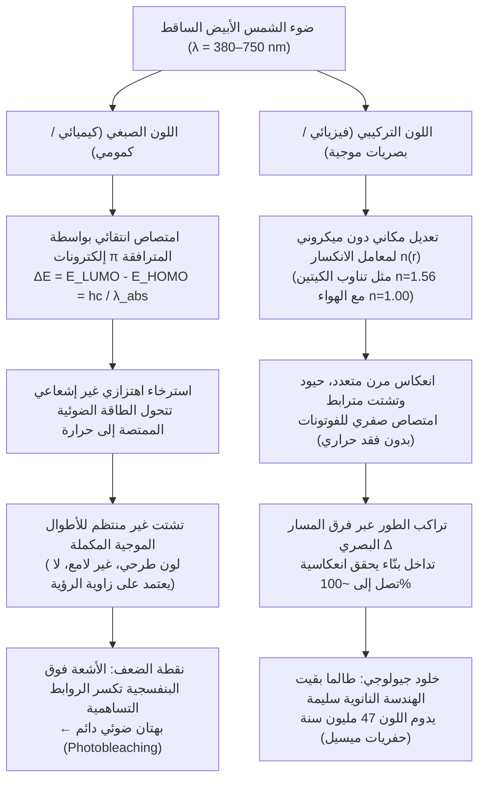
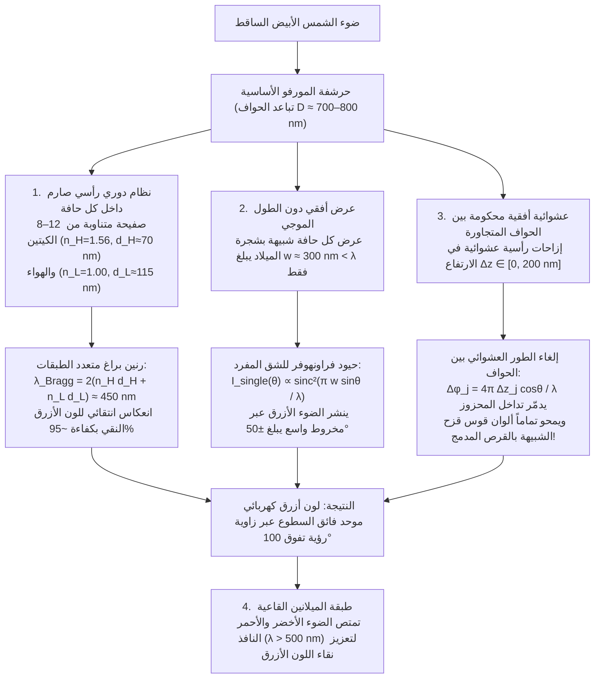

عندما تحلّق <strong>فراشة المورفو (*Morpho rhetenor* و*Morpho menelaus* و*Morpho didius*)</strong> عبر مظلة الغابات الاستوائية المطيرة في أمريكا الجنوبية، تطلق أجنحتها وميضاً أزرق كوبالتياً معدنياً وكهربائياً بالغ الشدة إلى درجة أن طياري الطائرات الخفيفة يمكنهم رصده من مسافة تتجاوز الكيلومتر. وفي مدينة نارا باليابان، يزدان الكنز الوطني من القرن السابع الميلادي المعروف باسم <strong>ضريح تاماموشي (玉虫厨子)</strong> في معبد هوريوجي بآلاف الأجنحة الغمدية لـ <strong>الخنفساء الجوهرية (*Chrysochroa fulgidissima*)</strong>؛ وبعد مرور نحو 1,400 عام على صنعه، لا تزال تلك الأجنحة تتألق ببريقها الأخضر الزمردي والأرجواني الذهبي دون أن تبهت. والأكثر إثارة للدهشة أن <strong>حفريات الخنافس التي يبلغ عمرها 47 مليون عام (من العصر الإيوسيني) والمستخرجة من موقع ميسيل (Messel Pit)</strong> في ألمانيا، تومض بألوان خضراء وزرقاء معدنية ساطعة فور تعرضها للضوء، رغم أن العمليات الجيولوجية قد غيّرت التركيب الكيميائي لجزيئاتها الحيوية الأصلية.

إن الدهانات العادية وأصباغ النسيج وبتلات الأزهار وأوراق الخريف تتلاشى ألوانها حتماً تحت أشعة الشمس فوق البنفسجية (UV) خلال أشهر أو سنوات قليلة بفعل التبييض الضوئي الكيميائي. فلماذا إذن تتفوق أجنحة المورفو، ودروع الخنافس الجوهرية، وبقع العيون في ريش الطاووس (*Pavo cristatus*)، والشريط المضيء لسمكة النيون تترا (*Paracheirodon innesi*) على جميع الأصباغ الصناعية وتتحدى الزمن الجيولوجي؟

تكشف تجربة مخبرية كلاسيكية هذا السر المذهل: إذا وضعنا جناح فراشة *Morpho rhetenor* الأزرق المتوهج في هاون من العقيق وسحقناه حتى يتحول إلى مسحوق ناعم، <strong>فلن نحصل على ذرة واحدة من المسحوق الأزرق؛ بل سيتبقى فقط غبار باهت بلون بني طيني داكن</strong>! أو بدلاً من ذلك، إذا تركنا الجناح سليماً ووضعنا عليه قطرة واحدة من الأسيتون أو الإيثانول النقي (معامل الانكسار $n \approx 1.36$)، فبمجرد تغلغل السائل داخل الحراشف المجهرية يختفي اللون الأزرق الكهربائي فوراً ويتحول إلى بني داكن أو أخضر باهت — ثم يعود اللون الأزرق الكوبالتي الساطع بكامل رونقه فور تبخر المذيب.

النتيجة حاسمة: <strong>لا يحتوي جناح فراشة المورفو على مليغرام واحد من الصبغة الزرقاء</strong>. فلونه لا ينشأ عن امتصاص الفوتونات كيميائياً، بل هو تجلٍّ خالص للديناميكا الكهربائية لماكسويل — أي <strong>اللون التركيبي (Structural Coloration)</strong> — الناتج عن التعديل المكاني لمعامل الانكسار $n(\mathbf{r})$ للبوليمرات الحيوية الشفافة على مقياس الطول الموجي للضوء المرئي ($\lambda \approx 380\text{–}750\,\text{nm}$). في هذا المقال، نشتق رياضياً وفيزيائياً المعماريات البصرية الأربع الكبرى في الطبيعة: <strong>(I) تداخل الغشاء الرقيق المفرد</strong>، و<strong>(II) عواكس براغ الموزعة متعددة الطبقات أحادية البعد (DBR)</strong>، و<strong>(III) مفارقة فراشة المورفو (كيف يتآزر النظام الرأسي مع العشوائية الأفقية لإلغاء قوس قزح الحيود)</strong>، و<strong>(IV) البلورات الفوتونية ثنائية وثلاثية الأبعاد والتشتت المترابط غير المتبلور</strong>.

---

## 1. اللون الصبغي (الامتصاص الكيميائي) مقابل اللون التركيبي (التداخل الموجي الفيزيائي)

### 1.1 اللون الصبغي: حاملات اللون ذات إلكترونات $\pi$ المترافقة والتبدد الحراري

إن اللون الأخضر لليخضور (الكلوروفيل)، والبرتقالي المحمر للكاروتينات، والأرجواني للأنثوسيانين، والبني الأسود للميلانين هي كلها <strong>ألوان صبغية</strong> تحكمها ميكانيكا الكم الجزيئية. وتتميز جزيئات الأصباغ بوجود <strong>نظام إلكترونات $\pi$ مترافق (Conjugated $\pi$-electron system)</strong> يتكون من تناوب الروابط التساهمية الأحادية ($\sigma$) والثنائية ($\sigma + \pi$). ومع ازدياد طول سلسلة الترافق $L$، يؤدي عدم تمركز إلكترونات $\pi$ إلى تضييق فجوة الطاقة $\Delta E$ بين <strong>أعلى مدار جزيئي مشغول (HOMO)</strong> و<strong>أدنى مدار جزيئي غير مشغول (LUMO)</strong> لتقع ضمن طيف الضوء المرئي ($1.65\text{–}3.26\,\text{eV}$):

$$
\Delta E = E_{\text{LUMO}} - E_{\text{HOMO}} = h\nu = \frac{hc}{\lambda_{\text{abs}}}
$$

عندما يسقط فوتون بطول موجي $\lambda_{\text{abs}}$، يتم امتصاصه وتتحول طاقته خلال بيكو ثانية ($10^{-12}\,\text{s}$) عبر الاسترخاء الاهتزازي غير الإشعاعي إلى <strong>حرارة (اهتزازات جزيئية)</strong>، بينما تدرك أعيننا فقط <strong>اللون المكمل</strong> المتشتت. ويعاني هذا النظام الطرحي من عيبين أساسيين: تكسير الروابط التساهمية بفعل فوتونات الأشعة فوق البنفسجية (<strong>التبييض الضوئي / بهتان اللون</strong>)، وضياع معظم الطاقة الضوئية على شكل حرارة.

### 1.2 اللون التركيبي: التعديل النانوي لمعامل الانكسار $n(\mathbf{r})$

في المقابل، لا يتضمن <strong>اللون التركيبي</strong> أي امتصاص إلكتروني. بل يُبنى من مواد حيوية شفافة وعديمة اللون — مثل <strong>الكيتين ($n \approx 1.56$)</strong> في الحشرات، و<strong>الكيراتين-$\beta$ ($n \approx 1.54\text{–}1.58$)</strong> في ريش الطيور، و<strong>السليلوز ($n \approx 1.53$)</strong> في النباتات، أو <strong>بلورات الغوانين ($n \approx 1.83$)</strong> في حراشف الأسماك — بالتناوب مع فجوات <strong>الهواء ($n = 1.00$)</strong> أو <strong>السيتوبلازم المائي ($n \approx 1.33$)</strong>. تتراكب الموجات الكهرومغناطيسية المنعكسة عند كل سطح فاصل لتنتج <strong>تداخلاً بنّاءً (Constructive Interference)</strong> يصل إلى انعكاس بدون فقد بنسبة $\sim 100\,\%$ لأطوال موجية محددة، و<strong>تداخلاً هدّاماً (Destructive Interference)</strong> لبقية الأطوال الموجية.

منذ أن لاحظ <strong>روبرت هوك (1665)</strong> في كتابه *Micrographia* اختفاء ألوان ريش الطاووس عند غمره بالماء، وربط <strong>إسحاق نيوتن (1704)</strong> في *Opticks* هذه الظاهرة بحلقات التداخل في الأغشية الرقيقة، وصولاً إلى معادلات <strong>توماس يونغ</strong> و<strong>أوغستان فرينل</strong> و<strong>اللورد رايلي (1917)</strong>، يتضح سبب اختفاء زرقة المورفو بالأسيتون ($n = 1.36$): إذ يحل السائل محل الهواء ($n = 1.00$) فيتلاشى فرق معامل الانكسار $\Delta n$ مع الكيتين ($n = 1.56$)، ويتوقف انعكاس فرينل، فتظهر طبقة الميلانين البنية القاعية.

---

## 2. المعمارية I: تداخل الغشاء الرقيق المفرد وفيزياء التقزح اللوني (Iridescence)

تخضع فقاعات الصابون، وبقع الزيت على الأسفلت المبلل، وأجنحة الذباب والدبابير الشفافة لتداخل غشاء عازل رقيق سمكه $d$ ومعامل انكساره $n_1$ محاط بالهواء ($n_0 = n_2 = 1.00$).

### 2.1 اشتقاق فرق المسار البصري وانقلاب الطور بمقدار $\pi$

بموجب <strong>قانون سنيل</strong> $n_0 \sin\theta_0 = n_1 \sin\theta_1$، فإن فرق المسار البصري الهندسي بين الشعاع $R_2$ (المنكسر بزاوية $\theta_1$ والمنعكس عن السطح السفلي) والشعاع $R_1$ (المنعكس عن السطح العلوي) يُعطى بالعلاقة:

$$
\Delta_{\text{geom}} = L_2 - L_1 = \frac{2 n_1 d}{\cos\theta_1}\left(1 - \sin^2\theta_1\right) = 2 n_1 d \cos\theta_1
$$

ووفقاً <strong>لمعاملات انعكاس فرينل</strong> بالقرب من السقوط العمودي، $r_{ij} = \frac{n_i - n_j}{n_i + n_j}$، فإن الانعكاس من وسط أقل كثافة بصرية إلى وسط أعلى كثافة ($n_0 < n_1 \implies r_{01} < 0$) يُحدث <strong>انقلاباً في الطور بمقدار $\pi$ راديان (نصف طول موجي $\frac{\lambda}{2}$)</strong>، بينما لا يحدث تغير في الطور عند السطح السفلي ($n_1 > n_2 \implies r_{12} > 0$). وبذلك يكون <strong>فرق المسار البصري الفعال الكلي</strong>:

$$
\Delta_{\text{total}} = 2 n_1 d \cos\theta_1 + \frac{\lambda}{2}
$$

ومنه نستنتج شروط التداخل (عندما يكون $n_0 < n_1 > n_2$):

$$
\begin{aligned}
\text{التداخل البنّاء (القمم المضيئة)}: \quad 2 n_1 d \cos\theta_1 &= \left(m - \frac{1}{2}\right)\lambda \quad &(m = 1, 2, 3, \dots) \\
\text{التداخل الهدّام (القيعان المظلمة)}: \quad 2 n_1 d \cos\theta_1 &= m\lambda \quad &(m = 0, 1, 2, \dots)
\end{aligned}
$$

يفسر هذا القانون ظاهرة <strong>غشاء نيوتن الأسود (Newton's black film)</strong> قبيل انفجار فقاعة الصابون مباشرة ($d \to 0 \implies \Delta_{\text{geom}} \to 0$، حيث يؤدي فرق الطور $\frac{\lambda}{2}$ إلى تداخل هدّام تام $m=0$ لجميع الأطوال الموجية المرئية فيبدو الغشاء أسود داكناً)، كما يفسر <strong>التقزح اللوني (الإزاحة الزرقاء بزيادة زاوية الرؤية)</strong>: فبما أن $\lambda_{\text{peak}}(\theta_1) = 4 n_1 d \cos\theta_1 = \lambda_{\text{peak}}(0)\cos\theta_1$، فإن زيادة زاوية المشاهدة ($\theta_1 \uparrow \implies \cos\theta_1 \downarrow$) تزيح اللون المنعكس حتمياً نحو الأطوال الموجية الأقصر (الأزرق والبنفسجي).

---

## 3. المعمارية II: عواكس براغ متعددة الطبقات أحادية البعد (DBR) ومكدسات ربع الطول الموجي

لما كان السطح الفاصل الواحد بين الكيتين والهواء يعكس فقط $R_1 \approx 4.8\,\%$، فإن الخنافس الجوهرية (*Chrysochroa*) والأسماك الفضية تراكم $N$ من الطبقات المزدوجة المتناوبة ذات معامل الانكسار العالي ($n_H, d_H$) والمنخفض ($n_L, d_L$) لتشكيل <strong>عاكس براغ الموزع (DBR)</strong> الخاضع <strong>لقانون براغ-سنيل</strong>:

$$
m \lambda_{\text{Bragg}} = 2 \left( n_H d_H \cos\theta_H + n_L d_L \cos\theta_L \right) = 2 \left( d_H \sqrt{n_H^2 - \sin^2\theta_0} + d_L \sqrt{n_L^2 - \sin^2\theta_0} \right)
$$

وعند تحقق شرط <strong>مكدس ربع الطول الموجي (Quarter-Wave Stack)</strong>، أي $n_H d_H = n_L d_L = \frac{\lambda_0}{4}$، تتجمع الموجات المنعكسة من جميع الأسطح البينية البالغ عددها $2N$ بنفس الطور تماماً، وتعطي طريقة مصفوفة النقل (TMM) ذروة الانعكاسية $R_N(\lambda_0)$:

$$
R_N = \left[ \frac{n_0 \left(\frac{n_H}{n_L}\right)^{2N} - n_s}{n_0 \left(\frac{n_H}{n_L}\right)^{2N} + n_s} \right]^2 \xrightarrow{N \gg 1} 100\,\%
$$

* <strong>جليدة الخنفساء الجوهرية (*Chrysochroa fulgidissima*)</strong>: تتناوب نحو $N \approx 15\text{–}20$ طبقة من الكيتين الغني بالميلانين ($n_H \approx 1.68$) والفقير بالميلانين ($n_L \approx 1.55$) لتنتج بريقاً معدنياً أخضر ذهبياً صمد 1,400 عام في ضريح تاماموشي.
* <strong>الحراشف الفضية للأسماك والتغير اللوني الديناميكي في النيون تترا</strong>: تراكم الخلايا القزحية في الأسماك <strong>صفائح الغوانين البلورية ($n_H = 1.83$)</strong> و<strong>السيتوبلازم ($n_L = 1.33$)</strong> محققة انعكاسية تفوق $90\,\%$ بست دورات فقط. وتقوم سمكة النيون تترا (*Paracheirodon innesi*) وحرباء النمر (*Furcifer pardalis*) بتعديل المسافة $d_L$ أو زاوية ميل بلورات الغوانين لتغيير $\lambda_{\text{Bragg}}$ لحظياً!

---

## 4. المعمارية III: مفارقة فراشة المورفو — كيف يهزم النظام والعشوائية قوس قزح؟

تعكس المرآة متعددة الطبقات المسطحة الضوء في الاتجاه المرآوي فقط ويتغير لونها بشدة مع الزاوية؛ وفي المقابل، فإن محزوز الحيود الدوري ذو الأخاديد المتباعدة بمسافة $D \approx 700\,\text{nm}$ يجب أن يحلل الضوء الأبيض إلى قوس قزح وفق معادلة المحزوز $D(\sin\theta_i + \sin\theta_m) = m\lambda$ تماماً مثل القرص المدمج (CD). غير أن جناح فراشة *Morpho* يشع <strong>بلون أزرق كوبالتي موحد عبر مخروط رؤية هائل يتجاوز $100^\circ$ ($\pm 50^\circ$) دون أي تشتت قزحي</strong>!

نجح الفيزيائيان <strong>شويتشي كينوشيتا وشينيا يوشيوكا</strong> (جامعة أوساكا) في حل هذه المفارقة باكتشاف البنية النانوية لحواف الحراشف التي تشبه في مقطعها العرضي <strong>«شجرة عيد الميلاد»</strong>، والتي تجمع أربع آليات بصرية:

1. <strong>الدورية الرأسية الصارمة</strong>: تتراكم 6 إلى 12 صفيحة كيتين ($n_H=1.56, d_H\approx 72\,\text{nm}$) وهواء ($n_L=1.00, d_L\approx 113\,\text{nm}$) لتعكس $\lambda_{\text{Bragg}} = 2(n_H d_H + n_L d_L) \approx 450\,\text{nm}$ (الأزرق النقي).
2. <strong>حيود الشق المفرد بعرض دون الطول الموجي</strong>: تعمل كل حافة بعرض <strong>$w \approx 300\,\text{nm} < \lambda$</strong> كشق مفرد يفرّق الضوء الأزرق وفق $I_{\text{single}}(\theta) \propto \operatorname{sinc}^2\left(\frac{\pi w \sin\theta}{\lambda}\right)$ عبر أكثر من $\pm 50^\circ$.
3. <strong>العشوائية الرأسية في الارتفاع $\pm\Delta z_j$</strong>: تختلف ارتفاعات الحواف المتجاورة عشوائياً بمقدار $\Delta z_j \in [0, \lambda/2]$، مما يجعل الطور $\phi_j = \frac{4\pi \Delta z_j \cos\theta}{\lambda}$ عشوائياً ويلغي الحدود التداخلية للمحزوز:
   $$
   I_{\text{total}}(\theta) = I_{\text{single}}(\theta) \left\langle \left| \sum_{j=1}^{N_{\text{ridge}}} \exp\left[ i k \left( j D \sin\theta + 2 \Delta z_j \cos\theta \right) \right] \right|^2 \right\rangle \approx N_{\text{ridge}} \, I_{\text{single}}(\theta)
   $$
4. <strong>امتصاص الميلانين القاعي</strong>: تمتص حبيبات الميلانين في قاعدة الحرشفة الضوء الأخضر والأحمر النافذ ($\lambda > 500\,\text{nm}$) لمنع التشتت الخلفي الأبيض.

---

## 5. المعمارية IV: البلورات الفوتونية ثنائية وثلاثية الأبعاد والتشتت المترابط غير المتبلور

عندما تتغير السماحية الكهربائية $\varepsilon(\mathbf{r}) = n(\mathbf{r})^2$ دورياً في بعدين أو ثلاثة أبعاد ($\varepsilon(\mathbf{r} + \mathbf{R}) = \varepsilon(\mathbf{r})$)، تقود معادلات ماكسويل إلى <strong>المعادلة الرئيسية للقيم الذاتية الهرميتية</strong> للمجال المغناطيسي $\mathbf{H}(\mathbf{r})$ (<strong>إيلي يابلونوفيتش وساجيف جون، 1987</strong>):

$$
\hat{\Theta} \mathbf{H}(\mathbf{r}) \equiv \nabla \times \left( \frac{1}{\varepsilon(\mathbf{r})} \nabla \times \mathbf{H}(\mathbf{r}) \right) = \left(\frac{\omega}{c}\right)^2 \mathbf{H}(\mathbf{r})
$$

وبموجب <strong>مبرهنة بلوخ</strong> $\mathbf{H}_{\mathbf{k}}(\mathbf{r}) = e^{i\mathbf{k}\cdot\mathbf{r}} \mathbf{u}_{\mathbf{k}}(\mathbf{r})$، يؤدي الانفصال بين <strong>نطاق العازل ($\omega_-$)</strong> و<strong>نطاق الهواء ($\omega_+$)</strong> عند حافة منطقة بريلوين ($k = \pm\frac{\pi}{a}$) إلى فتح <strong>فجوة نطاق فوتونية (Photonic Band Gap, PBG)</strong> تنعدم فيها كثافة الحالات الفوتونية $\rho(\omega) = 0$ وينعكس الضوء بنسبة $100\,\%$.

* <strong>بلورات ثنائية الأبعاد في ريش الطاووس (*Pavo cristatus*)</strong>: شبكة ثنائية الأبعاد من قضبان الميلانين ($n \approx 2.0$) في الكيراتين ($n \approx 1.54$) تنتج الأزرق والأخضر والأصفر والبني بتغيير ثابت الشبكة $a \approx 140\text{–}165\,\text{nm}$.
* <strong>بلورات الجيرويد (Gyroid) ثلاثية الأبعاد في السوس الجوهري (*Pachyrhynchus*, *Entimus*) وفراشة *Callophrys rubi</strong>*: تحتوي حراشفها على شبكة <strong>جيرويد</strong> ثلاثية الأبعاد ($a \approx 300\,\text{nm}$) تتشكل ذاتياً عبر أغشية الشبكة الإندوبلازمية الملساء:
  $$
  \sin\left(\frac{2\pi x}{a}\right)\cos\left(\frac{2\pi y}{a}\right) + \sin\left(\frac{2\pi y}{a}\right)\cos\left(\frac{2\pi z}{a}\right) + \sin\left(\frac{2\pi z}{a}\right)\cos\left(\frac{2\pi x}{a}\right) = t
  $$
* <strong>البنى الفوتونية غير المتبلورة في طائر القيق الأزرق (*Cyanocitta cristata*) والرفراف</strong>: أثبت ريتشارد بروم أن <strong>التفكك السبينودالي (Spinodal Decomposition)</strong> للكيراتين-$\beta$ ينشئ إسفنجاً نانوياً متناحي الخواص ذا نظام قصير المدى ($d_0 \approx 180\,\text{nm}$)، يشكل طيف فورييه له $|\tilde{\varepsilon}(\mathbf{q})|^2$ قشرة كروية منتظمة نصف قطرها $|\mathbf{q}| = q_0 \approx \frac{2\pi}{d_0}$، مما ينتج <strong>لوناً أزرق تركيبياً غير متقزح (ثابتاً مهما تغيرت زاوية الرؤية)</strong> عبر التشتت المترابط.

---

## 6. جداول مقارنة: اللون الصبغي مقابل التركيبي والمعماريات البصرية الأربع

### الجدول 1: مقارنة أساسية بين اللون الصبغي واللون التركيبي

| الخاصية الفيزيائية | اللون الصبغي (امتصاص كيميائي) | اللون التركيبي (بصريات موجية) |
| :--- | :--- | :--- |
| <strong>الآلية الأساسية</strong> | امتصاص انتقائي للفوتونات ($\Delta E = E_{\text{LUMO}} - E_{\text{HOMO}} = hc/\lambda$) بواسطة إلكترونات $\pi$ المترافقة | تداخل، انعكاس براغ، حيود، وتشتت مترابط بفعل التعديل المكاني لمعامل الانكسار $n(\mathbf{r})$ |
| <strong>ميزان الطاقة</strong> | تتحول الطاقة الممتصة إلى <strong>حرارة</strong> (لون طرحي) | <strong>انعكاس مرن بدون فقد طاقي</strong> يصل إلى $99.9\,\%$ |
| <strong>الاعتماد على الزاوية</strong> | مستقل عن الزاوية (غير لامع) | <strong>متقزح (إزاحة زرقاء)</strong> في البنى الدورية؛ واسع الزاوية أو غير متقزح في *Morpho* والبنى غير المتبلورة |
| <strong>السحق / المذيبات</strong> | يبقى اللون في المسحوق أو المذيبات | <strong>يختفي اللون عند السحق (يتبقى ميلانين بني)</strong>؛ الأسيتون ($n \approx 1.36$) يمحو اللون فوراً |
| <strong>الديمومة والثبات</strong> | <strong>بهتان ضوئي (UV)</strong> خلال أشهر أو سنوات | <strong>خالد جيولوجياً</strong> (1,400 عام في ضريح تاماموشي؛ حفريات ميسيل بعمر 47 مليون سنة) |

### الجدول 2: المعماريات البصرية الأربع للون التركيبي في الطبيعة

| المعمارية البصرية | الأبعاد والنظام | المعادلة الحاكمة / شرط الرنين | السلوك البصري | أمثلة حيوية |
| :--- | :--- | :--- | :--- | :--- |
| <strong>I. غشاء رقيق مفرد</strong> | 1D طبقة مفردة (سمك $d$) | $2 n_1 d \cos\theta_1 = \left(m - \frac{1}{2}\right)\lambda$ | انعكاسية $\sim 15\,\%$؛ تقزح لوني؛ غشاء نيوتن الأسود عند $d \to 0$ | فقاعات الصابون، بقع الزيت، ريش عنق الحمام، أجنحة الذباب |
| <strong>II. متعدد طبقات براغ (DBR)</strong> | 1D دوري ($N$ طبقة مزدوجة $H/L$) | $m\lambda_{\text{Bragg}} = 2(n_H d_H \cos\theta_H + n_L d_L \cos\theta_L)$ ربع طول موجي: $n_H d_H = n_L d_L = \frac{\lambda_0}{4}$ | $R_N = \left[\frac{n_0(n_H/n_L)^{2N}-n_s}{n_0(n_H/n_L)^{2N}+n_s}\right]^2 \to 100\,\%$؛ بريق معدني | الخنفساء الجوهرية (*Chrysochroa*)، حراشف الأسماك (غوانين)، النيون تترا |
| <strong>III. محزوز *Morpho* الهرمي</strong> | رأسي: صفائح منتظمة أفقي: $w < \lambda$ + ارتفاع عشوائي $\pm\Delta z$ | رأسي: $2(n_H d_H + n_L d_L) \approx 450\,\text{nm}$ أفقي: $I(\theta) \approx N_{\text{ridge}} \operatorname{sinc}^2\left(\frac{\pi w\sin\theta}{\lambda}\right)$ | العشوائية الرأسية $\Delta z_j$ تلغي قوس قزح المحزوز؛ <strong>أزرق موحد عبر $>100^\circ$</strong> | *Morpho rhetenor*, *Morpho didius*, *Morpho menelaus* |
| <strong>IV-a. بلورات فوتونية 2D/3D</strong> | شبكة دورية $\varepsilon(\mathbf{r}+\mathbf{R})=\varepsilon(\mathbf{r})$ | $\nabla \times \left(\frac{1}{\varepsilon(\mathbf{r})}\nabla \times \mathbf{H}\right) = \left(\frac{\omega}{c}\right)^2 \mathbf{H}$ | فجوة نطاق فوتونية ($\rho(\omega)=0$)؛ استقطاب دائري في الجيرويد | ريش الطاووس (2D)، الأوبال (3D)، السوس وفراشة *Callophrys rubi* (جيرويد 3D) |
| <strong>IV-b. فوتونيات غير متبلورة</strong> | 3D متناحي قصير المدى (سبينودالي) | قشرة كروية في فضاء فورييه $|\mathbf{q}| = q_0 \approx \frac{2\pi}{d_0}$ | <strong>غير متقزح (ثابت الزاوية)</strong> عبر التشتت المترابط | القيق الأزرق (*Cyanocitta cristata*)، الرفراف، ببغاء المكاو الأزرق |

---

## 7. حفريات بعمر 47 مليون سنة وتطبيقات المحاكاة الحيوية الصناعية

أثبتت دراسات <strong>ماريا ماكنمارا (Maria E. McNamara, 2011)</strong> على الخنافس المتحجرة بعمر <strong>47 مليون سنة من موقع ميسيل</strong> أن الهندسة النانوية متعددة الطبقات تصمد أمام التحجر، مما أتاح حتى إعادة بناء الريش المتقزح لديناصورات العصر الجوراسي مثل <strong>*Microraptor</strong>*. واليوم تقود هذه الفيزياء ثورة صناعية:
1. <strong>ألياف النسيج الخالية من الأصباغ *Morfotex</strong>* (شركة Teijin): 61 طبقة نانوية متناوبة من البوليستر ($n_H=1.63$) والنايلون ($n_L=1.53$) تنتج أقمشة متألقة دون قطرة صبغة أو مياه صرف ملوثة.
2. <strong>طلاء السيارات *Structural Blue* من لكزس (Lexus)</strong>: رقائق نانوية من 7 طبقات تعكس ما يقارب $100\,\%$ من الضوء الأزرق مقارنة بأقل من $5\,\%$ في الأصباغ التقليدية.
3. <strong>شاشات MEMS الانعكاسية *Mirasol* (IMOD) من كوالكوم</strong>: فجوات هوائية قابلة للضبط كهروستاتيكياً تعكس ضوء الشمس المباشر بدون إضاءة خلفية وتحقق اللون الأسود الحقيقي عند $d \to 0$ (غشاء نيوتن الأسود).
4. <strong>أحبار العملات المضادة للتزييف (OVI) ومستشعرات الهيدروجيل الحيوية</strong>: يمنع الانزياح الزاوي $\lambda \propto \cos\theta$ تزوير الأوراق النقدية، بينما تغير الهيدروجيلات الفوتونية ثلاثية الأبعاد لونها استجابة لمستوى الجلوكوز أو الرقم الهيدروجيني (pH) بدون بطارية.
5. <strong>التبريد الإشعاعي السلبي النهاري (Daytime Radiative Cooling)</strong>: باستلهام الشعيرات المنشورية المثلثة لـ <strong>النملة الفضية الصحراوية (*Cataglyphis bombycina*)</strong>، تعكس المواد الفوتونية الخارقة $96\,\%$ من إشعاع الشمس ($0.3\text{–}2.5\,\mu\text{m}$) وتبث الحرارة عبر نافذة الشفافية الجوية تحت الحمراء ($8\text{–}13\,\mu\text{m}$) إلى الفضاء الخارجي البارد ($3\,\text{K}$)، مما يبرّد المباني بمقدار <strong>$5\text{ إلى }10\,^\circ\text{C}$ دون درجة حرارة الهواء المحيط تحت شمس الظهيرة بدون أي استهلاك للكهرباء</strong>.
