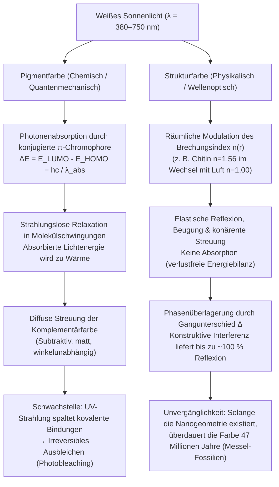
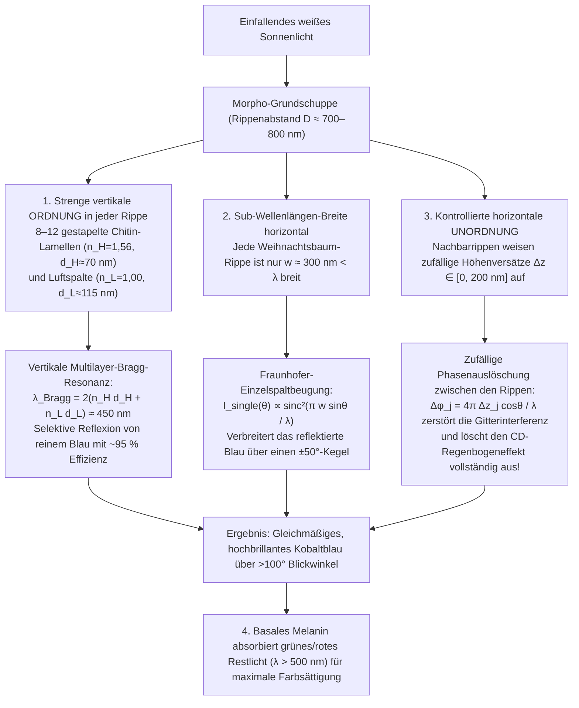

Wenn der <strong>Morpho-Falter (*Morpho rhetenor*, *Morpho menelaus* und *Morpho didius*)</strong> durch das sonnendurchflutete Kronendach des neotropischen Regenwaldes segelt, blitzt auf seinen Flügeln ein derart intensives, metallisches Kobaltblau auf, dass selbst Piloten in Kleinflugzeugen dieses Leuchten aus über einem Kilometer Entfernung erkennen können. Im japanischen Hōryū-ji-Tempel in Nara steht der berühmte <strong>Tamamushi-Schrein (玉虫厨子)</strong> aus dem 7. Jahrhundert, der mit den Flügeldecken (Elytren) tausender <strong>Prachtkäfer (*Chrysochroa fulgidissima*)</strong> verziert ist: Selbst nach fast 1.400 Jahren strahlen diese Käferflügel noch immer in unvermindertem Smaragdgrün und Purpurgold. Noch erstaunlicher sind die <strong>47 Millionen Jahre alten Käferfossilien aus dem eozänen Ölschiefer der Grube Messel</strong> bei Darmstadt: Obwohl die ursprünglichen Biomoleküle über Jahrmillionen diagenetisch verändert wurden, leuchten diese fossilen Panzer im selben Moment, in dem das Tageslicht auf sie fällt, in brillantem Metallic-Grün und Königsblau.

Gewöhnliche Malerfarben, Textilfarbstoffe, Blütenblätter und Herbstlaub verblassen unter der ultravioletten (UV) Strahlung der Sonne innerhalb weniger Monate oder Jahre durch photochemische Ausbleichung. Warum aber überdauern die Farben eines *Morpho*-Flügels, eines Prachtkäfers, einer Pfauenfeder (*Pavo cristatus*) oder des Leuchtstreifens eines Neonsalmlers (*Paracheirodon innesi*) Jahrtausende und Jahrmillionen mit einer Leuchtkraft, die jedes synthetische Pigment in den Schatten stellt?

Ein klassisches Laborexperiment liefert die verblüffende Antwort: Legt man den strahlend blauen Flügel eines *Morpho rhetenor* in einen Achatmörser und zerreibt ihn zu feinem Staub, <strong>bleibt kein einziges blaues Körnchen übrig – im Mörser liegt lediglich ein stumpfes, erdbraunes Pulver</strong>! Oder man lässt den Flügel völlig unversehrt und gibt einen Tropfen reines Aceton oder Ethanol (Brechungsindex $n \approx 1.36$) auf seine Oberfläche: In der Sekunde, in der die Flüssigkeit in die mikroskopischen Schuppen eindringt, erlischt das leuchtende Blau wie durch Geisterhand und weicht einem dunklen Braun oder matten Grün – nur um sofort in voller kobaltblauer Pracht wiederzuerstehen, sobald das Lösungsmittel verdunstet ist.

Die Schlussfolgerung ist unausweichlich: <strong>Der Flügel des *Morpho*-Falters enthält kein einziges Milligramm blaues Pigment.</strong> Seine Farbe entsteht nicht durch die chemische Absorption von Photonen, sondern durch ein rein physikalisches Phänomen der Maxwellschen Elektrodynamik – die <strong>Strukturfarbe (Structural Coloration)</strong>. Hierbei wird der Brechungsindex $n(\mathbf{r})$ transparenter Biopolymere auf der Längenskala der Wellenlänge des sichtbaren Lichts ($\lambda \approx 380\text{–}750\,\text{nm}$) räumlich moduliert. In diesem Artikel leiten wir die vier fundamentalen optischen Architekturen der Natur streng mathematisch her: <strong>(I) Einschicht-Dünnschichtinterferenz</strong>, <strong>(II) Eindimensionale dielektrische Bragg-Spiegel (DBR)</strong>, <strong>(III) Das *Morpho*-Paradoxon (das Zusammenspiel von vertikaler Ordnung und horizontaler Unordnung)</strong> sowie <strong>(IV) Zwei- und dreidimensionale photonische Kristalle und amorphe kohärente Streuung</strong>.

---

## 1. Pigmentfarbe (Chemische Absorption) vs. Strukturfarbe (Wellenoptische Interferenz)

### 1.1 Pigmentfarbe: Konjugierte $\pi$-Elektronensysteme und thermische Relaxation

Das Grün des Chlorophylls, das Rotorange der Carotinoide, das Purpur der Anthocyane und das Schwarzbraun des Melanins sind <strong>Pigmentfarben</strong>. Ihr gemeinsames chemisches Merkmal ist ein <strong>konjugiertes $\pi$-Elektronensystem</strong> aus alternierenden Einfach- ($\sigma$) und Doppelbindungen ($\sigma + \pi$). Mit zunehmender Konjugationslänge $L$ delokalisieren die $\pi$-Elektronen (analog zum quantenmechanischen Teilchen im eindimensionalen Kasten der Länge $L$), wodurch die Energielücke $\Delta E$ zwischen dem <strong>höchsten besetzten Molekülorbital (HOMO)</strong> und dem <strong>niedrigsten unbesetzten Molekülorbital (LUMO)</strong> in den sichtbaren Spektralbereich ($1{,}65\text{–}3{,}26\,\text{eV}$) absinkt:

$$
\Delta E = E_{\text{LUMO}} - E_{\text{HOMO}} = h\nu = \frac{hc}{\lambda_{\text{abs}}}
$$

Photonen der Wellenlänge $\lambda_{\text{abs}}$ werden absorbiert und ihre Energie wird innerhalb von Pikosekunden ($10^{-12}\,\text{s}$) durch strahlungslose Schwingungsrelaxation in <strong>Wärme</strong> umgewandelt. Unser Auge nimmt lediglich die nicht absorbierte <strong>Komplementärfarbe</strong> als diffuse Streustrahlung wahr. Diese subtraktive Farberzeugung hat zwei gravierende Nachteile: Erstens spalten energiereiche UV-Photonen die kovalenten Bindungen des konjugierten Systems (<strong>Photobleaching / Ausbleichen</strong>), und zweitens geht der Großteil der Lichtenergie als Wärme verloren.

### 1.2 Strukturfarbe: Brechungsindexmodulation auf der Nanoskala

<strong>Strukturfarben</strong> hingegen kommen völlig ohne elektronische Absorption aus. Sie bestehen aus farblosen, transparenten Biomaterialien wie <strong>Chitin ($n \approx 1{,}56$)</strong> bei Insekten, <strong>$\beta$-Keratin ($n \approx 1{,}54\text{–}1{,}58$)</strong> in Vogelfedern, <strong>Cellulose ($n \approx 1{,}53$)</strong> in Pflanzen oder <strong>Guaninkristallen ($n \approx 1{,}83$)</strong> in Fischschuppen, die sich im Abstand weniger hundert Nanometer mit <strong>Luft ($n = 1{,}00$)</strong> oder <strong>Cytoplasma ($n \approx 1{,}33$)</strong> abwechseln. An jeder Grenzfläche werden elektromagnetische Teilwellen reflektiert; durch Überlagerung entsteht für ausgewählte Wellenlängen <strong>konstruktive Interferenz</strong> (bis zu hampir $100\,\%$ verlustfreie Reflexion) und für alle anderen <strong>destruktive Interferenz</strong>.

Bereits 1665 erkannte <strong>Robert Hooke</strong> in seiner *Micrographia*, dass die Farben von Pfauenfedern beim Benetzen mit Wasser verschwinden, und <strong>Isaac Newton</strong> führte sie 1704 in *Opticks* auf die Interferenz dünner Schichten (Newtonsche Ringe) zurück, bevor <strong>Thomas Young</strong>, <strong>Augustin-Jean Fresnel</strong> und <strong>Lord Rayleigh (1917)</strong> die vollständige Wellentheorie lieferten. Wenn Aceton ($n = 1{,}36$) in die Luftkammern ($n = 1{,}00$) des *Morpho*-Flügels eindringt, schrumpft der Brechungsindexkontrast $\Delta n$ zum Chitin ($n = 1{,}56$) drastisch; die Interferenzreflexion bricht zusammen und gibt den Blick auf das braune Melanin-Fundament frei.

---

## 2. Architektur I: Einschicht-Dünnschichtinterferenz und Irisieren (Blauverschiebung)

Seifenblasen, Ölfilme auf nassem Asphalt und transparente Insektenflügel beruhen auf der Interferenz an einer einzelnen dünnen Schicht der Dicke $d$ und Brechzahl $n_1$ (umgeben von Luft $n_0 = n_2 = 1{,}00$).

### 2.1 Herleitung des optischen Gangunterschieds und des $\pi$-Phasensprungs

Nach dem <strong>Snelliusschen Brechungsgesetz</strong> $n_0 \sin\theta_0 = n_1 \sin\theta_1$ legt der in die Schicht gebrochene Strahl $R_2$ im Medium $n_1$ den optischen Weg $L_2 = \frac{2 n_1 d}{\cos\theta_1}$ zurück, während der an der Oberseite reflektierte Strahl $R_1$ in Luft den Weg $L_1 = 2 d \tan\theta_1 (n_0 \sin\theta_0) = \frac{2 n_1 d \sin^2\theta_1}{\cos\theta_1}$ durchläuft. Wegen $1 - \sin^2\theta_1 = \cos^2\theta_1$ beträgt der rein <strong>geometrische Gangunterschied</strong>:

$$
\Delta_{\text{geom}} = L_2 - L_1 = 2 n_1 d \cos\theta_1
$$

Aus den <strong>Fresnelschen Formeln</strong> für die Reflexionsamplitude bei nahezu senkrechtem Einfall,

$$
r_{ij} = \frac{n_i - n_j}{n_i + n_j},
$$

folgt zudem: Bei der Reflexion am optisch dichteren Medium ($n_0 < n_1$) ist $r_{01} < 0$, was einem <strong>Phasensprung um $\pi$ (einer halben Wellenlänge $\frac{\lambda}{2}$)</strong> entspricht, während an der Unterseite ($n_1 > n_2$) kein Phasensprung auftritt ($\delta = 0$). Der <strong>gesamte effektive Gangunterschied</strong> lautet damit:

$$
\Delta_{\text{total}} = 2 n_1 d \cos\theta_1 + \frac{\lambda}{2}
$$

Daraus ergeben sich die Interferenzbedingungen (für $n_0 < n_1 > n_2$):

$$
\begin{aligned}
\text{Konstruktive Interferenz (Maxima)}: \quad 2 n_1 d \cos\theta_1 &= \left(m - \frac{1}{2}\right)\lambda \quad &(m = 1, 2, 3, \dots) \\
\text{Destruktive Interferenz (Minima)}: \quad 2 n_1 d \cos\theta_1 &= m\lambda \quad &(m = 0, 1, 2, \dots)
\end{aligned}
$$

Dies erklärt erstens den <strong>Newtonschen Schwarzer Film</strong> kurz vor dem Zerplatzen einer Seifenblase ($d \to 0 \implies \Delta_{\text{geom}} \to 0$, sodass der $\frac{\lambda}{2}$-Phasensprung alle Wellenlängen destruktiv auslöscht) und zweitens das <strong>Irisieren (Winkelabhängige Blauverschiebung)</strong>: Wegen $\lambda_{\text{peak}}(\theta_1) = 4 n_1 d \cos\theta_1 = \lambda_{\text{peak}}(0)\cos\theta_1$ verschiebt sich die reflektierte Farbe bei flacherem Betrachtungswinkel ($\theta_1 \uparrow \implies \cos\theta_1 \downarrow$) zwingend zu kürzeren, blauen Wellenlängen.

---

## 3. Architektur II: Eindimensionale Bragg-Spiegel (DBR) und $\lambda/4$-Schichtstapel

Da eine einzelne Chitin-Luft-Grenzfläche nur $R_1 = \left(\frac{1{,}56-1}{1{,}56+1}\right)^2 \approx 4{,}8\,\%$ reflektiert, stapeln Prachtkäfer (*Chrysochroa*) und Fische $N$ Doppelschichten aus hochbrechendem Material ($n_H, d_H$) und niedrigbrechendem Material ($n_L, d_L$) zu einem <strong>verteilten Bragg-Reflektor (DBR)</strong>. Die konstruktive Überlagerung gehorcht dem <strong>Bragg-Snellius-Gesetz</strong>:

$$
m \lambda_{\text{Bragg}} = 2 \left( n_H d_H \cos\theta_H + n_L d_L \cos\theta_L \right) = 2 \left( d_H \sqrt{n_H^2 - \sin^2\theta_0} + d_L \sqrt{n_L^2 - \sin^2\theta_0} \right)
$$

Sind die optischen Schichtdicken exakt auf ein Viertel der Zielwellenlänge $\lambda_0$ abgestimmt (<strong>Quarter-Wave Stack / $\lambda/4$-Stapel</strong>, $n_H d_H = n_L d_L = \frac{\lambda_0}{4}$), so addieren sich die Teilwellen aller $2N$ Grenzflächen phasengleich. Die Transfer-Matrix-Methode (TMM) liefert für den Spitzenreflexionsgrad $R_N$:

$$
R_N = \left[ \frac{n_0 \left(\frac{n_H}{n_L}\right)^{2N} - n_s}{n_0 \left(\frac{n_H}{n_L}\right)^{2N} + n_s} \right]^2 \xrightarrow{N \gg 1} 100\,\%
$$

* <strong>Prachtkäfer (*Chrysochroa fulgidissima*)</strong>: Ca. $N = 15\text{–}20$ alternierende Chitin-Melanin-Schichten ($n_H \approx 1{,}68, n_L \approx 1{,}55$) erzeugen metallisches Smaragdgrün, das über 1.400 Jahre (Tamamushi-Schrein) unverändert bleibt.
* <strong>Silberglanz von Fischen und dynamischer Farbwechsel beim Neonsalmler</strong>: Heringe stapeln <strong>Guaninplättchen ($n_H = 1{,}83$)</strong> und <strong>Cytoplasma ($n_L = 1{,}33$)</strong>; schon $N = 6$ Perioden liefern $R > 90\,\%$. Der Neonsalmler (*Paracheirodon innesi*) und das Pantherchamäleon (*Furcifer pardalis*) verändern aktiv den Abstand $d_L$ bzw. Neigungswinkel der Guaninkristalle und verschieben so $\lambda_{\text{Bragg}}$ in Echtzeit zwischen Blaugrün, Violett und Rot!

---

## 4. Architektur III: Das Morpho-Paradoxon – Wie Ordnung und Unordnung den Regenbogen besiegen

Ein ebener Bragg-Spiegel reflektiert nur spiegelnd und ändert seine Farbe stark mit dem Winkel; ein regelmäßiges Beugungsgitter mit dem Rippenabstand $D \approx 700\,\text{nm}$ müsste weißes Licht gemäß $D(\sin\theta_i + \sin\theta_m) = m\lambda$ wie eine CD in alle Regenbogenfarben zerlegen. Warum aber erscheint der Flügel eines *Morpho didius* oder *Morpho rhetenor* über einen <strong>extrem weiten Winkelbereich von über $100^\circ$ ($\pm 50^\circ$) in einem einheitlichen, strahlenden Kobaltblau</strong>?

Die Physiker <strong>Shuichi Kinoshita und Shinya Yoshioka</strong> (Universität Osaka) lösten dieses Rätsel anhand der <strong>„Weihnachtsbaum“-Nanostruktur</strong> der Schuppenrippen (Ridges):

1. <strong>Vertikale Periodizität</strong>: Jede Rippe trägt 6–12 Lamellen ($n_H = 1{,}56, d_H \approx 72\,\text{nm}$ und Luft $n_L = 1{,}00, d_L \approx 113\,\text{nm}$), was exakt $\lambda_{\text{Bragg}} = 2(n_H d_H + n_L d_L) \approx 450\,\text{nm}$ (Blau) reflektiert.
2. <strong>Einzelspaltbeugung durch Sub-Wellenlängen-Breite</strong>: Da jede Rippe nur <strong>$w \approx 300\,\text{nm} < \lambda$</strong> breit ist, wirkt sie als Beugungsspalt mit der Einhüllenden $I_{\text{single}}(\theta) \propto \operatorname{sinc}^2\left(\frac{\pi w \sin\theta}{\lambda}\right)$ und fächert das blaue Licht über mehr als $\pm 50^\circ$ auf.
3. <strong>Zufällige Höhenversätze $\pm\Delta z_j$</strong>: Benachbarte Rippen sind vertikal um zufällige Beträge $\Delta z_j \in [0, \lambda/2]$ gegeneinander verschoben. Im Fernfeld mitteln sich die Phasenfaktoren $\phi_j = \frac{4\pi \Delta z_j \cos\theta}{\lambda}$ zwischen verschiedenen Rippen ($j \neq l$) weg:
   $$
   I_{\text{total}}(\theta) = I_{\text{single}}(\theta) \left\langle \left| \sum_{j=1}^{N_{\text{ridge}}} \exp\left[ i k \left( j D \sin\theta + 2 \Delta z_j \cos\theta \right) \right] \right|^2 \right\rangle \approx N_{\text{ridge}} \, I_{\text{single}}(\theta)
   $$
   Die Gitter-Regenbogenmaxima verschwinden komplett, während der breite blaue Einzelspalt-Beugungskegel erhalten bleibt!
4. <strong>Melanin-Absorptionsschicht</strong>: Melaningranula am Schuppenboden absorbieren transmittiertes grünes und rotes Licht ($\lambda > 500\,\text{nm}$) und verhindern eine Weißaufhellung.

---

## 5. Architektur IV: 2D/3D Photonische Kristalle und Amorphe Kohärente Streuung

Variiert die Permittivität $\varepsilon(\mathbf{r}) = n(\mathbf{r})^2$ zweidimensional oder dreidimensional periodisch ($\varepsilon(\mathbf{r} + \mathbf{R}) = \varepsilon(\mathbf{r})$), entsteht ein <strong>photonischer Kristall</strong> (Eli Yablonovitch & Sajeev John, 1987). Aus den Maxwell-Gleichungen folgt durch Elimination von $\mathbf{E}(\mathbf{r})$ die hermitesche <strong>Master-Eigenwertgleichung</strong> für das Magnetfeld $\mathbf{H}(\mathbf{r})$:

$$
\hat{\Theta} \mathbf{H}(\mathbf{r}) \equiv \nabla \times \left( \frac{1}{\varepsilon(\mathbf{r})} \nabla \times \mathbf{H}(\mathbf{r}) \right) = \left(\frac{\omega}{c}\right)^2 \mathbf{H}(\mathbf{r})
$$

Nach dem <strong>Bloch-Theorem</strong> $\mathbf{H}_{\mathbf{k}}(\mathbf{r}) = e^{i\mathbf{k}\cdot\mathbf{r}} \mathbf{u}_{\mathbf{k}}(\mathbf{r})$ spalten die stehenden Wellen am Rand der Brillouin-Zone ($k = \pm\frac{\pi}{a}$) in das niederfrequente <strong>Dielektrikumsband ($\omega_-$)</strong> (Feldenergie $|\mathbf{E}|^2$ im hochbrechenden $\varepsilon_H$ konzentriert) und das hochfrequente <strong>Luftband ($\omega_+$)</strong> (Feldenergie in den Luftkammern $\varepsilon_L$) auf. Dazwischen öffnet sich die <strong>Photonische Bandlücke (Photonic Band Gap, PBG)</strong>, in der die optische Zustandsdichte $\rho(\omega) = 0$ verschwindet und Licht zu $100\,\%$ reflektiert wird.

* <strong>2D-Kristalle in Pfauenfedern (*Pavo cristatus*)</strong>: Ein 2D-Gitter aus Melaninstäbchen ($n \approx 2{,}0$) in Keratin ($n \approx 1{,}54$) erzeugt durch Variation der Gitterkonstante $a \approx 140\text{–}165\,\text{nm}$ Blau, Türkis, Grün und Goldbraun.
* <strong>3D-Gyroid-Kristalle in Rüsselkäfern (*Pachyrhynchus*, *Entimus*) und Zipfelfaltern (*Callophrys rubi*)</strong>: Statt einfacher Kugelpackungen (wie beim Edelopal aus $\text{SiO}_2$-Kugeln) bilden diese Insekten durch Selbstorganisation des glatten endoplasmatischen Retikulums (SER) ein dreidimensional-bikontinuierliches <strong>Gyroid-Minimalflächengitter</strong> ($a \approx 300\,\text{nm}$):
  $$
  \sin\left(\frac{2\pi x}{a}\right)\cos\left(\frac{2\pi y}{a}\right) + \sin\left(\frac{2\pi y}{a}\right)\cos\left(\frac{2\pi z}{a}\right) + \sin\left(\frac{2\pi z}{a}\right)\cos\left(\frac{2\pi x}{a}\right) = t
  $$
* <strong>Amorphe (quasi-geordnete) Nanostrukturen beim Blauhäher (*Cyanocitta cristata*) und Eisvogel</strong>: Warum schillern deren blaue Federn nicht winkelabhängig? Richard Prum zeigte, dass durch <strong>spinodale Entmischung</strong> von $\beta$-Keratin und Luft ein isotropes Schwammnetzwerk mit reiner Nahordnung ($d_0 \approx 180\,\text{nm}$) entsteht. Im Fourier-Raum bildet $|\tilde{\varepsilon}(\mathbf{q})|^2$ eine isotrope Kugelschale mit Radius $|\mathbf{q}| = q_0 \approx \frac{2\pi}{d_0}$, die durch <strong>kohärente Streuung</strong> in alle Raumrichtungen dasselbe matte Strukturblau streut!

---

## 6. Vergleichstabellen: Pigment- vs. Strukturfarbe & Die 4 Optischen Architekturen

### Tabelle 1: Pigmentfarbe vs. Strukturfarbe

| Eigenschaft | Pigmentfarbe (Chemische Absorption) | Strukturfarbe (Physikalische Wellenoptik) |
| :--- | :--- | :--- |
| <strong>Physikalisches Prinzip</strong> | Selektive Photonenabsorption ($\Delta E = E_{\text{LUMO}} - E_{\text{HOMO}} = hc/\lambda$) in konjugierten $\pi$-Systemen | Interferenz, Bragg-Reflexion, Beugung und kohärente Streuung an Nanostrukturen $n(\mathbf{r})$ |
| <strong>Energiebilanz</strong> | Absorbierte Lichtenergie wird in <strong>Wärme</strong> umgewandelt (subtraktiv) | <strong>Verlustfreie elastische Reflexion</strong> bis zu $R \approx 99{,}9\,\%$ |
| <strong>Winkelabhängigkeit</strong> | Winkelunabhängig (diffus matt) | <strong>Irisierend (Blauverschiebung)</strong> bei periodischen Schichten; weitwinklig oder winkelunabhängig bei *Morpho* und amorphen Strukturen |
| <strong>Zerreiben / Lösungsmittel</strong> | Farbe bleibt im Pulver oder in Lösungsmitteln erhalten | <strong>Beim Zerreiben verschwindet die Farbe (braunes Melanin bleibt)</strong>; Aceton ($n \approx 1{,}36$) löscht die Farbe sofort aus |
| <strong>Beständigkeit</strong> | <strong>Photobleaching</strong> (UV-Bindungsbruch) nach Jahren | <strong>Geologisch unvergänglich</strong> (1.400 Jahre Tamamushi-Schrein; 47 Mio. Jahre Messel-Fossilien) |

### Tabelle 2: Die vier optischen Architekturen biologischer Strukturfarben

| Architektur | Dimension & Ordnung | Grundgleichung / Resonanzbedingung | Optisches Verhalten | Biologische Beispiele |
| :--- | :--- | :--- | :--- | :--- |
| <strong>I. Dünnschichtinterferenz</strong> | 1D Einzelschicht (Dicke $d$) | $2 n_1 d \cos\theta_1 = \left(m - \frac{1}{2}\right)\lambda$ | Reflexion $\sim 15\,\%$; Blauverschiebung mit dem Winkel; Newtonscher Schwarzer Film für $d \to 0$ | Seifenblasen, Ölfilme, Taubenfedern, Fliegenflügel |
| <strong>II. 1D Bragg-Spiegel (DBR)</strong> | 1D Stapel aus $N$ Paaren $(n_H, d_H), (n_L, d_L)$ | $m\lambda_{\text{Bragg}} = 2(n_H d_H \cos\theta_H + n_L d_L \cos\theta_L)$ $\lambda/4$-Stapel: $n_H d_H = n_L d_L = \frac{\lambda_0}{4}$ | $R_N = \left[\frac{n_0(n_H/n_L)^{2N}-n_s}{n_0(n_H/n_L)^{2N}+n_s}\right]^2 \to 100\,\%$; metallischer Spiegelglanz | Prachtkäfer (*Chrysochroa*), Fischschuppen (Guanin), Neonsalmler |
| <strong>III. *Morpho*-Hierarchiegitter</strong> | Vertikal: geordnete Lamellen Horizontal: Breite $w < \lambda$ + Zufallshöhe $\pm\Delta z$ | Vertikal: $2(n_H d_H + n_L d_L) \approx 450\,\text{nm}$ Horizontal: $I(\theta) \approx N_{\text{ridge}} \operatorname{sinc}^2\left(\frac{\pi w\sin\theta}{\lambda}\right)$ | Höhenunordnung $\Delta z_j$ tilgt Gitter-Regenbogen; Einzelspaltbeugung erzeugt <strong>$>100^\circ$ Weitwinkel-Blau</strong> | *Morpho rhetenor*, *Morpho didius*, *Morpho menelaus* |
| <strong>IV-a. 2D/3D Photonische Kristalle</strong> | 2D/3D Gitter $\varepsilon(\mathbf{r}+\mathbf{R})=\varepsilon(\mathbf{r})$ | $\nabla \times \left(\frac{1}{\varepsilon(\mathbf{r})}\nabla \times \mathbf{H}\right) = \left(\frac{\omega}{c}\right)^2 \mathbf{H}$ | Photonische Bandlücke ($\rho(\omega)=0$); Zirkularpolarisation bei chiralen Gyroiden | Pfauenfeder (2D), Seemaus (2D), Edelopal (3D), Rüsselkäfer & *Callophrys rubi* (3D Gyroid) |
| <strong>IV-b. Amorphe Photonik</strong> | 3D isotrope Nahordnung (spinodale Entmischung) | Kugelschale im Fourier-Raum bei $|\mathbf{q}| = q_0 \approx \frac{2\pi}{d_0}$ | <strong>Nicht-irisierendes (winkelunabhängiges)</strong> Strukturblau durch kohärente Streuung | Blauhäher (*Cyanocitta cristata*), Eisvogel, Aras |

---

## 7. 47 Millionen Jahre alte Fossilien und Biomimetische Hochtechnologie

Untersuchungen von <strong>Maria E. McNamara</strong> (2011) an <strong>47 Millionen Jahre alten Pracht- und Rüsselkäfer-Fossilien aus der Grube Messel</strong> bewiesen, dass selbst nach der chemischen Umwandlung des Chitins in Kerogen die $100\,\text{nm}$-Multilayer-Geometrie erhalten bleibt und im Sonnenlicht wieder aufleuchtet – ein Prinzip, mit dem Paläontologen heute sogar das schillernde Gefieder 150 Millionen Jahre alter Dinosaurier (*Microraptor*) rekonstruieren.

In der modernen Technik inspiriert die Strukturfarbe bahnbrechende Innovationen:
1. <strong>Farbstofffreie Textilfaser *Morfotex</strong>* (Teijin): 61 alternierende Nanoschichten aus Polyester ($n_H=1{,}63$) und Nylon ($n_L=1{,}53$) erzeugen brillante Gewebe ohne einen Tropfen Färbereiabwasser.
2. <strong>Lexus *Structural Blue* Autolack</strong>: 7-lagige Nano-Flakes reflektieren fast $100\,\%$ des blauen Lichts anstelle von $<5\,\%$ bei herkömmlichen Pigmenten.
3. <strong>Qualcomm *Mirasol* (IMOD) MEMS-Displays</strong>: Elektrostatisch verstellbare Fabry-Pérot-Luftspalte $d$ reflektieren Sonnenlicht extrem stromsparend oder schalten auf $d \to 0$ (Newtonscher Schwarzer Film) für perfektes Schwarz.
4. <strong>Fälschungssichere Banknoten (OVI) & Hydrogel-Sensoren</strong>: Winkelabhängige Interferenzfarben auf Euro-Banknoten verhindern Kopien; photonische Hydrogele zeigen Glukose- oder pH-Werte durch Farbwechsel ohne Batterie an.
5. <strong>Stromlose Strahlungskühlung (Daytime Passive Radiative Cooling)</strong>: Nach dem Vorbild der <strong>Sahara-Silberameise (*Cataglyphis bombycina*)</strong> reflektieren photonische Metamaterialien $96\,\%$ des Sonnenlichts ($0{,}3\text{–}2{,}5\,\mu\text{m}$) und strahlen Wärme durch das atmosphärische Infrarotfenster ($8\text{–}13\,\mu\text{m}$) direkt in den $3\,\text{K}$ kalten Weltraum ab – und kühlen Gebäude im prallen Sonnenschein um <strong>$5\text{–}10\,^\circ\text{C}$ unter die Umgebungstemperatur</strong>.
