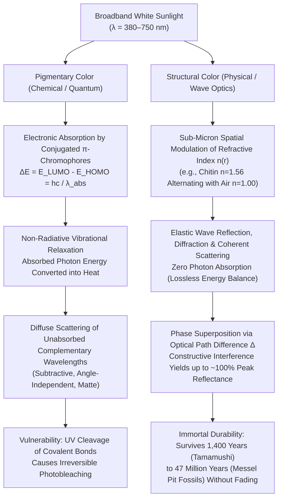
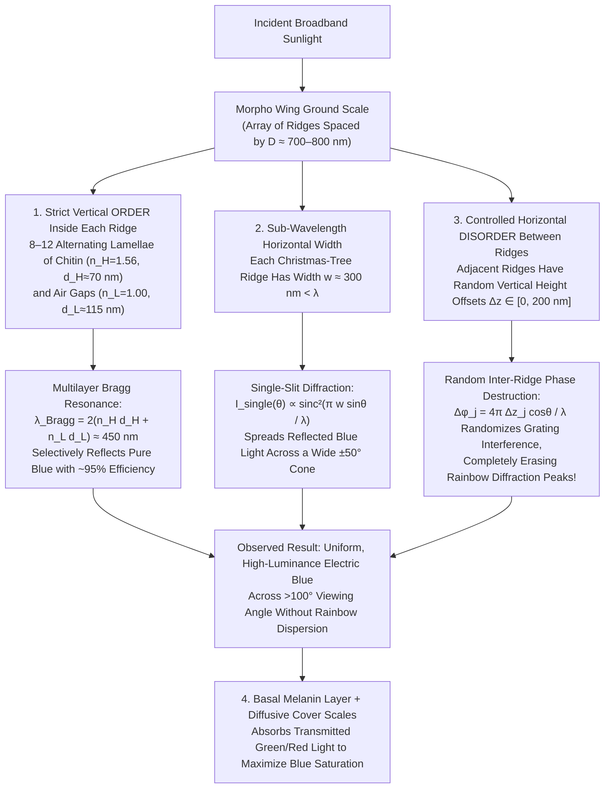

Soaring through the sunlit canopies of Neotropical rainforests, the <strong>Morpho butterfly (*Morpho rhetenor*, *Morpho menelaus*, and *Morpho didius*)</strong> flashes a metallic, electric cobalt blue so intense that pilots in low-flying aircraft can spot its glint from over a kilometer away. In Nara, Japan, the seventh-century Asuka-period national treasure known as the <strong>Tamamushi Shrine (玉虫厨子)</strong> at Hōryū-ji Temple is adorned with the iridescent wing cases (elytra) of thousands of <strong>jewel beetles (*Chrysochroa fulgidissima*)</strong>; nearly 1,400 years after their artisans laid them down, those beetle wings still gleam with undiminished emerald green and violet-gold luster. More astonishing still, fossilized beetles excavated from the <strong>47-million-year-old Eocene oil shales of the Messel Pit</strong> in Germany flash brilliant metallic greens and blues the moment they are exposed to light, even though diagenesis has chemically altered the original biological macromolecules over tens of millions of years.

Ordinary paints, textile dyes, flower petals, and autumn leaves fade relentlessly when exposed to solar ultraviolet (UV) radiation, succumbing to photochemical bleaching within months or years. Why, then, can the wings of a *Morpho* butterfly, the carapace of a jewel beetle, the eyespot of a peacock feather (*Pavo cristatus*), or the lateral stripe of a neon tetra (*Paracheirodon innesi*) shine with a brilliance that outperforms synthetic pigments and defies geological time?

Consider a classic, almost unsettling laboratory demonstration. Take a shed wing of *Morpho rhetenor*—an object of blinding azure radiance—place it in an agate mortar, and grind it into a fine powder. As the microscopic scales are pulverized, <strong>not a single grain of blue powder is produced; what remains in the mortar is a dull, muddy dark-brown dust</strong>. Alternatively, leave the wing intact and place a single drop of pure acetone or ethanol (refractive index $n \approx 1.36$) onto its surface. The instant the liquid infiltrates the microscopic scales, the electric blue vanishes before your eyes, turning dark brown or dull green—only for the brilliant cobalt blue to resurrect itself, completely unharmed, the moment the solvent evaporates.

The conclusion is inescapable: <strong>the *Morpho* butterfly wing contains zero blue pigment</strong>. Its color does not arise from the selective absorption of photons by chemical chromophores. Instead, it is a pure manifestation of Maxwellian electrodynamics—<strong>Structural Coloration (構造色)</strong>—generated when transparent biological dielectrics are sculpted on the spatial scale of visible light wavelengths ($\lambda \approx 380\text{–}750\,\text{nm}$), manipulating electromagnetic waves through thin-film interference, multilayer Bragg reflection, sub-wavelength diffraction, and photonic band gaps.

In this article, we contrast the quantum chemistry of <strong>pigmentary color</strong> against the wave physics of <strong>structural color</strong>, and derive from first principles the four fundamental optical architectures evolved by living organisms: <strong>(I) Single Thin-Film Interference</strong>, <strong>(II) 1D Multilayer Distributed Bragg Reflectors (DBRs)</strong>, <strong>(III) The *Morpho* Butterfly Paradox (how nanoscale order and disorder conspire to defeat rainbow grating dispersion)</strong>, and <strong>(IV) 2D/3D Photonic Crystals and Amorphous Coherent Scattering</strong>.

---

## 1. The Two Fundamental Mechanisms of Color in Nature: Chemical Absorption vs. Physical Wave Interference

When white sunlight—a broadband continuum of electromagnetic waves spanning $\lambda \approx 380\,\text{nm}$ (violet) to $750\,\text{nm}$ (red)—strikes an object, our visual cortex perceives color only if specific spectral bands are preferentially delivered to the cone photoreceptors of the retina while others are removed. Nature accomplishes this spectral filtering through two fundamentally distinct physical paradigms.

### 1.1 Pigmentary Color: Conjugated $\pi$-Electron Chromophores and Non-Radiative Thermal Dissipation

The green of chlorophyll in leaves, the orange-red of $\beta$-carotene in carrots and flamingos, the crimson-purple of anthocyanins in berries, and the dark brown-black of eumelanin in human skin and animal fur are all <strong>pigmentary colors</strong> governed by molecular quantum mechanics.

Organic pigments and dyes share a defining structural motif: a <strong>conjugated $\pi$-electron system</strong> consisting of alternating single ($\sigma$) and double ($\sigma + \pi$) covalent carbon-carbon bonds, often coupled to electron-donating or electron-withdrawing functional groups (the <strong>chromophore</strong>). In molecular orbital theory, $\pi$ electrons delocalize across the conjugated backbone of length $L$. Much like a quantum particle in a one-dimensional box of width $L$ whose energy levels scale as $E_n = \frac{n^2 h^2}{8 m_e L^2}$, extending the conjugation length $L$ narrows the energy gap $\Delta E$ between the <strong>Highest Occupied Molecular Orbital (HOMO)</strong> and the <strong>Lowest Unoccupied Molecular Orbital (LUMO)</strong>.

While saturated hydrocarbons ($\sigma$ bonds only) exhibit large HOMO–LUMO gaps ($\Delta E > 6\,\text{eV}$, absorbing only deep UV photons with $\lambda < 200\,\text{nm}$ and appearing colorless), a conjugated system of 7 to 11 double bonds lowers $\Delta E$ into the visible spectrum ($1.65\,\text{eV} \le \Delta E \le 3.26\,\text{eV}$):

$$
\Delta E = E_{\text{LUMO}} - E_{\text{HOMO}} = h\nu = \frac{hc}{\lambda_{\text{abs}}}
$$

where $h = 6.626 \times 10^{-34}\,\text{J}\cdot\text{s}$ is Planck's constant, $c$ is the speed of light in vacuum, and $\nu$ is the optical frequency. When an incident photon matches $\lambda_{\text{abs}}$, it is annihilated, promoting a $\pi$ electron from the HOMO to the excited $\pi^*$ LUMO state. Unless the molecule is fluorescent, internal conversion and vibrational relaxation rapidly (within $10^{-13}\text{–}10^{-11}\,\text{s}$) dissipate this electronic excitation energy into <strong>molecular vibrations (heat)</strong> in the surrounding medium.

Consequently, pigmentary color is <strong>subtractive</strong>: we perceive the <strong>complementary wavelengths</strong> that were *not* absorbed, diffusely scattered back from the material's disordered interior. This quantum-chemical mechanism carries two intrinsic physical limitations:
1. <strong>Photochemical Bleaching (Fading)</strong>: High-energy solar UV photons ($\lambda < 350\,\text{nm}$, $E > 3.5\,\text{eV}$) exceed the dissociation energy of carbon-carbon and carbon-nitrogen covalent bonds or trigger singlet-oxygen photo-oxidation. Once a single covalent bond along the conjugated backbone is cleaved, the delocalized $\pi$ box is broken, $\Delta E$ shifts back into the UV, and the pigment permanently loses its color.
2. <strong>Thermodynamic Energy Loss and Limited Luminance</strong>: Because pigments generate color by destroying unwanted wavelengths and converting their energy into heat, most of the incident solar flux is wasted, and the diffuse reflectance cannot achieve directional metallic brilliance.

### 1.2 Structural Color: Sub-Micron Refractive Index Modulation $n(\mathbf{r})$

<strong>Structural coloration</strong>, by contrast, involves <strong>zero electronic absorption</strong> to create hue. The building blocks of biological structural colors are transparent, colorless biopolymers and biominerals:
* <strong>Chitin</strong> in insect cuticles and butterfly scales ($n \approx 1.56$)
* <strong>$\beta$-Keratin</strong> in bird feathers and reptile scales ($n \approx 1.54\text{–}1.58$)
* <strong>Cellulose</strong> in iridescent fruits (*Pollia condensata*) and leaves ($n \approx 1.53$)
* <strong>Crystalline Guanine</strong> platelets in fish scales, chameleons, and spiders ($n \approx 1.83$)
* <strong>Amorphous Silica ($\text{SiO}_2$)</strong> or <strong>Aragonite ($\text{CaCO}_3$)</strong> in opals, diatoms, and mollusk nacre ($n \approx 1.45\text{–}1.68$)

Interspersed with <strong>air voids ($n = 1.00$)</strong> or <strong>aqueous cytoplasm ($n \approx 1.33\text{–}1.35$)</strong>, these materials form spatial modulations of the refractive index $n(\mathbf{r})$—or equivalently the relative dielectric permittivity $\varepsilon(\mathbf{r}) = n(\mathbf{r})^2$—with characteristic periodicities $d \sim 100\text{–}350\,\text{nm}$. When white light enters such a nanostructure, partial waves reflect and scatter coherently at every dielectric boundary. By the principle of linear superposition, wavelengths whose optical path differences equal an integer multiple of $\lambda$ undergo <strong>constructive interference</strong> (approaching $100\%$ lossless reflection), while other wavelengths undergo <strong>destructive interference</strong> and transmit through the structure.

The scientific recognition of structural color began at the dawn of modern optics:
* <strong>Robert Hooke (1665)</strong>, in his landmark treatise *Micrographia*, examined peacock feathers and silverfish scales under his compound microscope. He discovered that submerging a peacock feather in water completely obliterated its brilliant colors, proving that the color resided not in a chemical dye, but in microscopic alternating plates of solid and air.
* <strong>Isaac Newton (1704)</strong>, in *Opticks*, quantitatively connected the colors of peacock feathers and metallic bodies to the interference fringes of thin air wedges between glass lenses (<strong>Newton's rings</strong>) and soap bubbles.
* <strong>Thomas Young (1801)</strong> and <strong>Augustin-Jean Fresnel (1816–1821)</strong> established the transverse wave theory of light and derived the boundary reflection coefficients that govern thin-film interference.
* <strong>Lord Rayleigh (1917)</strong> formulated the electromagnetic theory of periodic stratified media (1D Bragg reflection), explicitly motivated by the iridescent potassium chlorate crystals and beetle carapaces in his laboratory.

This wave-optical framework immediately explains our opening experiment with the *Morpho* wing. Pulverizing the wing destroys the $100\,\text{nm}$-scale periodic air-chitin architecture, eliminating coherent phase relationships and leaving behind only the basal layer of <strong>eumelanin pigment granules</strong>, which are dark brown. Similarly, flooding the intact wing with acetone ($n = 1.36$) or a refractive-index-matching fluid ($n \approx 1.56$) replaces the air gaps ($n_L = 1.00$) with liquid. As the refractive index contrast $\Delta n = n_{\text{chitin}} - n_{\text{medium}}$ collapses toward zero, Fresnel reflection at the internal boundaries vanishes; the nanostructure becomes optically homogeneous and transparent, exposing the brown melanin floor beneath!

---

## 2. Architecture I: Single Thin-Film Interference and the Physics of Iridescence

The simplest structural color architecture in nature is a <strong>single dielectric thin film</strong> of uniform thickness $d$ and refractive index $n_1$, bounded above by an incident medium of index $n_0$ (typically air, $n_0 = 1.00$) and below by a substrate or second medium of index $n_2$. This geometry governs soap bubbles, oil slicks on wet pavement, the iridescent neck feathers of rock pigeons (*Columba livia*), and the transparent wings of dragonflies, houseflies, and hymenopterans.

### 2.1 Rigorous Derivation of the Optical Path Difference (OPD)

Consider a monochromatic plane wave of vacuum wavelength $\lambda$ incident from medium $n_0$ at angle $\theta_0$ onto a planar film of thickness $d$ and index $n_1$. At the top interface ($z = 0$), part of the wave reflects at angle $\theta_0$ as Ray $R_1$, while the transmitted portion refracts into the film at angle $\theta_1$ governed by <strong>Snell's Law</strong>:

$$
n_0 \sin\theta_0 = n_1 \sin\theta_1
$$

The refracted ray travels from point $A$ on the top interface to point $B$ on the bottom interface ($z = d$), reflects upward to point $C$ on the top interface, and refracts back into medium $n_0$ at angle $\theta_0$ as Ray $R_2$, parallel to Ray $R_1$.

Let us compute the <strong>geometrical optical path difference $\Delta_{\text{geom}}$</strong> between Ray $R_2$ and Ray $R_1$ up to a common wavefront plane $CD$ perpendicular to both outgoing rays (where $D$ is the foot of the perpendicular dropped from $C$ onto Ray $R_1$):
1. Inside the film of index $n_1$, the segments $AB$ and $BC$ each have physical length $\frac{d}{\cos\theta_1}$. Hence, the optical path length traversed by Ray $R_2$ inside the film is:
   $$
   L_2 = n_1 \left(AB + BC\right) = \frac{2 n_1 d}{\cos\theta_1}
   $$
2. Meanwhile, Ray $R_1$ travels in medium $n_0$ from $A$ to $D$. Since the horizontal separation along the top surface is $AC = 2 d \tan\theta_1$, right-triangle geometry gives $AD = AC \sin\theta_0 = 2 d \tan\theta_1 \sin\theta_0$. Multiplying by $n_0$ and substituting Snell's law $n_0 \sin\theta_0 = n_1 \sin\theta_1$ yields the optical path length of Ray $R_1$:
   $$
   L_1 = n_0 AD = 2 d \tan\theta_1 \left(n_0 \sin\theta_0\right) = 2 d \frac{\sin\theta_1}{\cos\theta_1} \left(n_1 \sin\theta_1\right) = \frac{2 n_1 d \sin^2\theta_1}{\cos\theta_1}
   $$
3. Subtracting $L_1$ from $L_2$ and applying the fundamental trigonometric identity $1 - \sin^2\theta_1 = \cos^2\theta_1$ produces the exact geometrical optical path difference:
   $$
   \Delta_{\text{geom}} = L_2 - L_1 = \frac{2 n_1 d}{\cos\theta_1}\left(1 - \sin^2\theta_1\right) = 2 n_1 d \cos\theta_1 = 2 d \sqrt{n_1^2 - n_0^2 \sin^2\theta_0}
   $$

### 2.2 Fresnel Reflection Coefficients and the $\pi$ Phase Shift at Dielectric Boundaries

The geometrical path difference $\Delta_{\text{geom}}$ alone does not determine whether Ray $R_1$ and Ray $R_2$ interfere constructively or destructively; we must account for <strong>reflection phase shifts</strong> dictated by electromagnetic boundary conditions (continuity of tangential $\mathbf{E}$ and $\mathbf{H}$ fields).

From Maxwell's equations, the <strong>Fresnel amplitude reflection coefficients</strong> for $s$-polarized (TE, electric field perpendicular to the plane of incidence) and $p$-polarized (TM, electric field parallel to the plane of incidence) waves travelling from medium $i$ into medium $j$ are:

$$
r_{ij}^{(s)} = \frac{n_i \cos\theta_i - n_j \cos\theta_j}{n_i \cos\theta_i + n_j \cos\theta_j}, \qquad r_{ij}^{(p)} = \frac{n_j \cos\theta_i - n_i \cos\theta_j}{n_j \cos\theta_i + n_i \cos\theta_j}
$$

At normal and near-normal incidence ($\theta_i \approx \theta_j \approx 0$), both expressions reduce to:

$$
r_{ij} = \frac{n_i - n_j}{n_i + n_j}
$$

This reveals a fundamental dichotomy:
* <strong>Low-to-High Index Reflection ($n_i < n_j$, optically rare to optically dense)</strong>: The reflection coefficient is negative ($r_{ij} < 0$). Because $-1 = e^{i\pi}$, the reflected electric field undergoes an abrupt <strong>phase inversion of $\delta = \pi$ radians</strong>, equivalent to an additional half-wavelength ($\frac{\lambda}{2}$) of optical path length.
* <strong>High-to-Low Index Reflection ($n_i > n_j$, optically dense to optically rare)</strong>: The reflection coefficient is positive ($r_{ij} > 0$), so the wave reflects with <strong>zero phase shift ($\delta = 0$)</strong> (for $\theta_i$ below Brewster's angle in $p$-polarization).

In a soap film suspended in air ($n_0 = 1.00 < n_1 \approx 1.33 > n_2 = 1.00$) or a single chitin lamella surrounded by air ($n_0 = 1.00 < n_1 = 1.56 > n_2 = 1.00$), the top reflection ($n_0 \to n_1$) incurs a $\pi$ phase shift ($+\frac{\lambda}{2}$), whereas the bottom reflection ($n_1 \to n_2$) incurs zero phase shift. The <strong>total effective optical path difference</strong> is therefore:

$$
\Delta_{\text{total}} = 2 n_1 d \cos\theta_1 + \frac{\lambda}{2}
$$

Setting $\Delta_{\text{total}} = m\lambda$ for constructive interference and $\Delta_{\text{total}} = \left(m + \frac{1}{2}\right)\lambda$ for destructive interference (when $n_0 < n_1 > n_2$, or $n_0 > n_1 < n_2$) gives:

$$
\begin{aligned}
\text{Constructive Interference (Maxima)}: \quad 2 n_1 d \cos\theta_1 &= \left(m - \frac{1}{2}\right)\lambda \quad &(m = 1, 2, 3, \dots) \\
\text{Destructive Interference (Minima)}: \quad 2 n_1 d \cos\theta_1 &= m\lambda \quad &(m = 0, 1, 2, \dots)
\end{aligned}
$$

*(Note: If the film rests on a substrate of even higher index such that $n_0 < n_1 < n_2$—as in a magnesium fluoride $\text{MgF}_2$ anti-reflection coating with $n_1 = 1.38$ on crown glass $n_2 = 1.52$—both interfaces experience a $\pi$ phase shift. The two $\pi$ shifts cancel out, reversing the conditions so that $2 n_1 d \cos\theta_1 = \left(m - \frac{1}{2}\right)\lambda$ becomes the condition for destructive interference, yielding the quarter-wave anti-reflection thickness $d = \frac{\lambda}{4 n_1}$.)*

### 2.3 Newton's Black Soap Film and the Universal Grazing-Angle Blue-Shift

Two striking physical consequences follow immediately from these equations:
1. <strong>Newton's Black Film ($d \to 0$)</strong>: Just before a soap bubble bursts, gravity and capillary drainage thin its apex to a molecular bilayer ($d \approx 4\text{–}6\,\text{nm} \ll \lambda$). Intuitively, one might expect a vanishingly thin film to reflect weakly or appear white. Instead, it turns <strong>jet black</strong> (completely non-reflecting across the entire visible spectrum). Why? As $d \to 0$, the geometrical path difference $2 n_1 d \cos\theta_1 \to 0$, leaving only the intrinsic $\frac{\lambda}{2}$ phase shift between the top ($n_0 \to n_1$) and bottom ($n_1 \to n_0$) reflections. Consequently, Rays $R_1$ and $R_2$ are $180^\circ$ out of phase for *every* wavelength $\lambda$, satisfying the $m = 0$ destructive interference condition simultaneously across the entire visible band!
2. <strong>Iridescence (Angle-Dependent Blue-Shift)</strong>: Solving the first-order ($m = 1$) constructive interference equation for the peak reflected wavelength $\lambda_{\text{peak}}(\theta_1)$ yields:
   $$
   \lambda_{\text{peak}}(\theta_1) = 4 n_1 d \cos\theta_1 = \lambda_{\text{peak}}(0) \cos\theta_1
   $$
   Because $\cos\theta_1$ is a strictly decreasing function of the viewing angle $\theta_1 \in (0, \pi/2)$, <strong>tilting a thin film or periodic multilayer toward a more grazing viewing angle ($\theta_0 \uparrow \implies \theta_1 \uparrow$) inevitably shifts its reflected color toward shorter wavelengths (blue-shift)</strong>. A beetle cuticle or soap film tuned to reflect red ($\lambda_{\text{peak}}(0) = 660\,\text{nm}$) at normal incidence shifts to green ($\lambda \approx 540\,\text{nm}$) at $\theta_1 = 35^\circ$ and to violet-blue ($\lambda \approx 425\,\text{nm}$) at $\theta_1 = 50^\circ$.

---

## 3. Architecture II: 1D Multilayer Bragg Reflectors and Quarter-Wave Stacks

While a single thin film generates vivid interference colors, its peak reflectance is fundamentally limited by the small Fresnel reflection coefficient at a single biological interface. For chitin ($n_1 = 1.56$) in air ($n_0 = 1.00$), a single surface reflects only $R_1 = \left(\frac{1.56 - 1.00}{1.56 + 1.00}\right)^2 = 4.79\%$, and a single freestanding chitin film achieves at most $R_{\text{max}} = \frac{4 R_1}{(1 + R_1)^2} \approx 17.5\%$. More than $82\%$ of the incident light escapes through transmission!

To achieve the <strong>metallic, mirror-like reflectances ($R > 80\%\text{–}99\%$)</strong> seen in jewel beetles (*Chrysochroa*), *Morpho* butterflies, and silver pelagic fish (*Clupea harengus*, *Trichiurus lepturus*), evolution invented the biological <strong>Distributed Bragg Reflector (DBR)</strong>—a one-dimensional periodic stack of $N$ alternating high-refractive-index layers ($n_H$, thickness $d_H$) and low-refractive-index layers ($n_L$, thickness $d_L$).

### 3.1 The Multilayer Bragg–Snell Law and the Quarter-Wave Condition

Consider a periodic 1D stack with unit cell period $\Lambda = d_H + d_L$. For partial waves reflected from successive unit cells to interfere constructively, the round-trip optical path across one bilayer $(H + L)$ must equal an integer multiple $m$ of the vacuum wavelength $\lambda$:

$$
m \lambda_{\text{Bragg}} = 2 \left( n_H d_H \cos\theta_H + n_L d_L \cos\theta_L \right) \quad (m = 1, 2, 3, \dots)
$$

Using Snell's law $n_0 \sin\theta_0 = n_H \sin\theta_H = n_L \sin\theta_L$ (with $n_0 = 1$ in air), we obtain the <strong>Multilayer Bragg–Snell Law</strong> in terms of the external incidence angle $\theta_0$:

$$
m \lambda_{\text{Bragg}}(\theta_0) = 2 \left( d_H \sqrt{n_H^2 - \sin^2\theta_0} + d_L \sqrt{n_L^2 - \sin^2\theta_0} \right) = 2 \Lambda \sqrt{n_{\text{eff}}^2 - \sin^2\theta_0}
$$

When is this multilayer reflection maximized? Notice that within each unit cell, there are *two* interfaces: a low-to-high transition ($L \to H$, reflection phase shift $\pi$) and a high-to-low transition ($H \to L$, reflection phase shift $0$). For the reflections from *both* sets of interfaces to add in phase at normal incidence ($\theta_0 = 0$), the round-trip geometrical path across the $H$ layer ($2 n_H d_H$) must supply a phase delay of $\pi$ (i.e., half a wavelength, $\frac{\lambda_0}{2}$) to compensate for the missing $\pi$ reflection shift at the $H \to L$ boundary, and similarly for the $L$ layer! This occurs when every individual layer has an optical thickness equal to exactly <strong>one-quarter of the target wavelength $\lambda_0$</strong>—the <strong>Quarter-Wave Stack</strong>:

$$
n_H d_H = n_L d_L = \frac{\lambda_0}{4} \implies \lambda_0 = 2 \left( n_H d_H + n_L d_L \right)
$$

In a quarter-wave stack, every single upward-reflected wave from all $2N$ interfaces emerges at the top surface with the exact same phase ($\pi$), interfering constructively with zero destructive cancellation.

### 3.2 Transfer-Matrix Derivation of Peak Reflectance $R_N$

Using the electromagnetic <strong>Transfer-Matrix Method (TMM)</strong>, each quarter-wave layer at $\lambda = \lambda_0$ transforms the optical admittance $Y = H_y / E_x$ via a $2 \times 2$ characteristic matrix:

$$
M_k = \begin{pmatrix} \cos(\pi/2) & -\frac{i}{n_k}\sin(\pi/2) \\ -i n_k \sin(\pi/2) & \cos(\pi/2) \end{pmatrix} = \begin{pmatrix} 0 & -\frac{i}{n_k} \\ -i n_k & 0 \end{pmatrix}
$$

Multiplying the matrices for one bilayer pair $(H, L)$ yields a diagonal matrix that scales the admittance by $(n_H / n_L)^2$:

$$
M_H M_L = \begin{pmatrix} 0 & -i/n_H \\ -i n_H & 0 \end{pmatrix} \begin{pmatrix} 0 & -i/n_L \\ -i n_L & 0 \end{pmatrix} = \begin{pmatrix} -\frac{n_L}{n_H} & 0 \\ 0 & -\frac{n_H}{n_L} \end{pmatrix}
$$

For $N$ bilayer periods sandwiched between an incident medium $n_0$ and a substrate $n_s$, raising this matrix to the $N$-th power yields the exact analytical expression for the peak power reflectance $R_N(\lambda_0)$:

$$
R_N = \left[ \frac{n_0 \left(\frac{n_H}{n_L}\right)^{2N} - n_s}{n_0 \left(\frac{n_H}{n_L}\right)^{2N} + n_s} \right]^2
$$

Let us evaluate the astonishing consequence of the exponent $2N$ across three classic biological systems:
1. <strong>Chitin–Air Multilayers (*Morpho* lamellae and wasps)</strong>: With $n_H = 1.56$ (chitin) and $n_L = 1.00$ (air), the index ratio is $\frac{n_H}{n_L} = 1.56$. For just $N = 6$ periods ($12$ layers), $(1.56)^{12} \approx 209.5$, yielding a peak reflectance of:
   $$
   R_6 = \left(\frac{209.5 - 1.56}{209.5 + 1.56}\right)^2 \approx \mathbf{97.1\%}
   $$
   By $N = 10$ periods, $R_{10} > \mathbf{99.9\%}$—surpassing the reflectance of polished metallic aluminum or silver!
2. <strong>Jewel Beetle Cuticle (*Chrysochroa fulgidissima*)</strong>: Because the beetle's exocuticle must be mechanically solid to protect against predators, it cannot contain fragile air gaps. Instead, it alternates melanin-rich chitin layers ($n_H \approx 1.68, d_H \approx 90\,\text{nm}$) with melanin-poor chitin layers ($n_L \approx 1.55, d_L \approx 100\,\text{nm}$). Even with this tiny refractive index contrast ($\Delta n = 0.13$, ratio $n_H/n_L = 1.084$), stacking $N = 18$ periods gives $(1.084)^{36} \approx 18.2$, boosting reflectance to over $80\%$ at $\lambda_0 = 2(1.68 \times 90 + 1.55 \times 100) \approx 612\,\text{nm}$, while the embedded melanin absorbs stray transmitted light.
3. <strong>Fish Silver Scales (Guanine–Cytoplasm Broadband Mirrors) and Dynamic Neon Tetra Stripes</strong>: Pelagic fish such as herring (*Clupea harengus*) and hairtail (*Trichiurus lepturus*) achieve mirror-like silver camouflage without a single atom of elemental metal. Their dermal iridophores stack crystalline <strong>guanine platelets ($n_H = 1.83$)</strong> separated by <strong>aqueous cytoplasm ($n_L = 1.33$)</strong>. With $\frac{n_H}{n_L} = 1.376$, a mere $N = 6$ periods achieves $R > 90\%$. By stacking three different sets of multilayer thicknesses—or gradually varying $d_H(z)$ and $d_L(z)$ with depth to form a <strong>chirped broadband Bragg mirror</strong>—fish reflect the entire visible spectrum ($400\text{–}700\,\text{nm}$). Meanwhile, the <strong>neon tetra (*Paracheirodon innesi*)</strong> and <strong>panther chameleon (*Furcifer pardalis*)</strong> actively tune the spacing $d_L$ or tilt angle of their guanine nanocrystals via osmotic pressure or sympathetic nerve signaling, shifting $\lambda_{\text{Bragg}}$ across the visible spectrum in seconds!

---

## 4. Architecture III: The Morpho Butterfly Paradox—How Order and Disorder Defeat the Rainbow

We now confront one of the most celebrated puzzles in biological optics: <strong>The *Morpho* Butterfly Paradox</strong>.

According to the laws of wave optics derived in Sections 2 and 3, a planar multilayer reflector is inherently <strong>specular</strong> (it reflects light only along the mirror angle $\theta_r = \theta_i$) and strongly <strong>iridescent</strong> (its peak wavelength shifts rapidly with angle as $\lambda_{\text{Bragg}} \propto \cos\theta$). Conversely, if a surface is patterned with a periodic array of microscopic grooves spaced by $D \approx 700\text{–}800\,\text{nm}$—a <strong>diffraction grating</strong>, like the tracks on a Compact Disc (CD)—white light must split into discrete diffraction orders $m$ governed by the grating equation:

$$
D \left(\sin\theta_i + \sin\theta_m\right) = m\lambda \quad (m = 0, \pm 1, \pm 2, \dots)
$$

which disperses white light into a vivid <strong>rainbow of changing colors</strong> as the viewing angle $\theta_m$ varies.

Yet when we look at a *Morpho rhetenor* or *Morpho didius* butterfly wing, <strong>neither happens</strong>! Instead of acting like a flat mirror visible only at one angle, or splitting light into a CD-like rainbow, the *Morpho* wing radiates a <strong>uniform, brilliant cobalt blue across an enormous viewing cone exceeding $\pm 50^\circ$ ($100^\circ$ total angular width)</strong>! How can a nanostructure generate color purely by wave interference while simultaneously abolishing rainbow grating dispersion and angular color shift?

The paradox was solved through pioneering experimental and theoretical investigations by <strong>Shuichi Kinoshita and Shinya Yoshioka</strong> at Osaka University, who revealed that the *Morpho* scale is a masterpiece of <strong>hierarchical synergy between strict vertical order and controlled horizontal disorder</strong>.

### 4.1 The Four-Part Optical Engineering of the Morpho "Christmas-Tree" Ridge

Scanning and transmission electron microscopy (SEM/TEM) of a *Morpho* ground scale reveal longitudinal ridges spaced every $D \approx 700\text{–}800\,\text{nm}$. When sliced in cross-section perpendicular to the ridges, each ridge appears as a nanoscale <strong>"Christmas tree"</strong> (or stacked shelf structure) featuring four distinct optical mechanisms:

1. <strong>Strict Vertical Periodicity (Selective Blue Bragg Reflection)</strong>:
   Each ridge consists of $M = 6$ to $12$ stacked horizontal chitin lamellae ($n_H = 1.56, d_H \approx 70\text{–}75\,\text{nm}$) separated by air spaces ($n_L = 1.00, d_L \approx 110\text{–}115\,\text{nm}$). Applying the multilayer Bragg equation along the vertical axis yields:
   $$
   \lambda_{\text{Bragg}} = 2\left(n_H d_H + n_L d_L\right) \approx 2\left(1.56 \times 72\,\text{nm} + 1.00 \times 113\,\text{nm}\right) \approx 450\,\text{nm}
   $$
   Thus, each individual ridge acts as a high-efficiency 1D Bragg resonator tuned specifically to <strong>pure blue ($\lambda \approx 450\,\text{nm}$)</strong>.
2. <strong>Sub-Wavelength Ridge Width (Wide-Angle Single-Slit Diffraction)</strong>:
   Unlike a continuous flat multilayer film, each *Morpho* ridge is laterally truncated to a sub-wavelength width of only <strong>$w \approx 300\,\text{nm} < \lambda$</strong>. By Fraunhofer diffraction theory, a reflective strip of width $w$ acts as a single slit whose angular intensity envelope is governed by the squared sinc function:
   $$
   I_{\text{single}}(\theta) = I_0 \operatorname{sinc}^2\left(\frac{\pi w \sin\theta}{\lambda}\right) = I_0 \left[\frac{\sin\left(\frac{\pi w \sin\theta}{\lambda}\right)}{\frac{\pi w \sin\theta}{\lambda}}\right]^2
   $$
   Because $w \approx 300\,\text{nm}$ is smaller than the blue wavelength $\lambda = 450\,\text{nm}$, single-slit diffraction spreads the reflected $450\,\text{nm}$ wave across a massive angular lobe of half-width $\Delta\theta \sim \arcsin\left(\frac{\lambda}{2w}\right) \approx 50^\circ$ perpendicular to the ridges!
3. <strong>Random Vertical Height Offsets $\pm\Delta z_j$ (Destruction of Grating Rainbow Peaks)</strong>:
   If hundreds of these $300\,\text{nm}$-wide ridges sat at the exact same vertical height $z = 0$ with periodic spacing $D = 700\,\text{nm}$, multi-slit interference between ridges would chop the broad single-slit envelope $I_{\text{single}}(\theta)$ into sharp grating orders $D\sin\theta_m = m\lambda$, creating a rainbow CD effect.
   Kinoshita and Yoshioka discovered how the butterfly defeats this: <strong>adjacent Christmas-tree ridges are displaced vertically by random height offsets $\Delta z_j$ distributed across $[0, \lambda/2]$ (roughly $0\text{–}200\,\text{nm}$)</strong>!
   Summing the scattered electric fields from $N_{\text{ridge}}$ ridges with horizontal positions $x_j = j D$ and random vertical offsets $\Delta z_j$ gives the total far-field intensity:
   $$
   I_{\text{total}}(\theta) = I_{\text{single}}(\theta) \left| \sum_{j=1}^{N_{\text{ridge}}} \exp\left[ i \frac{2\pi}{\lambda} \left( j D \sin\theta + 2 \Delta z_j \cos\theta \right) \right] \right|^2
   $$
   Because the round-trip vertical phase shift $\phi_j = \frac{4\pi \Delta z_j \cos\theta}{\lambda}$ varies randomly over $[-\pi, \pi]$ when the standard deviation $\sigma_z \gtrsim \lambda/4$, the cross-interference terms ($j \neq l$) average to zero upon ensemble averaging:
   $$
   \left\langle \left| \sum_{j=1}^{N_{\text{ridge}}} e^{i\left(j k D \sin\theta + \phi_j\right)} \right|^2 \right\rangle = N_{\text{ridge}} + \sum_{j \neq l} e^{i(j-l)k D\sin\theta} \underbrace{\left\langle e^{i(\phi_j - \phi_l)} \right\rangle}_{\approx \, 0} \approx N_{\text{ridge}}
   $$
   Thus, $I_{\text{total}}(\theta) \approx N_{\text{ridge}} \, I_{\text{single}}(\theta)$! <strong>The random height disorder $\Delta z_j$ completely wipes out the multi-ridge grating rainbow while preserving the single-ridge wide-angle blue diffraction envelope!</strong>
4. <strong>Anisotropic Diffusion by Cover Scales and Basal Melanin Absorption</strong>:
   In species such as *Morpho didius*, a second layer of transparent, grooved <strong>cover scales</strong> overlies the blue <strong>ground scales</strong>, acting as an optical diffuser that further smooths the angular distribution. Finally, a dense carpet of <strong>melanin granules</strong> at the base of the scale absorbs the transmitted green, yellow, and red wavelengths ($\lambda > 500\,\text{nm}$), preventing white diffuse backscattering from desaturating the electric blue reflection.

---

## 5. Architecture IV: 2D & 3D Photonic Crystals and Amorphous Coherent Scattering

In thin films and 1D multilayers, the dielectric permittivity $\varepsilon(z) = n(z)^2$ varies periodically along only one spatial coordinate ($z$). What happens when the refractive index is modulated periodically in <strong>two dimensions</strong> $\varepsilon(x, y)$ or across <strong>all three dimensions</strong> $\varepsilon(x, y, z)$?

In two landmark papers published simultaneously in *Physical Review Letters* in 1987, <strong>Eli Yablonovitch</strong> and <strong>Sajeev John</strong> demonstrated that a three-dimensional periodic dielectric lattice $\varepsilon(\mathbf{r}) = \varepsilon(\mathbf{r} + \mathbf{R})$ acts on photons exactly as an atomic crystal lattice acts on electrons in a semiconductor. Just as Bragg scattering of electron de Broglie waves opens an electronic band gap between the valence and conduction bands, Bragg scattering of electromagnetic waves opens a <strong>Photonic Band Gap (PBG)</strong>—a frequency window $\omega \in (\omega_-, \omega_+)$ within which the <strong>photonic density of states (DOS) $\rho(\omega)$ vanishes identically</strong> and electromagnetic wave propagation is strictly forbidden in any direction!

Long before physicists formulated this theory in 1987, biological evolution had already engineered intricate 2D and 3D photonic crystals across polychaete worms, bird feathers, butterflies, and weevils.

### 5.1 Derivation of the Photonic Crystal Master Equation from Maxwell's Equations

Consider a macroscopic, non-magnetic ($\mu = \mu_0$), lossless, source-free dielectric medium characterized by a spatially periodic relative permittivity $\varepsilon(\mathbf{r}) = \varepsilon(\mathbf{r} + \mathbf{R})$, where $\mathbf{R} = n_1 \mathbf{a}_1 + n_2 \mathbf{a}_2 + n_3 \mathbf{a}_3$ is a Bravais lattice vector. Maxwell's equations are:

$$
\begin{aligned}
\nabla \cdot \left[\varepsilon_0 \varepsilon(\mathbf{r}) \mathbf{E}(\mathbf{r}, t)\right] &= 0, & \nabla \cdot \mathbf{H}(\mathbf{r}, t) &= 0 \\
\nabla \times \mathbf{E}(\mathbf{r}, t) &= -\mu_0 \frac{\partial \mathbf{H}(\mathbf{r}, t)}{\partial t}, & \nabla \times \mathbf{H}(\mathbf{r}, t) &= \varepsilon_0 \varepsilon(\mathbf{r}) \frac{\partial \mathbf{E}(\mathbf{r}, t)}{\partial t}
\end{aligned}
$$

Expanding the fields into time-harmonic eigenmodes $\mathbf{E}(\mathbf{r}, t) = \mathbf{E}(\mathbf{r}) e^{-i\omega t}$ and $\mathbf{H}(\mathbf{r}, t) = \mathbf{H}(\mathbf{r}) e^{-i\omega t}$ transforms the two curl equations into:

$$
\nabla \times \mathbf{E}(\mathbf{r}) = i\omega\mu_0 \mathbf{H}(\mathbf{r}), \qquad \nabla \times \mathbf{H}(\mathbf{r}) = -i\omega\varepsilon_0 \varepsilon(\mathbf{r}) \mathbf{E}(\mathbf{r})
$$

Dividing the second equation by $\varepsilon_0 \varepsilon(\mathbf{r})$, taking the curl ($\nabla \times$) of both sides, and substituting the first equation to eliminate $\mathbf{E}(\mathbf{r})$ yields the <strong>Master Eigenvalue Equation of Photonic Crystals</strong> for the magnetic field $\mathbf{H}(\mathbf{r})$ (using $c^2 = \frac{1}{\varepsilon_0 \mu_0}$):

$$
\hat{\Theta} \mathbf{H}(\mathbf{r}) \equiv \nabla \times \left( \frac{1}{\varepsilon(\mathbf{r})} \nabla \times \mathbf{H}(\mathbf{r}) \right) = \left(\frac{\omega}{c}\right)^2 \mathbf{H}(\mathbf{r})
$$

subject to the transversality constraint $\nabla \cdot \mathbf{H}(\mathbf{r}) = 0$.

Why do we formulate this in terms of $\mathbf{H}(\mathbf{r})$ rather than $\mathbf{E}(\mathbf{r})$? Because the differential operator $\hat{\Theta} = \nabla \times \frac{1}{\varepsilon(\mathbf{r})} \nabla \times$ is strictly <strong>Hermitian (self-adjoint)</strong> under the standard inner product $\langle \mathbf{F} | \mathbf{G} \rangle = \int \mathbf{F}^*(\mathbf{r}) \cdot \mathbf{G}(\mathbf{r})\,d^3r$, guaranteeing real eigenvalues $(\omega/c)^2 \ge 0$ and orthogonal eigenmodes!

By <strong>Bloch's Theorem</strong>, because $\hat{\Theta}$ commutes with the lattice translation operators $T_{\mathbf{R}}$, the eigenmodes take the Bloch-Floquet form labeled by the wavevector $\mathbf{k}$ in the first Brillouin zone:

$$
\mathbf{H}_{n, \mathbf{k}}(\mathbf{r}) = e^{i \mathbf{k} \cdot \mathbf{r}} \mathbf{u}_{n, \mathbf{k}}(\mathbf{r}), \qquad \mathbf{u}_{n, \mathbf{k}}(\mathbf{r} + \mathbf{R}) = \mathbf{u}_{n, \mathbf{k}}(\mathbf{r})
$$

### 5.2 Physical Origin of the Photonic Band Gap: The Dielectric Band vs. The Air Band

Why does a frequency gap $\Delta\omega = \omega_+ - \omega_-$ open at the edge of the Brillouin zone (e.g., at $k = \frac{\pi}{a}$)?
The electromagnetic variational theorem states that the eigenfrequency $\omega$ of a mode is governed by the Rayleigh quotient of the electric displacement energy:

$$
\left(\frac{\omega}{c}\right)^2 = \frac{\langle \mathbf{H} | \hat{\Theta} | \mathbf{H} \rangle}{\langle \mathbf{H} | \mathbf{H} \rangle} = \frac{\int \frac{1}{\varepsilon(\mathbf{r})} |\nabla \times \mathbf{H}(\mathbf{r})|^2 \, d^3r}{\int |\mathbf{H}(\mathbf{r})|^2 \, d^3r} \propto \frac{\int \varepsilon(\mathbf{r}) |\mathbf{E}(\mathbf{r})|^2 \, d^3r}{\int |\mathbf{H}(\mathbf{r})|^2 \, d^3r} \quad (\text{inverse relationship})
$$

More precisely, minimizing the variational functional requires concentrating the electric field energy $|\mathbf{E}(\mathbf{r})|^2$ inside regions of <strong>high dielectric constant $\varepsilon_H$</strong> to lower the frequency $\omega$, while maintaining orthogonality to lower bands.
At the Brillouin zone boundary $k = \frac{\pi}{a}$, forward- and backward-propagating waves $e^{\pm i \pi x / a}$ couple via Bragg reflection to form two standing-wave eigenmodes with spatial period $a$:
1. <strong>The Dielectric Band (Lower band edge $\omega_-$)</strong>: The standing wave positions its electric field antinodes ($|\mathbf{E}|^2$ peaks) directly inside the <strong>high-index dielectric regions ($\varepsilon_H$, such as chitin or guanine)</strong>. This lowers its eigenfrequency to $\omega_-$.
2. <strong>The Air Band (Upper band edge $\omega_+$)</strong>: By orthogonality, the next higher standing wave must place its nodes in the high-index regions and concentrate its electric field antinodes inside the <strong>low-index regions ($\varepsilon_L$, such as air voids)</strong>. This raises its eigenfrequency to $\omega_+$.

Between $\omega_-$ and $\omega_+$ lies the <strong>Photonic Band Gap (PBG)</strong>. No real wavevector $\mathbf{k}$ can satisfy the dispersion relation $\omega(\mathbf{k})$ inside this interval. Any incident photon with frequency $\omega \in (\omega_-, \omega_+)$ acquires a purely imaginary crystal momentum component $k = \frac{\pi}{a} + i\kappa$, decaying exponentially as an evanescent wave $e^{-\kappa x}$ inside the crystal and undergoing <strong>100% total reflection back into the surrounding space</strong>.

### 5.3 Biological 2D and 3D Photonic Crystals: Peacock Eyespots, Opals, and Gyroid Weevils

* <strong>2D Photonic Crystals in Peacock Feathers (*Pavo cristatus*) and the Sea Mouse (*Aphrodita aculeata*)</strong>:
  In 2003, Jian Zi and colleagues demonstrated that the dazzling blue, green, yellow, and brown rings of the male peacock's tail eyespot are produced by a <strong>2D photonic crystal</strong> inside the cortex of each feather barbule. Melanin rods ($n \approx 2.0$, diameter $\sim 120\,\text{nm}$) are embedded in a $\beta$-keratin matrix ($n \approx 1.54$) interspersed with air holes, forming a regular 2D square or rectangular lattice. By varying just two structural parameters—the <strong>lattice constant $a$</strong> ($a \approx 140\,\text{nm}$ for blue, $150\,\text{nm}$ for green, $165\,\text{nm}$ for yellow) and the <strong>number of rod periods $N$</strong>—the peacock tunes the partial photonic band gap across the entire visible spectrum using only a single biomaterial! Similarly, the marine polychaete worm *Aphrodita aculeata* ("sea mouse") packs its dorsal spines with a hexagonal 2D photonic crystal of hollow chitosan nanotubes, achieving nearly $100\%$ crimson reflection in the dim depths of the ocean floor.
* <strong>3D Photonic Crystals: Precious Opals and Biological Bicontinuous Gyroids</strong>:
  In geology, <strong>precious opal</strong> consists of monodisperse amorphous silica nanospheres ($\text{SiO}_2, n = 1.45$, diameter $150\text{–}300\,\text{nm}$) self-assembled into a 3D face-centered cubic (FCC) lattice.
  In biology, even more sophisticated 3D photonic crystals are found in the emerald-green butterflies <strong>*Callophrys rubi</strong>* (the Green Hairstreak) and <strong>*Parides sesostris</strong>*, as well as the jewel weevils <strong>*Pachyrhynchus argus</strong>* and <strong>*Entimus imperialis</strong>* (the Brazilian "diamond weevil"). High-resolution X-ray scattering and electron tomography reveal that their scales are filled with a <strong>3D Single Gyroid Network</strong>—a chiral, bicontinuous <strong>Triply Periodic Minimal Surface (TPMS)</strong> dividing space into two interpenetrating labyrinthine channels of chitin ($n = 1.56$) and air ($n = 1.00$), governed by the nodal surface equation:

$$
\sin\left(\frac{2\pi x}{a}\right)\cos\left(\frac{2\pi y}{a}\right) + \sin\left(\frac{2\pi y}{a}\right)\cos\left(\frac{2\pi z}{a}\right) + \sin\left(\frac{2\pi z}{a}\right)\cos\left(\frac{2\pi x}{a}\right) = t
$$

where $a \approx 300\text{–}350\,\text{nm}$ is the cubic lattice constant and $t$ sets the chitin volume fraction ($\phi \approx 0.30$). During pupal development, the living scale cell folds its <strong>Smooth Endoplasmic Reticulum (SER)</strong> lipid membranes into a double-gyroid cubic phase, secretes chitin precursor into one of the two labyrinth channels, and then undergoes programmed cell death (apoptosis), leaving behind a solidified, chiral 3D photonic crystal that reflects circularly polarized green light!

### 5.4 Quasi-Ordered (Amorphous) Photonic Structures: Why Blue Jay and Kingfisher Feathers Are Non-Iridescent

One major mystery remains. Birds such as the <strong>Blue Jay (*Cyanocitta cristata*)</strong>, <strong>Eastern Bluebird (*Sialia sialis*)</strong>, <strong>Common Kingfisher (*Alcedo atthis*)</strong>, and <strong>Blue-and-Yellow Macaw (*Ara ararauna*)</strong> possess vivid sky-blue feathers that contain <strong>zero blue pigment</strong> (vertebrates, with the rare exception of turacoverdin/psittacofulvin in red/green/yellow, almost never synthesize blue pigments; virtually every blue bird on Earth is structurally colored).
Yet unlike a peacock feather or a jewel beetle, a Blue Jay feather is <strong>completely non-iridescent</strong>: its hue does not shift toward violet or green as you tilt it, appearing matte blue from every viewing angle, just like a pigment!

For over a century following John Tyndall (1869) and Lord Rayleigh (1871), textbooks erroneously attributed the blue of bird feathers and blue eyes to <strong>incoherent Rayleigh scattering</strong> ($I \propto \lambda^{-4}$ by independent point scatterers with $d \ll \lambda$). Beginning in 1998, ornithologist <strong>Richard O. Prum</strong> and physicists used 2D Fourier transform spatial power spectrum analysis of TEM feather sections to overturn this misconception.

Inside the spongy medullary layer of a Blue Jay feather barb, $\beta$-keratin and air form an interconnected nanoporous network (either channel-type or sphere-type) with characteristic pore spacing $d_0 \approx 150\text{–}200\,\text{nm}$. During feather maturation, polymerizing $\beta$-keratin protein undergoes <strong>thermodynamic spinodal decomposition (phase separation)</strong> within the aqueous cytoplasm; the process arrests and solidifies before coarsening completes, leaving an <strong>isotropic, short-range-ordered (quasi-ordered / amorphous) photonic nanostructure</strong>.

When we compute the 3D spatial Fourier power spectrum (the structure factor $S(\mathbf{q}) \propto |\tilde{\varepsilon}(\mathbf{q})|^2$) as a function of the scattering wavevector $\mathbf{q} = \mathbf{k}_{\text{out}} - \mathbf{k}_{\text{in}}$ (where $|\mathbf{q}| = \frac{4\pi n_{\text{eff}}}{\lambda}\sin\frac{\theta_s}{2}$):
* An <strong>ordered 3D crystal (opal/gyroid)</strong> exhibits discrete, sharp <strong>Bragg spots</strong> at specific reciprocal lattice vectors $\mathbf{G}_{hkl}$, causing the reflected wavelength to depend strongly on crystal orientation (iridescence).
* An <strong>amorphous quasi-ordered sponge (Blue Jay feather)</strong> lacks long-range translational periodicity, so its Fourier power spectrum forms a <strong>uniform, isotropic spherical shell (a ring in 2D cross-section)</strong> of radius $|\mathbf{q}| = q_0 \approx \frac{2\pi}{d_0}$!

Because $S(|\mathbf{q}|)$ peaks at the exact same spatial frequency $q_0$ in *every* spatial direction, incident white light undergoes <strong>omnidirectional coherent scattering</strong> at $\lambda_{\text{peak}} \approx 2 n_{\text{eff}} d_0 \approx 450\,\text{nm}$, producing a pure, angle-independent structural blue without iridescence!

---

## 6. Comparative Synthesis: Pigmentary vs. Structural Color and the Four Optical Architectures

### Table 1: Fundamental Comparison of Pigmentary Color vs. Structural Color

| Physical Property | Pigmentary Color (Chemical Absorption) | Structural Color (Physical Wave Optics) |
| :--- | :--- | :--- |
| <strong>Primary Mechanism</strong> | Selective photon absorption via electronic transitions ($\text{HOMO} \to \text{LUMO}$, $\Delta E = hc/\lambda$) in conjugated $\pi$-electron chromophores | Elastic interference, Bragg reflection, diffraction, and coherent scattering from sub-micron refractive index modulation $n(\mathbf{r})$ |
| <strong>Thermodynamic Energy Balance</strong> | Absorbed spectral bands are dissipated into <strong>molecular vibrational heat</strong> (subtractive color) | <strong>Lossless elastic scattering</strong> of target wavelengths; peak reflectance can reach $R \to 95\%\text{–}99.9\%$ |
| <strong>Luminance & Visual Appearance</strong> | Diffuse, matte appearance; bounded reflectance; cannot produce true metallic luster | Intense directional metallic brilliance, neon-like saturation, or angle-independent coherent matte hues |
| <strong>Angular Dependence</strong> | <strong>Angle-independent</strong> (isotropic diffuse reflection) | <strong>Iridescent (blue-shifting with grazing angle)</strong> in periodic films/crystals; <strong>wide-angle or non-iridescent</strong> in *Morpho* and amorphous structures |
| <strong>Response to Crushing or Solvent Immersion</strong> | Color persists when ground into powder or wetted with solvents (unless chemically reacted) | Grinding destroys the nanostructure (leaving brown melanin); immersion in acetone/ethanol ($n \approx 1.36$) erases or shifts color instantly |
| <strong>Longevity & Photostability</strong> | Susceptible to <strong>UV photochemical bleaching</strong> (covalent bond cleavage) within months to decades | <strong>Geologically immortal</strong> as long as nanoscale geometry survives (1,400-year Tamamushi Shrine; 47-million-year Messel Pit fossils) |

### Table 2: The Four Fundamental Optical Architectures of Biological Structural Color

| Optical Architecture | Spatial Dimension & Order | Governing Wave Equation / Condition | Angular & Spectral Behavior | Classic Biological & Geological Examples |
| :--- | :--- | :--- | :--- | :--- |
| <strong>I. Single Thin-Film Interference</strong> | 1D single layer of thickness $d$, index $n_1$ | $2 n_1 d \cos\theta_1 = \left(m - \frac{1}{2}\right)\lambda$ (with single $\pi$ phase shift) | Modest reflectance ($\sim 15\%$); continuous rainbow iridescence; Newton black film as $d \to 0$ | Soap bubbles, oil slicks, pigeon neck feathers, transparent fly and wasp wings |
| <strong>II. 1D Multilayer Bragg Reflector (DBR)</strong> | 1D periodic stack of $N$ bilayers $(n_H, d_H)$ and $(n_L, d_L)$ | $m\lambda_{\text{Bragg}} = 2(n_H d_H \cos\theta_H + n_L d_L \cos\theta_L)$ Quarter-wave: $n_H d_H = n_L d_L = \frac{\lambda_0}{4}$ | Exponential approach to $100\%$ metallic reflectance: $R_N = \left[\frac{n_0(n_H/n_L)^{2N}-n_s}{n_0(n_H/n_L)^{2N}+n_s}\right]^2$; strong blue-shift with angle | Jewel beetle (*Chrysochroa*) cuticle, fish guanine/cytoplasm silver scales, neon tetra dynamic stripes |
| <strong>III. *Morpho* Hierarchical Ridge Array</strong> | Vertical: ordered multilayer Horizontal: sub-$\lambda$ width $w$ + random height $\pm\Delta z$ | Vertical: $2(n_H d_H + n_L d_L) \approx 450\,\text{nm}$ Horizontal: $I(\theta) \approx N_{\text{ridge}} \operatorname{sinc}^2\left(\frac{\pi w\sin\theta}{\lambda}\right)$ | Random height offsets $\Delta z_j$ destroy grating rainbow orders while sub-$\lambda$ ridges diffract pure blue across a $\pm 50^\circ$ ($>100^\circ$) cone | *Morpho rhetenor*, *Morpho didius*, *Morpho menelaus* butterflies |
| <strong>IV-a. 2D & 3D Ordered Photonic Crystals</strong> | 2D or 3D Bravais lattice $\varepsilon(\mathbf{r}+\mathbf{R})=\varepsilon(\mathbf{r})$ | $\nabla \times \left(\frac{1}{\varepsilon(\mathbf{r})}\nabla \times \mathbf{H}\right) = \left(\frac{\omega}{c}\right)^2 \mathbf{H}$ (Photonic Band Gap where DOS $\rho(\omega)=0$) | Omnidirectional or directional stop-bands; polarization-selective reflection (e.g., circular polarization in chiral gyroids) | Peacock feather eyespots (2D melanin rod lattice), sea mouse spines (2D), precious opal (3D FCC silica), weevils & *Callophrys* butterflies (3D gyroid) |
| <strong>IV-b. Amorphous / Quasi-Ordered Photonic Structures</strong> | 3D isotropic short-range order via spinodal decomposition | Isotropic spherical shell in Fourier space: $S(\mathbf{q}) \propto |\tilde{\varepsilon}(\mathbf{q})|^2$ peaks at $|\mathbf{q}| = q_0 \approx \frac{2\pi}{d_0}$ | <strong>Non-iridescent (angle-independent)</strong> coherent scattering; uniform hue across all viewing angles | Blue Jay (*Cyanocitta cristata*), Eastern Bluebird, Kingfisher, Scarlet Macaw blue barbs, chameleon leucophores |

---

## 7. Eternity in Stone and Biomimetic Engineering: From 47-Million-Year-Old Fossils to Radiative Cooling

### 7.1 Paleocolor: Why 47-Million-Year-Old Messel Pit Beetles Still Shine

Because structural color is encoded in <strong>spatial geometry</strong> rather than fragile conjugated $\pi$ bonds, it can survive geological epochs that obliterate chemical pigments.
In 2011, paleobiologist <strong>Maria E. McNamara</strong> and colleagues analyzed fossilized beetles from the <strong>47-million-year-old Middle Eocene Messel Pit</strong> (Germany) and the 15-million-year-old Clarkia biota (USA). Although geothermal heat and tectonic pressure had coalified and chemically transformed the original chitin into kerogen-like geopolymers, TEM imaging revealed that the internal 1D multilayer reflectors ($d \approx 80\text{–}120\,\text{nm}$) and 3D photonic crystal lattices inside the fossilized cuticles remained physically intact! Accounting for the slight diagenetic alteration of the organic refractive index ($n_{\text{chitin}} \approx 1.56 \to n_{\text{fossil}} \approx 1.65$), physicists can even reconstruct the exact original living wavelength of Eocene insects—and apply the same multilayer and melanosome-array scattering models to reconstruct the iridescent plumage of 150-million-year-old Jurassic feathered dinosaurs such as <strong>*Microraptor</strong>* and <strong>*Caihong juji</strong>*.

### 7.2 Industrial Biomimetics: Harnessing Structural Color for Sustainable Technology

Today, materials scientists and optical engineers are translating nature's structural color blueprints into revolutionary industrial technologies:

1. <strong>Dye-Free Structural Color Textiles (*Morfotex*)</strong>:
   Industrial textile dyeing consumes billions of tons of water and releases toxic chemical effluent. Inspired by *Morpho* butterfly lamellae, Japan's <strong>Teijin Limited</strong>, in collaboration with Nissan Motor and Tanaka Kikinzoku, developed <strong>Morfotex</strong>—the world's first un-dyed structurally colored fiber. By co-extruding <strong>61 alternating nanolayers</strong> of two transparent polymers with different refractive indices—<strong>polyethylene terephthalate (PET, $n_H = 1.63$)</strong> and <strong>nylon-6 ($n_L = 1.53$)</strong>, each controlled to $70\text{–}90\,\text{nm}$ thickness—inside a flat fiber cross-section, Morfotex produces brilliant cobalt blue, emerald green, or ruby red fabrics without a single drop of dye, zero wastewater, and complete immunity to UV fading.
2. <strong>Lexus *Structural Blue* Automotive Coatings & Photonic Cosmetics</strong>:
   Conventional blue automotive pigments absorb over $95\%$ of incident sunlight, reflecting less than $5\%$ as blue light. After 15 years of R&D inspired by *Morpho* butterflies, <strong>Lexus (Toyota)</strong> and Viavi Solutions engineered <strong>Structural Blue</strong> pigment flakes: multilayer nanostructured nano-flakes that compress the optical performance of a 40-layer interferometer into an optimized <strong>7-layer</strong> inorganic core-shell architecture. Reflecting nearly <strong>$100\%$ of incident blue light</strong> across a wide viewing cone, it achieves a depth of chroma and luminance impossible with chemical pigments.
3. <strong>Interferometric Modulator Displays (Qualcomm *Mirasol* / MEMS Fabry–Pérot Pixels)</strong>:
   Emissive displays (LCDs and OLEDs) wash out under direct sunlight and drain battery power continuously. <strong>Interferometric Modulator (IMOD)</strong> MEMS displays replicate the tunable thin-film interference of soap films and neon tetras. Each pixel consists of a semi-reflective top film and a conductive, electrostatically movable bottom membrane separated by an <strong>air cavity of height $d$</strong>. Applying a micro-voltage adjusts the air gap $d$ to constructively reflect red, green, or blue ambient sunlight—or snaps the membrane shut to $d \approx 0\,\text{nm}$ (<strong>Newton's black film state</strong>), producing a true optical black with near-zero static power consumption.
4. <strong>Anti-Counterfeiting Banknotes & Colorimetric Hydrogel Biosensors</strong>:
   The <strong>Optically Variable Ink (OVI)</strong> on banknotes (such as the Euro, US Dollar, and Japanese Yen) embeds multilayer interference micro-flakes whose angle-dependent blue-shift ($\lambda \propto \cos\theta$) cannot be reproduced by color photocopiers or RGB scanners. Meanwhile, biomedical engineers embed 3D opal photonic crystals inside stimuli-responsive <strong>hydrogels</strong>: when tear glucose, sweat pH, or toxic vapor causes the hydrogel to swell by a few tens of nanometers, the lattice constant $a$ expands and the patch visibly shifts color from blue to green to red—creating a battery-free, naked-eye medical diagnostic sensor.
5. <strong>Daytime Passive Radiative Cooling Photonic Metamaterials</strong>:
   Perhaps the most transformative application of structural optics targets global climate change. The <strong>Saharan silver ant (*Cataglyphis bombycina*)</strong> survives $70^\circ\text{C}$ desert sands because its triangular chitin hairs form a photonic array that reflects $96\%$ of solar radiation ($\lambda = 0.3\text{–}2.5\,\mu\text{m}$) while strongly emitting thermal infrared radiation ($\lambda = 8\text{–}13\,\mu\text{m}$) right through Earth's <strong>atmospheric transparency window</strong> into the $3\,\text{K}$ cold sink of outer space. Inspired by this dual-band photonic architecture, Shanhui Fan's group at Stanford University and researchers worldwide have engineered multilayer photonic films ($\text{SiO}_2/\text{HfO}_2$) and nanoporous polymer coatings (hierarchical spinodal pores analogous to Blue Jay feathers) that cool buildings <strong>$5^\circ\text{C}\text{–}10^\circ\text{C}$ below ambient air temperature under direct midday sunlight with zero electricity input</strong>.

---

## 8. Conclusion: The Nanoscale Symphony of Geometry and Light

The pinch of dull brown dust left behind when a *Morpho* butterfly wing is ground in a mortar reveals one of nature's deepest physical truths. Neither the electric azure of the rainforest canopy, nor the 1,400-year-old gleam of the Tamamushi Shrine, nor the resplendent eyespot of a peacock feather was ever painted with chemical dye. Instead, living cells learned over half a billion years of evolution to sculpt ordinary, colorless polymers—chitin, keratin, cellulose, and guanine—on the exact spatial scale of visible electromagnetic waves.

* In a <strong>single thin film</strong>, two interfaces separated by a hundred nanometers pit geometrical delay against Fresnel's $\pi$ phase inversion to paint shifting rainbows on a soap bubble.
* In a <strong>1D Bragg stack</strong>, quarter-wave layers lock twenty reflections into phase unison, forging a $99\%$ metallic mirror out of transparent organic tissue.
* In the <strong>*Morpho* butterfly's Christmas-tree ridge</strong>, vertical periodicity selects pure blue while sub-wavelength aperture diffraction and random vertical height offsets ($\pm\Delta z$) conspire to erase the rainbow grating, broadcasting uniform azure brilliance across a $100^\circ$ sky.
* And in <strong>3D photonic crystals and amorphous sponges</strong>, Maxwell's curl operator $\nabla \times \frac{1}{\varepsilon(\mathbf{r})}\nabla \times$ opens complete photonic band gaps and isotropic Fourier rings, dictating which photons may exist and which must turn back.

Whenever we gaze upon the shimmer of a butterfly wing or the turquoise flash of a kingfisher, we are not looking at a substance. We are witnessing <strong>pure geometry made visible</strong>—a lossless, immortal symphony of Maxwellian waves resonating through a nanoscale cathedral of air and light.
