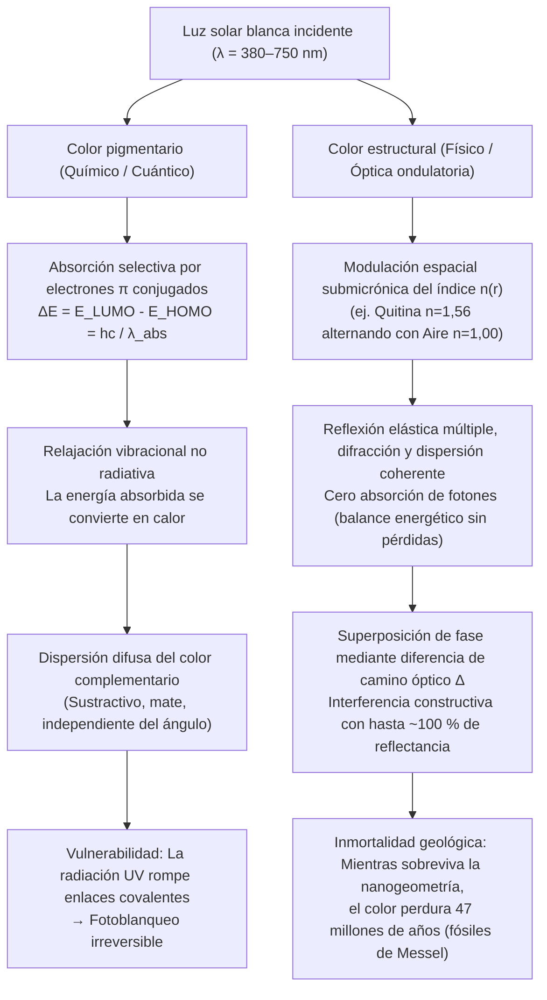
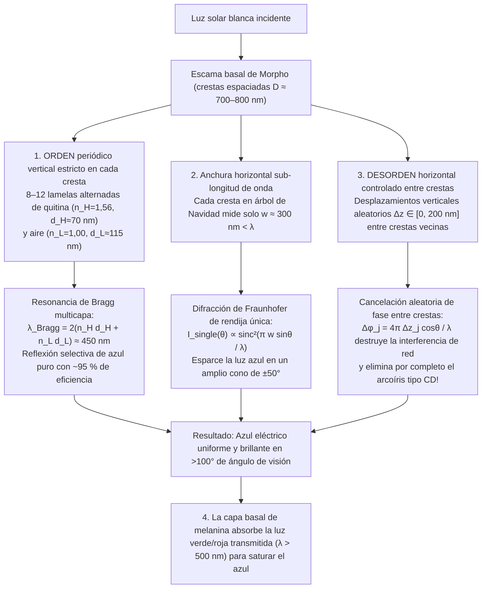

Al volar por el dosel iluminado de las selvas neotropicales, la <strong>mariposa Morpho (*Morpho rhetenor*, *Morpho menelaus* y *Morpho didius*)</strong> despliega un destello azul cobalto metálico y eléctrico tan intenso que los pilotos de avionetas pueden divisarlo desde más de un kilómetro de distancia. En Nara, Japón, el tesoro nacional del siglo VII conocido como el <strong>Santuario Tamamushi (玉虫厨子)</strong> en el templo Hōryū-ji está decorado con los élitros de miles de <strong>escarabajos joya (*Chrysochroa fulgidissima*)</strong>; casi 1.400 años después de su construcción, esas alas de escarabajo siguen brillando con un verde esmeralda y un púrpura dorado intactos. Más asombroso aún: los escarabajos fosilizados excavados en las <strong>lutitas bituminosas del Eoceno de Messel (Alemania), de 47 millones de años de antigüedad</strong>, destellan intensos colores verdes y azules metálicos en el instante en que reciben la luz del sol, a pesar de que la diagénesis ha alterado químicamente sus biomoléculas originales.

Las pinturas ordinarias, los tintes textiles, los pétalos de flores y las hojas de otoño se decoloran inexorablemente bajo la radiación ultravioleta (UV) solar en cuestión de meses o años. ¿Por qué, entonces, las alas de una *Morpho*, el caparazón de un escarabajo joya, el ocelo de una pluma de pavo real (*Pavo cristatus*) o la franja lateral de un tetra neón (*Paracheirodon innesi*) brillan con una intensidad que supera a cualquier pigmento sintético y desafía el tiempo geológico?

Un experimento clásico de laboratorio revela la respuesta. Si tomamos un ala radiante de *Morpho rhetenor*, la colocamos en un mortero de ágata y la trituramos hasta convertirla en polvo fino, <strong>no queda ni un solo grano de polvo azul: en el mortero solo resta un polvo opaco de color marrón oscuro</strong>. O bien, si dejamos el ala intacta y depositamos una gota de acetona o etanol puro (índice de refracción $n \approx 1{,}36$) sobre su superficie, el azul eléctrico desaparece al instante, volviéndose marrón oscuro o verde apagado, solo para resucitar en todo su esplendor azul cobalto tan pronto como el disolvente se evapora.

La conclusión es irrefutable: <strong>el ala de la mariposa *Morpho* no contiene ni un miligramo de pigmento azul</strong>. Su color no surge de la absorción química de fotones, sino de la electrodinámica maxwelliana pura —la <strong>coloración estructural (Structural Coloration)</strong>—, generada cuando biopolímeros transparentes modulan espacialmente el índice de refracción $n(\mathbf{r})$ en la escala de la longitud de onda de la luz visible ($\lambda \approx 380\text{–}750\,\text{nm}$). En este artículo derivamos rigurosamente las cuatro arquitecturas ópticas fundamentales de la naturaleza: <strong>(I) Interferencia de película delgada única</strong>, <strong>(II) Reflectores de Bragg distribuidos multicapa 1D (DBR)</strong>, <strong>(III) La paradoja de la mariposa *Morpho* (cómo el orden vertical y el desorden horizontal eliminan el arcoíris de difracción)</strong> y <strong>(IV) Cristales fotónicos 2D/3D y dispersión coherente amorfa</strong>.

---

## 1. Color pigmentario (Absorción química) vs. Color estructural (Interferencia física)

### 1.1 Color pigmentario: Cromóforos de electrones $\pi$ conjugados y disipación térmica

El verde de la clorofila, el rojo anaranjado de los carotenoides, el púrpura de las antocianinas y el marrón oscuro de la eumelanina son <strong>colores pigmentarios</strong> regidos por la mecánica cuántica molecular. Su rasgo común es un <strong>sistema de electrones $\pi$ conjugados</strong> con enlaces simples ($\sigma$) y dobles ($\sigma + \pi$) alternados. Al aumentar la longitud de conjugación $L$, la deslocalización electrónica estrecha la brecha energética $\Delta E$ entre el <strong>orbital molecular ocupado más alto (HOMO)</strong> y el <strong>orbital molecular desocupado más bajo (LUMO)</strong> hasta el espectro visible ($1{,}65\text{–}3{,}26\,\text{eV}$):

$$
\Delta E = E_{\text{LUMO}} - E_{\text{HOMO}} = h\nu = \frac{hc}{\lambda_{\text{abs}}}
$$

Los fotones de longitud de onda $\lambda_{\text{abs}}$ son absorbidos y su energía se disipa en picosegundos ($10^{-12}\,\text{s}$) en forma de <strong>calor (vibraciones moleculares)</strong>. Nuestro ojo solo percibe la <strong>longitud de onda complementaria</strong> dispersada. Este mecanismo sustractivo sufre de <strong>fotoblanqueo (decoloración)</strong> cuando los fotones UV rompen los enlaces covalentes, además de perder la mayor parte de la energía solar como calor.

### 1.2 Color estructural: Modulación submicrónica del índice de refracción $n(\mathbf{r})$

Por el contrario, el <strong>color estructural</strong> no implica absorción electrónica. Se construye con biomateriales transparentes e incoloros —<strong>quitina ($n \approx 1{,}56$)</strong> en insectos, <strong>$\beta$-queratina ($n \approx 1{,}54\text{–}1{,}58$)</strong> en plumas de aves, <strong>celulosa ($n \approx 1{,}53$)</strong> en plantas o <strong>cristales de guanina ($n \approx 1{,}83$)</strong> en escamas de peces— alternados con <strong>aire ($n = 1{,}00$)</strong> o <strong>citoplasma acuoso ($n \approx 1{,}33$)</strong>. Las ondas electromagnéticas reflejadas en cada interfaz se superponen produciendo <strong>interferencia constructiva</strong> (reflexión sin pérdidas de hasta $\sim 100\,\%$) para longitudes de onda específicas e <strong>interferencia destructiva</strong> para el resto.

Descubierto por <strong>Robert Hooke (1665)</strong> en *Micrographia* al mojar plumas de pavo real, vinculado a los anillos de interferencia por <strong>Isaac Newton (1704)</strong> en *Opticks*, y formalizado por <strong>Thomas Young</strong>, <strong>Augustin-Jean Fresnel</strong> y <strong>Lord Rayleigh (1917)</strong>, este principio explica por qué la acetona ($n = 1{,}36$) apaga el azul de la *Morpho*: al reemplazar el aire ($n = 1{,}00$), colapsa el contraste de índice $\Delta n$ frente a la quitina ($n = 1{,}56$), anulando la reflexión de Fresnel y dejando ver el fondo marrón de melanina.

---

## 2. Arquitectura I: Interferencia de película delgada única e iridiscencia

Las pompas de jabón, las manchas de aceite sobre asfalto mojado y las alas transparentes de dípteros e himenópteros se rigen por la interferencia en una película delgada de espesor $d$ e índice $n_1$ rodeada de aire ($n_0 = n_2 = 1{,}00$).

### 2.1 Derivación de la diferencia de camino óptico y la inversión de fase de $\pi$

Por la <strong>ley de Snell</strong> $n_0 \sin\theta_0 = n_1 \sin\theta_1$, la diferencia de camino óptico geométrica entre el rayo $R_2$ (que se refracta con ángulo $\theta_1$ y se refleja en la cara inferior) y el rayo $R_1$ (reflejado en la cara superior) es:

$$
\Delta_{\text{geom}} = L_2 - L_1 = \frac{2 n_1 d}{\cos\theta_1}\left(1 - \sin^2\theta_1\right) = 2 n_1 d \cos\theta_1
$$

Según los <strong>coeficientes de reflexión de Fresnel</strong> cerca de la incidencia normal, $r_{ij} = \frac{n_i - n_j}{n_i + n_j}$, la reflexión desde un medio de menor índice hacia uno de mayor índice ($n_0 < n_1 \implies r_{01} < 0$) introduce un <strong>salto de fase de $\pi$ radianes (media longitud de onda $\frac{\lambda}{2}$)</strong>, mientras que la reflexión inferior ($n_1 > n_2 \implies r_{12} > 0$) no altera la fase. La <strong>diferencia de camino óptico efectiva total</strong> es:

$$
\Delta_{\text{total}} = 2 n_1 d \cos\theta_1 + \frac{\lambda}{2}
$$

Lo que conduce a las condiciones de interferencia (para $n_0 < n_1 > n_2$):

$$
\begin{aligned}
\text{Interferencia constructiva (Máximos)}: \quad 2 n_1 d \cos\theta_1 &= \left(m - \frac{1}{2}\right)\lambda \quad &(m = 1, 2, 3, \dots) \\
\text{Interferencia destructiva (Mínimos)}: \quad 2 n_1 d \cos\theta_1 &= m\lambda \quad &(m = 0, 1, 2, \dots)
\end{aligned}
$$

Esto explica tanto la <strong>película negra de Newton</strong> justo antes de que estalle una burbuja de jabón ($d \to 0 \implies \Delta_{\text{geom}} \to 0$, donde el desfase $\frac{\lambda}{2}$ produce interferencia destructiva total $m=0$ en todo el espectro visible) como la <strong>iridiscencia (desplazamiento al azul con el ángulo)</strong>: como $\lambda_{\text{peak}}(\theta_1) = 4 n_1 d \cos\theta_1 = \lambda_{\text{peak}}(0)\cos\theta_1$, al observar desde un ángulo más rasante ($\theta_1 \uparrow \implies \cos\theta_1 \downarrow$) el color reflejado se desplaza inevitablemente hacia longitudes de onda más cortas (azul/violeta).

---

## 3. Arquitectura II: Reflectores de Bragg multicapa 1D (DBR) y pilas de cuarto de onda

Como una sola interfaz quitina-aire refleja apenas $R_1 \approx 4{,}8\,\%$, los escarabajos joya (*Chrysochroa*) y los peces plateados apilan $N$ bicapas alternadas de alto índice ($n_H, d_H$) y bajo índice ($n_L, d_L$) formando un <strong>Reflector de Bragg Distribuido (DBR)</strong> gobernado por la <strong>ley de Bragg-Snell</strong>:

$$
m \lambda_{\text{Bragg}} = 2 \left( n_H d_H \cos\theta_H + n_L d_L \cos\theta_L \right) = 2 \left( d_H \sqrt{n_H^2 - \sin^2\theta_0} + d_L \sqrt{n_L^2 - \sin^2\theta_0} \right)
$$

En la condición óptima de <strong>pila de cuarto de onda (Quarter-Wave Stack)</strong>, $n_H d_H = n_L d_L = \frac{\lambda_0}{4}$, las reflexiones de las $2N$ interfaces interfieren constructivamente en fase, y el método de matrices de transferencia (TMM) arroja la reflectancia pico $R_N(\lambda_0)$:

$$
R_N = \left[ \frac{n_0 \left(\frac{n_H}{n_L}\right)^{2N} - n_s}{n_0 \left(\frac{n_H}{n_L}\right)^{2N} + n_s} \right]^2 \xrightarrow{N \gg 1} 100\,\%
$$

* <strong>Cutícula del escarabajo joya (*Chrysochroa fulgidissima*)</strong>: $N \approx 15\text{–}20$ bicapas de quitina con distinta densidad de melanina ($n_H \approx 1{,}68, n_L \approx 1{,}55$) producen un brillo metálico verde-dorado inalterable durante 1.400 años (Santuario Tamamushi).
* <strong>Escamas plateadas de peces y cambio dinámico en el tetra neón</strong>: Los iridóforos de los peces apilan <strong>plaquetas de guanina ($n_H = 1{,}83$)</strong> y <strong>citoplasma ($n_L = 1{,}33$)</strong>, logrando $R > 90\,\%$ con solo 6 periodos. El tetra neón (*Paracheirodon innesi*) y el camaleón pantera (*Furcifer pardalis*) ajustan activamente el espaciado $d_L$ o la inclinación de sus cristales de guanina para desplazar $\lambda_{\text{Bragg}}$ en tiempo real.

---

## 4. Arquitectura III: La paradoja de la mariposa Morpho — Orden vertical y desorden horizontal

Una multicapa plana solo refleja especularmente y cambia de color con el ángulo; por otro lado, una red de difracción periódica con surcos espaciados cada $D \approx 700\,\text{nm}$ debería dispersar la luz blanca en un arcoíris según $D(\sin\theta_i + \sin\theta_m) = m\lambda$, igual que un CD. Sin embargo, el ala de la *Morpho* brilla con un <strong>azul cobalto uniforme a lo largo de un cono visual superior a $100^\circ$ ($\pm 50^\circ$) sin descomponerse en un arcoíris</strong>.

<strong>Shuichi Kinoshita y Shinya Yoshioka</strong> (Universidad de Osaka) descubrieron que las crestas (ridges) de las escamas de *Morpho*, cuya sección transversal parece un <strong>«árbol de Navidad» nanométrico</strong>, combinan cuatro mecanismos ópticos:

1. <strong>Periodicidad vertical</strong>: 6 a 12 lamelas de quitina ($n_H=1{,}56, d_H\approx 72\,\text{nm}$) y aire ($n_L=1{,}00, d_L\approx 113\,\text{nm}$) seleccionan $\lambda_{\text{Bragg}} = 2(n_H d_H + n_L d_L) \approx 450\,\text{nm}$ (azul puro).
2. <strong>Difracción de rendija única por anchura sub-longitud de onda</strong>: Cada cresta de anchura <strong>$w \approx 300\,\text{nm} < \lambda$</strong> difracta el azul según $I_{\text{single}}(\theta) \propto \operatorname{sinc}^2\left(\frac{\pi w \sin\theta}{\lambda}\right)$ a lo largo de más de $\pm 50^\circ$.
3. <strong>Desorden aleatorio de altura $\pm\Delta z_j$</strong>: Las crestas vecinas tienen desfases verticales aleatorios $\Delta z_j \in [0, \lambda/2]$, lo que aleatoriza la fase $\phi_j = \frac{4\pi \Delta z_j \cos\theta}{\lambda}$ y anula los picos de interferencia de red:
   $$
   I_{\text{total}}(\theta) = I_{\text{single}}(\theta) \left\langle \left| \sum_{j=1}^{N_{\text{ridge}}} \exp\left[ i k \left( j D \sin\theta + 2 \Delta z_j \cos\theta \right) \right] \right|^2 \right\rangle \approx N_{\text{ridge}} \, I_{\text{single}}(\theta)
   $$
4. <strong>Absorción basal de melanina</strong>: Los gránulos de melanina en la base absorben la luz verde y roja transmitida ($\lambda > 500\,\text{nm}$), evitando la desaturación por retrodispersión blanca.

---

## 5. Arquitectura IV: Cristales fotónicos 2D/3D y dispersión coherente amorfa

Cuando la permitividad dieléctrica $\varepsilon(\mathbf{r}) = n(\mathbf{r})^2$ varía periódicamente en 2D o 3D ($\varepsilon(\mathbf{r} + \mathbf{R}) = \varepsilon(\mathbf{r})$), las ecuaciones de Maxwell conducen a la <strong>ecuación maestra de autovalores hermitiana</strong> para el campo magnético $\mathbf{H}(\mathbf{r})$ (<strong>Eli Yablonovitch y Sajeev John, 1987</strong>):

$$
\hat{\Theta} \mathbf{H}(\mathbf{r}) \equiv \nabla \times \left( \frac{1}{\varepsilon(\mathbf{r})} \nabla \times \mathbf{H}(\mathbf{r}) \right) = \left(\frac{\omega}{c}\right)^2 \mathbf{H}(\mathbf{r})
$$

Por el <strong>teorema de Bloch</strong> $\mathbf{H}_{\mathbf{k}}(\mathbf{r}) = e^{i\mathbf{k}\cdot\mathbf{r}} \mathbf{u}_{\mathbf{k}}(\mathbf{r})$, la separación entre la <strong>banda dieléctrica ($\omega_-$)</strong> y la <strong>banda de aire ($\omega_+$)</strong> en el borde de la zona de Brillouin ($k = \pm\frac{\pi}{a}$) abre una <strong>brecha de banda fotónica (Photonic Band Gap, PBG)</strong> donde la densidad de estados fotónicos es $\rho(\omega) = 0$ y la luz se refleja al $100\,\%$.

* <strong>Cristales 2D en plumas de pavo real (*Pavo cristatus*)</strong>: Una red 2D de varillas de melanina ($n \approx 2{,}0$) en queratina ($n \approx 1{,}54$) genera azul, verde, amarillo y marrón variando la constante de red $a \approx 140\text{–}165\,\text{nm}$.
* <strong>Cristales giroides 3D en gorgojos joya (*Pachyrhynchus*, *Entimus*) y mariposas (*Callophrys rubi*)</strong>: Sus escamas contienen una red 3D bicontinua <strong>giroide</strong> ($a \approx 300\,\text{nm}$) autoensamblada por las membranas del retículo endoplasmático liso (REL):
  $$
  \sin\left(\frac{2\pi x}{a}\right)\cos\left(\frac{2\pi y}{a}\right) + \sin\left(\frac{2\pi y}{a}\right)\cos\left(\frac{2\pi z}{a}\right) + \sin\left(\frac{2\pi z}{a}\right)\cos\left(\frac{2\pi x}{a}\right) = t
  $$
* <strong>Estructuras fotónicas amorfas en el arrendajo azul (*Cyanocitta cristata*) y el martín pescador</strong>: Richard Prum demostró que la <strong>descomposición espinodal</strong> de la $\beta$-queratina genera una esponja nanoporosa isótropa con orden de corto alcance ($d_0 \approx 180\,\text{nm}$), cuyo espectro de Fourier $|\tilde{\varepsilon}(\mathbf{q})|^2$ forma una capa esférica uniforme de radio $|\mathbf{q}| = q_0 \approx \frac{2\pi}{d_0}$, produciendo un <strong>azul estructural no iridiscente (independiente del ángulo)</strong> por dispersión coherente.

---

## 6. Tablas comparativas: Color pigmentario vs. estructural y las 4 arquitecturas

### Tabla 1: Comparación entre color pigmentario y color estructural

| Propiedad física | Color pigmentario (Absorción química) | Color estructural (Óptica ondulatoria) |
| :--- | :--- | :--- |
| <strong>Mecanismo primario</strong> | Absorción selectiva de fotones ($\Delta E = E_{\text{LUMO}} - E_{\text{HOMO}} = hc/\lambda$) en electrones $\pi$ conjugados | Interferencia, reflexión de Bragg, difracción y dispersión coherente por modulación de $n(\mathbf{r})$ |
| <strong>Balance energético</strong> | La energía absorbida se disipa en <strong>calor</strong> (sustractivo) | <strong>Reflexión elástica sin pérdidas</strong> de hasta $99{,}9\,\%$ |
| <strong>Dependencia angular</strong> | Independiente del ángulo (mate difuso) | <strong>Iridiscente (desplazamiento al azul)</strong> en estructuras periódicas; gran angular o no iridiscente en *Morpho* y estructuras amorfas |
| <strong>Trituración / Disolventes</strong> | El color persiste en polvo o en disolventes | <strong>Al triturar desaparece el color (queda melanina marrón)</strong>; la acetona ($n \approx 1{,}36$) apaga el color al instante |
| <strong>Durabilidad</strong> | <strong>Fotoblanqueo (UV)</strong> en meses o años | <strong>Geológicamente inmortal</strong> (1.400 años en Hōryū-ji; fósiles de Messel de 47 millones de años) |

### Tabla 2: Las cuatro arquitecturas ópticas del color estructural

| Arquitectura | Dimensión y orden | Ecuación / Condición de resonancia | Comportamiento óptico | Ejemplos biológicos |
| :--- | :--- | :--- | :--- | :--- |
| <strong>I. Película delgada única</strong> | 1D monocapa (espesor $d$) | $2 n_1 d \cos\theta_1 = \left(m - \frac{1}{2}\right)\lambda$ | Reflectancia $\sim 15\,\%$; iridiscencia; película negra de Newton para $d \to 0$ | Pompas de jabón, manchas de aceite, cuello de paloma, alas de moscas |
| <strong>II. Multicapa de Bragg (DBR)</strong> | 1D periódico ($N$ bicapas $H/L$) | $m\lambda_{\text{Bragg}} = 2(n_H d_H \cos\theta_H + n_L d_L \cos\theta_L)$ Cuarto de onda: $n_H d_H = n_L d_L = \frac{\lambda_0}{4}$ | $R_N = \left[\frac{n_0(n_H/n_L)^{2N}-n_s}{n_0(n_H/n_L)^{2N}+n_s}\right]^2 \to 100\,\%$; brillo metálico | Escarabajo joya (*Chrysochroa*), escamas de peces (guanina), tetra neón |
| <strong>III. Red jerárquica *Morpho</strong>* | Vertical: lamelas ordenadas Horizontal: $w < \lambda$ + altura aleatoria $\pm\Delta z$ | Vertical: $2(n_H d_H + n_L d_L) \approx 450\,\text{nm}$ Horizontal: $I(\theta) \approx N_{\text{ridge}} \operatorname{sinc}^2\left(\frac{\pi w\sin\theta}{\lambda}\right)$ | El desorden $\Delta z_j$ elimina el arcoíris de red; <strong>azul uniforme en $>100^\circ$</strong> | *Morpho rhetenor*, *Morpho didius*, *Morpho menelaus* |
| <strong>IV-a. Cristales fotónicos 2D/3D</strong> | Red 2D/3D $\varepsilon(\mathbf{r}+\mathbf{R})=\varepsilon(\mathbf{r})$ | $\nabla \times \left(\frac{1}{\varepsilon(\mathbf{r})}\nabla \times \mathbf{H}\right) = \left(\frac{\omega}{c}\right)^2 \mathbf{H}$ | Brecha de banda fotónica ($\rho(\omega)=0$); polarización circular en giroides | Pluma de pavo real (2D), ópalo (3D), gorgojos y *Callophrys rubi* (giroide 3D) |
| <strong>IV-b. Fotónica amorfa</strong> | 3D isótropo de corto alcance (espinodal) | Capa esférica en el espacio de Fourier $|\mathbf{q}| = q_0 \approx \frac{2\pi}{d_0}$ | <strong>No iridiscente (independiente del ángulo)</strong> por dispersión coherente | Arrendajo azul (*Cyanocitta cristata*), martín pescador, guacamayo azul |

---

## 7. Fósiles de 47 millones de años y aplicaciones biomiméticas industriales

Los estudios de <strong>Maria E. McNamara</strong> (2011) sobre escarabajos fósiles de <strong>47 millones de años de Messel</strong> demostraron que la geometría multicapa sobrevive a la fosilización, permitiendo incluso reconstruir el plumaje iridiscente de dinosaurios jurásicos como <strong>*Microraptor</strong>*. Hoy en día, esta física impulsa tecnologías revolucionarias:
1. <strong>Fibras textiles sin teñir *Morfotex</strong>* (Teijin): 61 nanocapas alternadas de poliéster ($n_H=1{,}63$) y nailon ($n_L=1{,}53$) producen tejidos brillantes sin tintes ni aguas residuales.
2. <strong>Pintura automotriz *Structural Blue* de Lexus</strong>: Nanoescamas de 7 capas que reflejan casi el $100\,\%$ de la luz azul frente al $<5\,\%$ de los pigmentos convencionales.
3. <strong>Pantallas MEMS *Mirasol* (IMOD) de Qualcomm</strong>: Cavidades de aire Fabry-Pérot ajustables electrostáticamente que reflejan la luz solar directa sin retroiluminación y logran negro puro en $d \to 0$ (película negra de Newton).
4. <strong>Tintas de seguridad en billetes (OVI) y biosensores de hidrogel</strong>: El desplazamiento angular $\lambda \propto \cos\theta$ impide la falsificación de billetes, mientras que hidrogeles fotónicos 3D cambian de color ante la glucosa o el pH sin usar batería.
5. <strong>Enfriamiento radiativo pasivo diurno (Daytime Radiative Cooling)</strong>: Inspirados en los pelos triangulares de la <strong>hormiga plateada del Sahara (*Cataglyphis bombycina*)</strong>, los metamateriales fotónicos reflejan el $96\,\%$ de la radiación solar ($0{,}3\text{–}2{,}5\,\mu\text{m}$) y emiten calor a través de la ventana infrarroja atmosférica ($8\text{–}13\,\mu\text{m}$) hacia el espacio exterior a $3\,\text{K}$, enfriando edificios de <strong>$5\text{ a }10\,^\circ\text{C}$ por debajo de la temperatura ambiente a pleno sol sin electricidad</strong>.
