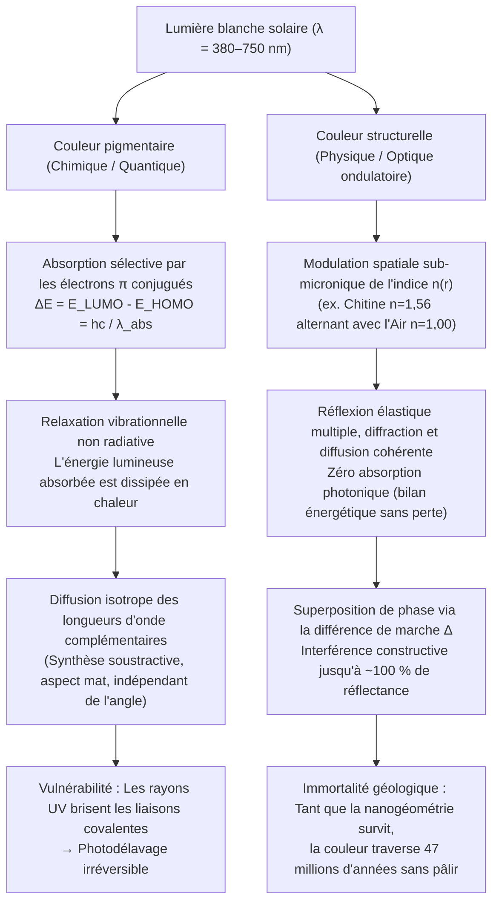
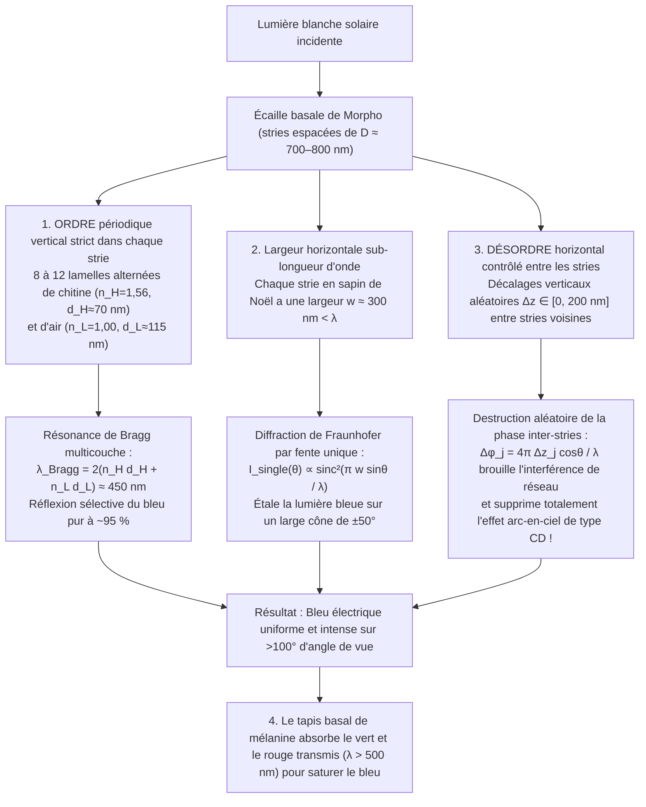

Lorsqu'il plane à travers la canopée ensoleillée des forêts tropicales d'Amérique du Sud, le <strong>papillon Morpho (*Morpho rhetenor*, *Morpho menelaus* et *Morpho didius*)</strong> déploie un bleu de cobalt métallique et électrique si intense que les pilotes d'avion volant à basse altitude peuvent percevoir son éclat à plus d'un kilomètre de distance. Au Japon, dans le temple Hōryū-ji de Nara, le trésor national du VIIe siècle connu sous le nom de <strong>sanctuaire Tamamushi (玉虫厨子)</strong> est orné des élytres de milliers de <strong>buprestes (*Chrysochroa fulgidissima*)</strong> ; près de 1 400 ans après sa création, ces ailes de coléoptères resplendissent toujours d'un vert émeraude et d'un pourpre doré intacts. Plus fascinant encore, des coléoptères fossiles exhumés des <strong>schistes bitumineux éocènes de Messel (Grube Messel)</strong> en Allemagne, vieux de <strong>47 millions d'années</strong>, brillent d'un vert et d'un bleu métalliques éclatants dès qu'ils sont exposés à la lumière, bien que la diagenèse ait chimiquement altéré leurs macromolécules organiques d'origine.

Les peintures ordinaires, les teintures textiles, les pétales de fleurs et les feuilles d'automne pâlissent inexorablement sous l'effet du rayonnement ultraviolet (UV) solaire, victimes du photodélavage en quelques mois ou années. Comment les ailes d'un *Morpho*, la carapace d'un bupreste, l'ocelle d'une plume de paon (*Pavo cristatus*) ou la bande latérale d'un tétra néon (*Paracheirodon innesi*) peuvent-ils surpasser tous les pigments synthétiques et défier les temps géologiques ?

Une expérience de laboratoire classique révèle la clé de l'énigme. Si l'on place une aile éblouissante de *Morpho rhetenor* dans un mortier d'agate et qu'on la réduit en poudre fine, <strong>on n'obtient pas le moindre grain de poudre bleue : il ne reste au fond du mortier qu'une poussière terne d'un brun boueux</strong> ! Ou bien, si l'on dépose sur l'aile intacte une simple goutte d'acétone ou d'éthanol pur (indice de réfraction $n \approx 1{,}36$), le bleu électrique s'évanouit instantanément pour laisser place à un brun sombre ou à un vert terne — avant de renaître dans toute sa splendeur azurée dès que le solvant s'évapore.

La conclusion est formelle : <strong>l'aile du papillon *Morpho* ne contient pas un seul milligramme de pigment bleu</strong>. Sa couleur ne provient pas d'une absorption chimique de photons, mais d'un phénomène pur d'électrodynamique maxwellienne — la <strong>coloration structurelle (Structural Coloration)</strong> — engendré par la modulation spatiale de l'indice de réfraction $n(\mathbf{r})$ de biopolymères transparents à l'échelle de la longueur d'onde de la lumière visible ($\lambda \approx 380\text{–}750\,\text{nm}$). Dans cet article, nous dérivons à partir des premiers principes les quatre grandes architectures optiques du vivant : <strong>(I) l'interférence de couche mince unique</strong>, <strong>(II) les réflecteurs de Bragg distribués multicouches 1D (DBR)</strong>, <strong>(III) le paradoxe du *Morpho* (comment l'ordre vertical et le désordre horizontal abolissent la dispersion arc-en-ciel)</strong> et <strong>(IV) les cristaux photoniques 2D/3D et la diffusion cohérente amorphe</strong>.

---

## 1. Couleur pigmentaire (Absorption chimique) vs Couleur structurelle (Interférence physique)

### 1.1 Couleur pigmentaire : Chromophores à électrons $\pi$ conjugués et dissipation thermique

Le vert de la chlorophylle, l'orange des caroténoïdes, le pourpre des anthocyanes et le brun-noir de l'eumélanine sont des <strong>couleurs pigmentaires</strong> régies par la mécanique quantique moléculaire. Leur motif commun est un <strong>système d'électrons $\pi$ conjugués</strong> alternant liaisons simples ($\sigma$) et doubles ($\sigma + \pi$). À mesure que la longueur de conjugaison $L$ augmente, la délocalisation des électrons $\pi$ réduit l'écart énergétique $\Delta E$ entre l'<strong>orbite moléculaire occupée la plus haute (HOMO)</strong> et l'<strong>orbite moléculaire inoccupée la plus basse (LUMO)</strong> jusqu'au domaine visible ($1{,}65\text{–}3{,}26\,\text{eV}$) :

$$
\Delta E = E_{\text{LUMO}} - E_{\text{HOMO}} = h\nu = \frac{hc}{\lambda_{\text{abs}}}
$$

Un photon de longueur d'onde $\lambda_{\text{abs}}$ est absorbé et son énergie est rapidement convertie en <strong>chaleur (vibrations moléculaires)</strong> par relaxation non radiative en quelques picosecondes ($10^{-12}\,\text{s}$). Notre œil ne perçoit donc que la <strong>couleur complémentaire</strong> diffusée. Ce mécanisme soustractif souffre de deux limites : la rupture des liaisons covalentes par les photons UV (<strong>photoblanchiment</strong>) et la perte énergétique sous forme de chaleur.

### 1.2 Couleur structurelle : Modulation nanométrique de l'indice de réfraction $n(\mathbf{r})$

À l'inverse, la <strong>couleur structurelle</strong> n'implique aucune absorption électronique. Elle repose sur l'assemblage nanométrique de matériaux biologiques transparents — <strong>chitine ($n \approx 1{,}56$)</strong> des insectes, <strong>$\beta$-kératine ($n \approx 1{,}54\text{–}1{,}58$)</strong> des plumes d'oiseaux, <strong>cellulose ($n \approx 1{,}53$)</strong> végétale ou <strong>cristaux de guanine ($n \approx 1{,}83$)</strong> des écailles de poissons — alternant avec des cavités d'<strong>air ($n = 1{,}00$)</strong> ou du <strong>cytoplasme aqueux ($n \approx 1{,}33$)</strong>. À chaque interface diélectrique, les ondes lumineuses subissent des réflexions partielles qui se superposent par <strong>interférence constructive</strong> (réflexion sans perte pouvant atteindre $\sim 100\,\%$) pour certaines longueurs d'onde et par <strong>interférence destructive</strong> pour les autres.

Découverte par <strong>Robert Hooke (1665)</strong> dans *Micrographia* sur les plumes de paon mouillées, reliée aux anneaux d'interférence par <strong>Isaac Newton (1704)</strong> dans *Opticks*, puis formalisée par <strong>Thomas Young</strong>, <strong>Augustin-Jean Fresnel</strong> et <strong>Lord Rayleigh (1917)</strong>, cette physique explique pourquoi l'acétone ($n = 1{,}36$) éteint le bleu du *Morpho* : en remplaçant l'air ($n = 1{,}00$), le liquide annule le contraste d'indice $\Delta n$ avec la chitine ($n = 1{,}56$), supprimant la réflexion de Fresnel et dévoilant le tapis brun de mélanine sous-jacent.

---

## 2. Architecture I : Interférence d'une couche mince unique et loi de l'iridescence

Les bulles de savon, les nappes d'huile sur l'asphalte mouillé, les plumes du cou des pigeons et les ailes transparentes de mouches obéissent à l'interférence d'un film diélectrique mince d'épaisseur $d$ et d'indice $n_1$ plongé dans l'air ($n_0 = n_2 = 1{,}00$).

### 2.1 Dérivation de la différence de marche optique et du déphasage de $\pi$

D'après la <strong>loi de Snell-Descartes</strong> $n_0 \sin\theta_0 = n_1 \sin\theta_1$, la différence de marche purement géométrique entre le rayon $R_2$ (réfléchi sur la face inférieure avec un angle interne $\theta_1$) et le rayon $R_1$ (réfléchi sur la face supérieure) vaut :

$$
\Delta_{\text{geom}} = L_2 - L_1 = \frac{2 n_1 d}{\cos\theta_1}\left(1 - \sin^2\theta_1\right) = 2 n_1 d \cos\theta_1
$$

Or, les <strong>coefficients de réflexion de Fresnel</strong> en incidence quasi normale, $r_{ij} = \frac{n_i - n_j}{n_i + n_j}$, imposent un <strong>déphasage de $\pi$ radians (demi-longueur d'onde $\frac{\lambda}{2}$)</strong> lors d'une réflexion d'un milieu moins réfringent vers un milieu plus réfringent ($n_0 < n_1 \implies r_{01} < 0$), tandis que la réflexion inférieure ($n_1 > n_2 \implies r_{12} > 0$) s'effectue sans déphasage. La <strong>différence de marche totale effective</strong> est donc :

$$
\Delta_{\text{total}} = 2 n_1 d \cos\theta_1 + \frac{\lambda}{2}
$$

d'où découlent les conditions d'interférence (pour $n_0 < n_1 > n_2$) :

$$
\begin{aligned}
\text{Interférence constructive (Maxima)} : \quad 2 n_1 d \cos\theta_1 &= \left(m - \frac{1}{2}\right)\lambda \quad &(m = 1, 2, 3, \dots) \\
\text{Interférence destructive (Minima)} : \quad 2 n_1 d \cos\theta_1 &= m\lambda \quad &(m = 0, 1, 2, \dots)
\end{aligned}
$$

Cette équation explique à la fois le <strong>film noir de Newton</strong> juste avant l'éclatement d'une bulle de savon ($d \to 0 \implies \Delta_{\text{geom}} \to 0$, où le déphasage résiduel de $\frac{\lambda}{2}$ provoque une interférence destructive totale $m=0$ sur tout le spectre visible) et l'<strong>iridescence (décalage vers le bleu / blue-shift à angle rasant)</strong> : comme $\lambda_{\text{peak}}(\theta_1) = 4 n_1 d \cos\theta_1 = \lambda_{\text{peak}}(0)\cos\theta_1$, l'augmentation de l'angle d'observation $\theta_1$ fait décroître $\cos\theta_1$ et décale systématiquement la couleur réfléchie vers les courtes longueurs d'onde (du rouge vers le vert, puis le bleu-violet).

---

## 3. Architecture II : Réflecteurs de Bragg multicouches 1D (DBR) et empilements quart d'onde

Une seule interface chitine-air ne réfléchissant que $R_1 \approx 4{,}8\,\%$, les buprestes (*Chrysochroa*), les papillons *Morpho* et les poissons argentés empilent $N$ bicouches alternées de haut indice ($n_H, d_H$) et de bas indice ($n_L, d_L$) pour former un <strong>réflecteur de Bragg distribué (DBR)</strong> régi par la <strong>loi de Bragg-Snell</strong> :

$$
m \lambda_{\text{Bragg}} = 2 \left( n_H d_H \cos\theta_H + n_L d_L \cos\theta_L \right) = 2 \left( d_H \sqrt{n_H^2 - \sin^2\theta_0} + d_L \sqrt{n_L^2 - \sin^2\theta_0} \right)
$$

Lorsque chaque couche possède une épaisseur optique égale au quart de la longueur d'onde cible (<strong>empilement quart d'onde / Quarter-Wave Stack</strong>, $n_H d_H = n_L d_L = \frac{\lambda_0}{4}$), toutes les réflexions aux $2N$ interfaces s'additionnent exactement en phase ($\pi$). La méthode des matrices de transfert (TMM) donne alors la réflectance maximale $R_N(\lambda_0)$ :

$$
R_N = \left[ \frac{n_0 \left(\frac{n_H}{n_L}\right)^{2N} - n_s}{n_0 \left(\frac{n_H}{n_L}\right)^{2N} + n_s} \right]^2 \xrightarrow{N \gg 1} 100\,\%
$$

* <strong>Cuticule du bupreste (*Chrysochroa fulgidissima*)</strong> : $N \approx 15\text{–}20$ bicouches de chitine riche et pauvre en mélanine ($n_H \approx 1{,}68, n_L \approx 1{,}55$) produisent un éclat métallique vert-or indestructible depuis 1 400 ans (sanctuaire Tamamushi).
* <strong>Écailles argentées des poissons et changement de couleur dynamique du tétra néon</strong> : Les iridophores des poissons pélagiques alternent <strong>plaquettes cristallines de guanine ($n_H = 1{,}83$)</strong> et <strong>cytoplasme ($n_L = 1{,}33$)</strong>, atteignant $R > 90\,\%$ en seulement 6 périodes. Le tétra néon (*Paracheirodon innesi*) et le caméléon panthère (*Furcifer pardalis*) modulent activement l'espacement $d_L$ ou l'inclinaison de leurs nanocristaux de guanine pour faire varier $\lambda_{\text{Bragg}}$ en temps réel !

---

## 4. Architecture III : Le paradoxe du papillon Morpho — L'alliance de l'ordre et du désordre

Un multicouche plan ne réfléchit que dans la direction spéculaire et change fortement de couleur selon l'angle ; quant à un réseau de diffraction périodique d'espacement $D \approx 700\,\text{nm}$, il devrait disperser la lumière blanche en un arc-en-ciel selon $D(\sin\theta_i + \sin\theta_m) = m\lambda$, comme un CD-ROM. Or, l'aile du *Morpho* rayonne d'un <strong>bleu de cobalt uniforme sur un cône angulaire géant dépassant $100^\circ$ ($\pm 50^\circ$) sans aucune dispersion arc-en-ciel</strong> !

Les travaux de <strong>Shuichi Kinoshita et Shinya Yoshioka</strong> (Université d'Osaka) ont démontré que les stries (ridges) des écailles du *Morpho*, en forme de <strong>« sapin de Noël » nanométrique</strong>, combinent quatre mécanismes optiques :

1. <strong>Périodicité verticale stricte</strong> : 6 à 12 lamelles de chitine ($n_H=1{,}56, d_H\approx 72\,\text{nm}$) et d'air ($n_L=1{,}00, d_L\approx 113\,\text{nm}$) sélectionnent $\lambda_{\text{Bragg}} = 2(n_H d_H + n_L d_L) \approx 450\,\text{nm}$ (bleu pur).
2. <strong>Diffraction grand-angle par largeur sub-longueur d'onde</strong> : Chaque strie de largeur <strong>$w \approx 300\,\text{nm} < \lambda$</strong> diffracte le bleu selon $I_{\text{single}}(\theta) \propto \operatorname{sinc}^2\left(\frac{\pi w \sin\theta}{\lambda}\right)$ sur plus de $\pm 50^\circ$.
3. <strong>Désordre vertical aléatoire $\pm\Delta z_j$</strong> : Les stries adjacentes présentent des décalages de hauteur aléatoires $\Delta z_j \in [0, \lambda/2]$, ce qui randomise la phase $\phi_j = \frac{4\pi \Delta z_j \cos\theta}{\lambda}$ et annule les termes croisés d'interférence du réseau :
   $$
   I_{\text{total}}(\theta) = I_{\text{single}}(\theta) \left\langle \left| \sum_{j=1}^{N_{\text{ridge}}} \exp\left[ i k \left( j D \sin\theta + 2 \Delta z_j \cos\theta \right) \right] \right|^2 \right\rangle \approx N_{\text{ridge}} \, I_{\text{single}}(\theta)
   $$
4. <strong>Absorption basale par la mélanine</strong> : Les granules de mélanine à la base de l'écaille absorbent la lumière verte et rouge transmise ($\lambda > 500\,\text{nm}$), maximisant la saturation du bleu.

---

## 5. Architecture IV : Cristaux photoniques 2D/3D et diffusion cohérente amorphe

Lorsque la permittivité diélectrique $\varepsilon(\mathbf{r}) = n(\mathbf{r})^2$ est modulée périodiquement en 2D ou 3D ($\varepsilon(\mathbf{r} + \mathbf{R}) = \varepsilon(\mathbf{r})$), les équations de Maxwell conduisent à l'<strong>équation maîtresse aux valeurs propres hermitienne</strong> pour le champ magnétique $\mathbf{H}(\mathbf{r})$ (<strong>Eli Yablonovitch et Sajeev John, 1987</strong>) :

$$
\hat{\Theta} \mathbf{H}(\mathbf{r}) \equiv \nabla \times \left( \frac{1}{\varepsilon(\mathbf{r})} \nabla \times \mathbf{H}(\mathbf{r}) \right) = \left(\frac{\omega}{c}\right)^2 \mathbf{H}(\mathbf{r})
$$

Par le <strong>théorème de Bloch</strong> $\mathbf{H}_{\mathbf{k}}(\mathbf{r}) = e^{i\mathbf{k}\cdot\mathbf{r}} \mathbf{u}_{\mathbf{k}}(\mathbf{r})$, la séparation entre la <strong>bande diélectrique ($\omega_-$)</strong> (énergie électrique $|\mathbf{E}|^2$ concentrée dans $\varepsilon_H$) et la <strong>bande d'air ($\omega_+$)</strong> (énergie concentrée dans $\varepsilon_L$) au bord de la zone de Brillouin ($k = \pm\frac{\pi}{a}$) ouvre une <strong>bande interdite photonique (Photonic Band Gap, PBG)</strong> où la densité d'états photoniques $\rho(\omega) = 0$ s'annule, entraînant une réflexion omnidirectionnelle de $100\,\%$.

* <strong>Cristaux 2D des plumes de paon (*Pavo cristatus*)</strong> : Un réseau 2D de bâtonnets de mélanine ($n \approx 2{,}0$) dans la kératine ($n \approx 1{,}54$) produit toutes les couleurs de l'ocelle en faisant simplement varier le paramètre de maille $a \approx 140\text{–}165\,\text{nm}$.
* <strong>Cristaux gyroïdes 3D des charançons (*Pachyrhynchus*, *Entimus*) et du papillon *Callophrys rubi</strong>* : Leurs écailles renferment un réseau 3D bicontinu <strong>gyroïde</strong> (surface minimale triplement périodique, $a \approx 300\,\text{nm}$) auto-assemblé à partir des membranes du réticulum endoplasmique lisse (REL) :
  $$
  \sin\left(\frac{2\pi x}{a}\right)\cos\left(\frac{2\pi y}{a}\right) + \sin\left(\frac{2\pi y}{a}\right)\cos\left(\frac{2\pi z}{a}\right) + \sin\left(\frac{2\pi z}{a}\right)\cos\left(\frac{2\pi x}{a}\right) = t
  $$
* <strong>Structures photoniques amorphes (quasi-ordonnées) du Geai bleu (*Cyanocitta cristata*) et du Martin-pêcheur</strong> : Pourquoi leur bleu n'est-il pas iridescent ? Richard Prum a montré que la <strong>décomposition spinodale</strong> de la $\beta$-kératine crée une nanostructure spongieuse isotrope à ordre à courte portée ($d_0 \approx 180\,\text{nm}$), dont le spectre de Fourier $|\tilde{\varepsilon}(\mathbf{q})|^2$ forme une coquille sphérique uniforme de rayon $|\mathbf{q}| = q_0 \approx \frac{2\pi}{d_0}$, produisant une <strong>diffusion cohérente omnidirectionnelle</strong> sans changement de couleur avec l'angle !

---

## 6. Tableaux récapitulatifs : Couleur pigmentaire vs structurelle et les 4 architectures

### Tableau 1 : Comparaison fondamentale entre couleur pigmentaire et couleur structurelle

| Propriété physique | Couleur pigmentaire (Absorption chimique) | Couleur structurelle (Optique ondulatoire) |
| :--- | :--- | :--- |
| <strong>Mécanisme primaire</strong> | Absorption sélective de photons ($\Delta E = E_{\text{LUMO}} - E_{\text{HOMO}} = hc/\lambda$) par des électrons $\pi$ conjugués | Interférence, réflexion de Bragg, diffraction et diffusion cohérente par modulation d'indice $n(\mathbf{r})$ |
| <strong>Bilan énergétique</strong> | L'énergie absorbée est dissipée en <strong>chaleur</strong> (synthèse soustractive) | <strong>Diffusion élastique sans perte</strong> ; réflectance maximale jusqu'à $99{,}9\,\%$ |
| <strong>Dépendance angulaire</strong> | Indépendante de l'angle (aspect mat diffus) | <strong>Iridescente (décalage vers le bleu)</strong> pour les réseaux périodiques ; grand-angle ou non-iridescente (*Morpho*, amorphe) |
| <strong>Broyage / Solvant</strong> | La couleur persiste en poudre ou dans un solvant | <strong>Le broyage détruit la couleur (poudre brune de mélanine)</strong> ; l'acétone ($n \approx 1{,}36$) efface la couleur instantanément |
| <strong>Durabilité</strong> | <strong>Photodélavage (UV)</strong> en quelques mois ou années | <strong>Immortelle à l'échelle géologique</strong> (1 400 ans à Hōryū-ji ; fossiles de Messel de 47 millions d'années) |

### Tableau 2 : Les quatre architectures optiques de la coloration structurelle

| Architecture | Dimension & Ordre | Équation directrice / Condition | Comportement optique | Exemples biologiques |
| :--- | :--- | :--- | :--- | :--- |
| <strong>I. Film mince unique</strong> | 1D monocouche (épaisseur $d$) | $2 n_1 d \cos\theta_1 = \left(m - \frac{1}{2}\right)\lambda$ | Réflectance $\sim 15\,\%$ ; iridescence ; film noir de Newton pour $d \to 0$ | Bulles de savon, nappes d'huile, gorge de pigeon, ailes de mouches |
| <strong>II. Multicouche de Bragg (DBR)</strong> | 1D périodique ($N$ bicouches $H/L$) | $m\lambda_{\text{Bragg}} = 2(n_H d_H \cos\theta_H + n_L d_L \cos\theta_L)$ Quart d'onde : $n_H d_H = n_L d_L = \frac{\lambda_0}{4}$ | $R_N = \left[\frac{n_0(n_H/n_L)^{2N}-n_s}{n_0(n_H/n_L)^{2N}+n_s}\right]^2 \to 100\,\%$ ; éclat métallique | Bupreste (*Chrysochroa*), écailles de poissons (guanine), tétra néon |
| <strong>III. Réseau hiérarchique *Morpho</strong>* | Vertical : lamelles ordonnées Horizontal : $w < \lambda$ + hauteur aléatoire $\pm\Delta z$ | Vertical : $2(n_H d_H + n_L d_L) \approx 450\,\text{nm}$ Horizontal : $I(\theta) \approx N_{\text{ridge}} \operatorname{sinc}^2\left(\frac{\pi w\sin\theta}{\lambda}\right)$ | Le désordre vertical $\Delta z_j$ élimine l'arc-en-ciel du réseau ; <strong>bleu uniforme sur $>100^\circ$</strong> | *Morpho rhetenor*, *Morpho didius*, *Morpho menelaus* |
| <strong>IV-a. Cristaux photoniques 2D/3D</strong> | Réseau 2D/3D $\varepsilon(\mathbf{r}+\mathbf{R})=\varepsilon(\mathbf{r})$ | $\nabla \times \left(\frac{1}{\varepsilon(\mathbf{r})}\nabla \times \mathbf{H}\right) = \left(\frac{\omega}{c}\right)^2 \mathbf{H}$ | Bande interdite photonique ($\rho(\omega)=0$) ; polarisation circulaire (gyroïdes) | Plume de paon (2D), opale (3D), charançons & *Callophrys rubi* (gyroïde 3D) |
| <strong>IV-b. Structures amorphes</strong> | 3D isotrope à courte portée (spinodale) | Coquille sphérique dans l'espace de Fourier $|\mathbf{q}| = q_0 \approx \frac{2\pi}{d_0}$ | <strong>Non-iridescent (indépendant de l'angle)</strong> par diffusion cohérente | Geai bleu (*Cyanocitta cristata*), Martin-pêcheur, Ara bleu |

---

## 7. Fossiles de 47 millions d'années et applications biomimétiques industrielles

Les travaux de <strong>Maria E. McNamara</strong> (2011) sur les coléoptères fossiles de <strong>47 millions d'années de Messel</strong> ont prouvé que l'architecture multicouche survit à la fossilisation, permettant même de reconstruire le plumage iridescent de dinosaures à plumes du Jurassique comme <strong>*Microraptor</strong>*. Aujourd'hui, cette physique révolutionne l'industrie :
1. <strong>Fibres textiles sans teinture *Morfotex</strong>* (Teijin) : 61 nanocouches alternées de polyester ($n_H=1{,}63$) et de nylon ($n_L=1{,}53$) produisent des tissus éclatants sans colorant ni eaux usées.
2. <strong>Peinture automobile *Structural Blue* de Lexus</strong> : Des nano-paillettes à 7 couches réfléchissent près de $100\,\%$ de la lumière bleue contre $<5\,\%$ pour un pigment classique.
3. <strong>Écrans MEMS *Mirasol* (IMOD) de Qualcomm</strong> : Une cavité d'air Fabry-Pérot ajustable électrostatiquement réfléchit le plein soleil sans rétroéclairage et affiche un noir parfait à $d \to 0$ (film noir de Newton).
4. <strong>Encres fiduciaires anti-contrefaçon (OVI) et biocapteurs hydrogels</strong> : Les billets de banque exploitent le décalage angulaire $\lambda \propto \cos\theta$ impossible à photocopier, tandis que des hydrogels photoniques 3D changent de couleur selon le taux de glucose ou le pH sans batterie.
5. <strong>Refroidissement radiatif passif diurne (Daytime Radiative Cooling)</strong> : Inspirés des poils triangulaires de la <strong>fourmi argentée du Sahara (*Cataglyphis bombycina*)</strong>, des métamatériaux photoniques réfléchissent $96\,\%$ du spectre solaire ($0{,}3\text{–}2{,}5\,\mu\text{m}$) tout en émettant de la chaleur dans la fenêtre atmosphérique infrarouge ($8\text{–}13\,\mu\text{m}$) vers l'espace froid à $3\,\text{K}$, abaissant la température des bâtiments de <strong>$5\text{ à }10\,^\circ\text{C}$ sous la température ambiante en plein soleil sans électricité</strong>.
