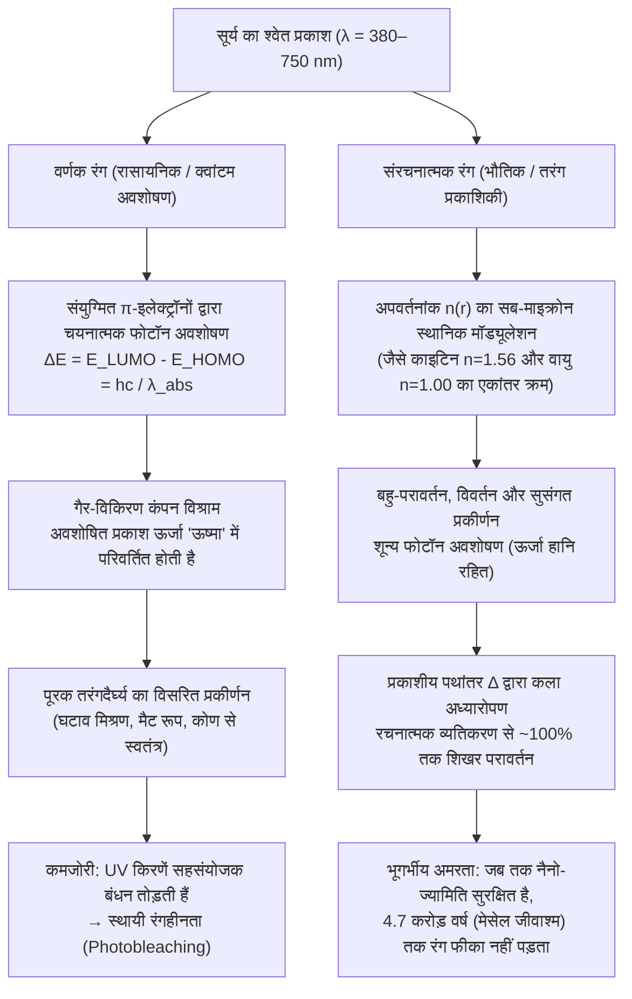
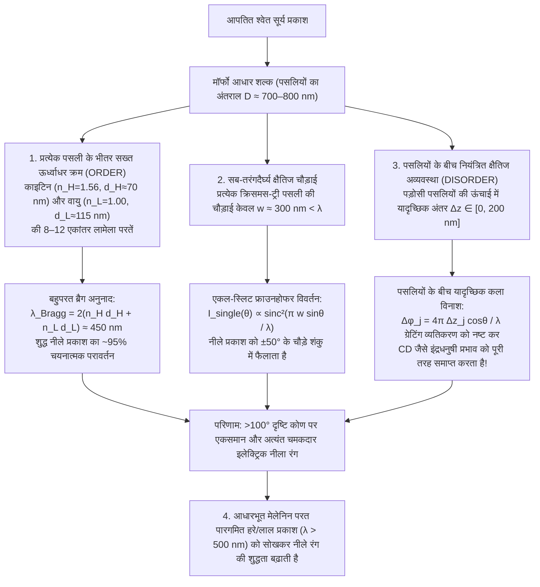

दक्षिण और मध्य अमेरिका के उष्णकटिबंधीय वर्षावनों की धूप से नहाई छतरी (canopy) में उड़ती हुई <strong>मॉर्फो तितली (*Morpho rhetenor*, *Morpho menelaus* और *Morpho didius*)</strong> के पंखों से इतनी तीव्र और धात्विक कोबाल्ट-नीली चमक निकलती है कि कम ऊंचाई पर उड़ने वाले विमानों के पायलट भी इसे एक किलोमीटर दूर से देख सकते हैं। जापान के नारा स्थित होरयू-जी (Hōryū-ji) मंदिर में रखे 7वीं शताब्दी के राष्ट्रीय खजाने <strong>'तामामुशी श्राइन' (玉虫厨子)</strong> को हजारों <strong>ज्वेल बीटल (*Chrysochroa fulgidissima*, जापानी में तामामुशी)</strong> के पंखों (elytra) से सजाया गया है; निर्माण के लगभग 1,400 वर्ष बीत जाने के बाद भी, उन भृंगों के पंखों की पन्ना-हरी (emerald green) और बैंगनी-सुनहरी चमक बिल्कुल फीकी नहीं पड़ी है। इससे भी अधिक आश्चर्यजनक बात यह है कि जर्मनी के <strong>मेसेल पिट (Messel Pit)</strong> की <strong>4.7 करोड़ वर्ष पुरानी इओसीन (Eocene) चट्टानों</strong> से निकाले गए जीवाश्म भृंगों पर जैसे ही धूप पड़ती है, वे तुरंत चमकदार धात्विक हरे और नीले रंग में दमक उठते हैं, भले ही भूगर्भीय प्रक्रियाओं ने उनके मूल जैविक अणुओं को रासायनिक रूप से बदल दिया है।

साधारण पेंट, कपड़ों के रंजक (dyes), फूलों की पंखुड़ियां और पतझड़ के पत्ते सूर्य की पराबैंगनी (UV) किरणों के संपर्क में आने पर कुछ महीनों या वर्षों में प्रकाश-रासायनिक विरंजन (*photobleaching*) के कारण फीके पड़ जाते हैं। फिर मॉर्फो तितली के पंख, ज्वेल बीटल का कवच, मोर (*Pavo cristatus*) के पंख का 'आंख' वाला पैटर्न, या नियॉन टेट्रा मछली (*Paracheirodon innesi*) की चमकदार पट्टी किसी भी कृत्रिम वर्णक को मात देते हुए करोड़ों वर्षों तक कैसे चमक सकती है?

एक क्लासिक प्रयोगशाला प्रयोग इस रहस्य से पर्दा उठाता है। यदि हम *Morpho rhetenor* तितली के अत्यंत चमकीले नीले पंख को अगेट खरल (mortar) में डालकर बारीक पीस लें, तो <strong>नीले पाउडर का एक भी कण प्राप्त नहीं होता; खरल में केवल कीचड़ जैसी मटमैली गहरी भूरी धूल बचती है</strong>! या फिर, पंख को बिना कोई नुकसान पहुंचाए उस पर शुद्ध एसीटोन या इथेनॉल (अपवर्तनांक $n \approx 1.36$) की एक बूंद डालें: जैसे ही तरल सूक्ष्म शल्कों (scales) के भीतर प्रवेश करता है, बिजली जैसा नीला रंग जादू की तरह गायब हो जाता है और गहरा भूरा या मटमैला हरा दिखने लगता है — लेकिन जैसे ही एसीटोन वाष्पित होकर सूखता है, वह अद्भुत कोबाल्ट-नीला रंग पूरी चमक के साथ वापस लौट आता है।

निष्कर्ष स्पष्ट है: <strong>मॉर्फो तितली के पंख में नीला वर्णक (Blue Pigment) एक मिलीग्राम भी नहीं होता</strong>। इसका रंग फोटॉनों के रासायनिक अवशोषण से नहीं, बल्कि मैक्सवेल के विद्युत-गतिकी (Maxwellian electrodynamics) के शुद्ध भौतिक प्रभाव — <strong>संरचनात्मक रंजन (Structural Coloration)</strong> — से उत्पन्न होता है, जब पारदर्शी जैव-बहुलक दृश्य प्रकाश की तरंगदैर्घ्य ($\lambda \approx 380\text{–}750\,\text{nm}$) के पैमाने पर अपवर्तनांक $n(\mathbf{r})$ को स्थानिक रूप से मॉड्यूलेट करते हैं। इस लेख में हम प्रकृति के चार मूलभूत प्रकाशीय स्थापत्यों का गणितीय व्युत्पन्न करेंगे: <strong>(I) एकल पतली-फिल्म व्यतिकरण</strong>, <strong>(II) एक-आयामी बहुपरत ब्रैग परावर्तक (DBR)</strong>, <strong>(III) मॉर्फो तितली विरोधाभास (ऊर्ध्वाधर क्रम और क्षैतिज अव्यवस्था का संगम)</strong>, तथा <strong>(IV) 2D/3D फोटोनिक क्रिस्टल और अक्रिस्टलीय सुसंगत प्रकीर्णन</strong>।

---

## 1. वर्णक रंग (रासायनिक अवशोषण) बनाम संरचनात्मक रंग (भौतिक तरंग व्यतिकरण)

### 1.1 वर्णक रंग (Pigmentary Color): संयुग्मित $\pi$-इलेक्ट्रॉन क्रोमोफोर और ऊष्मीय क्षय

पत्तियों के क्लोरोफिल का हरा रंग, गाजर और फ्लेमिंगो के कैरोटीनॉयड का नारंगी-लाल रंग, जामुन के एंथोसायनिन का बैंगनी रंग और त्वचा व बालों के मेलेनिन का काला-भूरा रंग सभी <strong>वर्णक रंग</strong> हैं जो आणविक क्वांटम यांत्रिकी द्वारा शासित होते हैं। इन अणुओं की मूल विशेषता एकांतर एकल ($\sigma$) और द्वि-बंध ($\sigma + \pi$) वाली <strong>संयुग्मित $\pi$-इलेक्ट्रॉन प्रणाली (Conjugated $\pi$-electron system)</strong> है। जैसे-जैसे संयुग्मन लंबाई $L$ बढ़ती है, $\pi$-इलेक्ट्रॉनों का विस्थानीकरण <strong>उच्चतम अधिकृत आणविक कक्षक (HOMO)</strong> और <strong>निम्नतम रिक्त आणविक कक्षक (LUMO)</strong> के बीच ऊर्जा अंतराल $\Delta E$ को घटाकर दृश्य स्पेक्ट्रम ($1.65\text{–}3.26\,\text{eV}$) में ले आता है:

$$
\Delta E = E_{\text{LUMO}} - E_{\text{HOMO}} = h\nu = \frac{hc}{\lambda_{\text{abs}}}
$$

$\lambda_{\text{abs}}$ तरंगदैर्घ्य का फोटॉन अवशोषित होता है और उसकी ऊर्जा पिकोसेकंड ($10^{-12}\,\text{s}$) में गैर-विकिरण कंपन विश्राम द्वारा <strong>ऊष्मा (आणविक कंपन)</strong> में बदल जाती है। हमारी आंखें केवल बचे हुए <strong>पूरक रंग (Complementary Color)</strong> का विसरित प्रकीर्णन देखती हैं। इस घटाव (subtractive) प्रक्रिया की दो बड़ी सीमाएं हैं: सूर्य की उच्च-ऊर्जा UV किरणें सहसंयोजक बंधनों को तोड़कर रंग को स्थायी रूप से उड़ा देती हैं (<strong>फोटोब्लीचिंग</strong>), और अधिकांश प्रकाश ऊर्जा ऊष्मा के रूप में नष्ट हो जाती है।

### 1.2 संरचनात्मक रंग (Structural Color): अपवर्तनांक $n(\mathbf{r})$ का सब-माइक्रोन मॉड्यूलेशन

इसके विपरीत, <strong>संरचनात्मक रंग</strong> में कोई इलेक्ट्रॉनिक अवशोषण नहीं होता। यह रंगहीन, पारदर्शी जैव-पदार्थों — कीटों के <strong>काइटिन (Chitin, $n \approx 1.56$)</strong>, पक्षियों के पंखों के <strong>$\beta$-केराटिन ($n \approx 1.54\text{–}1.58$)</strong>, पौधों के <strong>सेल्यूलोज ($n \approx 1.53$)</strong>, या मछली के शल्कों के <strong>गुआनिन क्रिस्टल ($n \approx 1.83$)</strong> — तथा उनके बीच भरी <strong>वायु ($n = 1.00$)</strong> या <strong>कोशिका द्रव्य ($n \approx 1.33$)</strong> के नैनो-स्तरीय संयोजन से बनता है। प्रत्येक परावैद्युत (dielectric) सीमा पर परावर्तित होने वाली विद्युत-चुंबकीय तरंगें अध्यारोपण के सिद्धांत के अनुसार विशिष्ट तरंगदैर्घ्य के लिए <strong>रचनात्मक व्यतिकरण (Constructive Interference, $\sim 100\,\%$ तक बिना ऊर्जा हानि के परावर्तन)</strong> और अन्य के लिए <strong>विनाशकारी व्यतिकरण (Destructive Interference)</strong> उत्पन्न करती हैं।

<strong>रॉबर्ट हुक (1665)</strong> द्वारा *Micrographia* में मोरपंख पर पानी डालने के प्रयोग, <strong>आइजैक न्यूटन (1704)</strong> के *Opticks* में पतली फिल्म के छल्लों (Newton's rings), और आगे चलकर <strong>थॉमस यंग</strong>, <strong>फ्रेनेल</strong> तथा <strong>लॉर्ड रेले (1917)</strong> के सिद्धांतों ने यह स्पष्ट कर दिया कि मॉर्फो पंख पर एसीटोन ($n = 1.36$) डालने पर वायु ($n = 1.00$) का स्थान तरल ले लेता है, जिससे काइटिन ($n = 1.56$) के साथ अपवर्तनांक अंतर $\Delta n$ लगभग समाप्त हो जाता है और नीचे की भूरी मेलेनिन परत दिखाई देने लगती है।

---

## 2. स्थापत्य I: एकल पतली-फिल्म व्यतिकरण और इंद्रधनुषी नीला-विस्थापन (Iridescence)

साबुन के बुलबुले, गीली सड़क पर तेल की परत और मक्खियों के पारदर्शी पंख $d$ मोटाई और $n_1$ अपवर्तनांक वाली एकल पतली फिल्म के व्यतिकरण पर आधारित हैं जिसके दोनों ओर वायु ($n_0 = n_2 = 1.00$) होती है।

### 2.1 प्रकाशीय पथांतर (OPD) और $\pi$ कला-परिवर्तन का व्युत्पन्न

<strong>स्नेल के नियम (Snell's Law)</strong> $n_0 \sin\theta_0 = n_1 \sin\theta_1$ के अनुसार, निचली सतह से परावर्तित किरण $R_2$ और ऊपरी सतह से परावर्तित किरण $R_1$ के बीच शुद्ध <strong>ज्यामितीय प्रकाशीय पथांतर</strong>:

$$
\Delta_{\text{geom}} = L_2 - L_1 = \frac{2 n_1 d}{\cos\theta_1}\left(1 - \sin^2\theta_1\right) = 2 n_1 d \cos\theta_1
$$

लंबवत आपतन के निकट <strong>फ्रेनेल परावर्तन गुणांक</strong> $r_{ij} = \frac{n_i - n_j}{n_i + n_j}$ के अनुसार, विरल से सघन माध्यम ($n_0 < n_1 \implies r_{01} < 0$) में परावर्तन पर <strong>$\pi$ रेडियन (अर्थात आधी तरंगदैर्घ्य $\frac{\lambda}{2}$) का कला-उलटाव (phase shift)</strong> होता है, जबकि निचली सतह ($n_1 > n_2 \implies r_{12} > 0$) पर कोई कला परिवर्तन नहीं होता। अतः <strong>कुल प्रभावी पथांतर</strong>:

$$
\Delta_{\text{total}} = 2 n_1 d \cos\theta_1 + \frac{\lambda}{2}
$$

इससे व्यतिकरण की शर्तें ($n_0 < n_1 > n_2$ के लिए) प्राप्त होती हैं:

$$
\begin{aligned}
\text{रचनात्मक व्यतिकरण (दीप्त शिखर)}: \quad 2 n_1 d \cos\theta_1 &= \left(m - \frac{1}{2}\right)\lambda \quad &(m = 1, 2, 3, \dots) \\
\text{विनाशकारी व्यतिकरण (अदीप्त न्यूनतम)}: \quad 2 n_1 d \cos\theta_1 &= m\lambda \quad &(m = 0, 1, 2, \dots)
\end{aligned}
$$

यह समीकरण साबुन के बुलबुले के फूटने से ठीक पहले बनने वाली <strong>न्यूटन की काली फिल्म (Newton's black film)</strong> ($d \to 0 \implies \Delta_{\text{geom}} \to 0$, जहां $\frac{\lambda}{2}$ कलांतर के कारण सभी दृश्य तरंगदैर्घ्य पर $m=0$ विनाशकारी व्यतिकरण होता है और फिल्म काली दिखती है) तथा <strong>कोण के साथ नीला-विस्थापन (Iridescence / Blue-shift)</strong> दोनों की व्याख्या करता है: क्योंकि $\lambda_{\text{peak}}(\theta_1) = 4 n_1 d \cos\theta_1 = \lambda_{\text{peak}}(0)\cos\theta_1$, देखने का कोण $\theta_1$ बढ़ने पर $\cos\theta_1$ घटता है और रंग हमेशा छोटी तरंगदैर्घ्य (नीले/बैंगनी) की ओर खिसकता है।

---

## 3. स्थापत्य II: 1D बहुपरत ब्रैग परावर्तक (DBR) और चौथाई-तरंग स्टैक

चूंकि एकल काइटिन-वायु सतह केवल $R_1 \approx 4.8\,\%$ प्रकाश परावर्तित करती है, इसलिए ज्वेल बीटल (*Chrysochroa*) और रुपहली मछलियां उच्च अपवर्तनांक ($n_H, d_H$) और निम्न अपवर्तनांक ($n_L, d_L$) की $N$ द्वि-परतें चढ़ाकर <strong>वितरित ब्रैग परावर्तक (DBR)</strong> बनाती हैं, जो <strong>ब्रैग-स्नेल नियम</strong> का पालन करता है:

$$
m \lambda_{\text{Bragg}} = 2 \left( n_H d_H \cos\theta_H + n_L d_L \cos\theta_L \right) = 2 \left( d_H \sqrt{n_H^2 - \sin^2\theta_0} + d_L \sqrt{n_L^2 - \sin^2\theta_0} \right)
$$

<strong>चौथाई-तरंग स्टैक (Quarter-Wave Stack)</strong> की शर्त $n_H d_H = n_L d_L = \frac{\lambda_0}{4}$ पर सभी $2N$ सतहों से परावर्तित तरंगें समान कला में जुड़ती हैं, और ट्रांसफर-मैट्रिक्स विधि (TMM) से शिखर परावर्तकता $R_N(\lambda_0)$ प्राप्त होती है:

$$
R_N = \left[ \frac{n_0 \left(\frac{n_H}{n_L}\right)^{2N} - n_s}{n_0 \left(\frac{n_H}{n_L}\right)^{2N} + n_s} \right]^2 \xrightarrow{N \gg 1} 100\,\%
$$

* <strong>ज्वेल बीटल (*Chrysochroa fulgidissima*) का कवच</strong>: मेलेनिन-युक्त काइटिन ($n_H \approx 1.68$) और कम-मेलेनिन काइटिन ($n_L \approx 1.55$) की $N \approx 15\text{–}20$ परतें धात्विक सुनहरा-हरा रंग बनाती हैं जो 1,400 वर्षों (तामामुशी श्राइन) से अटल है।
* <strong>मछलियों के चांदी जैसे शल्क और नियॉन टेट्रा का गतिशील रंग परिवर्तन</strong>: मछलियों की इरिडोफोर कोशिकाएं <strong>गुआनिन क्रिस्टल प्लेटलेट्स ($n_H = 1.83$)</strong> और <strong>कोशिका द्रव्य ($n_L = 1.33$)</strong> को केवल 6 आवर्तों में सजाकर $R > 90\,\%$ परावर्तन प्राप्त करती हैं। नियॉन टेट्रा (*Paracheirodon innesi*) और पैंथर गिरगिट (*Furcifer pardalis*) गुआनिन क्रिस्टलों के बीच की दूरी $d_L$ या झुकाव कोण को बदलकर वास्तविक समय में अपना रंग बदलते हैं!

---

## 4. स्थापत्य III: मॉर्फो तितली विरोधाभास — क्रम और अव्यवस्था मिलकर इंद्रधनुष को कैसे मिटाते हैं?

एक समतल बहुपरत दर्पण केवल दर्पण कोण पर चमकता है और कोण बदलने पर रंग बदलता है; वहीं $D \approx 700\,\text{nm}$ अंतराल वाला आवधिक विवर्तन ग्रेटिंग (diffraction grating) कॉम्पैक्ट डिस्क (CD) की तरह श्वेत प्रकाश को $D(\sin\theta_i + \sin\theta_m) = m\lambda$ के अनुसार इंद्रधनुषी रंगों में बांट देगा। किंतु *Morpho* तितली का पंख <strong>$100^\circ$ ($\pm 50^\circ$) से अधिक के विशाल कोण पर बिना इंद्रधनुष बने एकसमान चमकीला कोबाल्ट-नीला</strong> दिखाई देता है!

ओसाका विश्वविद्यालय के <strong>शुइची किनोशिता और शिन्या योशिओका</strong> ने खोजा कि मॉर्फो शल्क की पसलियां (ridges), जिनका अनुप्रस्थ काट नैनो-स्तरीय <strong>'क्रिसमस ट्री'</strong> जैसा दिखता है, चार प्रकाशीय तंत्रों को जोड़ती हैं:

1. <strong>ऊर्ध्वाधर आवधिकता</strong>: 6 से 12 काइटिन ($n_H=1.56, d_H\approx 72\,\text{nm}$) और वायु ($n_L=1.00, d_L\approx 113\,\text{nm}$) की परतें केवल $\lambda_{\text{Bragg}} = 2(n_H d_H + n_L d_L) \approx 450\,\text{nm}$ (शुद्ध नीला) परावर्तित करती हैं।
2. <strong>सब-तरंगदैर्घ्य चौड़ाई से चौड़े कोण का एकल-स्लिट विवर्तन</strong>: प्रत्येक पसली की चौड़ाई <strong>$w \approx 300\,\text{nm} < \lambda$</strong> होने से यह $I_{\text{single}}(\theta) \propto \operatorname{sinc}^2\left(\frac{\pi w \sin\theta}{\lambda}\right)$ के अनुसार नीले प्रकाश को $\pm 50^\circ$ से अधिक कोण पर फैलाती है।
3. <strong>पसलियों की यादृच्छिक ऊंचाई $\pm\Delta z_j$</strong>: पड़ोसी पसलियां ऊर्ध्वाधर रूप से $\Delta z_j \in [0, \lambda/2]$ द्वारा अनियमित रूप से ऊपर-नीचे होती हैं, जिससे कला $\phi_j = \frac{4\pi \Delta z_j \cos\theta}{\lambda}$ यादृच्छिक हो जाती है और बहु-स्लिट ग्रेटिंग के इंद्रधनुषी शिखर नष्ट हो जाते हैं:
   $$
   I_{\text{total}}(\theta) = I_{\text{single}}(\theta) \left\langle \left| \sum_{j=1}^{N_{\text{ridge}}} \exp\left[ i k \left( j D \sin\theta + 2 \Delta z_j \cos\theta \right) \right] \right|^2 \right\rangle \approx N_{\text{ridge}} \, I_{\text{single}}(\theta)
   $$
4. <strong>आधारभूत मेलेनिन अवशोषण</strong>: शल्क के तल में स्थित मेलेनिन कण पारगमित हरे और लाल प्रकाश ($\lambda > 500\,\text{nm}$) को सोख लेते हैं, जिससे सफेद प्रकीर्णन नहीं होता।

---

## 5. स्थापत्य IV: 2D/3D फोटोनिक क्रिस्टल और अक्रिस्टलीय सुसंगत प्रकीर्णन

जब परावैद्युतांक $\varepsilon(\mathbf{r}) = n(\mathbf{r})^2$ दो या तीन आयामों में आवधिक रूप से बदलता है ($\varepsilon(\mathbf{r} + \mathbf{R}) = \varepsilon(\mathbf{r})$), तो मैक्सवेल के समीकरण चुंबकीय क्षेत्र $\mathbf{H}(\mathbf{r})$ के लिए <strong>हर्मिटियन मास्टर आइगेनवैल्यू समीकरण</strong> देते हैं (<strong>एली याब्लोनोविच और सजीव जॉन, 1987</strong>):

$$
\hat{\Theta} \mathbf{H}(\mathbf{r}) \equiv \nabla \times \left( \frac{1}{\varepsilon(\mathbf{r})} \nabla \times \mathbf{H}(\mathbf{r}) \right) = \left(\frac{\omega}{c}\right)^2 \mathbf{H}(\mathbf{r})
$$

<strong>ब्लॉख के प्रमेय (Bloch's Theorem)</strong> $\mathbf{H}_{\mathbf{k}}(\mathbf{r}) = e^{i\mathbf{k}\cdot\mathbf{r}} \mathbf{u}_{\mathbf{k}}(\mathbf{r})$ के अनुसार, ब्रिलुआन क्षेत्र की सीमा ($k = \pm\frac{\pi}{a}$) पर <strong>डाइइलेक्ट्रिक बैंड ($\omega_-$)</strong> और <strong>एयर बैंड ($\omega_+$)</strong> के बीच <strong>फोटोनिक बैंड गैप (Photonic Band Gap, PBG)</strong> खुलता है जहां फोटोनिक अवस्था घनत्व $\rho(\omega) = 0$ होता है और प्रकाश $100\,\%$ परावर्तित हो जाता है।

* <strong>मोरपंख (*Pavo cristatus*) में 2D फोटोनिक क्रिस्टल</strong>: केराटिन ($n \approx 1.54$) में मेलेनिन छड़ों ($n \approx 2.0$) का 2D जालक केवल जालक स्थिरांक $a \approx 140\text{–}165\,\text{nm}$ बदलकर नीला, हरा, पीला और भूरा रंग बनाता है।
* <strong>ज्वेल वीविल (*Pachyrhynchus*, *Entimus*) और *Callophrys rubi* तितली में 3D जायरॉइड (Gyroid) क्रिस्टल</strong>: इनके शल्कों में चिकनी अंतर्द्रव्यी जालिका (SER) की झिल्लियों के स्व-संयोजन से बना 3D द्वि-सतत <strong>जायरॉइड नेटवर्क</strong> ($a \approx 300\,\text{nm}$) होता है:
  $$
  \sin\left(\frac{2\pi x}{a}\right)\cos\left(\frac{2\pi y}{a}\right) + \sin\left(\frac{2\pi y}{a}\right)\cos\left(\frac{2\pi z}{a}\right) + \sin\left(\frac{2\pi z}{a}\right)\cos\left(\frac{2\pi x}{a}\right) = t
  $$
* <strong>ब्लू जे (*Cyanocitta cristata*) और किंगफिशर में अक्रिस्टलीय फोटोनिक संरचनाएं</strong>: रिचर्ड प्रम ने सिद्ध किया कि $\beta$-केराटिन के <strong>स्पिनोडल अपघटन (Spinodal Decomposition)</strong> से लघु-परास क्रम ($d_0 \approx 180\,\text{nm}$) वाला समदैशिक नैनो-स्पंज बनता है, जिसका फूरियर पावर स्पेक्ट्रम $|\tilde{\varepsilon}(\mathbf{q})|^2$ त्रिज्या $|\mathbf{q}| = q_0 \approx \frac{2\pi}{d_0}$ का एकसमान गोलीय कोश बनाता है और सुसंगत प्रकीर्णन द्वारा <strong>कोण-स्वतंत्र (गैर-इंद्रधनुषी) नीला रंग</strong> देता है।

---

## 6. तुलनात्मक सारणियां: वर्णक बनाम संरचनात्मक रंग और 4 प्रकाशीय स्थापत्य

### सारणी 1: वर्णक रंग और संरचनात्मक रंग की मूलभूत तुलना

| भौतिक गुण | वर्णक रंग (रासायनिक अवशोषण) | संरचनात्मक रंग (तरंग प्रकाशिकी) |
| :--- | :--- | :--- |
| <strong>मुख्य तंत्र</strong> | संयुग्मित $\pi$-इलेक्ट्रॉनों द्वारा चयनात्मक फोटॉन अवशोषण ($\Delta E = E_{\text{LUMO}} - E_{\text{HOMO}} = hc/\lambda$) | अपवर्तनांक $n(\mathbf{r})$ के मॉड्यूलेशन से व्यतिकरण, ब्रैग परावर्तन, विवर्तन और सुसंगत प्रकीर्णन |
| <strong>ऊर्जा संतुलन</strong> | अवशोषित ऊर्जा <strong>ऊष्मा</strong> में बदल जाती है (घटाव रंग) | <strong>बिना ऊर्जा हानि के प्रत्यास्थ परावर्तन</strong> ($99.9\,\%$ तक) |
| <strong>कोण निर्भरता</strong> | कोण से स्वतंत्र (मैट विसरित) | आवधिक संरचनाओं में <strong>इंद्रधनुषी नीला-विस्थापन</strong>; *Morpho* और अक्रिस्टलीय संरचनाओं में चौड़े कोण या कोण-स्वतंत्र |
| <strong>पीसना / विलायक</strong> | पाउडर या विलायक में रंग बना रहता है | <strong>पीसने पर रंग समाप्त (भूरा मेलेनिन बचता है)</strong>; एसीटोन ($n \approx 1.36$) तुरंत रंग मिटा देता है |
| <strong>स्थायित्व और आयु</strong> | महीनों या वर्षों में <strong>UV फोटोब्लीचिंग</strong> | <strong>भूगर्भीय रूप से अमर</strong> (1,400 वर्ष पुराना तामामुशी श्राइन; 4.7 करोड़ वर्ष पुराने मेसेल जीवाश्म) |

### सारणी 2: जैविक संरचनात्मक रंग के चार प्रकाशीय स्थापत्य

| स्थापत्य | आयाम और क्रम | नियंत्रक समीकरण / अनुनाद शर्त | प्रकाशीय व्यवहार | जैविक उदाहरण |
| :--- | :--- | :--- | :--- | :--- |
| <strong>I. एकल पतली फिल्म</strong> | 1D एकल परत (मोटाई $d$) | $2 n_1 d \cos\theta_1 = \left(m - \frac{1}{2}\right)\lambda$ | परावर्तन $\sim 15\,\%$; इंद्रधनुषी बदलाव; $d \to 0$ पर न्यूटन की काली फिल्म | साबुन के बुलबुले, तेल की परत, कबूतर की गर्दन के पंख, मक्खी के पंख |
| <strong>II. बहुपरत ब्रैग परावर्तक (DBR)</strong> | 1D आवधिक ($N$ द्वि-परतें $H/L$) | $m\lambda_{\text{Bragg}} = 2(n_H d_H \cos\theta_H + n_L d_L \cos\theta_L)$ चौथाई तरंग: $n_H d_H = n_L d_L = \frac{\lambda_0}{4}$ | $R_N = \left[\frac{n_0(n_H/n_L)^{2N}-n_s}{n_0(n_H/n_L)^{2N}+n_s}\right]^2 \to 100\,\%$; धात्विक चमक | ज्वेल बीटल (*Chrysochroa*), मछली के शल्क (गुआनिन), नियॉन टेट्रा |
| <strong>III. *Morpho* पदानुक्रमित ग्रेटिंग</strong> | ऊर्ध्वाधर: क्रमिक लामेला क्षैतिज: $w < \lambda$ + यादृच्छिक ऊंचाई $\pm\Delta z$ | ऊर्ध्वाधर: $2(n_H d_H + n_L d_L) \approx 450\,\text{nm}$ क्षैतिज: $I(\theta) \approx N_{\text{ridge}} \operatorname{sinc}^2\left(\frac{\pi w\sin\theta}{\lambda}\right)$ | यादृच्छिक ऊंचाई $\Delta z_j$ ग्रेटिंग इंद्रधनुष को मिटाती है; <strong>$>100^\circ$ पर एकसमान नीला</strong> | *Morpho rhetenor*, *Morpho didius*, *Morpho menelaus* |
| <strong>IV-a. 2D/3D फोटोनिक क्रिस्टल</strong> | 2D/3D जालक $\varepsilon(\mathbf{r}+\mathbf{R})=\varepsilon(\mathbf{r})$ | $\nabla \times \left(\frac{1}{\varepsilon(\mathbf{r})}\nabla \times \mathbf{H}\right) = \left(\frac{\omega}{c}\right)^2 \mathbf{H}$ | फोटोनिक बैंड गैप ($\rho(\omega)=0$); जायरॉइड में वृत्तीय ध्रुवण | मोरपंख (2D), ओपल (3D), वीविल भृंग और *Callophrys rubi* (3D जायरॉइड) |
| <strong>IV-b. अक्रिस्टलीय फोटोनिक्स</strong> | 3D समदैशिक लघु-परास क्रम (स्पिनोडल) | फूरियर स्पेस में गोलीय कोश $|\mathbf{q}| = q_0 \approx \frac{2\pi}{d_0}$ | सुसंगत प्रकीर्णन द्वारा <strong>गैर-इंद्रधनुषी (कोण-स्वतंत्र)</strong> रंग | ब्लू जे (*Cyanocitta cristata*), किंगफिशर, नीला मकाउ |

---

## 7. 4.7 करोड़ वर्ष पुराने जीवाश्म और बायोमिमेटिक औद्योगिक क्रांति

<strong>मारिया मैकनमारा (Maria E. McNamara, 2011)</strong> द्वारा <strong>मेसेल पिट के 4.7 करोड़ वर्ष पुराने भृंग जीवाश्मों</strong> के अध्ययन ने साबित किया कि नैनो-स्तरीय बहुपरत ज्यामिति जीवाश्मीकरण के बाद भी सुरक्षित रहती है, जिससे वैज्ञानिकों ने 15 करोड़ वर्ष पुराने जुरासिक पंख वाले डायनासोर <strong>*Microraptor</strong>* के इंद्रधनुषी रंगों का भी पुनर्निर्माण किया है। आज यह भौतिकी अत्याधुनिक उद्योगों को बदल रही है:
1. <strong>बिना रंगाई वाला *Morfotex* कपड़ा फाइबर</strong> (Teijin): पॉलिएस्टर ($n_H=1.63$) और नायलॉन ($n_L=1.53$) की 61 एकांतर नैनो-परतें बिना एक बूंद डाई या दूषित पानी के कभी न फीका पड़ने वाला कपड़ा बनाती हैं।
2. <strong>लेक्सस (Lexus) का *Structural Blue* ऑटोमोटिव पेंट</strong>: 7-परत वाले नैनो-फ्लेक्स आपतित नीले प्रकाश का लगभग $100\,\%$ परावर्तित करते हैं (साधारण पेंट में $<5\,\%$)।
3. <strong>क्वालकॉम *Mirasol* (IMOD) MEMS डिस्प्ले</strong>: स्थिरवैद्युत रूप से नियंत्रित फैब्री-पेरो वायु अंतराल $d$ सीधी धूप में बिना बैकलाइट के चमकदार रंग और $d \to 0$ (न्यूटन की काली फिल्म) पर पूर्ण काला रंग देता है।
4. <strong>जालसाजी-रोधी बैंकनोट स्याही (OVI) और हाइड्रोजेल बायोसेंसर</strong>: कोण के साथ रंग बदलने वाली स्याही ($\lambda \propto \cos\theta$) नोटों की नकल रोकती है, जबकि 3D फोटोनिक हाइड्रोजेल बिना बैटरी के ग्लूकोज या pH बदलने पर रंग बदलकर रोगों की जांच करते हैं।
5. <strong>बिना बिजली के दिन के समय विकिरण शीतलन (Daytime Radiative Cooling)</strong>: <strong>सहारा की सिल्वर चींटी (*Cataglyphis bombycina*)</strong> के त्रिकोणीय बालों से प्रेरित फोटोनिक मेटामटेरियल $96\,\%$ सौर विकिरण ($0.3\text{–}2.5\,\mu\text{m}$) को परावर्तित करते हैं और मध्य-अवरक्त वायुमंडलीय खिड़की ($8\text{–}13\,\mu\text{m}$) के माध्यम से सीधे $3\,\text{K}$ के बाह्य अंतरिक्ष में ऊष्मा उत्सर्जित करके, भरी दुपहरी में <strong>बिना बिजली खर्च किए इमारतों को परिवेश के तापमान से $5\text{–}10\,^\circ\text{C}$ तक ठंडा रखते हैं</strong>।
