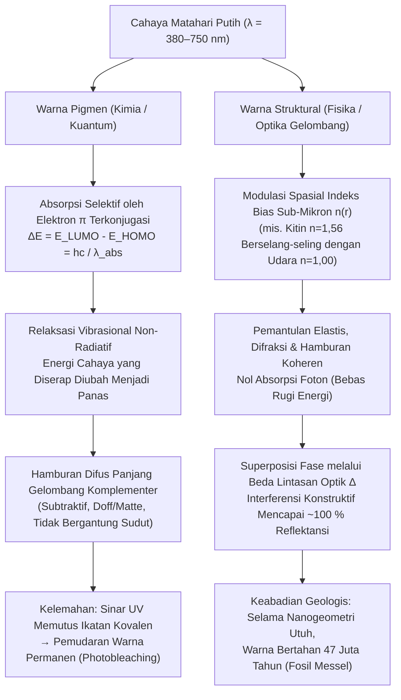
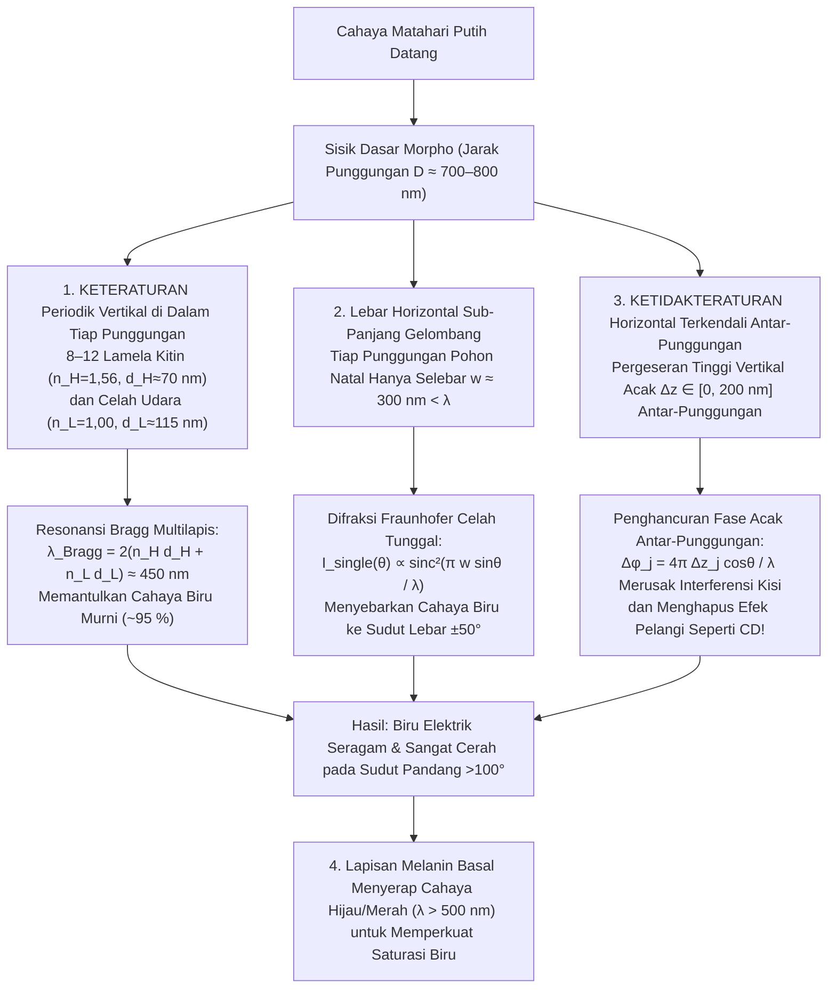

Saat melayang menembus kanopi hutan hujan Neotropis yang bermandikan cahaya matahari, <strong>kupu-kupu Morpho (*Morpho rhetenor*, *Morpho menelaus*, dan *Morpho didius*)</strong> memancarkan kilau biru kobalt metalik yang begitu menyilaukan hingga pilot pesawat terbang rendah dapat melihatnya dari jarak lebih dari satu kilometer. Di kuil Hōryū-ji di Nara, Jepang, harta nasional abad ke-7 yang dikenal sebagai <strong>Kuil Tamamushi (玉虫厨子)</strong> dihiasi dengan ribuan sayap keras (elitera) <strong>kumbang permata (*Chrysochroa fulgidissima*)</strong>; hampir 1.400 tahun setelah dibuat, sayap kumbang tersebut masih memancarkan kilau hijau zamrud dan ungu keemasan yang tak pudar. Lebih menakjubkan lagi, fosil kumbang berusia <strong>47 juta tahun dari serpih minyak Eosen di Messel Pit</strong>, Jerman, langsung memancarkan warna hijau dan biru metalik cemerlang begitu terkena cahaya matahari, meskipun proses diagenesis telah mengubah susunan kimia makromolekul aslinya.

Cat biasa, pewarna tekstil, kelopak bunga, dan dedaunan musim gugur memudar dengan cepat di bawah radiasi ultraviolet (UV) matahari akibat pemutihan fotokimia (*photobleaching*). Mengapa sayap *Morpho*, cangkang kumbang permata, pola mata pada bulu merak (*Pavo cristatus*), atau garis menyala pada ikan neon tetra (*Paracheirodon innesi*) mampu mengungguli pigmen sintetis dan bertahan melintasi waktu geologis?

Sebuah eksperimen laboratorium klasik mengungkap jawabannya. Jika kita mengambil sehelai sayap *Morpho rhetenor* yang biru menyilaukan, memasukkannya ke dalam lumpang batu akik, lalu menggerusnya hingga menjadi bubuk halus, <strong>tidak ada satu butir pun bubuk biru yang tersisa; yang tertinggal hanyalah debu cokelat tua yang kusam seperti lumpur</strong>! Atau biarkan sayap tersebut utuh, lalu teteskan satu tetes aseton atau etanol murni (indeks bias $n \approx 1{,}36$) ke permukaannya. Begitu cairan meresap ke celah sisik mikroskopisnya, warna biru elektrik itu lenyap seketika menjadi cokelat gelap atau hijau kusam — namun begitu aseton menguap, warna biru kobalt yang memukau itu hidup kembali tanpa cacat.

Kesimpulannya mutlak: <strong>sayap kupu-kupu *Morpho* sama sekali tidak mengandung satu miligram pun pigmen biru</strong>. Warnanya bukan berasal dari penyerapan foton secara kimiawi, melainkan murni fenomena elektrodinamika Maxwell — <strong>pewarnaan struktural (Structural Coloration)</strong> — yang dihasilkan ketika biopolimer transparan memodulasi indeks bias $n(\mathbf{r})$ secara spasial pada skala panjang gelombang cahaya tampak ($\lambda \approx 380\text{–}750\,\text{nm}$). Dalam artikel ini, kita menurunkan secara matematis empat arsitektur optik utama di alam: <strong>(I) Interferensi Lapisan Tipis Tunggal</strong>, <strong>(II) Reflektor Bragg Terdistribusi Multilapis 1D (DBR)</strong>, <strong>(III) Paradoks Kupu-Kupu *Morpho* (sinergi keteraturan vertikal dan ketidakteraturan horizontal)</strong>, serta <strong>(IV) Kristal Fotonik 2D/3D dan Hamburan Koheren Amorf</strong>.

---

## 1. Warna Pigmen (Absorpsi Kimia) vs. Warna Struktural (Interferensi Fisika)

### 1.1 Warna Pigmen: Kromofor Elektron $\pi$ Terkonjugasi dan Disipasi Termal

Hijau klorofil, jingga-merah karotenoid, ungu antosianin, dan cokelat-hitam eumelanin adalah <strong>warna pigmen</strong> yang diatur oleh mekanika kuantum molekuler. Ciri utamanya adalah <strong>sistem elektron $\pi$ terkonjugasi</strong> dengan ikatan tunggal ($\sigma$) dan rangkap ($\sigma + \pi$) berselang-seling. Semakin panjang rantai konjugasi $L$, delokalisasi elektron mempersempit celah energi $\Delta E$ antara <strong>Orbital Molekul Terisi Tertinggi (HOMO)</strong> dan <strong>Orbital Molekul Kosong Terendah (LUMO)</strong> hingga masuk ke spektrum tampak ($1{,}65\text{–}3{,}26\,\text{eV}$):

$$
\Delta E = E_{\text{LUMO}} - E_{\text{HOMO}} = h\nu = \frac{hc}{\lambda_{\text{abs}}}
$$

Foton dengan panjang gelombang $\lambda_{\text{abs}}$ diserap dan energinya diubah dalam waktu pikodetik ($10^{-12}\,\text{s}$) menjadi <strong>panas (getaran molekul)</strong> melalui relaksasi non-radiatif. Mata kita hanya menerima <strong>warna komplementer</strong> yang dihamburkan secara difus. Mekanisme subtraktif ini memiliki dua kelemahan: foton UV berenergi tinggi memutus ikatan kovalen (<strong>photobleaching / pemudaran warna</strong>) dan sebagian besar energi cahaya terbuang menjadi panas.

### 1.2 Warna Struktural: Modulasi Indeks Bias Sub-Mikron $n(\mathbf{r})$

Sebaliknya, <strong>warna struktural</strong> tidak melibatkan absorpsi elektronik sama sekali. Ia dibangun dari biomaterial transparan tak berwarna — <strong>kitin ($n \approx 1{,}56$)</strong> pada serangga, <strong>$\beta$-keratin ($n \approx 1{,}54\text{–}1{,}58$)</strong> pada bulu burung, <strong>selulosa ($n \approx 1{,}53$)</strong> pada tumbuhan, atau <strong>kristal guanin ($n \approx 1{,}83$)</strong> pada sisik ikan — yang berselang-seling dengan <strong>udara ($n = 1{,}00$)</strong> atau <strong>sitoplasma berair ($n \approx 1{,}33$)</strong>. Gelombang elektromagnetik yang dipantulkan di setiap antarmuka mengalami superposisi fase, menghasilkan <strong>interferensi konstruktif</strong> (pemantulan tanpa rugi-rugi hingga $\sim 100\,\%$) untuk panjang gelombang tertentu dan <strong>interferensi destruktif</strong> untuk panjang gelombang lainnya.

Diamati pertama kali oleh <strong>Robert Hooke (1665)</strong> dalam *Micrographia* pada bulu merak yang dibasahi air, dihubungkan dengan cincin interferensi oleh <strong>Isaac Newton (1704)</strong> dalam *Opticks*, dan diformulasikan oleh <strong>Thomas Young</strong>, <strong>Augustin-Jean Fresnel</strong>, serta <strong>Lord Rayleigh (1917)</strong>, prinsip ini menjelaskan mengapa aseton ($n = 1{,}36$) menghapus warna biru *Morpho*: cairan menggantikan udara ($n = 1{,}00$), menghilangkan kontras indeks bias $\Delta n$ terhadap kitin ($n = 1{,}56$), mematikan pantulan Fresnel, dan memperlihatkan lapisan dasar melanin yang berwarna cokelat gelap.

---

## 2. Arsitektur I: Interferensi Lapisan Tipis Tunggal dan Hukum Iridesensi

Gelembung sabun, lapisan minyak di atas aspal basah, dan sayap transparan lalat maupun tawon diatur oleh interferensi pada lapisan tipis setebal $d$ dengan indeks bias $n_1$ yang dikelilingi udara ($n_0 = n_2 = 1{,}00$).

### 2.1 Penurunan Beda Lintasan Optik (OPD) dan Pembalikan Fase $\pi$

Berdasarkan <strong>Hukum Snellius</strong> $n_0 \sin\theta_0 = n_1 \sin\theta_1$, beda lintasan optik geometris antara sinar $R_2$ (yang dibiaskan dengan sudut $\theta_1$ dan dipantulkan oleh permukaan bawah) dan sinar $R_1$ (dipantulkan oleh permukaan atas) adalah:

$$
\Delta_{\text{geom}} = L_2 - L_1 = \frac{2 n_1 d}{\cos\theta_1}\left(1 - \sin^2\theta_1\right) = 2 n_1 d \cos\theta_1
$$

Berdasarkan <strong>koefisien refleksi Fresnel</strong> di dekat sudut datang normal, $r_{ij} = \frac{n_i - n_j}{n_i + n_j}$, pemantulan dari medium renggang ke medium rapat ($n_0 < n_1 \implies r_{01} < 0$) menghasilkan <strong>lompatan fase sebesar $\pi$ radian (setengah panjang gelombang $\frac{\lambda}{2}$)</strong>, sedangkan pemantulan di batas bawah ($n_1 > n_2 \implies r_{12} > 0$) tidak mengalami perubahan fase. Maka <strong>beda lintasan optik efektif total</strong> adalah:

$$
\Delta_{\text{total}} = 2 n_1 d \cos\theta_1 + \frac{\lambda}{2}
$$

Sehingga diperoleh syarat interferensi (untuk $n_0 < n_1 > n_2$):

$$
\begin{aligned}
\text{Interferensi Konstruktif (Maksimum)}: \quad 2 n_1 d \cos\theta_1 &= \left(m - \frac{1}{2}\right)\lambda \quad &(m = 1, 2, 3, \dots) \\
\text{Interferensi Destruktif (Minimum)}: \quad 2 n_1 d \cos\theta_1 &= m\lambda \quad &(m = 0, 1, 2, \dots)
\end{aligned}
$$

Persamaan ini menjelaskan fenomena <strong>lapisan hitam Newton (Newton's black film)</strong> sesaat sebelum gelembung sabun pecah ($d \to 0 \implies \Delta_{\text{geom}} \to 0$, di mana pergeseran $\frac{\lambda}{2}$ menyebabkan interferensi destruktif total $m=0$ di seluruh spektrum tampak) serta <strong>iridesensi (pergeseran biru / blue-shift terhadap sudut pandang)</strong>: karena $\lambda_{\text{peak}}(\theta_1) = 4 n_1 d \cos\theta_1 = \lambda_{\text{peak}}(0)\cos\theta_1$, memperbesar sudut pandang ($\theta_1 \uparrow \implies \cos\theta_1 \downarrow$) pasti menggeser warna pantulan ke panjang gelombang yang lebih pendek (biru/ungu).

---

## 3. Arsitektur II: Reflektor Bragg Multilapis 1D (DBR) dan Tumpukan Seperempat Gelombang

Karena satu antarmuka kitin-udara hanya memantulkan $R_1 \approx 4{,}8\,\%$, kumbang permata (*Chrysochroa*) dan ikan keperakan menumpuk $N$ pasang lapisan indeks tinggi ($n_H, d_H$) dan indeks rendah ($n_L, d_L$) membentuk <strong>Distributed Bragg Reflector (DBR)</strong> yang memenuhi <strong>Hukum Bragg-Snellius</strong>:

$$
m \lambda_{\text{Bragg}} = 2 \left( n_H d_H \cos\theta_H + n_L d_L \cos\theta_L \right) = 2 \left( d_H \sqrt{n_H^2 - \sin^2\theta_0} + d_L \sqrt{n_L^2 - \sin^2\theta_0} \right)
$$

Pada kondisi <strong>tumpukan seperempat gelombang (Quarter-Wave Stack)</strong>, $n_H d_H = n_L d_L = \frac{\lambda_0}{4}$, pantulan dari seluruh $2N$ antarmuka berinterferensi konstruktif secara sefase, dan metode matriks transfer (TMM) memberikan reflektansi puncak $R_N(\lambda_0)$:

$$
R_N = \left[ \frac{n_0 \left(\frac{n_H}{n_L}\right)^{2N} - n_s}{n_0 \left(\frac{n_H}{n_L}\right)^{2N} + n_s} \right]^2 \xrightarrow{N \gg 1} 100\,\%
$$

* <strong>Kutikula Kumbang Permata (*Chrysochroa fulgidissima*)</strong>: $N \approx 15\text{–}20$ pasang lapisan kitin kaya-melanin ($n_H \approx 1{,}68$) dan miskin-melanin ($n_L \approx 1{,}55$) menghasilkan kilau logam hijau-emas yang bertahan 1.400 tahun (Kuil Tamamushi).
* <strong>Sisik Perak Ikan dan Perubahan Warna Dinamis Neon Tetra</strong>: Iridofor ikan menumpuk <strong>kepingan kristal guanin ($n_H = 1{,}83$)</strong> dan <strong>sitoplasma ($n_L = 1{,}33$)</strong>, mencapai $R > 90\,\%$ hanya dengan 6 periode. Ikan neon tetra (*Paracheirodon innesi*) dan bunglon panther (*Furcifer pardalis*) secara aktif mengubah jarak $d_L$ atau kemiringan nanokristal guanin untuk menggeser $\lambda_{\text{Bragg}}$ secara nyata!

---

## 4. Arsitektur III: Paradoks Kupu-Kupu Morpho — Sinergi Keteraturan dan Ketidakteraturan

Cermin multilapis datar hanya memantulkan cahaya pada sudut spekular dan berubah warna drastis terhadap sudut; sebaliknya, kisi difraksi periodik dengan jarak alur $D \approx 700\,\text{nm}$ seharusnya memecah cahaya putih menjadi pelangi sesuai $D(\sin\theta_i + \sin\theta_m) = m\lambda$ seperti kepingan CD. Namun sayap *Morpho* memancarkan <strong>warna biru kobalt yang seragam pada kerucut sudut pandang sangat lebar melebihi $100^\circ$ ($\pm 50^\circ$) tanpa terurai menjadi pelangi</strong>!

Fisikawan <strong>Shuichi Kinoshita dan Shinya Yoshioka</strong> (Universitas Osaka) menemukan bahwa punggungan (*ridges*) sisik *Morpho* yang penampang melintangnya menyerupai <strong>pohon Natal berskala nano</strong> menggabungkan empat mekanisme optik:

1. <strong>Periodisitas Vertikal</strong>: 6–12 lamela kitin ($n_H=1{,}56, d_H\approx 72\,\text{nm}$) dan udara ($n_L=1{,}00, d_L\approx 113\,\text{nm}$) memilih $\lambda_{\text{Bragg}} = 2(n_H d_H + n_L d_L) \approx 450\,\text{nm}$ (biru murni).
2. <strong>Difraksi Celah Tunggal Sub-Panjang Gelombang</strong>: Tiap punggungan selebar <strong>$w \approx 300\,\text{nm} < \lambda$</strong> mendifraksikan cahaya biru menurut $I_{\text{single}}(\theta) \propto \operatorname{sinc}^2\left(\frac{\pi w \sin\theta}{\lambda}\right)$ hingga lebih dari $\pm 50^\circ$.
3. <strong>Ketidakteraturan Tinggi Acak $\pm\Delta z_j$</strong>: Punggungan yang berdampingan memiliki perbedaan tinggi vertikal acak $\Delta z_j \in [0, \lambda/2]$ yang mengacak fase $\phi_j = \frac{4\pi \Delta z_j \cos\theta}{\lambda}$ dan melenyapkan puncak pelangi kisi difraksi:
   $$
   I_{\text{total}}(\theta) = I_{\text{single}}(\theta) \left\langle \left| \sum_{j=1}^{N_{\text{ridge}}} \exp\left[ i k \left( j D \sin\theta + 2 \Delta z_j \cos\theta \right) \right] \right|^2 \right\rangle \approx N_{\text{ridge}} \, I_{\text{single}}(\theta)
   $$
4. <strong>Absorpsi Melanin Basal</strong>: Butiran melanin di dasar sisik menyerap cahaya hijau dan merah yang diteruskan ($\lambda > 500\,\text{nm}$), mencegah pemudaran saturasi biru.

---

## 5. Arsitektur IV: Kristal Fotonik 2D/3D dan Hamburan Koheren Amorf

Ketika permitivitas dielektrik $\varepsilon(\mathbf{r}) = n(\mathbf{r})^2$ bervariasi secara periodik dalam 2D atau 3D ($\varepsilon(\mathbf{r} + \mathbf{R}) = \varepsilon(\mathbf{r})$), persamaan Maxwell menghasilkan <strong>persamaan nilai eigen utama Hermitean</strong> untuk medan magnet $\mathbf{H}(\mathbf{r})$ (<strong>Eli Yablonovitch & Sajeev John, 1987</strong>):

$$
\hat{\Theta} \mathbf{H}(\mathbf{r}) \equiv \nabla \times \left( \frac{1}{\varepsilon(\mathbf{r})} \nabla \times \mathbf{H}(\mathbf{r}) \right) = \left(\frac{\omega}{c}\right)^2 \mathbf{H}(\mathbf{r})
$$

Melalui <strong>Teorema Bloch</strong> $\mathbf{H}_{\mathbf{k}}(\mathbf{r}) = e^{i\mathbf{k}\cdot\mathbf{r}} \mathbf{u}_{\mathbf{k}}(\mathbf{r})$, pemisahan antara <strong>pita dielektrik ($\omega_-$)</strong> dan <strong>pita udara ($\omega_+$)</strong> di tepi zona Brillouin ($k = \pm\frac{\pi}{a}$) membuka <strong>Celah Pita Fotonik (Photonic Band Gap, PBG)</strong> di mana rapat keadaan fotonik $\rho(\omega) = 0$ dan cahaya dipantulkan $100\,\%$.

* <strong>Kristal Fotonik 2D Bulu Merak (*Pavo cristatus*)</strong>: Kisi 2D batang melanin ($n \approx 2{,}0$) dalam matriks keratin ($n \approx 1{,}54$) menghasilkan warna biru, hijau, kuning, dan cokelat hanya dengan mengubah konstanta kisi $a \approx 140\text{–}165\,\text{nm}$.
* <strong>Kristal Giroid 3D Kumbang Moncong (*Pachyrhynchus*, *Entimus*) dan Kupu-Kupu *Callophrys rubi</strong>*: Sisiknya berisi jaringan 3D bikontinu <strong>giroid</strong> ($a \approx 300\,\text{nm}$) yang dirakit mandiri oleh membran retikulum endoplasma halus (SER):
  $$
  \sin\left(\frac{2\pi x}{a}\right)\cos\left(\frac{2\pi y}{a}\right) + \sin\left(\frac{2\pi y}{a}\right)\cos\left(\frac{2\pi z}{a}\right) + \sin\left(\frac{2\pi z}{a}\right)\cos\left(\frac{2\pi x}{a}\right) = t
  $$
* <strong>Struktur Fotonik Amorf pada Burung Blue Jay (*Cyanocitta cristata*) dan Raja Udang</strong>: Richard Prum membuktikan bahwa <strong>dekomposisi spinodal</strong> $\beta$-keratin membentuk spons nanopori isotropik berorde jarak pendek ($d_0 \approx 180\,\text{nm}$), yang spektrum daya Fouriernya $|\tilde{\varepsilon}(\mathbf{q})|^2$ membentuk kulit bola seragam berjari-jari $|\mathbf{q}| = q_0 \approx \frac{2\pi}{d_0}$, menghasilkan <strong>warna biru struktural non-iridesen (tidak berubah terhadap sudut pandang)</strong> melalui hamburan koheren.

---

## 6. Tabel Perbandingan: Warna Pigmen vs. Struktural dan 4 Arsitektur Optik

### Tabel 1: Perbandingan Warna Pigmen dan Warna Struktural

| Sifat Fisika | Warna Pigmen (Absorpsi Kimia) | Warna Struktural (Optika Gelombang) |
| :--- | :--- | :--- |
| <strong>Mekanisme Utama</strong> | Absorpsi foton selektif ($\Delta E = E_{\text{LUMO}} - E_{\text{HOMO}} = hc/\lambda$) pada elektron $\pi$ terkonjugasi | Interferensi, refleksi Bragg, difraksi, dan hamburan koheren oleh modulasi $n(\mathbf{r})$ |
| <strong>Neraca Energi</strong> | Energi yang diserap diubah menjadi <strong>panas</strong> (subtraktif) | <strong>Pemantulan elastis tanpa rugi energi</strong> hingga $99{,}9\,\%$ |
| <strong>Ketergantungan Sudut</strong> | Tidak bergantung sudut (matte/doff difus) | <strong>Iridesen (pergeseran biru)</strong> pada struktur periodik; sudut lebar atau non-iridesen pada *Morpho* dan amorf |
| <strong>Penggerusan / Pelarut</strong> | Warna bertahan dalam bubuk atau pelarut | <strong>Digerus warna hilang (tersisa melanin cokelat)</strong>; aseton ($n \approx 1{,}36$) menghapus warna seketika |
| <strong>Daya Tahan</strong> | <strong>Pemudaran UV (Photobleaching)</strong> dalam bulan/tahun | <strong>Abadi secara geologis</strong> (1.400 tahun Kuil Tamamushi; fosil Messel 47 juta tahun) |

### Tabel 2: Empat Arsitektur Optik Warna Struktural di Alam

| Arsitektur | Dimensi & Orde | Persamaan / Syarat Resonansi | Perilaku Optik | Contoh Biologis |
| :--- | :--- | :--- | :--- | :--- |
| <strong>I. Lapisan Tipis Tunggal</strong> | 1D satu lapis (tebal $d$) | $2 n_1 d \cos\theta_1 = \left(m - \frac{1}{2}\right)\lambda$ | Reflektansi $\sim 15\,\%$; iridesensi; lapisan hitam Newton saat $d \to 0$ | Gelembung sabun, lapisan minyak, bulu leher merpati, sayap lalat |
| <strong>II. Multilapis Bragg (DBR)</strong> | 1D periodik ($N$ dwilapis $H/L$) | $m\lambda_{\text{Bragg}} = 2(n_H d_H \cos\theta_H + n_L d_L \cos\theta_L)$ Seperempat gelombang: $n_H d_H = n_L d_L = \frac{\lambda_0}{4}$ | $R_N = \left[\frac{n_0(n_H/n_L)^{2N}-n_s}{n_0(n_H/n_L)^{2N}+n_s}\right]^2 \to 100\,\%$; kilau logam | Kumbang permata (*Chrysochroa*), sisik ikan (guanin), neon tetra |
| <strong>III. Kisi Hierarkis *Morpho</strong>* | Vertikal: lamela teratur Horizontal: $w < \lambda$ + tinggi acak $\pm\Delta z$ | Vertikal: $2(n_H d_H + n_L d_L) \approx 450\,\text{nm}$ Horizontal: $I(\theta) \approx N_{\text{ridge}} \operatorname{sinc}^2\left(\frac{\pi w\sin\theta}{\lambda}\right)$ | Tinggi acak $\Delta z_j$ menghapus pelangi kisi; <strong>biru seragam pada $>100^\circ$</strong> | *Morpho rhetenor*, *Morpho didius*, *Morpho menelaus* |
| <strong>IV-a. Kristal Fotonik 2D/3D</strong> | Kisi 2D/3D $\varepsilon(\mathbf{r}+\mathbf{R})=\varepsilon(\mathbf{r})$ | $\nabla \times \left(\frac{1}{\varepsilon(\mathbf{r})}\nabla \times \mathbf{H}\right) = \left(\frac{\omega}{c}\right)^2 \mathbf{H}$ | Celah pita fotonik ($\rho(\omega)=0$); polarisasi melingkar pada giroid | Bulu merak (2D), opal (3D), kumbang moncong & *Callophrys rubi* (giroid 3D) |
| <strong>IV-b. Fotonik Amorf</strong> | 3D isotropik orde pendek (spinodal) | Kulit bola di ruang Fourier $|\mathbf{q}| = q_0 \approx \frac{2\pi}{d_0}$ | <strong>Non-iridesen (bebas sudut)</strong> melalui hamburan koheren | Blue Jay (*Cyanocitta cristata*), raja udang, burung makaw biru |

---

## 7. Fosil 47 Juta Tahun dan Rekayasa Biomimetika Industri

Penelitian <strong>Maria E. McNamara</strong> (2011) terhadap fosil kumbang berusia <strong>47 juta tahun dari Messel Pit</strong> membuktikan bahwa geometri multilapis bertahan melampaui proses fosilisasi, bahkan memungkinkan rekonstruksi bulu iridesen dinosaurus Jurassic seperti <strong>*Microraptor</strong>*. Kini, fisika warna struktural melahirkan teknologi masa depan:
1. <strong>Serat Tekstil Tanpa Pewarna *Morfotex</strong>* (Teijin): 61 nanolapisan poliester ($n_H=1{,}63$) dan nilon ($n_L=1{,}53$) menghasilkan kain berkilau tanpa setetes pun zat warna dan limbah cair.
2. <strong>Cat Otomotif *Structural Blue* Lexus</strong>: Serpihan nano 7-lapis yang memantulkan hampir $100\,\%$ cahaya biru dibandingkan $<5\,\%$ pada pigmen biasa.
3. <strong>Layar MEMS *Mirasol* (IMOD) Qualcomm</strong>: Rongga udara Fabry-Pérot yang diatur secara elektrostatis memantulkan sinar matahari langsung tanpa lampu latar dan menghasilkan warna hitam pekat pada $d \to 0$ (lapisan hitam Newton).
4. <strong>Tinta Uang Kertas Anti-Pemalsuan (OVI) & Biosensor Hidrogel</strong>: Pergeseran sudut $\lambda \propto \cos\theta$ mencegah pemalsuan uang kertas, sementara hidrogel fotonik 3D berubah warna saat mendeteksi glukosa atau pH tanpa baterai.
5. <strong>Pendinginan Radiatif Pasif Siang Hari (Daytime Radiative Cooling)</strong>: Meniru rambut prisma segitiga <strong>semut perak Sahara (*Cataglyphis bombycina*)</strong>, metamaterial fotonik memantulkan $96\,\%$ radiasi matahari ($0{,}3\text{–}2{,}5\,\mu\text{m}$) dan memancarkan panas tubuh melalui jendela atmosfer inframerah ($8\text{–}13\,\mu\text{m}$) langsung ke luar angkasa ($3\,\text{K}$), mendinginkan gedung <strong>$5\text{–}10\,^\circ\text{C}$ di bawah suhu udara sekitar di bawah terik matahari tanpa listrik</strong>.
